# C_ORDERLINE

Area [C](../../data-model/c/index.md) · class **business** (proposed) · read from database `idempiere-db` (owner `ADEMPIERE`) · 27 row(s) when profiled

Application model: `org.compiere.model.X_C_OrderLine`, access level 1 - Org.

## Columns

| column | type | key | not null | business name | references (code) | nulls | distinct |
|---|---|---|---|---|---|---|---|
| `C_ORDERLINE_ID` | NUMBER(10,0) | PK | yes | Sales Order Line |  | 0 | 27 |
| `AD_CLIENT_ID` | NUMBER(10,0) |  | yes | Tenant |  | 0 | 1 |
| `AD_ORG_ID` | NUMBER(10,0) |  | yes | Organization |  | 0 | 1 |
| `ISACTIVE` | CHAR(1) |  | yes | Active |  | 0 | 1 |
| `CREATED` | DATE |  | yes | Created |  | 0 | 27 |
| `CREATEDBY` | NUMBER(10,0) |  | yes | Created By |  | 0 | 1 |
| `UPDATED` | DATE |  | yes | Updated |  | 0 | 7 |
| `UPDATEDBY` | NUMBER(10,0) |  | yes | Updated By |  | 0 | 2 |
| `C_ORDER_ID` | NUMBER(10,0) |  | yes | Order | [C_ORDER](../../data-model/c/c_order.md) | 0 | 8 |
| `LINE` | NUMBER(10,0) |  | yes | Line No |  | 0 | 10 |
| `C_BPARTNER_ID` | NUMBER(10,0) |  |  | Business Partner | [C_BPARTNER](../../data-model/c/c_bpartner.md) | 0 | 6 |
| `C_BPARTNER_LOCATION_ID` | NUMBER(10,0) |  |  | Partner Location | [C_BPARTNER_LOCATION](../../data-model/c/c_bpartner_location.md) | 0 | 6 |
| `DATEORDERED` | DATE |  | yes | Date Ordered |  | 0 | 4 |
| `DATEPROMISED` | DATE |  |  | Date Promised |  | 0 | 4 |
| `DATEDELIVERED` | DATE |  |  | Date Delivered |  | 25 | 1 |
| `DATEINVOICED` | DATE |  |  | Date Invoiced |  | 19 | 4 |
| `DESCRIPTION` | VARCHAR2(255 CHAR) |  |  | Description |  | 25 | 2 |
| `M_PRODUCT_ID` | NUMBER(10,0) |  |  | Product | [M_PRODUCT](../../data-model/m/m_product.md) | 0 | 20 |
| `M_WAREHOUSE_ID` | NUMBER(10,0) |  | yes | Warehouse | [M_WAREHOUSE](../../data-model/m/m_warehouse.md) | 0 | 1 |
| `C_UOM_ID` | NUMBER(10,0) |  | yes | UOM | [C_UOM](../../data-model/c/c_uom.md) | 0 | 2 |
| `QTYORDERED` | NUMBER |  | yes | Ordered Quantity |  | 0 | 10 |
| `QTYRESERVED` | NUMBER |  | yes | Reserved Quantity |  | 0 | 1 |
| `QTYDELIVERED` | NUMBER |  | yes | Delivered Quantity |  | 0 | 10 |
| `QTYINVOICED` | NUMBER |  | yes | Quantity Invoiced |  | 0 | 11 |
| `M_SHIPPER_ID` | NUMBER(10,0) |  |  | Shipper | [M_SHIPPER](../../data-model/m/m_shipper.md) | 27 | 0 |
| `C_CURRENCY_ID` | NUMBER(10,0) |  | yes | Currency | [C_CURRENCY](../../data-model/c/c_currency.md) | 0 | 2 |
| `PRICELIST` | NUMBER |  | yes | List Price |  | 0 | 19 |
| `PRICEACTUAL` | NUMBER |  | yes | Unit Price |  | 0 | 23 |
| `PRICELIMIT` | NUMBER |  | yes | Limit Price |  | 0 | 20 |
| `LINENETAMT` | NUMBER |  | yes | Line Amount |  | 0 | 24 |
| `DISCOUNT` | NUMBER |  |  | Discount % |  | 0 | 7 |
| `FREIGHTAMT` | NUMBER |  | yes | Freight Amount |  | 0 | 1 |
| `C_CHARGE_ID` | NUMBER(10,0) |  |  | Charge | [C_CHARGE](../../data-model/c/c_charge.md) | 27 | 0 |
| `C_TAX_ID` | NUMBER(10,0) |  | yes | Tax | [C_TAX](../../data-model/c/c_tax.md) | 0 | 2 |
| `S_RESOURCEASSIGNMENT_ID` | NUMBER(10,0) |  |  | Resource Assignment |  | 27 | 0 |
| `REF_ORDERLINE_ID` | NUMBER(10,0) |  |  | Referenced Order Line | [C_ORDERLINE](../../data-model/c/c_orderline.md) | 27 | 0 |
| `M_ATTRIBUTESETINSTANCE_ID` | NUMBER(10,0) |  |  | Attribute Set Instance | [M_ATTRIBUTESETINSTANCE](../../data-model/m/m_attributesetinstance.md) | 0 | 1 |
| `ISDESCRIPTION` | CHAR(1) |  | yes | Description Only |  | 0 | 1 |
| `PROCESSED` | CHAR(1) |  | yes | Processed |  | 0 | 1 |
| `QTYENTERED` | NUMBER |  | yes | Quantity |  | 0 | 10 |
| `PRICEENTERED` | NUMBER |  | yes | Price |  | 0 | 23 |
| `C_PROJECT_ID` | NUMBER(10,0) |  |  | Project | [C_PROJECT](../../data-model/c/c_project.md) | 27 | 0 |
| `PRICECOST` | NUMBER |  |  | Cost Price |  | 25 | 1 |
| `QTYLOSTSALES` | NUMBER |  | yes | Lost Sales Qty |  | 0 | 1 |
| `C_PROJECTPHASE_ID` | NUMBER(10,0) |  |  | Project Phase | [C_PROJECTPHASE](../../data-model/c/c_projectphase.md) | 27 | 0 |
| `C_PROJECTTASK_ID` | NUMBER(10,0) |  |  | Project Task | [C_PROJECTTASK](../../data-model/c/c_projecttask.md) | 27 | 0 |
| `RRSTARTDATE` | DATE |  |  | Revenue Recognition Start |  | 27 | 0 |
| `RRAMT` | NUMBER |  |  | Revenue Recognition Amt |  | 25 | 1 |
| `C_CAMPAIGN_ID` | NUMBER(10,0) |  |  | Campaign | [C_CAMPAIGN](../../data-model/c/c_campaign.md) | 27 | 0 |
| `C_ACTIVITY_ID` | NUMBER(10,0) |  |  | Activity | [C_ACTIVITY](../../data-model/c/c_activity.md) | 27 | 0 |
| `USER1_ID` | NUMBER(10,0) |  |  | User Element List 1 | [C_ELEMENTVALUE](../../data-model/c/c_elementvalue.md) | 27 | 0 |
| `USER2_ID` | NUMBER(10,0) |  |  | User Element List 2 | [C_ELEMENTVALUE](../../data-model/c/c_elementvalue.md) | 27 | 0 |
| `AD_ORGTRX_ID` | NUMBER(10,0) |  |  | Trx Organization |  | 27 | 0 |
| `LINK_ORDERLINE_ID` | NUMBER(10,0) |  |  | Linked Order Line | [C_ORDERLINE](../../data-model/c/c_orderline.md) | 27 | 0 |
| `PP_COST_COLLECTOR_ID` | NUMBER(10,0) |  |  | Manufacturing Cost Collector | [PP_COST_COLLECTOR](../../data-model/pp/pp_cost_collector.md) | 27 | 0 |
| `M_PROMOTION_ID` | NUMBER(10,0) |  |  |  |  | 27 | 0 |
| `C_ORDERLINE_UU` | VARCHAR2(36 CHAR) |  |  | C_OrderLine_UU |  | 0 | 27 |
| `CREATESHIPMENT` | CHAR(1) |  |  | Create Shipment |  | 25 | 1 |
| `CREATEPRODUCTION` | CHAR(1) |  |  | Create Production |  | 0 | 1 |

*references (code)* is the table the application model's code says a column points to; *Foreign keys* below are the constraints the database declares. Counts come from the profile; no value is ever shown.

## Check constraints

| name | expression |
|---|---|
| `SYS_C0020970` | `IsActive in ('Y','N')` |

## Foreign keys

**References**

| table | columns | on delete |
|---|---|---|
| [AD_ORG](../../data-model/ad/ad_org.md) | C_ORDERLINE.AD_ORGTRX_ID → AD_ORG.AD_ORG_ID | NO ACTION |
| [C_ACTIVITY](../../data-model/c/c_activity.md) | C_ORDERLINE.C_ACTIVITY_ID → C_ACTIVITY.C_ACTIVITY_ID | NO ACTION |
| [C_BPARTNER](../../data-model/c/c_bpartner.md) | C_ORDERLINE.C_BPARTNER_ID → C_BPARTNER.C_BPARTNER_ID | NO ACTION |
| [C_BPARTNER_LOCATION](../../data-model/c/c_bpartner_location.md) | C_ORDERLINE.C_BPARTNER_LOCATION_ID → C_BPARTNER_LOCATION.C_BPARTNER_LOCATION_ID | NO ACTION |
| [C_CAMPAIGN](../../data-model/c/c_campaign.md) | C_ORDERLINE.C_CAMPAIGN_ID → C_CAMPAIGN.C_CAMPAIGN_ID | NO ACTION |
| [C_CHARGE](../../data-model/c/c_charge.md) | C_ORDERLINE.C_CHARGE_ID → C_CHARGE.C_CHARGE_ID | NO ACTION |
| [C_CURRENCY](../../data-model/c/c_currency.md) | C_ORDERLINE.C_CURRENCY_ID → C_CURRENCY.C_CURRENCY_ID | NO ACTION |
| [C_ELEMENTVALUE](../../data-model/c/c_elementvalue.md) | C_ORDERLINE.USER1_ID → C_ELEMENTVALUE.C_ELEMENTVALUE_ID | NO ACTION |
| [C_ORDER](../../data-model/c/c_order.md) | C_ORDERLINE.C_ORDER_ID → C_ORDER.C_ORDER_ID | NO ACTION |
| [C_ORDERLINE](../../data-model/c/c_orderline.md) | C_ORDERLINE.REF_ORDERLINE_ID → C_ORDERLINE.C_ORDERLINE_ID | NO ACTION |
| [C_PROJECT](../../data-model/c/c_project.md) | C_ORDERLINE.C_PROJECT_ID → C_PROJECT.C_PROJECT_ID | NO ACTION |
| [C_PROJECTPHASE](../../data-model/c/c_projectphase.md) | C_ORDERLINE.C_PROJECTPHASE_ID → C_PROJECTPHASE.C_PROJECTPHASE_ID | SET NULL |
| [C_PROJECTTASK](../../data-model/c/c_projecttask.md) | C_ORDERLINE.C_PROJECTTASK_ID → C_PROJECTTASK.C_PROJECTTASK_ID | SET NULL |
| [C_TAX](../../data-model/c/c_tax.md) | C_ORDERLINE.C_TAX_ID → C_TAX.C_TAX_ID | NO ACTION |
| [C_UOM](../../data-model/c/c_uom.md) | C_ORDERLINE.C_UOM_ID → C_UOM.C_UOM_ID | NO ACTION |
| [M_ATTRIBUTESETINSTANCE](../../data-model/m/m_attributesetinstance.md) | C_ORDERLINE.M_ATTRIBUTESETINSTANCE_ID → M_ATTRIBUTESETINSTANCE.M_ATTRIBUTESETINSTANCE_ID | NO ACTION |
| [M_PRODUCT](../../data-model/m/m_product.md) | C_ORDERLINE.M_PRODUCT_ID → M_PRODUCT.M_PRODUCT_ID | NO ACTION |
| [M_PROMOTION](../../data-model/m/m_promotion.md) | C_ORDERLINE.M_PROMOTION_ID → M_PROMOTION.M_PROMOTION_ID | NO ACTION |
| [M_SHIPPER](../../data-model/m/m_shipper.md) | C_ORDERLINE.M_SHIPPER_ID → M_SHIPPER.M_SHIPPER_ID | NO ACTION |
| [M_WAREHOUSE](../../data-model/m/m_warehouse.md) | C_ORDERLINE.M_WAREHOUSE_ID → M_WAREHOUSE.M_WAREHOUSE_ID | NO ACTION |
| [PP_COST_COLLECTOR](../../data-model/pp/pp_cost_collector.md) | C_ORDERLINE.PP_COST_COLLECTOR_ID → PP_COST_COLLECTOR.PP_COST_COLLECTOR_ID | NO ACTION |
| [S_RESOURCEASSIGNMENT](../../data-model/s/s_resourceassignment.md) | C_ORDERLINE.S_RESOURCEASSIGNMENT_ID → S_RESOURCEASSIGNMENT.S_RESOURCEASSIGNMENT_ID | NO ACTION |

**Referenced by**

| table | columns | on delete |
|---|---|---|
| [C_COMMISSIONDETAIL](../../data-model/c/c_commissiondetail.md) | C_COMMISSIONDETAIL.C_ORDERLINE_ID → C_ORDERLINE.C_ORDERLINE_ID | NO ACTION |
| [C_INVOICELINE](../../data-model/c/c_invoiceline.md) | C_INVOICELINE.C_ORDERLINE_ID → C_ORDERLINE.C_ORDERLINE_ID | NO ACTION |
| [C_ORDERLANDEDCOSTALLOCATION](../../data-model/c/c_orderlandedcostallocation.md) | C_ORDERLANDEDCOSTALLOCATION.C_ORDERLINE_ID → C_ORDERLINE.C_ORDERLINE_ID | NO ACTION |
| [C_ORDERLINE](../../data-model/c/c_orderline.md) | C_ORDERLINE.REF_ORDERLINE_ID → C_ORDERLINE.C_ORDERLINE_ID | NO ACTION |
| `I_ORDER` | I_ORDER.C_ORDERLINE_ID → C_ORDERLINE.C_ORDERLINE_ID | SET NULL |
| [M_COSTDETAIL](../../data-model/m/m_costdetail.md) | M_COSTDETAIL.C_ORDERLINE_ID → C_ORDERLINE.C_ORDERLINE_ID | NO ACTION |
| [M_DEMANDDETAIL](../../data-model/m/m_demanddetail.md) | M_DEMANDDETAIL.C_ORDERLINE_ID → C_ORDERLINE.C_ORDERLINE_ID | CASCADE |
| [M_INOUTLINE](../../data-model/m/m_inoutline.md) | M_INOUTLINE.C_ORDERLINE_ID → C_ORDERLINE.C_ORDERLINE_ID | NO ACTION |
| [M_MATCHPO](../../data-model/m/m_matchpo.md) | M_MATCHPO.C_ORDERLINE_ID → C_ORDERLINE.C_ORDERLINE_ID | NO ACTION |
| [M_PRODUCTION](../../data-model/m/m_production.md) | M_PRODUCTION.C_ORDERLINE_ID → C_ORDERLINE.C_ORDERLINE_ID | NO ACTION |
| [M_REQUISITIONLINE](../../data-model/m/m_requisitionline.md) | M_REQUISITIONLINE.C_ORDERLINE_ID → C_ORDERLINE.C_ORDERLINE_ID | NO ACTION |
| [PP_MRP](../../data-model/pp/pp_mrp.md) | PP_MRP.C_ORDERLINE_ID → C_ORDERLINE.C_ORDERLINE_ID | NO ACTION |
| [PP_ORDER](../../data-model/pp/pp_order.md) | PP_ORDER.C_ORDERLINE_ID → C_ORDERLINE.C_ORDERLINE_ID | NO ACTION |
| [S_TIMEEXPENSELINE](../../data-model/s/s_timeexpenseline.md) | S_TIMEEXPENSELINE.C_ORDERLINE_ID → C_ORDERLINE.C_ORDERLINE_ID | NO ACTION |

```mermaid
erDiagram
  AD_ORG ||--o{ C_ORDERLINE : ""
  C_ACTIVITY ||--o{ C_ORDERLINE : ""
  C_BPARTNER ||--o{ C_ORDERLINE : ""
  C_BPARTNER_LOCATION ||--o{ C_ORDERLINE : ""
  C_CAMPAIGN ||--o{ C_ORDERLINE : ""
  C_CHARGE ||--o{ C_ORDERLINE : ""
  C_CURRENCY ||--o{ C_ORDERLINE : ""
  C_ELEMENTVALUE ||--o{ C_ORDERLINE : ""
  C_ORDER ||--o{ C_ORDERLINE : ""
  C_ORDERLINE ||--o{ C_COMMISSIONDETAIL : ""
  C_ORDERLINE ||--o{ C_INVOICELINE : ""
  C_ORDERLINE ||--o{ C_ORDERLANDEDCOSTALLOCATION : ""
  C_ORDERLINE ||--o{ C_ORDERLINE : ""
  C_ORDERLINE ||--o{ I_ORDER : ""
  C_ORDERLINE ||--o{ M_COSTDETAIL : ""
  C_ORDERLINE ||--o{ M_DEMANDDETAIL : ""
  C_ORDERLINE ||--o{ M_INOUTLINE : ""
  C_ORDERLINE ||--o{ M_MATCHPO : ""
  C_ORDERLINE ||--o{ M_PRODUCTION : ""
  C_ORDERLINE ||--o{ M_REQUISITIONLINE : ""
  C_PROJECT ||--o{ C_ORDERLINE : ""
  C_PROJECTPHASE ||--o{ C_ORDERLINE : ""
  C_PROJECTTASK ||--o{ C_ORDERLINE : ""
  C_TAX ||--o{ C_ORDERLINE : ""
  C_UOM ||--o{ C_ORDERLINE : ""
  M_ATTRIBUTESETINSTANCE ||--o{ C_ORDERLINE : ""
  M_PRODUCT ||--o{ C_ORDERLINE : ""
  M_PROMOTION ||--o{ C_ORDERLINE : ""
  M_SHIPPER ||--o{ C_ORDERLINE : ""
  M_WAREHOUSE ||--o{ C_ORDERLINE : ""
```

5 more neighbour(s) not drawn.

## Write behaviour

- updates: **raw_sql_skips_updated**
- deletes: **deleted_by_app, deleted_by_users**
- change log: **recorded**
- evidence: 6 citation(s)

## Read by

| kind | name |
|---|---|
| View | `C_INVOICE_CANDIDATE_V` |
| View | `C_INVOICE_CREATEFROM_V` |
| View | `C_ORDER_LINETAX_V` |
| View | `C_ORDER_LINETAX_VT` |
| View | `M_INOUT_CANDIDATE_V` |
| View | `M_INOUT_CREATEFROM_V` |
| View | `M_INOUT_LINECONFIRM_V` |
| View | `M_INOUT_LINECONFIRM_VT` |
| View | `M_INOUT_LINE_V` |
| View | `M_INOUT_LINE_VT` |
| View | `RV_COMMISSIONRUNDETAIL` |
| View | `RV_ORDERDETAIL` |
| View | `c_invoice_candidate_v` |
| View | `c_invoice_createfrom_v` |
| View | `c_order_linetax_v` |
| View | `c_order_linetax_vt` |
| View | `m_inout_candidate_v` |
| View | `m_inout_createfrom_v` |
| View | `m_inout_line_v` |
| View | `m_inout_line_vt` |
| View | `m_inout_lineconfirm_v` |
| View | `m_inout_lineconfirm_vt` |
| View | `rv_commissionrundetail` |
| View | `rv_orderdetail` |

## Schema history

74 change(s); the latest:

| applied | release | operation | column | tickets |
|---|---|---|---|---|
| 2024-05-14T13:59 | iD13 | `add_column` | C_Department_ID | IDEMPIERE-5598 |
| 2024-05-14T13:59 | iD13 | `add_constraint` |  | IDEMPIERE-5598 |
| 2024-05-14T13:59 | iD13 | `add_constraint` |  | IDEMPIERE-5598 |
| 2024-05-14T13:59 | iD13 | `add_constraint` |  | IDEMPIERE-5598 |
| 2024-05-14T13:59 | iD13 | `add_constraint` |  | IDEMPIERE-5598 |
| 2024-05-14T13:59 | iD13 | `add_column` | C_CostCenter_ID | IDEMPIERE-5598 |
| 2024-05-14T13:59 | iD13 | `add_column` | C_CostCenter_ID | IDEMPIERE-5598 |
| 2024-05-14T13:59 | iD13 | `add_column` | C_Department_ID | IDEMPIERE-5598 |
| 2023-06-21T18:41 | iD10 | `drop_constraint` |  | IDEMPIERE-5747 |
| 2023-06-21T18:41 | iD10 | `add_constraint` |  | IDEMPIERE-5747 |
| 2023-06-21T18:41 | iD10 | `add_constraint` |  | IDEMPIERE-5747 |
| 2023-06-21T18:41 | iD10 | `drop_constraint` |  | IDEMPIERE-5747 |
| 2023-04-09T15:47 | iD11 | `add_constraint` |  | IDEMPIERE-5567 |
| 2023-04-09T15:47 | iD11 | `add_constraint` |  | IDEMPIERE-5567 |
| 2021-12-05T16:45 | i8.2z | `drop_constraint` |  | IDEMPIERE-5075 |

## Open conflicts

| type | attribute | explanation |
|---|---|---|
| `mandatory_but_nullable` | `columns.C_BPartner_Location_ID.nullable` | unexplained |
| `model_column_missing` | `columns.C_CostCenter_ID` | unexplained |
| `model_column_missing` | `columns.C_Department_ID` | unexplained |
| `mandatory_but_nullable` | `columns.M_AttributeSetInstance_ID.nullable` | unexplained |

## Notes

<!-- ekos:manual id="table.c_orderline.notes" -->
_Business notes about this table._
<!-- /ekos:manual -->
