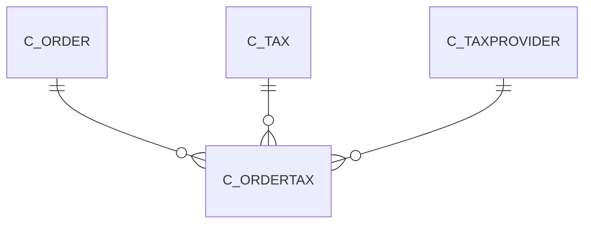

# C_ORDERTAX

Area [C](../../data-model/c/index.md) · class **business** (proposed) · read from database `idempiere-db` (owner `ADEMPIERE`) · 8 row(s) when profiled

Application model: `org.compiere.model.X_C_OrderTax`, access level 1 - Org.

## Columns

| column | type | key | not null | business name | references (code) | nulls | distinct |
|---|---|---|---|---|---|---|---|
| `C_ORDER_ID` | NUMBER(10,0) | PK | yes | Order | [C_ORDER](../../data-model/c/c_order.md) | 0 | 8 |
| `C_TAX_ID` | NUMBER(10,0) | PK | yes | Tax | [C_TAX](../../data-model/c/c_tax.md) | 0 | 2 |
| `AD_CLIENT_ID` | NUMBER(10,0) |  | yes | Tenant |  | 0 | 1 |
| `AD_ORG_ID` | NUMBER(10,0) |  | yes | Organization |  | 0 | 1 |
| `ISACTIVE` | CHAR(1) |  | yes | Active |  | 0 | 1 |
| `CREATED` | DATE |  | yes | Created |  | 0 | 8 |
| `CREATEDBY` | NUMBER(10,0) |  | yes | Created By |  | 0 | 1 |
| `UPDATED` | DATE |  | yes | Updated |  | 0 | 8 |
| `UPDATEDBY` | NUMBER(10,0) |  | yes | Updated By |  | 0 | 2 |
| `TAXBASEAMT` | NUMBER |  | yes | Tax base Amount |  | 0 | 8 |
| `TAXAMT` | NUMBER |  | yes | Tax Amount |  | 0 | 6 |
| `PROCESSED` | CHAR(1) |  | yes | Processed |  | 0 | 1 |
| `ISTAXINCLUDED` | CHAR(1) |  | yes | Price includes Tax |  | 0 | 1 |
| `C_ORDERTAX_UU` | VARCHAR2(36 CHAR) |  |  | C_OrderTax_UU |  | 0 | 8 |
| `C_TAXPROVIDER_ID` | NUMBER(10,0) |  |  | Tax Provider | [C_TAXPROVIDER](../../data-model/c/c_taxprovider.md) | 8 | 0 |

*references (code)* is the table the application model's code says a column points to; *Foreign keys* below are the constraints the database declares. Counts come from the profile; no value is ever shown.

## Check constraints

| name | expression |
|---|---|
| `SYS_C0020136` | `IsActive in ('Y','N')` |

## Foreign keys

**References**

| table | columns | on delete |
|---|---|---|
| [C_ORDER](../../data-model/c/c_order.md) | C_ORDERTAX.C_ORDER_ID → C_ORDER.C_ORDER_ID | CASCADE |
| [C_TAX](../../data-model/c/c_tax.md) | C_ORDERTAX.C_TAX_ID → C_TAX.C_TAX_ID | NO ACTION |
| [C_TAXPROVIDER](../../data-model/c/c_taxprovider.md) | C_ORDERTAX.C_TAXPROVIDER_ID → C_TAXPROVIDER.C_TAXPROVIDER_ID | NO ACTION |

**Referenced by**

_None._

## Write behaviour

- updates: **raw_sql_skips_updated**
- deletes: **deleted_by_app, deleted_by_users, deleted_by_cascade**
- change log: **not_recorded**
- evidence: 6 citation(s)

## Read by

| kind | name |
|---|---|
| View | `C_ORDER_LINETAX_V` |
| View | `C_ORDER_LINETAX_VT` |
| View | `c_order_linetax_v` |
| View | `c_order_linetax_vt` |

## Schema history

17 change(s); the latest:

| applied | release | operation | column | tickets |
|---|---|---|---|---|
| 2023-04-09T15:47 | iD11 | `add_constraint` |  | IDEMPIERE-5567 |
| 2023-04-09T15:47 | iD11 | `add_constraint` |  | IDEMPIERE-5567 |
| 2021-12-05T16:45 | i8.2z | `drop_constraint` |  | IDEMPIERE-5075 |
| 2021-12-05T16:45 | i8.2z | `add_constraint` |  | IDEMPIERE-5075 |
| 2021-12-05T16:45 | i8.2z | `drop_constraint` |  | IDEMPIERE-5075 |
| 2021-12-05T16:45 | i8.2z | `add_constraint` |  | IDEMPIERE-5075 |
| 2020-08-04T01:00 | i7.1z | `add_column` | tmp_col_1_tmp | IDEMPIERE-3862 |
| 2020-08-04T01:00 | i7.1z | `modify_column` | C_ORDERTAX_UU | IDEMPIERE-3862 |
| 2020-08-04T01:00 | i7.1z | `drop_column` | tmp_col_1_tmp | IDEMPIERE-3862 |
| 2013-12-11T17:45 | i2.0 | `add_constraint` |  | IDEMPIERE-1132 |
| 2013-12-11T17:45 | i2.0 | `drop_constraint` |  | IDEMPIERE-1132 |
| 2013-12-11T17:45 | i2.0 | `drop_constraint` |  | IDEMPIERE-1132 |
| 2013-12-11T17:45 | i2.0 | `add_constraint` |  | IDEMPIERE-1132 |
| 2013-08-27T12:43 | i1.0z | `add_constraint` |  | IDEMPIERE-1269 |
| 2013-08-27T12:43 | i1.0z | `add_column` | C_TaxProvider_ID | IDEMPIERE-1269 |

## Notes

<!-- ekos:manual id="table.c_ordertax.notes" -->
_Business notes about this table._
<!-- /ekos:manual -->
