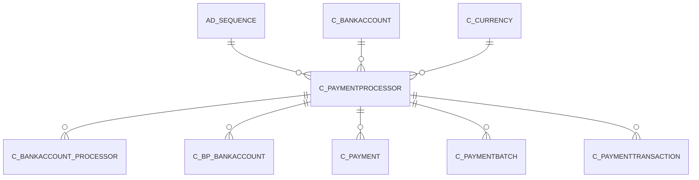

# C_PAYMENTPROCESSOR

Process Definition for Payments/Receipts (Check, CC, etc.)

Area [C](../../data-model/c/index.md) · class **business** (proposed) · read from database `idempiere-db` (owner `ADEMPIERE`) · 2 row(s) when profiled

Application model: `org.compiere.model.X_C_PaymentProcessor`, access level 6 - System - Client.

## Columns

| column | type | key | not null | business name | references (code) | nulls | distinct |
|---|---|---|---|---|---|---|---|
| `C_PAYMENTPROCESSOR_ID` | NUMBER(10,0) | PK | yes | Payment Processor |  | 0 | 2 |
| `AD_CLIENT_ID` | NUMBER(10,0) |  | yes | Tenant |  | 0 | 1 |
| `AD_ORG_ID` | NUMBER(10,0) |  | yes | Organization |  | 0 | 1 |
| `ISACTIVE` | CHAR(1) |  | yes | Active |  | 0 | 2 |
| `CREATED` | DATE |  | yes | Created |  | 0 | 2 |
| `CREATEDBY` | NUMBER(10,0) |  | yes | Created By |  | 0 | 1 |
| `UPDATED` | DATE |  | yes | Updated |  | 0 | 2 |
| `UPDATEDBY` | NUMBER(10,0) |  | yes | Updated By |  | 0 | 1 |
| `NAME` | VARCHAR2(60 CHAR) |  | yes | Name |  | 0 | 2 |
| `DESCRIPTION` | VARCHAR2(255 CHAR) |  |  | Description |  | 1 | 1 |
| `C_BANKACCOUNT_ID` | NUMBER(10,0) |  |  | Bank Account | [C_BANKACCOUNT](../../data-model/c/c_bankaccount.md) | 2 | 0 |
| `AD_SEQUENCE_ID` | NUMBER(10,0) |  |  | Sequence | [AD_SEQUENCE](../../data-model/ad/ad_sequence.md) | 2 | 0 |
| `PAYPROCESSORCLASS` | VARCHAR2(60 CHAR) |  |  | Payment Processor Class |  | 0 | 2 |
| `HOSTADDRESS` | VARCHAR2(60 CHAR) |  |  | Host Address |  | 0 | 1 |
| `HOSTPORT` | NUMBER(10,0) |  |  | Host port |  | 0 | 1 |
| `PROXYADDRESS` | VARCHAR2(60 CHAR) |  |  | Proxy address |  | 2 | 0 |
| `PROXYPORT` | NUMBER(10,0) |  |  | Proxy port |  | 1 | 1 |
| `PROXYLOGON` | VARCHAR2(60 CHAR) |  |  | Proxy logon |  | 2 | 0 |
| `PROXYPASSWORD` | VARCHAR2(60 CHAR) |  |  | Proxy password |  | 2 | 0 |
| `ACCEPTVISA` | CHAR(1) |  | yes | Accept Visa |  | 0 | 2 |
| `ACCEPTMC` | CHAR(1) |  | yes | Accept MasterCard |  | 0 | 2 |
| `ACCEPTAMEX` | CHAR(1) |  | yes | Accept AMEX |  | 0 | 2 |
| `ACCEPTDINERS` | CHAR(1) |  | yes | Accept Diners |  | 0 | 2 |
| `ACCEPTDISCOVER` | CHAR(1) |  | yes | Accept Discover |  | 0 | 2 |
| `ACCEPTCORPORATE` | CHAR(1) |  | yes | Accept Corporate |  | 0 | 2 |
| `ACCEPTCHECK` | CHAR(1) |  | yes | Accept Electronic Check |  | 0 | 1 |
| `ACCEPTATM` | CHAR(1) |  | yes | Accept ATM |  | 0 | 1 |
| `REQUIREVV` | CHAR(1) |  | yes | Require Credit Card Verification Code |  | 0 | 1 |
| `C_CURRENCY_ID` | NUMBER(10,0) |  |  | Currency | [C_CURRENCY](../../data-model/c/c_currency.md) | 0 | 1 |
| `COSTPERTRX` | NUMBER |  | yes | Cost per transaction |  | 0 | 2 |
| `COMMISSION` | NUMBER |  | yes | Commission % |  | 0 | 2 |
| `MINIMUMAMT` | NUMBER |  |  | Minimum Amt |  | 0 | 1 |
| `ACCEPTDIRECTDEBIT` | CHAR(1) |  | yes | Accept Direct Debit |  | 0 | 1 |
| `ACCEPTDIRECTDEPOSIT` | CHAR(1) |  | yes | Accept Direct Deposit |  | 0 | 1 |
| `C_PAYMENTPROCESSOR_UU` | VARCHAR2(36 CHAR) |  |  | C_PaymentProcessor_UU |  | 0 | 2 |
| `TRXTYPE` | CHAR(1) |  |  | Transaction Type |  | 2 | 0 |

*references (code)* is the table the application model's code says a column points to; *Foreign keys* below are the constraints the database declares. Counts come from the profile; no value is ever shown.

## Check constraints

| name | expression |
|---|---|
| `SYS_C0021913` | `AcceptATM in ('Y','N')` |
| `SYS_C0021914` | `AcceptCorporate in ('Y','N')` |
| `SYS_C0021916` | `IsActive in ('Y','N')` |
| `SYS_C0021917` | `AcceptAmex in ('Y','N')` |
| `SYS_C0021919` | `AcceptDiners in ('Y','N')` |
| `SYS_C0021920` | `AcceptCheck in ('Y','N')` |
| `SYS_C0021921` | `RequireVV in ('Y','N')` |
| `SYS_C0021922` | `AcceptDiscover in ('Y','N')` |
| `SYS_C0021923` | `AcceptMC in ('Y','N')` |
| `SYS_C0021924` | `AcceptVisa in ('Y','N')` |

## Foreign keys

**References**

| table | columns | on delete |
|---|---|---|
| [AD_SEQUENCE](../../data-model/ad/ad_sequence.md) | C_PAYMENTPROCESSOR.AD_SEQUENCE_ID → AD_SEQUENCE.AD_SEQUENCE_ID | NO ACTION |
| [C_BANKACCOUNT](../../data-model/c/c_bankaccount.md) | C_PAYMENTPROCESSOR.C_BANKACCOUNT_ID → C_BANKACCOUNT.C_BANKACCOUNT_ID | NO ACTION |
| [C_CURRENCY](../../data-model/c/c_currency.md) | C_PAYMENTPROCESSOR.C_CURRENCY_ID → C_CURRENCY.C_CURRENCY_ID | NO ACTION |

**Referenced by**

| table | columns | on delete |
|---|---|---|
| [C_BANKACCOUNT_PROCESSOR](../../data-model/c/c_bankaccount_processor.md) | C_BANKACCOUNT_PROCESSOR.C_PAYMENTPROCESSOR_ID → C_PAYMENTPROCESSOR.C_PAYMENTPROCESSOR_ID | NO ACTION |
| [C_BP_BANKACCOUNT](../../data-model/c/c_bp_bankaccount.md) | C_BP_BANKACCOUNT.C_PAYMENTPROCESSOR_ID → C_PAYMENTPROCESSOR.C_PAYMENTPROCESSOR_ID | NO ACTION |
| [C_PAYMENT](../../data-model/c/c_payment.md) | C_PAYMENT.C_PAYMENTPROCESSOR_ID → C_PAYMENTPROCESSOR.C_PAYMENTPROCESSOR_ID | NO ACTION |
| [C_PAYMENTBATCH](../../data-model/c/c_paymentbatch.md) | C_PAYMENTBATCH.C_PAYMENTPROCESSOR_ID → C_PAYMENTPROCESSOR.C_PAYMENTPROCESSOR_ID | NO ACTION |
| [C_PAYMENTTRANSACTION](../../data-model/c/c_paymenttransaction.md) | C_PAYMENTTRANSACTION.C_PAYMENTPROCESSOR_ID → C_PAYMENTPROCESSOR.C_PAYMENTPROCESSOR_ID | NO ACTION |

## Write behaviour

- updates: **po_only**
- deletes: **deleted_by_users**
- change log: **recorded**
- evidence: 1 citation(s)

## Schema history

48 change(s); the latest:

| applied | release | operation | column | tickets |
|---|---|---|---|---|
| 2023-04-09T15:47 | iD11 | `add_constraint` |  | IDEMPIERE-5567 |
| 2023-04-09T15:47 | iD11 | `add_constraint` |  | IDEMPIERE-5567 |
| 2021-12-05T16:45 | i8.2z | `drop_constraint` |  | IDEMPIERE-5075 |
| 2021-12-05T16:45 | i8.2z | `add_constraint` |  | IDEMPIERE-5075 |
| 2021-12-05T16:45 | i8.2z | `drop_constraint` |  | IDEMPIERE-5075 |
| 2021-12-05T16:45 | i8.2z | `drop_constraint` |  | IDEMPIERE-5075 |
| 2021-12-05T16:45 | i8.2z | `add_constraint` |  | IDEMPIERE-5075 |
| 2021-12-05T16:45 | i8.2z | `add_constraint` |  | IDEMPIERE-5075 |
| 2020-08-04T01:00 | i7.1z | `modify_column` | PROXYPASSWORD | IDEMPIERE-3862 |
| 2020-08-04T01:00 | i7.1z | `modify_column` | NAME | IDEMPIERE-3862 |
| 2020-08-04T01:00 | i7.1z | `drop_column` | tmp_col_4_tmp | IDEMPIERE-3862 |
| 2020-08-04T01:00 | i7.1z | `add_column` | tmp_col_2_tmp | IDEMPIERE-3862 |
| 2020-08-04T01:00 | i7.1z | `drop_column` | tmp_col_2_tmp | IDEMPIERE-3862 |
| 2020-08-04T01:00 | i7.1z | `drop_column` | tmp_col_3_tmp | IDEMPIERE-3862 |
| 2020-08-04T01:00 | i7.1z | `modify_column` | PROXYADDRESS | IDEMPIERE-3862 |

## Open conflicts

| type | attribute | explanation |
|---|---|---|
| `mandatory_but_nullable` | `columns.HostAddress.nullable` | unexplained |
| `mandatory_but_nullable` | `columns.HostPort.nullable` | unexplained |

## Notes

<!-- ekos:manual id="table.c_paymentprocessor.notes" -->
_Business notes about this table._
<!-- /ekos:manual -->
