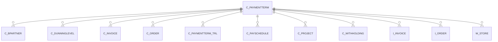

# C_PAYMENTTERM

Area [C](../../data-model/c/index.md) · class **business** (proposed) · read from database `idempiere-db` (owner `ADEMPIERE`) · 5 row(s) when profiled

Application model: `org.compiere.model.X_C_PaymentTerm`, access level 3 - Client - Org.

## Columns

| column | type | key | not null | business name | references (code) | nulls | distinct |
|---|---|---|---|---|---|---|---|
| `C_PAYMENTTERM_ID` | NUMBER(10,0) | PK | yes | Payment Term |  | 0 | 5 |
| `AD_CLIENT_ID` | NUMBER(10,0) |  | yes | Tenant |  | 0 | 1 |
| `AD_ORG_ID` | NUMBER(10,0) |  | yes | Organization |  | 0 | 2 |
| `ISACTIVE` | CHAR(1) |  | yes | Active |  | 0 | 2 |
| `CREATED` | DATE |  | yes | Created |  | 0 | 5 |
| `CREATEDBY` | NUMBER(10,0) |  | yes | Created By |  | 0 | 2 |
| `UPDATED` | DATE |  | yes | Updated |  | 0 | 2 |
| `UPDATEDBY` | NUMBER(10,0) |  | yes | Updated By |  | 0 | 2 |
| `NAME` | VARCHAR2(60 CHAR) |  | yes | Name |  | 0 | 5 |
| `DESCRIPTION` | VARCHAR2(255 CHAR) |  |  | Description |  | 4 | 1 |
| `DOCUMENTNOTE` | VARCHAR2(2000 CHAR) |  |  | Document Note |  | 4 | 1 |
| `AFTERDELIVERY` | CHAR(1) |  | yes | After Delivery |  | 0 | 1 |
| `ISDUEFIXED` | CHAR(1) |  | yes | Fixed due date |  | 0 | 1 |
| `NETDAYS` | NUMBER(10,0) |  | yes | Net Days |  | 0 | 2 |
| `GRACEDAYS` | NUMBER(10,0) |  | yes | Grace Days |  | 0 | 1 |
| `FIXMONTHCUTOFF` | NUMBER(10,0) |  |  | Fix month cutoff |  | 1 | 1 |
| `FIXMONTHDAY` | NUMBER(10,0) |  |  | Fix month day |  | 1 | 1 |
| `FIXMONTHOFFSET` | NUMBER(10,0) |  |  | Fix month offset |  | 1 | 1 |
| `DISCOUNTDAYS` | NUMBER(10,0) |  | yes | Discount Days |  | 0 | 2 |
| `DISCOUNT` | NUMBER |  | yes | Discount % |  | 0 | 2 |
| `DISCOUNTDAYS2` | NUMBER(10,0) |  | yes | Discount Days 2 |  | 0 | 1 |
| `DISCOUNT2` | NUMBER |  | yes | Discount 2 % |  | 0 | 1 |
| `ISNEXTBUSINESSDAY` | CHAR(1) |  |  | Next Business Day |  | 0 | 2 |
| `ISDEFAULT` | CHAR(1) |  |  | Default |  | 0 | 2 |
| `VALUE` | VARCHAR2(40 CHAR) |  | yes | Search Key |  | 0 | 5 |
| `NETDAY` | CHAR(1) |  |  | Net Day |  | 5 | 0 |
| `ISVALID` | CHAR(1) |  | yes | Valid |  | 0 | 2 |
| `PROCESSING` | CHAR(1) |  |  | Process Now |  | 4 | 1 |
| `PAYMENTTERMUSAGE` | CHAR(1) |  | yes | Payment Term Usage |  | 0 | 1 |
| `C_PAYMENTTERM_UU` | VARCHAR2(36 CHAR) |  |  | C_PaymentTerm_UU |  | 0 | 5 |

*references (code)* is the table the application model's code says a column points to; *Foreign keys* below are the constraints the database declares. Counts come from the profile; no value is ever shown.

## Check constraints

| name | expression |
|---|---|
| `SYS_C0020154` | `AfterDelivery in ('Y','N')` |
| `SYS_C0020156` | `IsDueFixed in ('Y','N')` |
| `SYS_C0020157` | `IsNextBusinessDay in ('Y','N')` |
| `SYS_C0020159` | `IsActive in ('Y','N')` |

## Foreign keys

**References**

_None._

**Referenced by**

| table | columns | on delete |
|---|---|---|
| [C_BPARTNER](../../data-model/c/c_bpartner.md) | C_BPARTNER.C_PAYMENTTERM_ID → C_PAYMENTTERM.C_PAYMENTTERM_ID | NO ACTION |
| [C_DUNNINGLEVEL](../../data-model/c/c_dunninglevel.md) | C_DUNNINGLEVEL.C_PAYMENTTERM_ID → C_PAYMENTTERM.C_PAYMENTTERM_ID | NO ACTION |
| [C_INVOICE](../../data-model/c/c_invoice.md) | C_INVOICE.C_PAYMENTTERM_ID → C_PAYMENTTERM.C_PAYMENTTERM_ID | NO ACTION |
| [C_ORDER](../../data-model/c/c_order.md) | C_ORDER.C_PAYMENTTERM_ID → C_PAYMENTTERM.C_PAYMENTTERM_ID | NO ACTION |
| [C_PAYMENTTERM_TRL](../../data-model/c/c_paymentterm_trl.md) | C_PAYMENTTERM_TRL.C_PAYMENTTERM_ID → C_PAYMENTTERM.C_PAYMENTTERM_ID | CASCADE |
| [C_PAYSCHEDULE](../../data-model/c/c_payschedule.md) | C_PAYSCHEDULE.C_PAYMENTTERM_ID → C_PAYMENTTERM.C_PAYMENTTERM_ID | NO ACTION |
| [C_PROJECT](../../data-model/c/c_project.md) | C_PROJECT.C_PAYMENTTERM_ID → C_PAYMENTTERM.C_PAYMENTTERM_ID | NO ACTION |
| [C_WITHHOLDING](../../data-model/c/c_withholding.md) | C_WITHHOLDING.C_PAYMENTTERM_ID → C_PAYMENTTERM.C_PAYMENTTERM_ID | NO ACTION |
| `I_INVOICE` | I_INVOICE.C_PAYMENTTERM_ID → C_PAYMENTTERM.C_PAYMENTTERM_ID | SET NULL |
| `I_ORDER` | I_ORDER.C_PAYMENTTERM_ID → C_PAYMENTTERM.C_PAYMENTTERM_ID | SET NULL |
| [W_STORE](../../data-model/w/w_store.md) | W_STORE.C_PAYMENTTERM_ID → C_PAYMENTTERM.C_PAYMENTTERM_ID | NO ACTION |

## Write behaviour

- updates: **po_only**
- deletes: **deleted_by_users**
- change log: **recorded**
- evidence: 1 citation(s)

## Read by

| kind | name |
|---|---|
| Procedure | [adempiere.paymenttermduedate](../../logic/adempiere.paymenttermduedate.md) |
| Procedure | [paymentTermDiscount](../../logic/paymenttermdiscount.md) |
| Procedure | [paymenttermDiscount](../../logic/paymenttermdiscount.md) |
| Procedure | [paymenttermDueDate](../../logic/paymenttermduedate.md) |
| Procedure | [paymenttermDueDays](../../logic/paymenttermduedays.md) |
| Procedure | [paymenttermduedate](../../logic/paymenttermduedate.md) |
| View | `C_DUNNING_LINE_V` |
| View | `C_DUNNING_LINE_VT` |
| View | `C_INVOICE_HEADER_V` |
| View | `C_INVOICE_HEADER_VT` |
| View | `C_ORDER_HEADER_V` |
| View | `C_ORDER_HEADER_VT` |
| View | `C_PROJECT_HEADER_V` |
| View | `C_PROJECT_HEADER_VT` |
| View | `RV_OPENITEM` |
| View | `RV_OPENITEMTODATE` |
| View | `c_dunning_line_v` |
| View | `c_dunning_line_vt` |
| View | `c_invoice_header_v` |
| View | `c_invoice_header_vt` |
| View | `c_order_header_v` |
| View | `c_order_header_vt` |
| View | `c_project_header_v` |
| View | `c_project_header_vt` |
| View | `rv_openitem` |
| View | `rv_openitemtodate` |

## Schema history

22 change(s); the latest:

| applied | release | operation | column | tickets |
|---|---|---|---|---|
| 2023-04-09T15:47 | iD11 | `add_constraint` |  | IDEMPIERE-5567 |
| 2023-04-09T15:47 | iD11 | `add_constraint` |  | IDEMPIERE-5567 |
| 2020-08-04T01:00 | i7.1z | `add_column` | tmp_col_2_tmp | IDEMPIERE-3862 |
| 2020-08-04T01:00 | i7.1z | `drop_column` | tmp_col_4_tmp | IDEMPIERE-3862 |
| 2020-08-04T01:00 | i7.1z | `modify_column` | NAME | IDEMPIERE-3862 |
| 2020-08-04T01:00 | i7.1z | `drop_column` | tmp_col_3_tmp | IDEMPIERE-3862 |
| 2020-08-04T01:00 | i7.1z | `drop_column` | tmp_col_5_tmp | IDEMPIERE-3862 |
| 2020-08-04T01:00 | i7.1z | `modify_column` | VALUE | IDEMPIERE-3862 |
| 2020-08-04T01:00 | i7.1z | `add_column` | tmp_col_1_tmp | IDEMPIERE-3862 |
| 2020-08-04T01:00 | i7.1z | `modify_column` | VALUE | IDEMPIERE-3862 |
| 2020-08-04T01:00 | i7.1z | `add_column` | tmp_col_4_tmp | IDEMPIERE-3862 |
| 2020-08-04T01:00 | i7.1z | `create_index` |  | IDEMPIERE-3862 |
| 2020-08-04T01:00 | i7.1z | `add_column` | tmp_col_3_tmp | IDEMPIERE-3862 |
| 2020-08-04T01:00 | i7.1z | `modify_column` | DESCRIPTION | IDEMPIERE-3862 |
| 2020-08-04T01:00 | i7.1z | `drop_column` | tmp_col_2_tmp | IDEMPIERE-3862 |

## Notes

<!-- ekos:manual id="table.c_paymentterm.notes" -->
_Business notes about this table._
<!-- /ekos:manual -->
