# C_PAYMENTTRANSACTION

Area [C](../../data-model/c/index.md) · class **business** (proposed) · read from database `idempiere-db` (owner `ADEMPIERE`) · 0 row(s) when profiled

Application model: `org.compiere.model.X_C_PaymentTransaction`, access level 1 - Org.

## Columns

| column | type | key | not null | business name | references (code) | nulls | distinct |
|---|---|---|---|---|---|---|---|
| `A_CITY` | VARCHAR2(60 CHAR) |  |  | Account City |  | 0 | 0 |
| `A_COUNTRY` | VARCHAR2(40 CHAR) |  |  | Account Country |  | 0 | 0 |
| `A_EMAIL` | VARCHAR2(60 CHAR) |  |  | Account EMail |  | 0 | 0 |
| `A_IDENT_DL` | VARCHAR2(20 CHAR) |  |  | Driver License |  | 0 | 0 |
| `A_IDENT_SSN` | VARCHAR2(20 CHAR) |  |  | Social Security No |  | 0 | 0 |
| `A_NAME` | VARCHAR2(60 CHAR) |  |  | Account Name |  | 0 | 0 |
| `A_STATE` | VARCHAR2(40 CHAR) |  |  | Account State |  | 0 | 0 |
| `A_STREET` | VARCHAR2(60 CHAR) |  |  | Account Street |  | 0 | 0 |
| `A_ZIP` | VARCHAR2(20 CHAR) |  |  | Account Zip/Postal |  | 0 | 0 |
| `ACCOUNTNO` | VARCHAR2(20 CHAR) |  |  | Account No |  | 0 | 0 |
| `AD_CLIENT_ID` | NUMBER(10,0) |  | yes | Tenant |  | 0 | 0 |
| `AD_ORG_ID` | NUMBER(10,0) |  | yes | Organization |  | 0 | 0 |
| `AD_ORGTRX_ID` | NUMBER(10,0) |  |  | Trx Organization |  | 0 | 0 |
| `C_ACTIVITY_ID` | NUMBER(10,0) |  |  | Activity | [C_ACTIVITY](../../data-model/c/c_activity.md) | 0 | 0 |
| `C_BANKACCOUNT_ID` | NUMBER(10,0) |  |  | Bank Account | [C_BANKACCOUNT](../../data-model/c/c_bankaccount.md) | 0 | 0 |
| `C_BP_BANKACCOUNT_ID` | NUMBER(10,0) |  |  | Partner Bank Account | [C_BP_BANKACCOUNT](../../data-model/c/c_bp_bankaccount.md) | 0 | 0 |
| `C_BPARTNER_ID` | NUMBER(10,0) |  | yes | Business Partner | [C_BPARTNER](../../data-model/c/c_bpartner.md) | 0 | 0 |
| `C_CAMPAIGN_ID` | NUMBER(10,0) |  |  | Campaign | [C_CAMPAIGN](../../data-model/c/c_campaign.md) | 0 | 0 |
| `C_CASHBOOK_ID` | NUMBER(10,0) |  |  | Cash Book | [C_CASHBOOK](../../data-model/c/c_cashbook.md) | 0 | 0 |
| `C_CHARGE_ID` | NUMBER(10,0) |  |  | Charge | [C_CHARGE](../../data-model/c/c_charge.md) | 0 | 0 |
| `C_CONVERSIONTYPE_ID` | NUMBER(10,0) |  |  | Currency Type | [C_CONVERSIONTYPE](../../data-model/c/c_conversiontype.md) | 0 | 0 |
| `C_CURRENCY_ID` | NUMBER(10,0) |  | yes | Currency | [C_CURRENCY](../../data-model/c/c_currency.md) | 0 | 0 |
| `C_DOCTYPE_ID` | NUMBER(10,0) |  |  |  |  | 0 | 0 |
| `C_INVOICE_ID` | NUMBER(10,0) |  |  | Invoice | [C_INVOICE](../../data-model/c/c_invoice.md) | 0 | 0 |
| `C_ORDER_ID` | NUMBER(10,0) |  |  | Order | [C_ORDER](../../data-model/c/c_order.md) | 0 | 0 |
| `C_PAYMENT_ID` | NUMBER(10,0) |  |  | Payment | [C_PAYMENT](../../data-model/c/c_payment.md) | 0 | 0 |
| `C_PAYMENTBATCH_ID` | NUMBER(10,0) |  |  | Payment Batch | [C_PAYMENTBATCH](../../data-model/c/c_paymentbatch.md) | 0 | 0 |
| `C_PAYMENTPROCESSOR_ID` | NUMBER(10,0) |  |  | Payment Processor | [C_PAYMENTPROCESSOR](../../data-model/c/c_paymentprocessor.md) | 0 | 0 |
| `C_PAYMENTTRANSACTION_ID` | NUMBER(10,0) | PK | yes | Payment Transaction |  | 0 | 0 |
| `C_PAYMENTTRANSACTION_UU` | VARCHAR2(36 CHAR) |  |  | C_PaymentTransaction_UU |  | 0 | 0 |
| `C_POSTENDERTYPE_ID` | NUMBER(10,0) |  |  | POS Tender Type | [C_POSTENDERTYPE](../../data-model/c/c_postendertype.md) | 0 | 0 |
| `C_PROJECT_ID` | NUMBER(10,0) |  |  | Project | [C_PROJECT](../../data-model/c/c_project.md) | 0 | 0 |
| `CHECKNO` | VARCHAR2(20 CHAR) |  |  | Check No |  | 0 | 0 |
| `CREATED` | DATE |  | yes | Created |  | 0 | 0 |
| `CREATEDBY` | NUMBER(10,0) |  | yes | Created By |  | 0 | 0 |
| `CREDITCARDEXPMM` | NUMBER(10,0) |  |  | Exp. Month |  | 0 | 0 |
| `CREDITCARDEXPYY` | NUMBER(10,0) |  |  | Exp. Year |  | 0 | 0 |
| `CREDITCARDNUMBER` | VARCHAR2(20 CHAR) |  |  | Number |  | 0 | 0 |
| `CREDITCARDTYPE` | CHAR(1) |  |  | Credit Card |  | 0 | 0 |
| `CREDITCARDVV` | VARCHAR2(4 CHAR) |  |  | Verification Code |  | 0 | 0 |
| `CUSTOMERADDRESSID` | VARCHAR2(60 CHAR) |  |  | Customer Address ID |  | 0 | 0 |
| `CUSTOMERPAYMENTPROFILEID` | VARCHAR2(60 CHAR) |  |  | Customer Payment Profile ID |  | 0 | 0 |
| `CUSTOMERPROFILEID` | VARCHAR2(60 CHAR) |  |  | Customer Profile ID |  | 0 | 0 |
| `DATETRX` | DATE |  | yes | Transaction Date |  | 0 | 0 |
| `DESCRIPTION` | VARCHAR2(255 CHAR) |  |  | Description |  | 0 | 0 |
| `ISACTIVE` | CHAR(1) |  | yes | Active |  | 0 | 0 |
| `ISAPPROVED` | CHAR(1) |  | yes | Approved |  | 0 | 0 |
| `ISDELAYEDCAPTURE` | CHAR(1) |  | yes | Delayed Capture |  | 0 | 0 |
| `ISONLINE` | CHAR(1) |  | yes | Online Access |  | 0 | 0 |
| `ISRECEIPT` | CHAR(1) |  | yes | Receipt |  | 0 | 0 |
| `ISSELFSERVICE` | CHAR(1) |  | yes | Self-Service |  | 0 | 0 |
| `ISVOIDED` | CHAR(1) |  | yes | Voided |  | 0 | 0 |
| `MICR` | VARCHAR2(20 CHAR) |  |  | Micr |  | 0 | 0 |
| `ORIG_TRXID` | VARCHAR2(20 CHAR) |  |  | Original Transaction ID |  | 0 | 0 |
| `PAYAMT` | NUMBER |  | yes | Payment amount |  | 0 | 0 |
| `PONUM` | VARCHAR2(60 CHAR) |  |  | PO Number |  | 0 | 0 |
| `R_AUTHCODE` | VARCHAR2(20 CHAR) |  |  | Authorization Code |  | 0 | 0 |
| `R_AVSADDR` | CHAR(1) |  |  | Address verified |  | 0 | 0 |
| `R_AVSZIP` | CHAR(1) |  |  | Zip verified |  | 0 | 0 |
| `R_CVV2MATCH` | CHAR(1) |  |  | CVV Match |  | 0 | 0 |
| `R_INFO` | VARCHAR2(2000 CHAR) |  |  | Info |  | 0 | 0 |
| `R_PNREF` | VARCHAR2(20 CHAR) |  |  | Reference |  | 0 | 0 |
| `R_RESPMSG` | VARCHAR2(60 CHAR) |  |  | Response Message |  | 0 | 0 |
| `R_RESULT` | VARCHAR2(20 CHAR) |  |  | Result |  | 0 | 0 |
| `R_VOIDMSG` | VARCHAR2(255 CHAR) |  |  | Void Message |  | 0 | 0 |
| `REF_PAYMENTTRANSACTION_ID` | NUMBER(10,0) |  |  | Referenced Payment Transaction | [C_PAYMENTTRANSACTION](../../data-model/c/c_paymenttransaction.md) | 0 | 0 |
| `ROUTINGNO` | VARCHAR2(20 CHAR) |  |  | Routing No |  | 0 | 0 |
| `TAXAMT` | NUMBER |  |  | Tax Amount |  | 0 | 0 |
| `TENDERTYPE` | CHAR(1) |  | yes | Tender type |  | 0 | 0 |
| `TRXTYPE` | CHAR(1) |  | yes | Transaction Type |  | 0 | 0 |
| `UPDATED` | DATE |  | yes | Updated |  | 0 | 0 |
| `UPDATEDBY` | NUMBER(10,0) |  | yes | Updated By |  | 0 | 0 |
| `USER1_ID` | NUMBER(10,0) |  |  | User Element List 1 | [C_ELEMENTVALUE](../../data-model/c/c_elementvalue.md) | 0 | 0 |
| `USER2_ID` | NUMBER(10,0) |  |  | User Element List 2 | [C_ELEMENTVALUE](../../data-model/c/c_elementvalue.md) | 0 | 0 |
| `VOICEAUTHCODE` | VARCHAR2(20 CHAR) |  |  | Voice authorization code |  | 0 | 0 |
| `VOIDIT` | CHAR(1) |  |  | Void It |  | 0 | 0 |
| `PROCESSED` | CHAR(1) |  | yes | Processed |  | 0 | 0 |
| `IBAN` | VARCHAR2(40 CHAR) |  |  | IBAN |  | 0 | 0 |
| `SWIFTCODE` | VARCHAR2(20 CHAR) |  |  | Swift code |  | 0 | 0 |

*references (code)* is the table the application model's code says a column points to; *Foreign keys* below are the constraints the database declares. Counts come from the profile; no value is ever shown.

## Check constraints

| name | expression |
|---|---|
| `SYS_C0022555` | `r_cvv2match IN ('Y', 'N')` |
| `SYS_C0022556` | `Processed IN ('Y','N')` |
| `SYS_C0022557` | `isreceipt IN ('Y', 'N')` |
| `SYS_C0022558` | `isonline IN ('Y', 'N')` |
| `SYS_C0022560` | `isselfservice IN ('Y', 'N')` |
| `SYS_C0022561` | `isapproved IN ('Y', 'N')` |
| `SYS_C0022562` | `isactive IN ('Y', 'N')` |
| `SYS_C0022564` | `isvoided IN ('Y', 'N')` |
| `SYS_C0022565` | `isdelayedcapture IN ('Y', 'N')` |

## Foreign keys

**References**

| table | columns | on delete |
|---|---|---|
| [AD_ORG](../../data-model/ad/ad_org.md) | C_PAYMENTTRANSACTION.AD_ORGTRX_ID → AD_ORG.AD_ORG_ID | NO ACTION |
| [C_ACTIVITY](../../data-model/c/c_activity.md) | C_PAYMENTTRANSACTION.C_ACTIVITY_ID → C_ACTIVITY.C_ACTIVITY_ID | NO ACTION |
| [C_BANKACCOUNT](../../data-model/c/c_bankaccount.md) | C_PAYMENTTRANSACTION.C_BANKACCOUNT_ID → C_BANKACCOUNT.C_BANKACCOUNT_ID | NO ACTION |
| [C_BPARTNER](../../data-model/c/c_bpartner.md) | C_PAYMENTTRANSACTION.C_BPARTNER_ID → C_BPARTNER.C_BPARTNER_ID | NO ACTION |
| [C_BP_BANKACCOUNT](../../data-model/c/c_bp_bankaccount.md) | C_PAYMENTTRANSACTION.C_BP_BANKACCOUNT_ID → C_BP_BANKACCOUNT.C_BP_BANKACCOUNT_ID | NO ACTION |
| [C_CAMPAIGN](../../data-model/c/c_campaign.md) | C_PAYMENTTRANSACTION.C_CAMPAIGN_ID → C_CAMPAIGN.C_CAMPAIGN_ID | NO ACTION |
| [C_CASHBOOK](../../data-model/c/c_cashbook.md) | C_PAYMENTTRANSACTION.C_CASHBOOK_ID → C_CASHBOOK.C_CASHBOOK_ID | NO ACTION |
| [C_CHARGE](../../data-model/c/c_charge.md) | C_PAYMENTTRANSACTION.C_CHARGE_ID → C_CHARGE.C_CHARGE_ID | NO ACTION |
| [C_CONVERSIONTYPE](../../data-model/c/c_conversiontype.md) | C_PAYMENTTRANSACTION.C_CONVERSIONTYPE_ID → C_CONVERSIONTYPE.C_CONVERSIONTYPE_ID | NO ACTION |
| [C_CURRENCY](../../data-model/c/c_currency.md) | C_PAYMENTTRANSACTION.C_CURRENCY_ID → C_CURRENCY.C_CURRENCY_ID | NO ACTION |
| [C_ELEMENTVALUE](../../data-model/c/c_elementvalue.md) | C_PAYMENTTRANSACTION.USER1_ID → C_ELEMENTVALUE.C_ELEMENTVALUE_ID | NO ACTION |
| [C_INVOICE](../../data-model/c/c_invoice.md) | C_PAYMENTTRANSACTION.C_INVOICE_ID → C_INVOICE.C_INVOICE_ID | NO ACTION |
| [C_ORDER](../../data-model/c/c_order.md) | C_PAYMENTTRANSACTION.C_ORDER_ID → C_ORDER.C_ORDER_ID | NO ACTION |
| [C_PAYMENT](../../data-model/c/c_payment.md) | C_PAYMENTTRANSACTION.C_PAYMENT_ID → C_PAYMENT.C_PAYMENT_ID | NO ACTION |
| [C_PAYMENTBATCH](../../data-model/c/c_paymentbatch.md) | C_PAYMENTTRANSACTION.C_PAYMENTBATCH_ID → C_PAYMENTBATCH.C_PAYMENTBATCH_ID | NO ACTION |
| [C_PAYMENTPROCESSOR](../../data-model/c/c_paymentprocessor.md) | C_PAYMENTTRANSACTION.C_PAYMENTPROCESSOR_ID → C_PAYMENTPROCESSOR.C_PAYMENTPROCESSOR_ID | NO ACTION |
| [C_PAYMENTTRANSACTION](../../data-model/c/c_paymenttransaction.md) | C_PAYMENTTRANSACTION.REF_PAYMENTTRANSACTION_ID → C_PAYMENTTRANSACTION.C_PAYMENTTRANSACTION_ID | NO ACTION |
| [C_POSTENDERTYPE](../../data-model/c/c_postendertype.md) | C_PAYMENTTRANSACTION.C_POSTENDERTYPE_ID → C_POSTENDERTYPE.C_POSTENDERTYPE_ID | NO ACTION |
| [C_PROJECT](../../data-model/c/c_project.md) | C_PAYMENTTRANSACTION.C_PROJECT_ID → C_PROJECT.C_PROJECT_ID | NO ACTION |

**Referenced by**

| table | columns | on delete |
|---|---|---|
| [C_PAYMENTTRANSACTION](../../data-model/c/c_paymenttransaction.md) | C_PAYMENTTRANSACTION.REF_PAYMENTTRANSACTION_ID → C_PAYMENTTRANSACTION.C_PAYMENTTRANSACTION_ID | NO ACTION |

```mermaid
erDiagram
  AD_ORG ||--o{ C_PAYMENTTRANSACTION : ""
  C_ACTIVITY ||--o{ C_PAYMENTTRANSACTION : ""
  C_BANKACCOUNT ||--o{ C_PAYMENTTRANSACTION : ""
  C_BPARTNER ||--o{ C_PAYMENTTRANSACTION : ""
  C_BP_BANKACCOUNT ||--o{ C_PAYMENTTRANSACTION : ""
  C_CAMPAIGN ||--o{ C_PAYMENTTRANSACTION : ""
  C_CASHBOOK ||--o{ C_PAYMENTTRANSACTION : ""
  C_CHARGE ||--o{ C_PAYMENTTRANSACTION : ""
  C_CONVERSIONTYPE ||--o{ C_PAYMENTTRANSACTION : ""
  C_CURRENCY ||--o{ C_PAYMENTTRANSACTION : ""
  C_ELEMENTVALUE ||--o{ C_PAYMENTTRANSACTION : ""
  C_INVOICE ||--o{ C_PAYMENTTRANSACTION : ""
  C_ORDER ||--o{ C_PAYMENTTRANSACTION : ""
  C_PAYMENT ||--o{ C_PAYMENTTRANSACTION : ""
  C_PAYMENTBATCH ||--o{ C_PAYMENTTRANSACTION : ""
  C_PAYMENTPROCESSOR ||--o{ C_PAYMENTTRANSACTION : ""
  C_PAYMENTTRANSACTION ||--o{ C_PAYMENTTRANSACTION : ""
  C_POSTENDERTYPE ||--o{ C_PAYMENTTRANSACTION : ""
  C_PROJECT ||--o{ C_PAYMENTTRANSACTION : ""
```

## Write behaviour

- updates: **po_only**
- deletes: **deleted_by_users**
- change log: **recorded**
- evidence: 1 citation(s)

## Schema history

161 change(s); the latest:

| applied | release | operation | column | tickets |
|---|---|---|---|---|
| 2024-05-14T13:59 | iD13 | `add_column` | C_CostCenter_ID | IDEMPIERE-5598 |
| 2024-05-14T13:59 | iD13 | `add_column` | C_Department_ID | IDEMPIERE-5598 |
| 2024-05-14T13:59 | iD13 | `add_constraint` |  | IDEMPIERE-5598 |
| 2024-05-14T13:59 | iD13 | `add_constraint` |  | IDEMPIERE-5598 |
| 2024-05-14T13:59 | iD13 | `add_constraint` |  | IDEMPIERE-5598 |
| 2024-05-14T13:59 | iD13 | `add_constraint` |  | IDEMPIERE-5598 |
| 2024-05-14T13:59 | iD13 | `add_column` | C_CostCenter_ID | IDEMPIERE-5598 |
| 2024-05-14T13:59 | iD13 | `add_column` | C_Department_ID | IDEMPIERE-5598 |
| 2023-04-09T15:47 | iD11 | `add_constraint` |  | IDEMPIERE-5567 |
| 2023-04-09T15:47 | iD11 | `add_constraint` |  | IDEMPIERE-5567 |
| 2020-08-04T01:00 | i7.1z | `modify_column` | CUSTOMERPAYMENTPROFILEID | IDEMPIERE-3862 |
| 2020-08-04T01:00 | i7.1z | `modify_column` | A_EMAIL | IDEMPIERE-3862 |
| 2020-08-04T01:00 | i7.1z | `add_column` | tmp_col_17_tmp | IDEMPIERE-3862 |
| 2020-08-04T01:00 | i7.1z | `modify_column` | A_IDENT_DL | IDEMPIERE-3862 |
| 2020-08-04T01:00 | i7.1z | `add_column` | tmp_col_3_tmp | IDEMPIERE-3862 |

## Open conflicts

| type | attribute | explanation |
|---|---|---|
| `model_column_missing` | `columns.C_CostCenter_ID` | unexplained |
| `model_column_missing` | `columns.C_Department_ID` | unexplained |

## Notes

<!-- ekos:manual id="table.c_paymenttransaction.notes" -->
_Business notes about this table._
<!-- /ekos:manual -->
