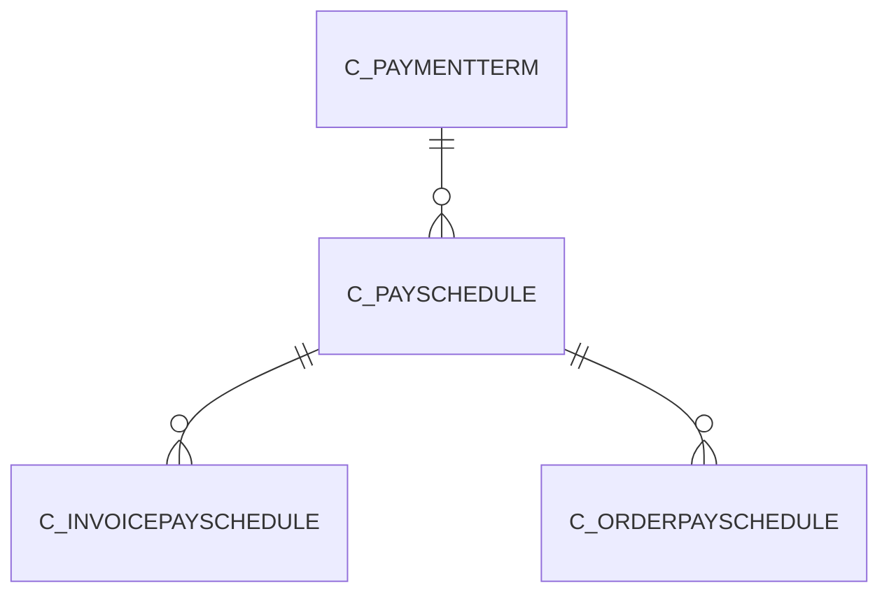

# C_PAYSCHEDULE

Area [C](../../data-model/c/index.md) · class **business** (proposed) · read from database `idempiere-db` (owner `ADEMPIERE`) · 2 row(s) when profiled

Application model: `org.compiere.model.X_C_PaySchedule`, access level 3 - Client - Org.

## Columns

| column | type | key | not null | business name | references (code) | nulls | distinct |
|---|---|---|---|---|---|---|---|
| `C_PAYSCHEDULE_ID` | NUMBER(10,0) | PK | yes | Payment Schedule |  | 0 | 2 |
| `AD_CLIENT_ID` | NUMBER(10,0) |  | yes | Tenant |  | 0 | 1 |
| `AD_ORG_ID` | NUMBER(10,0) |  | yes | Organization |  | 0 | 1 |
| `ISACTIVE` | CHAR(1) |  | yes | Active |  | 0 | 1 |
| `CREATED` | DATE |  | yes | Created |  | 0 | 2 |
| `CREATEDBY` | NUMBER(10,0) |  | yes | Created By |  | 0 | 1 |
| `UPDATED` | DATE |  | yes | Updated |  | 0 | 1 |
| `UPDATEDBY` | NUMBER(10,0) |  | yes | Updated By |  | 0 | 1 |
| `C_PAYMENTTERM_ID` | NUMBER(10,0) |  | yes | Payment Term | [C_PAYMENTTERM](../../data-model/c/c_paymentterm.md) | 0 | 1 |
| `PERCENTAGE` | NUMBER |  | yes | Percentage |  | 0 | 1 |
| `NETDAYS` | NUMBER(10,0) |  | yes | Net Days |  | 0 | 2 |
| `NETDAY` | CHAR(1) |  |  | Net Day |  | 2 | 0 |
| `DISCOUNTDAYS` | NUMBER(10,0) |  | yes | Discount Days |  | 0 | 1 |
| `DISCOUNT` | NUMBER |  | yes | Discount % |  | 0 | 1 |
| `ISVALID` | CHAR(1) |  | yes | Valid |  | 0 | 1 |
| `GRACEDAYS` | NUMBER(10,0) |  | yes | Grace Days |  | 0 | 1 |
| `C_PAYSCHEDULE_UU` | VARCHAR2(36 CHAR) |  |  | C_PaySchedule_UU |  | 0 | 2 |

*references (code)* is the table the application model's code says a column points to; *Foreign keys* below are the constraints the database declares. Counts come from the profile; no value is ever shown.

## Check constraints

| name | expression |
|---|---|
| `SYS_C0021569` | `IsActive in ('Y','N')` |
| `SYS_C0021571` | `IsValid in ('Y','N')` |

## Foreign keys

**References**

| table | columns | on delete |
|---|---|---|
| [C_PAYMENTTERM](../../data-model/c/c_paymentterm.md) | C_PAYSCHEDULE.C_PAYMENTTERM_ID → C_PAYMENTTERM.C_PAYMENTTERM_ID | NO ACTION |

**Referenced by**

| table | columns | on delete |
|---|---|---|
| [C_INVOICEPAYSCHEDULE](../../data-model/c/c_invoicepayschedule.md) | C_INVOICEPAYSCHEDULE.C_PAYSCHEDULE_ID → C_PAYSCHEDULE.C_PAYSCHEDULE_ID | NO ACTION |
| [C_ORDERPAYSCHEDULE](../../data-model/c/c_orderpayschedule.md) | C_ORDERPAYSCHEDULE.C_PAYSCHEDULE_ID → C_PAYSCHEDULE.C_PAYSCHEDULE_ID | NO ACTION |

## Write behaviour

- updates: **po_only**
- deletes: **deleted_by_users**
- change log: **recorded**
- evidence: 1 citation(s)

## Schema history

7 change(s); the latest:

| applied | release | operation | column | tickets |
|---|---|---|---|---|
| 2023-04-09T15:47 | iD11 | `add_constraint` |  | IDEMPIERE-5567 |
| 2023-04-09T15:47 | iD11 | `add_constraint` |  | IDEMPIERE-5567 |
| 2021-12-05T16:45 | i8.2z | `drop_constraint` |  | IDEMPIERE-5075 |
| 2021-12-05T16:45 | i8.2z | `add_constraint` |  | IDEMPIERE-5075 |
| 2020-08-04T01:00 | i7.1z | `add_column` | tmp_col_1_tmp | IDEMPIERE-3862 |
| 2020-08-04T01:00 | i7.1z | `modify_column` | C_PAYSCHEDULE_UU | IDEMPIERE-3862 |
| 2020-08-04T01:00 | i7.1z | `drop_column` | tmp_col_1_tmp | IDEMPIERE-3862 |

## Notes

<!-- ekos:manual id="table.c_payschedule.notes" -->
_Business notes about this table._
<!-- /ekos:manual -->
