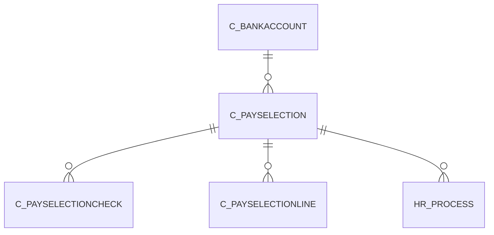

# C_PAYSELECTION

Default values for PaySelectionLine

Area [C](../../data-model/c/index.md) · class **business** (proposed) · read from database `idempiere-db` (owner `ADEMPIERE`) · 1 row(s) when profiled

Application model: `org.compiere.model.X_C_PaySelection`, access level 1 - Org.

## Columns

| column | type | key | not null | business name | references (code) | nulls | distinct |
|---|---|---|---|---|---|---|---|
| `C_PAYSELECTION_ID` | NUMBER(10,0) | PK | yes | Payment Selection |  | 0 | 1 |
| `AD_CLIENT_ID` | NUMBER(10,0) |  | yes | Tenant |  | 0 | 1 |
| `AD_ORG_ID` | NUMBER(10,0) |  | yes | Organization |  | 0 | 1 |
| `ISACTIVE` | CHAR(1) |  | yes | Active |  | 0 | 1 |
| `CREATED` | DATE |  | yes | Created |  | 0 | 1 |
| `CREATEDBY` | NUMBER(10,0) |  | yes | Created By |  | 0 | 1 |
| `UPDATED` | DATE |  | yes | Updated |  | 0 | 1 |
| `UPDATEDBY` | NUMBER(10,0) |  | yes | Updated By |  | 0 | 1 |
| `NAME` | VARCHAR2(120 CHAR) |  | yes | Name |  | 0 | 1 |
| `DESCRIPTION` | VARCHAR2(255 CHAR) |  |  | Description |  | 1 | 0 |
| `C_BANKACCOUNT_ID` | NUMBER(10,0) |  | yes | Bank Account | [C_BANKACCOUNT](../../data-model/c/c_bankaccount.md) | 0 | 1 |
| `PAYDATE` | DATE |  | yes | Payment date |  | 0 | 1 |
| `ISAPPROVED` | CHAR(1) |  | yes | Approved |  | 0 | 1 |
| `TOTALAMT` | NUMBER |  | yes | Total Amount |  | 0 | 1 |
| `CREATEFROM` | CHAR(1) |  |  | Create lines from |  | 0 | 1 |
| `PROCESSING` | CHAR(1) |  |  | Process Now |  | 0 | 1 |
| `PROCESSED` | CHAR(1) |  | yes | Processed |  | 0 | 1 |
| `C_PAYSELECTION_UU` | VARCHAR2(36 CHAR) |  |  | C_PaySelection_UU |  | 0 | 1 |
| `ISONEPAYMENTPERINVOICE` | CHAR(1) |  |  | One Payment Per Invoice |  | 1 | 0 |
| `REVERSEPREPAREPAYMENT` | CHAR(1) |  |  | Reverse Prepare Payment |  | 1 | 0 |

*references (code)* is the table the application model's code says a column points to; *Foreign keys* below are the constraints the database declares. Counts come from the profile; no value is ever shown.

## Check constraints

| name | expression |
|---|---|
| `SYS_C0022826` | `IsOnePaymentPerInvoice IN ('Y','N')` |
| `SYS_C0022828` | `IsActive in ('Y','N')` |
| `SYS_C0022830` | `Processed in ('Y','N')` |
| `SYS_C0022831` | `IsApproved in ('Y','N')` |

## Foreign keys

**References**

| table | columns | on delete |
|---|---|---|
| [C_BANKACCOUNT](../../data-model/c/c_bankaccount.md) | C_PAYSELECTION.C_BANKACCOUNT_ID → C_BANKACCOUNT.C_BANKACCOUNT_ID | NO ACTION |

**Referenced by**

| table | columns | on delete |
|---|---|---|
| [C_PAYSELECTIONCHECK](../../data-model/c/c_payselectioncheck.md) | C_PAYSELECTIONCHECK.C_PAYSELECTION_ID → C_PAYSELECTION.C_PAYSELECTION_ID | NO ACTION |
| [C_PAYSELECTIONLINE](../../data-model/c/c_payselectionline.md) | C_PAYSELECTIONLINE.C_PAYSELECTION_ID → C_PAYSELECTION.C_PAYSELECTION_ID | CASCADE |
| [HR_PROCESS](../../data-model/hr/hr_process.md) | HR_PROCESS.C_PAYSELECTION_ID → C_PAYSELECTION.C_PAYSELECTION_ID | NO ACTION |

## Write behaviour

- updates: **raw_sql_skips_updated**
- deletes: **deleted_by_app, deleted_by_users**
- change log: **recorded**
- evidence: 3 citation(s)

## Read by

| kind | name |
|---|---|
| View | `C_PAYSELECTION_CHECK_V` |
| View | `C_PAYSELECTION_CHECK_VT` |
| View | `c_payselection_check_v` |
| View | `c_payselection_check_vt` |

## Schema history

23 change(s); the latest:

| applied | release | operation | column | tickets |
|---|---|---|---|---|
| 2023-04-09T15:47 | iD11 | `add_constraint` |  | IDEMPIERE-5567 |
| 2023-04-09T15:47 | iD11 | `add_constraint` |  | IDEMPIERE-5567 |
| 2022-01-27T15:30 | i9 | `add_column` | ReversePreparePayment | IDEMPIERE-5170 |
| 2022-01-27T15:30 | i9 | `add_column` | ReversePreparePayment | IDEMPIERE-5170 |
| 2021-12-05T16:45 | i8.2z | `add_constraint` |  | IDEMPIERE-5075 |
| 2021-12-05T16:45 | i8.2z | `drop_constraint` |  | IDEMPIERE-5075 |
| 2020-08-04T01:00 | i7.1z | `drop_column` | tmp_col_1_tmp | IDEMPIERE-3862 |
| 2020-08-04T01:00 | i7.1z | `add_column` | tmp_col_1_tmp | IDEMPIERE-3862 |
| 2020-08-04T01:00 | i7.1z | `add_column` | tmp_col_3_tmp | IDEMPIERE-3862 |
| 2020-08-04T01:00 | i7.1z | `modify_column` | NAME | IDEMPIERE-3862 |
| 2020-08-04T01:00 | i7.1z | `modify_column` | NAME | IDEMPIERE-3862 |
| 2020-08-04T01:00 | i7.1z | `drop_column` | tmp_col_3_tmp | IDEMPIERE-3862 |
| 2020-08-04T01:00 | i7.1z | `modify_column` | NAME | IDEMPIERE-3862 |
| 2020-08-04T01:00 | i7.1z | `modify_column` | C_PAYSELECTION_UU | IDEMPIERE-3862 |
| 2020-08-04T01:00 | i7.1z | `modify_column` | DESCRIPTION | IDEMPIERE-3862 |

## Open conflicts

| type | attribute | explanation |
|---|---|---|
| `mandatory_but_nullable` | `columns.Processing.nullable` | unexplained |

## Notes

<!-- ekos:manual id="table.c_payselection.notes" -->
_Business notes about this table._
<!-- /ekos:manual -->
