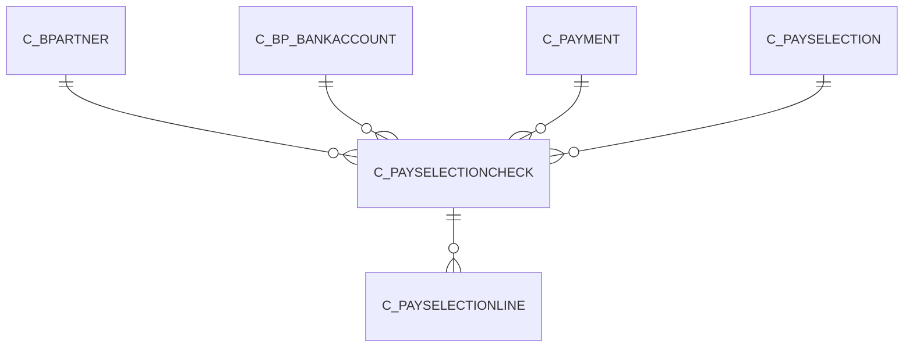

# C_PAYSELECTIONCHECK

Area [C](../../data-model/c/index.md) · class **business** (proposed) · read from database `idempiere-db` (owner `ADEMPIERE`) · 1 row(s) when profiled

Application model: `org.compiere.model.X_C_PaySelectionCheck`, access level 1 - Org.

## Columns

| column | type | key | not null | business name | references (code) | nulls | distinct |
|---|---|---|---|---|---|---|---|
| `C_PAYSELECTIONCHECK_ID` | NUMBER(10,0) | PK | yes | Pay Selection Check |  | 0 | 1 |
| `AD_CLIENT_ID` | NUMBER(10,0) |  | yes | Tenant |  | 0 | 1 |
| `AD_ORG_ID` | NUMBER(10,0) |  | yes | Organization |  | 0 | 1 |
| `ISACTIVE` | CHAR(1) |  | yes | Active |  | 0 | 1 |
| `CREATED` | DATE |  | yes | Created |  | 0 | 1 |
| `CREATEDBY` | NUMBER(10,0) |  | yes | Created By |  | 0 | 1 |
| `UPDATED` | DATE |  | yes | Updated |  | 0 | 1 |
| `UPDATEDBY` | NUMBER(10,0) |  | yes | Updated By |  | 0 | 1 |
| `C_PAYSELECTION_ID` | NUMBER(10,0) |  | yes | Payment Selection | [C_PAYSELECTION](../../data-model/c/c_payselection.md) | 0 | 1 |
| `C_BPARTNER_ID` | NUMBER(10,0) |  | yes | Business Partner | [C_BPARTNER](../../data-model/c/c_bpartner.md) | 0 | 1 |
| `PAYAMT` | NUMBER |  | yes | Payment amount |  | 0 | 1 |
| `QTY` | NUMBER |  | yes | Quantity |  | 0 | 1 |
| `C_PAYMENT_ID` | NUMBER(10,0) |  |  | Payment | [C_PAYMENT](../../data-model/c/c_payment.md) | 1 | 0 |
| `DOCUMENTNO` | VARCHAR2(30 CHAR) |  |  | Document No |  | 1 | 0 |
| `ISPRINTED` | CHAR(1) |  | yes | Printed |  | 0 | 1 |
| `PAYMENTRULE` | CHAR(1) |  | yes | Payment Rule |  | 0 | 1 |
| `PROCESSED` | CHAR(1) |  | yes | Processed |  | 0 | 1 |
| `DISCOUNTAMT` | NUMBER |  | yes | Discount Amount |  | 0 | 1 |
| `ISRECEIPT` | CHAR(1) |  | yes | Receipt |  | 0 | 1 |
| `C_BP_BANKACCOUNT_ID` | NUMBER(10,0) |  |  | Partner Bank Account | [C_BP_BANKACCOUNT](../../data-model/c/c_bp_bankaccount.md) | 1 | 0 |
| `ISGENERATEDDRAFT` | CHAR(1) |  | yes | Generated Draft |  | 0 | 1 |
| `C_PAYSELECTIONCHECK_UU` | VARCHAR2(36 CHAR) |  |  | C_PaySelectionCheck_UU |  | 0 | 1 |
| `WRITEOFFAMT` | NUMBER |  | yes | Write-off Amount |  | 0 | 1 |

*references (code)* is the table the application model's code says a column points to; *Foreign keys* below are the constraints the database declares. Counts come from the profile; no value is ever shown.

## Check constraints

| name | expression |
|---|---|
| `SYS_C0021997` | `IsGeneratedDraft IN ('Y','N')` |
| `SYS_C0022000` | `IsActive in ('Y','N')` |

## Foreign keys

**References**

| table | columns | on delete |
|---|---|---|
| [C_BPARTNER](../../data-model/c/c_bpartner.md) | C_PAYSELECTIONCHECK.C_BPARTNER_ID → C_BPARTNER.C_BPARTNER_ID | NO ACTION |
| [C_BP_BANKACCOUNT](../../data-model/c/c_bp_bankaccount.md) | C_PAYSELECTIONCHECK.C_BP_BANKACCOUNT_ID → C_BP_BANKACCOUNT.C_BP_BANKACCOUNT_ID | NO ACTION |
| [C_PAYMENT](../../data-model/c/c_payment.md) | C_PAYSELECTIONCHECK.C_PAYMENT_ID → C_PAYMENT.C_PAYMENT_ID | NO ACTION |
| [C_PAYSELECTION](../../data-model/c/c_payselection.md) | C_PAYSELECTIONCHECK.C_PAYSELECTION_ID → C_PAYSELECTION.C_PAYSELECTION_ID | NO ACTION |

**Referenced by**

| table | columns | on delete |
|---|---|---|
| [C_PAYSELECTIONLINE](../../data-model/c/c_payselectionline.md) | C_PAYSELECTIONLINE.C_PAYSELECTIONCHECK_ID → C_PAYSELECTIONCHECK.C_PAYSELECTIONCHECK_ID | NO ACTION |

## Write behaviour

- updates: **po_only**
- deletes: **deleted_by_app, deleted_by_users**
- change log: **recorded**
- evidence: 3 citation(s)

## Read by

| kind | name |
|---|---|
| View | `C_PAYSELECTION_CHECK_V` |
| View | `C_PAYSELECTION_CHECK_VT` |
| View | `c_payselection_check_v` |
| View | `c_payselection_check_vt` |

## Schema history

18 change(s); the latest:

| applied | release | operation | column | tickets |
|---|---|---|---|---|
| 2023-04-09T15:47 | iD11 | `add_constraint` |  | IDEMPIERE-5567 |
| 2023-04-09T15:47 | iD11 | `add_constraint` |  | IDEMPIERE-5567 |
| 2021-12-05T16:45 | i8.2z | `add_constraint` |  | IDEMPIERE-5075 |
| 2021-12-05T16:45 | i8.2z | `drop_constraint` |  | IDEMPIERE-5075 |
| 2021-12-05T16:45 | i8.2z | `add_constraint` |  | IDEMPIERE-5075 |
| 2021-12-05T16:45 | i8.2z | `drop_constraint` |  | IDEMPIERE-5075 |
| 2021-12-05T16:45 | i8.2z | `drop_constraint` |  | IDEMPIERE-5075 |
| 2021-12-05T16:45 | i8.2z | `add_constraint` |  | IDEMPIERE-5075 |
| 2021-12-05T16:45 | i8.2z | `drop_constraint` |  | IDEMPIERE-5075 |
| 2021-12-05T16:45 | i8.2z | `add_constraint` |  | IDEMPIERE-5075 |
| 2020-08-04T01:00 | i7.1z | `modify_column` | C_PAYSELECTIONCHECK_UU | IDEMPIERE-3862 |
| 2020-08-04T01:00 | i7.1z | `modify_column` | DOCUMENTNO | IDEMPIERE-3862 |
| 2020-08-04T01:00 | i7.1z | `drop_column` | tmp_col_1_tmp | IDEMPIERE-3862 |
| 2020-08-04T01:00 | i7.1z | `add_column` | tmp_col_1_tmp | IDEMPIERE-3862 |
| 2020-08-04T01:00 | i7.1z | `add_column` | tmp_col_2_tmp | IDEMPIERE-3862 |

## Notes

<!-- ekos:manual id="table.c_payselectioncheck.notes" -->
_Business notes about this table._
<!-- /ekos:manual -->
