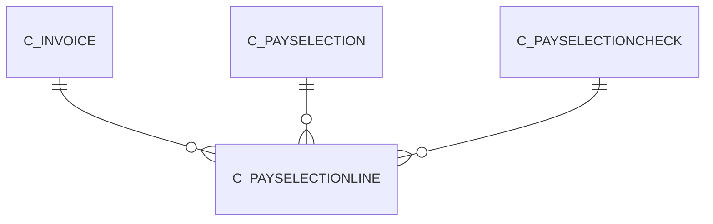

# C_PAYSELECTIONLINE

Area [C](../../data-model/c/index.md) · class **business** (proposed) · read from database `idempiere-db` (owner `ADEMPIERE`) · 1 row(s) when profiled

Application model: `org.compiere.model.X_C_PaySelectionLine`, access level 1 - Org.

## Columns

| column | type | key | not null | business name | references (code) | nulls | distinct |
|---|---|---|---|---|---|---|---|
| `C_PAYSELECTIONLINE_ID` | NUMBER(10,0) | PK | yes | Payment Selection Line |  | 0 | 1 |
| `AD_CLIENT_ID` | NUMBER(10,0) |  | yes | Tenant |  | 0 | 1 |
| `AD_ORG_ID` | NUMBER(10,0) |  | yes | Organization |  | 0 | 1 |
| `ISACTIVE` | CHAR(1) |  | yes | Active |  | 0 | 1 |
| `CREATED` | DATE |  | yes | Created |  | 0 | 1 |
| `CREATEDBY` | NUMBER(10,0) |  | yes | Created By |  | 0 | 1 |
| `UPDATED` | DATE |  | yes | Updated |  | 0 | 1 |
| `UPDATEDBY` | NUMBER(10,0) |  | yes | Updated By |  | 0 | 1 |
| `C_PAYSELECTION_ID` | NUMBER(10,0) |  | yes | Payment Selection | [C_PAYSELECTION](../../data-model/c/c_payselection.md) | 0 | 1 |
| `LINE` | NUMBER(10,0) |  | yes | Line No |  | 0 | 1 |
| `DESCRIPTION` | VARCHAR2(255 CHAR) |  |  | Description |  | 1 | 0 |
| `PAYMENTRULE` | CHAR(1) |  | yes | Payment Rule |  | 0 | 1 |
| `ISMANUAL` | CHAR(1) |  | yes | Manual |  | 0 | 1 |
| `C_INVOICE_ID` | NUMBER(10,0) |  | yes | Invoice | [C_INVOICE](../../data-model/c/c_invoice.md) | 0 | 1 |
| `PAYAMT` | NUMBER |  | yes | Payment amount |  | 0 | 1 |
| `DIFFERENCEAMT` | NUMBER |  | yes | Difference |  | 0 | 1 |
| `C_PAYSELECTIONCHECK_ID` | NUMBER(10,0) |  |  | Pay Selection Check | [C_PAYSELECTIONCHECK](../../data-model/c/c_payselectioncheck.md) | 0 | 1 |
| `PROCESSED` | CHAR(1) |  | yes | Processed |  | 0 | 1 |
| `DISCOUNTAMT` | NUMBER |  | yes | Discount Amount |  | 0 | 1 |
| `OPENAMT` | NUMBER |  | yes | Open Amount |  | 0 | 1 |
| `ISSOTRX` | CHAR(1) |  | yes | Sales Transaction |  | 0 | 1 |
| `C_PAYSELECTIONLINE_UU` | VARCHAR2(36 CHAR) |  |  | C_PaySelectionLine_UU |  | 0 | 1 |
| `WRITEOFFAMT` | NUMBER |  | yes | Write-off Amount |  | 0 | 1 |

*references (code)* is the table the application model's code says a column points to; *Foreign keys* below are the constraints the database declares. Counts come from the profile; no value is ever shown.

## Check constraints

| name | expression |
|---|---|
| `SYS_C0021588` | `IsManual in ('Y','N')` |
| `SYS_C0021589` | `IsActive in ('Y','N')` |

## Foreign keys

**References**

| table | columns | on delete |
|---|---|---|
| [C_INVOICE](../../data-model/c/c_invoice.md) | C_PAYSELECTIONLINE.C_INVOICE_ID → C_INVOICE.C_INVOICE_ID | NO ACTION |
| [C_PAYSELECTION](../../data-model/c/c_payselection.md) | C_PAYSELECTIONLINE.C_PAYSELECTION_ID → C_PAYSELECTION.C_PAYSELECTION_ID | CASCADE |
| [C_PAYSELECTIONCHECK](../../data-model/c/c_payselectioncheck.md) | C_PAYSELECTIONLINE.C_PAYSELECTIONCHECK_ID → C_PAYSELECTIONCHECK.C_PAYSELECTIONCHECK_ID | NO ACTION |

**Referenced by**

_None._

## Write behaviour

- updates: **po_only**
- deletes: **deleted_by_app, deleted_by_users, deleted_by_cascade**
- change log: **recorded**
- evidence: 3 citation(s)

## Read by

| kind | name |
|---|---|
| View | `C_PAYSELECTION_REMITTANCE_V` |
| View | `C_PAYSELECTION_REMITTANCE_VT` |
| View | `c_payselection_remittance_v` |
| View | `c_payselection_remittance_vt` |

## Schema history

16 change(s); the latest:

| applied | release | operation | column | tickets |
|---|---|---|---|---|
| 2023-04-09T15:47 | iD11 | `add_constraint` |  | IDEMPIERE-5567 |
| 2023-04-09T15:47 | iD11 | `add_constraint` |  | IDEMPIERE-5567 |
| 2021-12-05T16:45 | i8.2z | `add_constraint` |  | IDEMPIERE-5075 |
| 2021-12-05T16:45 | i8.2z | `add_constraint` |  | IDEMPIERE-5075 |
| 2021-12-05T16:45 | i8.2z | `drop_constraint` |  | IDEMPIERE-5075 |
| 2021-12-05T16:45 | i8.2z | `drop_constraint` |  | IDEMPIERE-5075 |
| 2021-12-05T16:45 | i8.2z | `drop_constraint` |  | IDEMPIERE-5075 |
| 2021-12-05T16:45 | i8.2z | `add_constraint` |  | IDEMPIERE-5075 |
| 2020-08-04T01:00 | i7.1z | `add_column` | tmp_col_2_tmp | IDEMPIERE-3862 |
| 2020-08-04T01:00 | i7.1z | `drop_column` | tmp_col_2_tmp | IDEMPIERE-3862 |
| 2020-08-04T01:00 | i7.1z | `modify_column` | DESCRIPTION | IDEMPIERE-3862 |
| 2020-08-04T01:00 | i7.1z | `drop_column` | tmp_col_1_tmp | IDEMPIERE-3862 |
| 2020-08-04T01:00 | i7.1z | `modify_column` | C_PAYSELECTIONLINE_UU | IDEMPIERE-3862 |
| 2020-08-04T01:00 | i7.1z | `add_column` | tmp_col_1_tmp | IDEMPIERE-3862 |
| 2017-01-13T14:46 | i4.1 | `add_column` | WriteOffAmt | IDEMPIERE-3279 |

## Notes

<!-- ekos:manual id="table.c_payselectionline.notes" -->
_Business notes about this table._
<!-- /ekos:manual -->
