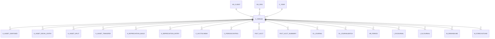

# C_PERIOD

Area [C](../../data-model/c/index.md) · class **business** (proposed) · read from database `idempiere-db` (owner `ADEMPIERE`) · 360 row(s) when profiled

Application model: `org.compiere.model.X_C_Period`, access level 2 - Client.

## Columns

| column | type | key | not null | business name | references (code) | nulls | distinct |
|---|---|---|---|---|---|---|---|
| `C_PERIOD_ID` | NUMBER(10,0) | PK | yes | Period |  | 0 | 360 |
| `AD_CLIENT_ID` | NUMBER(10,0) |  | yes | Tenant |  | 0 | 1 |
| `AD_ORG_ID` | NUMBER(10,0) |  | yes | Organization |  | 0 | 1 |
| `ISACTIVE` | CHAR(1) |  | yes | Active |  | 0 | 1 |
| `CREATED` | DATE |  | yes | Created |  | 0 | 298 |
| `CREATEDBY` | NUMBER(10,0) |  | yes | Created By |  | 0 | 2 |
| `UPDATED` | DATE |  | yes | Updated |  | 0 | 302 |
| `UPDATEDBY` | NUMBER(10,0) |  | yes | Updated By |  | 0 | 2 |
| `NAME` | VARCHAR2(60 CHAR) |  | yes | Name |  | 0 | 360 |
| `PERIODNO` | NUMBER(10,0) |  | yes | Period No |  | 0 | 12 |
| `C_YEAR_ID` | NUMBER(10,0) |  | yes | Year | [C_YEAR](../../data-model/c/c_year.md) | 0 | 30 |
| `STARTDATE` | DATE |  | yes | Start Date |  | 0 | 360 |
| `ENDDATE` | DATE |  |  | End Date |  | 0 | 360 |
| `PERIODTYPE` | CHAR(1) |  | yes | Period Type |  | 0 | 1 |
| `PROCESSING` | CHAR(1) |  |  | Process Now |  | 60 | 1 |
| `C_PERIOD_UU` | VARCHAR2(36 CHAR) |  |  | C_Period_UU |  | 0 | 360 |

*references (code)* is the table the application model's code says a column points to; *Foreign keys* below are the constraints the database declares. Counts come from the profile; no value is ever shown.

## Check constraints

| name | expression |
|---|---|
| `SYS_C0022288` | `IsActive in ('Y','N')` |

## Foreign keys

**References**

| table | columns | on delete |
|---|---|---|
| [AD_CLIENT](../../data-model/ad/ad_client.md) | C_PERIOD.AD_CLIENT_ID → AD_CLIENT.AD_CLIENT_ID | NO ACTION |
| [AD_ORG](../../data-model/ad/ad_org.md) | C_PERIOD.AD_ORG_ID → AD_ORG.AD_ORG_ID | NO ACTION |
| [C_YEAR](../../data-model/c/c_year.md) | C_PERIOD.C_YEAR_ID → C_YEAR.C_YEAR_ID | NO ACTION |

**Referenced by**

| table | columns | on delete |
|---|---|---|
| [A_ASSET_DISPOSED](../../data-model/a/a_asset_disposed.md) | A_ASSET_DISPOSED.C_PERIOD_ID → C_PERIOD.C_PERIOD_ID | NO ACTION |
| [A_ASSET_REVAL_ENTRY](../../data-model/a/a_asset_reval_entry.md) | A_ASSET_REVAL_ENTRY.C_PERIOD_ID → C_PERIOD.C_PERIOD_ID | NO ACTION |
| [A_ASSET_SPLIT](../../data-model/a/a_asset_split.md) | A_ASSET_SPLIT.C_PERIOD_ID → C_PERIOD.C_PERIOD_ID | NO ACTION |
| [A_ASSET_TRANSFER](../../data-model/a/a_asset_transfer.md) | A_ASSET_TRANSFER.C_PERIOD_ID → C_PERIOD.C_PERIOD_ID | NO ACTION |
| [A_DEPRECIATION_BUILD](../../data-model/a/a_depreciation_build.md) | A_DEPRECIATION_BUILD.C_PERIOD_ID → C_PERIOD.C_PERIOD_ID | NO ACTION |
| [A_DEPRECIATION_ENTRY](../../data-model/a/a_depreciation_entry.md) | A_DEPRECIATION_ENTRY.C_PERIOD_ID → C_PERIOD.C_PERIOD_ID | NO ACTION |
| [C_ACCTSCHEMA](../../data-model/c/c_acctschema.md) | C_ACCTSCHEMA.C_PERIOD_ID → C_PERIOD.C_PERIOD_ID | NO ACTION |
| [C_PERIODCONTROL](../../data-model/c/c_periodcontrol.md) | C_PERIODCONTROL.C_PERIOD_ID → C_PERIOD.C_PERIOD_ID | NO ACTION |
| [FACT_ACCT](../../data-model/fact/fact_acct.md) | FACT_ACCT.C_PERIOD_ID → C_PERIOD.C_PERIOD_ID | NO ACTION |
| [FACT_ACCT_SUMMARY](../../data-model/fact/fact_acct_summary.md) | FACT_ACCT_SUMMARY.C_PERIOD_ID → C_PERIOD.C_PERIOD_ID | NO ACTION |
| [GL_JOURNAL](../../data-model/gl/gl_journal.md) | GL_JOURNAL.C_PERIOD_ID → C_PERIOD.C_PERIOD_ID | NO ACTION |
| [GL_JOURNALBATCH](../../data-model/gl/gl_journalbatch.md) | GL_JOURNALBATCH.C_PERIOD_ID → C_PERIOD.C_PERIOD_ID | NO ACTION |
| [HR_PERIOD](../../data-model/hr/hr_period.md) | HR_PERIOD.C_PERIOD_ID → C_PERIOD.C_PERIOD_ID | NO ACTION |
| `I_FAJOURNAL` | I_FAJOURNAL.C_PERIOD_ID → C_PERIOD.C_PERIOD_ID | NO ACTION |
| `I_GLJOURNAL` | I_GLJOURNAL.C_PERIOD_ID → C_PERIOD.C_PERIOD_ID | SET NULL |
| [M_DEMANDLINE](../../data-model/m/m_demandline.md) | M_DEMANDLINE.C_PERIOD_ID → C_PERIOD.C_PERIOD_ID | NO ACTION |
| [M_FORECASTLINE](../../data-model/m/m_forecastline.md) | M_FORECASTLINE.C_PERIOD_ID → C_PERIOD.C_PERIOD_ID | NO ACTION |

## Write behaviour

- updates: **po_only**
- deletes: **soft_delete_only**
- change log: **recorded**
- evidence: 1 citation(s)

## Schema history

16 change(s); the latest:

| applied | release | operation | column | tickets |
|---|---|---|---|---|
| 2023-04-09T15:47 | iD11 | `add_constraint` |  | IDEMPIERE-5567 |
| 2023-04-09T15:47 | iD11 | `add_constraint` |  | IDEMPIERE-5567 |
| 2021-12-05T16:45 | i8.2z | `drop_constraint` |  | IDEMPIERE-5075 |
| 2021-12-05T16:45 | i8.2z | `add_constraint` |  | IDEMPIERE-5075 |
| 2021-12-05T16:45 | i8.2z | `add_constraint` |  | IDEMPIERE-5075 |
| 2021-12-05T16:45 | i8.2z | `drop_constraint` |  | IDEMPIERE-5075 |
| 2021-12-05T16:45 | i8.2z | `drop_constraint` |  | IDEMPIERE-5075 |
| 2021-12-05T16:45 | i8.2z | `add_constraint` |  | IDEMPIERE-5075 |
| 2020-08-04T01:00 | i7.1z | `modify_column` | NAME | IDEMPIERE-3862 |
| 2020-08-04T01:00 | i7.1z | `add_column` | tmp_col_2_tmp | IDEMPIERE-3862 |
| 2020-08-04T01:00 | i7.1z | `drop_column` | tmp_col_2_tmp | IDEMPIERE-3862 |
| 2020-08-04T01:00 | i7.1z | `modify_column` | C_PERIOD_UU | IDEMPIERE-3862 |
| 2020-08-04T01:00 | i7.1z | `add_column` | tmp_col_1_tmp | IDEMPIERE-3862 |
| 2020-08-04T01:00 | i7.1z | `modify_column` | NAME | IDEMPIERE-3862 |
| 2020-08-04T01:00 | i7.1z | `drop_column` | tmp_col_1_tmp | IDEMPIERE-3862 |

## Notes

<!-- ekos:manual id="table.c_period.notes" -->
_Business notes about this table._
<!-- /ekos:manual -->
