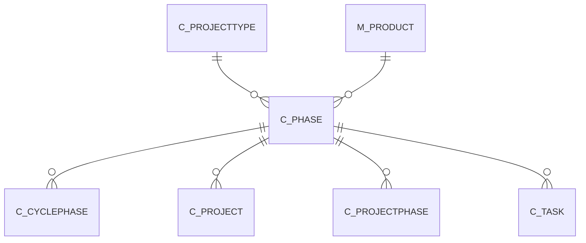

# C_PHASE

Area [C](../../data-model/c/index.md) · class **business** (proposed) · read from database `idempiere-db` (owner `ADEMPIERE`) · 13 row(s) when profiled

Application model: `org.compiere.model.X_C_Phase`, access level 3 - Client - Org.

## Columns

| column | type | key | not null | business name | references (code) | nulls | distinct |
|---|---|---|---|---|---|---|---|
| `AD_CLIENT_ID` | NUMBER(10,0) |  | yes | Tenant |  | 0 | 1 |
| `AD_ORG_ID` | NUMBER(10,0) |  | yes | Organization |  | 0 | 1 |
| `ISACTIVE` | CHAR(1) |  | yes | Active |  | 0 | 1 |
| `CREATED` | DATE |  | yes | Created |  | 0 | 13 |
| `CREATEDBY` | NUMBER(10,0) |  | yes | Created By |  | 0 | 1 |
| `UPDATED` | DATE |  | yes | Updated |  | 0 | 13 |
| `UPDATEDBY` | NUMBER(10,0) |  | yes | Updated By |  | 0 | 1 |
| `SEQNO` | NUMBER(10,0) |  | yes | Sequence |  | 0 | 8 |
| `NAME` | VARCHAR2(60 CHAR) |  | yes | Name |  | 0 | 13 |
| `DESCRIPTION` | VARCHAR2(255 CHAR) |  |  | Description |  | 3 | 10 |
| `HELP` | VARCHAR2(2000 CHAR) |  |  | Comment/Help |  | 12 | 1 |
| `C_PROJECTTYPE_ID` | NUMBER(10,0) |  | yes | Project Type | [C_PROJECTTYPE](../../data-model/c/c_projecttype.md) | 0 | 3 |
| `STANDARDQTY` | NUMBER |  | yes | Standard Quantity |  | 0 | 2 |
| `C_PHASE_ID` | NUMBER(10,0) | PK | yes | Standard Phase |  | 0 | 13 |
| `M_PRODUCT_ID` | NUMBER(10,0) |  |  | Product | [M_PRODUCT](../../data-model/m/m_product.md) | 13 | 0 |
| `C_PHASE_UU` | VARCHAR2(36 CHAR) |  |  | C_Phase_UU |  | 0 | 13 |

*references (code)* is the table the application model's code says a column points to; *Foreign keys* below are the constraints the database declares. Counts come from the profile; no value is ever shown.

## Foreign keys

**References**

| table | columns | on delete |
|---|---|---|
| [C_PROJECTTYPE](../../data-model/c/c_projecttype.md) | C_PHASE.C_PROJECTTYPE_ID → C_PROJECTTYPE.C_PROJECTTYPE_ID | CASCADE |
| [M_PRODUCT](../../data-model/m/m_product.md) | C_PHASE.M_PRODUCT_ID → M_PRODUCT.M_PRODUCT_ID | NO ACTION |

**Referenced by**

| table | columns | on delete |
|---|---|---|
| [C_CYCLEPHASE](../../data-model/c/c_cyclephase.md) | C_CYCLEPHASE.C_PHASE_ID → C_PHASE.C_PHASE_ID | CASCADE |
| [C_PROJECT](../../data-model/c/c_project.md) | C_PROJECT.C_PHASE_ID → C_PHASE.C_PHASE_ID | NO ACTION |
| [C_PROJECTPHASE](../../data-model/c/c_projectphase.md) | C_PROJECTPHASE.C_PHASE_ID → C_PHASE.C_PHASE_ID | NO ACTION |
| [C_TASK](../../data-model/c/c_task.md) | C_TASK.C_PHASE_ID → C_PHASE.C_PHASE_ID | CASCADE |

## Write behaviour

- updates: **po_only**
- deletes: **deleted_by_users, deleted_by_cascade**
- change log: **recorded**
- evidence: 2 citation(s)

## Read by

| kind | name |
|---|---|
| View | `C_PROJECT_HEADER_V` |
| View | `C_PROJECT_HEADER_VT` |
| View | `RV_PROJECTCYCLE` |
| View | `c_project_header_v` |
| View | `c_project_header_vt` |
| View | `rv_projectcycle` |

## Schema history

20 change(s); the latest:

| applied | release | operation | column | tickets |
|---|---|---|---|---|
| 2023-04-09T15:47 | iD11 | `add_constraint` |  | IDEMPIERE-5567 |
| 2023-04-09T15:47 | iD11 | `add_constraint` |  | IDEMPIERE-5567 |
| 2021-12-05T16:45 | i8.2z | `add_constraint` |  | IDEMPIERE-5075 |
| 2021-12-05T16:45 | i8.2z | `drop_constraint` |  | IDEMPIERE-5075 |
| 2021-12-05T16:45 | i8.2z | `drop_constraint` |  | IDEMPIERE-5075 |
| 2021-12-05T16:45 | i8.2z | `add_constraint` |  | IDEMPIERE-5075 |
| 2020-08-04T01:00 | i7.1z | `modify_column` | NAME | IDEMPIERE-3862 |
| 2020-08-04T01:00 | i7.1z | `drop_column` | tmp_col_4_tmp | IDEMPIERE-3862 |
| 2020-08-04T01:00 | i7.1z | `modify_column` | C_PHASE_UU | IDEMPIERE-3862 |
| 2020-08-04T01:00 | i7.1z | `drop_column` | tmp_col_1_tmp | IDEMPIERE-3862 |
| 2020-08-04T01:00 | i7.1z | `modify_column` | NAME | IDEMPIERE-3862 |
| 2020-08-04T01:00 | i7.1z | `modify_column` | HELP | IDEMPIERE-3862 |
| 2020-08-04T01:00 | i7.1z | `drop_column` | tmp_col_3_tmp | IDEMPIERE-3862 |
| 2020-08-04T01:00 | i7.1z | `add_column` | tmp_col_1_tmp | IDEMPIERE-3862 |
| 2020-08-04T01:00 | i7.1z | `add_column` | tmp_col_4_tmp | IDEMPIERE-3862 |

## Notes

<!-- ekos:manual id="table.c_phase.notes" -->
_Business notes about this table._
<!-- /ekos:manual -->
