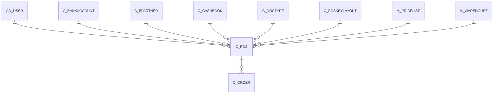

# C_POS

Area [C](../../data-model/c/index.md) · class **business** (proposed) · read from database `idempiere-db` (owner `ADEMPIERE`) · 1 row(s) when profiled

Application model: `org.compiere.model.X_C_POS`, access level 2 - Client.

## Columns

| column | type | key | not null | business name | references (code) | nulls | distinct |
|---|---|---|---|---|---|---|---|
| `C_POS_ID` | NUMBER(10,0) | PK | yes | POS Terminal |  | 0 | 1 |
| `AD_CLIENT_ID` | NUMBER(10,0) |  | yes | Tenant |  | 0 | 1 |
| `AD_ORG_ID` | NUMBER(10,0) |  | yes | Organization |  | 0 | 1 |
| `ISACTIVE` | CHAR(1) |  | yes | Active |  | 0 | 1 |
| `CREATED` | DATE |  | yes | Created |  | 0 | 1 |
| `CREATEDBY` | NUMBER(10,0) |  | yes | Created By |  | 0 | 1 |
| `UPDATED` | DATE |  | yes | Updated |  | 0 | 1 |
| `UPDATEDBY` | NUMBER(10,0) |  | yes | Updated By |  | 0 | 1 |
| `NAME` | VARCHAR2(60 CHAR) |  | yes | Name |  | 0 | 1 |
| `DESCRIPTION` | VARCHAR2(255 CHAR) |  |  | Description |  | 1 | 0 |
| `HELP` | VARCHAR2(2000 CHAR) |  |  | Comment/Help |  | 1 | 0 |
| `SALESREP_ID` | NUMBER(10,0) |  | yes | Sales Representative | [AD_USER](../../data-model/ad/ad_user.md) | 0 | 1 |
| `M_PRICELIST_ID` | NUMBER(10,0) |  | yes | Price List | [M_PRICELIST](../../data-model/m/m_pricelist.md) | 0 | 1 |
| `C_CASHBOOK_ID` | NUMBER(10,0) |  |  | Cash Book | [C_CASHBOOK](../../data-model/c/c_cashbook.md) | 0 | 1 |
| `M_WAREHOUSE_ID` | NUMBER(10,0) |  | yes | Warehouse | [M_WAREHOUSE](../../data-model/m/m_warehouse.md) | 0 | 1 |
| `PRINTERNAME` | VARCHAR2(60 CHAR) |  |  | Printer Name |  | 1 | 0 |
| `C_POSKEYLAYOUT_ID` | NUMBER(10,0) |  |  | POS Key Layout | [C_POSKEYLAYOUT](../../data-model/c/c_poskeylayout.md) | 0 | 1 |
| `ISMODIFYPRICE` | CHAR(1) |  | yes | Modify Price |  | 0 | 1 |
| `C_BPARTNERCASHTRX_ID` | NUMBER(10,0) |  |  | Template B.Partner | [C_BPARTNER](../../data-model/c/c_bpartner.md) | 1 | 0 |
| `C_DOCTYPE_ID` | NUMBER(10,0) |  |  | Document Type | [C_DOCTYPE](../../data-model/c/c_doctype.md) | 0 | 1 |
| `CASHDRAWER` | VARCHAR2(120 CHAR) |  |  | Cash Drawer |  | 1 | 0 |
| `C_BANKACCOUNT_ID` | NUMBER(10,0) |  |  | Bank Account | [C_BANKACCOUNT](../../data-model/c/c_bankaccount.md) | 0 | 1 |
| `C_POS_UU` | VARCHAR2(36 CHAR) |  |  | C_POS_UU |  | 0 | 1 |
| `OSK_KEYLAYOUT_ID` | NUMBER(10,0) |  |  | On Screen Keyboard layout | [C_POSKEYLAYOUT](../../data-model/c/c_poskeylayout.md) | 0 | 1 |
| `OSNP_KEYLAYOUT_ID` | NUMBER(10,0) |  |  | On Screen Number Pad layout | [C_POSKEYLAYOUT](../../data-model/c/c_poskeylayout.md) | 0 | 1 |
| `AUTOLOGOUTDELAY` | NUMBER(10,0) |  |  | Auto Logout Delay |  | 1 | 0 |

*references (code)* is the table the application model's code says a column points to; *Foreign keys* below are the constraints the database declares. Counts come from the profile; no value is ever shown.

## Check constraints

| name | expression |
|---|---|
| `SYS_C0022498` | `IsActive in ('Y','N')` |

## Foreign keys

**References**

| table | columns | on delete |
|---|---|---|
| [AD_USER](../../data-model/ad/ad_user.md) | C_POS.SALESREP_ID → AD_USER.AD_USER_ID | NO ACTION |
| [C_BANKACCOUNT](../../data-model/c/c_bankaccount.md) | C_POS.C_BANKACCOUNT_ID → C_BANKACCOUNT.C_BANKACCOUNT_ID | NO ACTION |
| [C_BPARTNER](../../data-model/c/c_bpartner.md) | C_POS.C_BPARTNERCASHTRX_ID → C_BPARTNER.C_BPARTNER_ID | NO ACTION |
| [C_CASHBOOK](../../data-model/c/c_cashbook.md) | C_POS.C_CASHBOOK_ID → C_CASHBOOK.C_CASHBOOK_ID | NO ACTION |
| [C_DOCTYPE](../../data-model/c/c_doctype.md) | C_POS.C_DOCTYPE_ID → C_DOCTYPE.C_DOCTYPE_ID | NO ACTION |
| [C_POSKEYLAYOUT](../../data-model/c/c_poskeylayout.md) | C_POS.C_POSKEYLAYOUT_ID → C_POSKEYLAYOUT.C_POSKEYLAYOUT_ID | NO ACTION |
| [M_PRICELIST](../../data-model/m/m_pricelist.md) | C_POS.M_PRICELIST_ID → M_PRICELIST.M_PRICELIST_ID | NO ACTION |
| [M_WAREHOUSE](../../data-model/m/m_warehouse.md) | C_POS.M_WAREHOUSE_ID → M_WAREHOUSE.M_WAREHOUSE_ID | NO ACTION |

**Referenced by**

| table | columns | on delete |
|---|---|---|
| [C_ORDER](../../data-model/c/c_order.md) | C_ORDER.C_POS_ID → C_POS.C_POS_ID | NO ACTION |

## Write behaviour

- updates: **po_only**
- deletes: **deleted_by_users**
- change log: **recorded**
- evidence: 1 citation(s)

## Schema history

46 change(s); the latest:

| applied | release | operation | column | tickets |
|---|---|---|---|---|
| 2023-04-09T15:47 | iD11 | `add_constraint` |  | IDEMPIERE-5567 |
| 2023-04-09T15:47 | iD11 | `add_constraint` |  | IDEMPIERE-5567 |
| 2021-12-05T16:45 | i8.2z | `drop_constraint` |  | IDEMPIERE-5075 |
| 2021-12-05T16:45 | i8.2z | `drop_constraint` |  | IDEMPIERE-5075 |
| 2021-12-05T16:45 | i8.2z | `add_constraint` |  | IDEMPIERE-5075 |
| 2021-12-05T16:45 | i8.2z | `add_constraint` |  | IDEMPIERE-5075 |
| 2021-12-05T16:45 | i8.2z | `add_constraint` |  | IDEMPIERE-5075 |
| 2021-12-05T16:45 | i8.2z | `drop_constraint` |  | IDEMPIERE-5075 |
| 2021-12-05T16:45 | i8.2z | `drop_constraint` |  | IDEMPIERE-5075 |
| 2021-12-05T16:45 | i8.2z | `drop_constraint` |  | IDEMPIERE-5075 |
| 2021-12-05T16:45 | i8.2z | `add_constraint` |  | IDEMPIERE-5075 |
| 2021-12-05T16:45 | i8.2z | `drop_constraint` |  | IDEMPIERE-5075 |
| 2021-12-05T16:45 | i8.2z | `add_constraint` |  | IDEMPIERE-5075 |
| 2021-12-05T16:45 | i8.2z | `add_constraint` |  | IDEMPIERE-5075 |
| 2021-12-05T16:45 | i8.2z | `drop_constraint` |  | IDEMPIERE-5075 |

## Notes

<!-- ekos:manual id="table.c_pos.notes" -->
_Business notes about this table._
<!-- /ekos:manual -->
