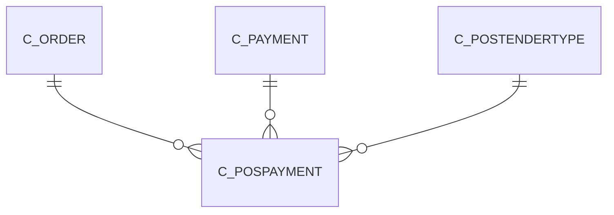

# C_POSPAYMENT

Area [C](../../data-model/c/index.md) · class **business** (proposed) · read from database `idempiere-db` (owner `ADEMPIERE`) · 0 row(s) when profiled

Application model: `org.compiere.model.X_C_POSPayment`, access level 3 - Client - Org.

## Columns

| column | type | key | not null | business name | references (code) | nulls | distinct |
|---|---|---|---|---|---|---|---|
| `ACCOUNTNO` | VARCHAR2(20 CHAR) |  |  | Account No |  | 0 | 0 |
| `AD_CLIENT_ID` | NUMBER(10,0) |  | yes | Tenant |  | 0 | 0 |
| `AD_ORG_ID` | NUMBER(10,0) |  | yes | Organization |  | 0 | 0 |
| `A_NAME` | VARCHAR2(60 CHAR) |  |  | Account Name |  | 0 | 0 |
| `CHECKNO` | VARCHAR2(20 CHAR) |  |  | Check No |  | 0 | 0 |
| `CHECKSTATUS` | CHAR(1) |  |  | Check Status |  | 0 | 0 |
| `C_ORDER_ID` | NUMBER(10,0) |  | yes | Order | [C_ORDER](../../data-model/c/c_order.md) | 0 | 0 |
| `C_PAYMENT_ID` | NUMBER(10,0) |  |  | Payment | [C_PAYMENT](../../data-model/c/c_payment.md) | 0 | 0 |
| `C_POSPAYMENT_ID` | NUMBER(10,0) | PK | yes | POS Payment |  | 0 | 0 |
| `C_POSPAYMENT_UU` | VARCHAR2(36 CHAR) |  |  | C_POSPayment_UU |  | 0 | 0 |
| `C_POSTENDERTYPE_ID` | NUMBER(10,0) |  | yes | POS Tender Type | [C_POSTENDERTYPE](../../data-model/c/c_postendertype.md) | 0 | 0 |
| `CREATED` | DATE |  | yes | Created |  | 0 | 0 |
| `CREATEDBY` | NUMBER(10,0) |  | yes | Created By |  | 0 | 0 |
| `CREDITCARDNUMBER` | VARCHAR2(20 CHAR) |  |  | Number |  | 0 | 0 |
| `CREDITCARDTYPE` | CHAR(1) |  |  | Credit Card |  | 0 | 0 |
| `DATEPROMISED` | DATE |  |  | Date Promised |  | 0 | 0 |
| `DEPOSITGROUP` | VARCHAR2(20 CHAR) |  |  | Deposit Group |  | 0 | 0 |
| `HELP` | VARCHAR2(2000 CHAR) |  |  | Comment/Help |  | 0 | 0 |
| `ISACTIVE` | CHAR(1) |  | yes | Active |  | 0 | 0 |
| `ISPOSTDATED` | CHAR(1) |  | yes | Post Dated |  | 0 | 0 |
| `MICR` | VARCHAR2(20 CHAR) |  |  | Micr |  | 0 | 0 |
| `PAYAMT` | NUMBER |  | yes | Payment amount |  | 0 | 0 |
| `PROCESSED` | CHAR(1) |  | yes | Processed |  | 0 | 0 |
| `ROUTINGNO` | VARCHAR2(20 CHAR) |  |  | Routing No |  | 0 | 0 |
| `TENDERTYPE` | CHAR(1) |  |  | Tender type |  | 0 | 0 |
| `UPDATED` | DATE |  | yes | Updated |  | 0 | 0 |
| `UPDATEDBY` | NUMBER(10,0) |  | yes | Updated By |  | 0 | 0 |
| `VOICEAUTHCODE` | VARCHAR2(20 CHAR) |  |  | Voice authorization code |  | 0 | 0 |
| `IBAN` | VARCHAR2(40 CHAR) |  |  | IBAN |  | 0 | 0 |
| `SWIFTCODE` | VARCHAR2(20 CHAR) |  |  | Swift code |  | 0 | 0 |

*references (code)* is the table the application model's code says a column points to; *Foreign keys* below are the constraints the database declares. Counts come from the profile; no value is ever shown.

## Check constraints

| name | expression |
|---|---|
| `SYS_C0022965` | `IsPostDated IN ('Y','N')` |
| `SYS_C0022966` | `IsActive IN ('Y','N')` |
| `SYS_C0022969` | `Processed IN ('Y','N')` |

## Foreign keys

**References**

| table | columns | on delete |
|---|---|---|
| [C_ORDER](../../data-model/c/c_order.md) | C_POSPAYMENT.C_ORDER_ID → C_ORDER.C_ORDER_ID | NO ACTION |
| [C_PAYMENT](../../data-model/c/c_payment.md) | C_POSPAYMENT.C_PAYMENT_ID → C_PAYMENT.C_PAYMENT_ID | NO ACTION |
| [C_POSTENDERTYPE](../../data-model/c/c_postendertype.md) | C_POSPAYMENT.C_POSTENDERTYPE_ID → C_POSTENDERTYPE.C_POSTENDERTYPE_ID | NO ACTION |

**Referenced by**

_None._

## Write behaviour

- updates: **po_only**
- deletes: **deleted_by_users**
- change log: **recorded**
- evidence: 1 citation(s)

## Schema history

52 change(s); the latest:

| applied | release | operation | column | tickets |
|---|---|---|---|---|
| 2023-04-09T15:47 | iD11 | `add_constraint` |  | IDEMPIERE-5567 |
| 2023-04-09T15:47 | iD11 | `add_constraint` |  | IDEMPIERE-5567 |
| 2021-12-05T16:45 | i8.2z | `drop_constraint` |  | IDEMPIERE-5075 |
| 2021-12-05T16:45 | i8.2z | `add_constraint` |  | IDEMPIERE-5075 |
| 2021-12-05T16:45 | i8.2z | `add_constraint` |  | IDEMPIERE-5075 |
| 2021-12-05T16:45 | i8.2z | `drop_constraint` |  | IDEMPIERE-5075 |
| 2021-12-05T16:45 | i8.2z | `drop_constraint` |  | IDEMPIERE-5075 |
| 2021-12-05T16:45 | i8.2z | `add_constraint` |  | IDEMPIERE-5075 |
| 2020-08-04T01:00 | i7.1z | `modify_column` | MICR | IDEMPIERE-3862 |
| 2020-08-04T01:00 | i7.1z | `modify_column` | VOICEAUTHCODE | IDEMPIERE-3862 |
| 2020-08-04T01:00 | i7.1z | `add_column` | tmp_col_1_tmp | IDEMPIERE-3862 |
| 2020-08-04T01:00 | i7.1z | `modify_column` | A_NAME | IDEMPIERE-3862 |
| 2020-08-04T01:00 | i7.1z | `modify_column` | ROUTINGNO | IDEMPIERE-3862 |
| 2020-08-04T01:00 | i7.1z | `modify_column` | SWIFTCODE | IDEMPIERE-3862 |
| 2020-08-04T01:00 | i7.1z | `modify_column` | IBAN | IDEMPIERE-3862 |

## Notes

<!-- ekos:manual id="table.c_pospayment.notes" -->
_Business notes about this table._
<!-- /ekos:manual -->
