# C_PROJECT

Area [C](../../data-model/c/index.md) · class **business** (proposed) · read from database `idempiere-db` (owner `ADEMPIERE`) · 2 row(s) when profiled

Application model: `org.compiere.model.X_C_Project`, access level 3 - Client - Org.

## Columns

| column | type | key | not null | business name | references (code) | nulls | distinct |
|---|---|---|---|---|---|---|---|
| `C_PROJECT_ID` | NUMBER(10,0) | PK | yes | Project |  | 0 | 2 |
| `AD_CLIENT_ID` | NUMBER(10,0) |  | yes | Tenant |  | 0 | 1 |
| `AD_ORG_ID` | NUMBER(10,0) |  | yes | Organization |  | 0 | 1 |
| `ISACTIVE` | CHAR(1) |  | yes | Active |  | 0 | 1 |
| `CREATED` | DATE |  | yes | Created |  | 0 | 2 |
| `CREATEDBY` | NUMBER(10,0) |  | yes | Created By |  | 0 | 2 |
| `UPDATED` | DATE |  | yes | Updated |  | 0 | 2 |
| `UPDATEDBY` | NUMBER(10,0) |  | yes | Updated By |  | 0 | 1 |
| `VALUE` | VARCHAR2(40 CHAR) |  | yes | Search Key |  | 0 | 2 |
| `NAME` | VARCHAR2(60 CHAR) |  | yes | Name |  | 0 | 2 |
| `DESCRIPTION` | VARCHAR2(255 CHAR) |  |  | Description |  | 1 | 1 |
| `NOTE` | VARCHAR2(2000 CHAR) |  |  | Note |  | 2 | 0 |
| `ISSUMMARY` | CHAR(1) |  | yes | Summary Level |  | 0 | 1 |
| `AD_USER_ID` | NUMBER(10,0) |  |  | User/Contact | [AD_USER](../../data-model/ad/ad_user.md) | 1 | 1 |
| `C_BPARTNER_ID` | NUMBER(10,0) |  |  | Business Partner | [C_BPARTNER](../../data-model/c/c_bpartner.md) | 1 | 1 |
| `C_BPARTNER_LOCATION_ID` | NUMBER(10,0) |  |  | Partner Location | [C_BPARTNER_LOCATION](../../data-model/c/c_bpartner_location.md) | 1 | 1 |
| `POREFERENCE` | VARCHAR2(20 CHAR) |  |  | Order Reference |  | 2 | 0 |
| `C_PAYMENTTERM_ID` | NUMBER(10,0) |  |  | Payment Term | [C_PAYMENTTERM](../../data-model/c/c_paymentterm.md) | 1 | 1 |
| `C_CURRENCY_ID` | NUMBER(10,0) |  | yes | Currency | [C_CURRENCY](../../data-model/c/c_currency.md) | 0 | 1 |
| `M_PRICELIST_VERSION_ID` | NUMBER(10,0) |  |  | Price List Version | [M_PRICELIST_VERSION](../../data-model/m/m_pricelist_version.md) | 2 | 0 |
| `C_CAMPAIGN_ID` | NUMBER(10,0) |  |  | Campaign | [C_CAMPAIGN](../../data-model/c/c_campaign.md) | 2 | 0 |
| `ISCOMMITMENT` | CHAR(1) |  | yes | Commitment |  | 0 | 1 |
| `PLANNEDAMT` | NUMBER |  | yes | Planned Amount |  | 0 | 2 |
| `PLANNEDQTY` | NUMBER |  | yes | Planned Quantity |  | 0 | 2 |
| `PLANNEDMARGINAMT` | NUMBER |  | yes | Planned Margin |  | 0 | 1 |
| `COMMITTEDAMT` | NUMBER |  | yes | Committed Amount |  | 0 | 1 |
| `DATECONTRACT` | DATE |  |  | Contract Date |  | 1 | 1 |
| `DATEFINISH` | DATE |  |  | Finish Date |  | 2 | 0 |
| `GENERATETO` | CHAR(1) |  |  | Generate To |  | 1 | 1 |
| `PROCESSED` | CHAR(1) |  | yes | Processed |  | 0 | 1 |
| `SALESREP_ID` | NUMBER(10,0) |  |  | Sales Representative | [AD_USER](../../data-model/ad/ad_user.md) | 2 | 0 |
| `COPYFROM` | CHAR(1) |  |  | Copy From |  | 2 | 0 |
| `C_PROJECTTYPE_ID` | NUMBER(10,0) |  |  | Project Type |  | 1 | 1 |
| `COMMITTEDQTY` | NUMBER |  | yes | Committed Quantity |  | 0 | 1 |
| `INVOICEDAMT` | NUMBER |  | yes | Invoiced Amount |  | 0 | 1 |
| `INVOICEDQTY` | NUMBER |  | yes | Quantity Invoiced |  | 0 | 1 |
| `PROJECTBALANCEAMT` | NUMBER |  | yes | Project Balance |  | 0 | 1 |
| `C_PHASE_ID` | NUMBER(10,0) |  |  | Standard Phase | [C_PHASE](../../data-model/c/c_phase.md) | 1 | 1 |
| `ISCOMMITCEILING` | CHAR(1) |  | yes | Commitment is Ceiling |  | 0 | 1 |
| `M_WAREHOUSE_ID` | NUMBER(10,0) |  |  | Warehouse | [M_WAREHOUSE](../../data-model/m/m_warehouse.md) | 2 | 0 |
| `PROJECTCATEGORY` | CHAR(1) |  |  | Project Category |  | 0 | 1 |
| `PROCESSING` | CHAR(1) |  |  | Process Now |  | 2 | 0 |
| `C_BPARTNERSR_ID` | NUMBER(10,0) |  |  | BPartner (Agent) | [C_BPARTNER](../../data-model/c/c_bpartner.md) | 2 | 0 |
| `PROJINVOICERULE` | CHAR(1) |  | yes | Invoice Rule |  | 0 | 1 |
| `PROJECTLINELEVEL` | CHAR(1) |  | yes | Line Level |  | 0 | 1 |
| `C_PROJECT_UU` | VARCHAR2(36 CHAR) |  |  | C_Project_UU |  | 0 | 2 |
| `AD_ORGTRX_ID` | NUMBER(10,0) |  |  | Trx Organization |  | 2 | 0 |
| `C_ACTIVITY_ID` | NUMBER(10,0) |  |  | Activity | [C_ACTIVITY](../../data-model/c/c_activity.md) | 2 | 0 |

*references (code)* is the table the application model's code says a column points to; *Foreign keys* below are the constraints the database declares. Counts come from the profile; no value is ever shown.

## Check constraints

| name | expression |
|---|---|
| `SYS_C0020204` | `IsActive in ('Y','N')` |
| `SYS_C0020207` | `GenerateTo in ('Y','N')` |
| `SYS_C0020208` | `IsCommitment in ('Y','N')` |
| `SYS_C0020209` | `Processed in ('Y','N')` |

## Foreign keys

**References**

| table | columns | on delete |
|---|---|---|
| [AD_CLIENT](../../data-model/ad/ad_client.md) | C_PROJECT.AD_CLIENT_ID → AD_CLIENT.AD_CLIENT_ID | NO ACTION |
| [AD_ORG](../../data-model/ad/ad_org.md) | C_PROJECT.AD_ORGTRX_ID → AD_ORG.AD_ORG_ID | NO ACTION |
| [AD_USER](../../data-model/ad/ad_user.md) | C_PROJECT.AD_USER_ID → AD_USER.AD_USER_ID | SET NULL |
| [C_ACTIVITY](../../data-model/c/c_activity.md) | C_PROJECT.C_ACTIVITY_ID → C_ACTIVITY.C_ACTIVITY_ID | NO ACTION |
| [C_BPARTNER](../../data-model/c/c_bpartner.md) | C_PROJECT.C_BPARTNERSR_ID → C_BPARTNER.C_BPARTNER_ID | NO ACTION |
| [C_BPARTNER_LOCATION](../../data-model/c/c_bpartner_location.md) | C_PROJECT.C_BPARTNER_LOCATION_ID → C_BPARTNER_LOCATION.C_BPARTNER_LOCATION_ID | NO ACTION |
| [C_CAMPAIGN](../../data-model/c/c_campaign.md) | C_PROJECT.C_CAMPAIGN_ID → C_CAMPAIGN.C_CAMPAIGN_ID | NO ACTION |
| [C_CURRENCY](../../data-model/c/c_currency.md) | C_PROJECT.C_CURRENCY_ID → C_CURRENCY.C_CURRENCY_ID | NO ACTION |
| [C_PAYMENTTERM](../../data-model/c/c_paymentterm.md) | C_PROJECT.C_PAYMENTTERM_ID → C_PAYMENTTERM.C_PAYMENTTERM_ID | NO ACTION |
| [C_PHASE](../../data-model/c/c_phase.md) | C_PROJECT.C_PHASE_ID → C_PHASE.C_PHASE_ID | NO ACTION |
| [C_PROJECTTYPE](../../data-model/c/c_projecttype.md) | C_PROJECT.C_PROJECTTYPE_ID → C_PROJECTTYPE.C_PROJECTTYPE_ID | NO ACTION |
| [M_PRICELIST_VERSION](../../data-model/m/m_pricelist_version.md) | C_PROJECT.M_PRICELIST_VERSION_ID → M_PRICELIST_VERSION.M_PRICELIST_VERSION_ID | NO ACTION |
| [M_WAREHOUSE](../../data-model/m/m_warehouse.md) | C_PROJECT.M_WAREHOUSE_ID → M_WAREHOUSE.M_WAREHOUSE_ID | NO ACTION |

**Referenced by**

| table | columns | on delete |
|---|---|---|
| [A_ASSET](../../data-model/a/a_asset.md) | A_ASSET.C_PROJECT_ID → C_PROJECT.C_PROJECT_ID | NO ACTION |
| [A_ASSET_ADDITION](../../data-model/a/a_asset_addition.md) | A_ASSET_ADDITION.C_PROJECT_ID → C_PROJECT.C_PROJECT_ID | NO ACTION |
| [C_ACCTSCHEMA_ELEMENT](../../data-model/c/c_acctschema_element.md) | C_ACCTSCHEMA_ELEMENT.C_PROJECT_ID → C_PROJECT.C_PROJECT_ID | NO ACTION |
| [C_CASH](../../data-model/c/c_cash.md) | C_CASH.C_PROJECT_ID → C_PROJECT.C_PROJECT_ID | NO ACTION |
| [C_CASHPLAN](../../data-model/c/c_cashplan.md) | C_CASHPLAN.C_PROJECT_ID → C_PROJECT.C_PROJECT_ID | NO ACTION |
| [C_CASHPLANLINE](../../data-model/c/c_cashplanline.md) | C_CASHPLANLINE.C_PROJECT_ID → C_PROJECT.C_PROJECT_ID | NO ACTION |
| [C_INVOICE](../../data-model/c/c_invoice.md) | C_INVOICE.C_PROJECT_ID → C_PROJECT.C_PROJECT_ID | NO ACTION |
| [C_INVOICEBATCHLINE](../../data-model/c/c_invoicebatchline.md) | C_INVOICEBATCHLINE.C_PROJECT_ID → C_PROJECT.C_PROJECT_ID | NO ACTION |
| [C_INVOICELINE](../../data-model/c/c_invoiceline.md) | C_INVOICELINE.C_PROJECT_ID → C_PROJECT.C_PROJECT_ID | NO ACTION |
| [C_ORDER](../../data-model/c/c_order.md) | C_ORDER.C_PROJECT_ID → C_PROJECT.C_PROJECT_ID | NO ACTION |
| [C_ORDERLINE](../../data-model/c/c_orderline.md) | C_ORDERLINE.C_PROJECT_ID → C_PROJECT.C_PROJECT_ID | NO ACTION |
| [C_PAYMENT](../../data-model/c/c_payment.md) | C_PAYMENT.C_PROJECT_ID → C_PROJECT.C_PROJECT_ID | NO ACTION |
| [C_PAYMENTTRANSACTION](../../data-model/c/c_paymenttransaction.md) | C_PAYMENTTRANSACTION.C_PROJECT_ID → C_PROJECT.C_PROJECT_ID | NO ACTION |
| [C_PROJECTISSUE](../../data-model/c/c_projectissue.md) | C_PROJECTISSUE.C_PROJECT_ID → C_PROJECT.C_PROJECT_ID | NO ACTION |
| [C_PROJECTLINE](../../data-model/c/c_projectline.md) | C_PROJECTLINE.C_PROJECT_ID → C_PROJECT.C_PROJECT_ID | CASCADE |
| [C_PROJECTPHASE](../../data-model/c/c_projectphase.md) | C_PROJECTPHASE.C_PROJECT_ID → C_PROJECT.C_PROJECT_ID | NO ACTION |
| [C_PROJECT_ACCT](../../data-model/c/c_project_acct.md) | C_PROJECT_ACCT.C_PROJECT_ID → C_PROJECT.C_PROJECT_ID | CASCADE |
| [C_RECURRING](../../data-model/c/c_recurring.md) | C_RECURRING.C_PROJECT_ID → C_PROJECT.C_PROJECT_ID | NO ACTION |
| [C_RECURRING_RUN](../../data-model/c/c_recurring_run.md) | C_RECURRING_RUN.C_PROJECT_ID → C_PROJECT.C_PROJECT_ID | NO ACTION |
| [C_VALIDCOMBINATION](../../data-model/c/c_validcombination.md) | C_VALIDCOMBINATION.C_PROJECT_ID → C_PROJECT.C_PROJECT_ID | NO ACTION |
| [DD_ORDER](../../data-model/dd/dd_order.md) | DD_ORDER.C_PROJECT_ID → C_PROJECT.C_PROJECT_ID | NO ACTION |
| [DD_ORDERLINE](../../data-model/dd/dd_orderline.md) | DD_ORDERLINE.C_PROJECT_ID → C_PROJECT.C_PROJECT_ID | NO ACTION |
| [FACT_ACCT](../../data-model/fact/fact_acct.md) | FACT_ACCT.C_PROJECT_ID → C_PROJECT.C_PROJECT_ID | NO ACTION |
| [FACT_ACCT_SUMMARY](../../data-model/fact/fact_acct_summary.md) | FACT_ACCT_SUMMARY.C_PROJECT_ID → C_PROJECT.C_PROJECT_ID | NO ACTION |
| [GL_DISTRIBUTION](../../data-model/gl/gl_distribution.md) | GL_DISTRIBUTION.C_PROJECT_ID → C_PROJECT.C_PROJECT_ID | NO ACTION |
| [GL_DISTRIBUTIONLINE](../../data-model/gl/gl_distributionline.md) | GL_DISTRIBUTIONLINE.C_PROJECT_ID → C_PROJECT.C_PROJECT_ID | NO ACTION |
| [GL_JOURNALLINE](../../data-model/gl/gl_journalline.md) | GL_JOURNALLINE.C_PROJECT_ID → C_PROJECT.C_PROJECT_ID | NO ACTION |
| [HR_CONTRACT](../../data-model/hr/hr_contract.md) | HR_CONTRACT.C_PROJECT_ID → C_PROJECT.C_PROJECT_ID | NO ACTION |
| [HR_MOVEMENT](../../data-model/hr/hr_movement.md) | HR_MOVEMENT.C_PROJECT_ID → C_PROJECT.C_PROJECT_ID | NO ACTION |
| `I_FAJOURNAL` | I_FAJOURNAL.C_PROJECT_ID → C_PROJECT.C_PROJECT_ID | NO ACTION |
| `I_GLJOURNAL` | I_GLJOURNAL.C_PROJECT_ID → C_PROJECT.C_PROJECT_ID | SET NULL |
| `I_INVOICE` | I_INVOICE.C_PROJECT_ID → C_PROJECT.C_PROJECT_ID | SET NULL |
| `I_MOVEMENT` | I_MOVEMENT.C_PROJECT_ID → C_PROJECT.C_PROJECT_ID | NO ACTION |
| `I_ORDER` | I_ORDER.C_PROJECT_ID → C_PROJECT.C_PROJECT_ID | SET NULL |
| [M_INOUT](../../data-model/m/m_inout.md) | M_INOUT.C_PROJECT_ID → C_PROJECT.C_PROJECT_ID | NO ACTION |
| [M_INOUTLINE](../../data-model/m/m_inoutline.md) | M_INOUTLINE.C_PROJECT_ID → C_PROJECT.C_PROJECT_ID | NO ACTION |
| [M_INVENTORY](../../data-model/m/m_inventory.md) | M_INVENTORY.C_PROJECT_ID → C_PROJECT.C_PROJECT_ID | NO ACTION |
| [M_MOVEMENT](../../data-model/m/m_movement.md) | M_MOVEMENT.C_PROJECT_ID → C_PROJECT.C_PROJECT_ID | NO ACTION |
| [M_PRODUCTION](../../data-model/m/m_production.md) | M_PRODUCTION.C_PROJECT_ID → C_PROJECT.C_PROJECT_ID | NO ACTION |
| [PA_DOCUMENTSTATUS](../../data-model/pa/pa_documentstatus.md) | PA_DOCUMENTSTATUS.C_PROJECT_ID → C_PROJECT.C_PROJECT_ID | NO ACTION |
| [PA_REPORTCOLUMN](../../data-model/pa/pa_reportcolumn.md) | PA_REPORTCOLUMN.C_PROJECT_ID → C_PROJECT.C_PROJECT_ID | NO ACTION |
| [PA_REPORTSOURCE](../../data-model/pa/pa_reportsource.md) | PA_REPORTSOURCE.C_PROJECT_ID → C_PROJECT.C_PROJECT_ID | NO ACTION |
| [PP_COST_COLLECTOR](../../data-model/pp/pp_cost_collector.md) | PP_COST_COLLECTOR.C_PROJECT_ID → C_PROJECT.C_PROJECT_ID | NO ACTION |
| [PP_ORDER](../../data-model/pp/pp_order.md) | PP_ORDER.C_PROJECT_ID → C_PROJECT.C_PROJECT_ID | NO ACTION |
| [R_ISSUEPROJECT](../../data-model/r/r_issueproject.md) | R_ISSUEPROJECT.C_PROJECT_ID → C_PROJECT.C_PROJECT_ID | NO ACTION |
| [R_REQUEST](../../data-model/r/r_request.md) | R_REQUEST.C_PROJECT_ID → C_PROJECT.C_PROJECT_ID | NO ACTION |
| [R_REQUESTACTION](../../data-model/r/r_requestaction.md) | R_REQUESTACTION.C_PROJECT_ID → C_PROJECT.C_PROJECT_ID | NO ACTION |
| [S_TIMEEXPENSELINE](../../data-model/s/s_timeexpenseline.md) | S_TIMEEXPENSELINE.C_PROJECT_ID → C_PROJECT.C_PROJECT_ID | NO ACTION |
| `T_AGING` | T_AGING.C_PROJECT_ID → C_PROJECT.C_PROJECT_ID | CASCADE |

```mermaid
erDiagram
  AD_CLIENT ||--o{ C_PROJECT : ""
  AD_ORG ||--o{ C_PROJECT : ""
  AD_USER ||--o{ C_PROJECT : ""
  C_ACTIVITY ||--o{ C_PROJECT : ""
  C_BPARTNER ||--o{ C_PROJECT : ""
  C_BPARTNER_LOCATION ||--o{ C_PROJECT : ""
  C_CAMPAIGN ||--o{ C_PROJECT : ""
  C_CURRENCY ||--o{ C_PROJECT : ""
  C_PAYMENTTERM ||--o{ C_PROJECT : ""
  C_PHASE ||--o{ C_PROJECT : ""
  C_PROJECT ||--o{ A_ASSET : ""
  C_PROJECT ||--o{ A_ASSET_ADDITION : ""
  C_PROJECT ||--o{ C_ACCTSCHEMA_ELEMENT : ""
  C_PROJECT ||--o{ C_CASH : ""
  C_PROJECT ||--o{ C_CASHPLAN : ""
  C_PROJECT ||--o{ C_CASHPLANLINE : ""
  C_PROJECT ||--o{ C_INVOICE : ""
  C_PROJECT ||--o{ C_INVOICEBATCHLINE : ""
  C_PROJECT ||--o{ C_INVOICELINE : ""
  C_PROJECT ||--o{ C_ORDER : ""
  C_PROJECT ||--o{ C_ORDERLINE : ""
  C_PROJECT ||--o{ C_PAYMENT : ""
  C_PROJECT ||--o{ C_PAYMENTTRANSACTION : ""
  C_PROJECT ||--o{ C_PROJECTISSUE : ""
  C_PROJECT ||--o{ C_PROJECTLINE : ""
  C_PROJECT ||--o{ C_PROJECTPHASE : ""
  C_PROJECT ||--o{ C_PROJECT_ACCT : ""
  C_PROJECT ||--o{ C_RECURRING : ""
  C_PROJECTTYPE ||--o{ C_PROJECT : ""
```

33 more neighbour(s) not drawn.

## Write behaviour

- updates: **raw_sql_skips_updated**
- deletes: **soft_delete_only**
- change log: **recorded**
- evidence: 2 citation(s)

## Read by

| kind | name |
|---|---|
| Procedure | [C_AcctSchema_Default_Copy](../../logic/c_acctschema_default_copy.md) |
| View | `C_PROJECT_DETAILS_V` |
| View | `C_PROJECT_DETAILS_VT` |
| View | `C_PROJECT_HEADER_V` |
| View | `C_PROJECT_HEADER_VT` |
| View | `RV_FACT_ADAXA` |
| View | `RV_PROJECTCYCLE` |
| View | `RV_UNPOSTED` |
| View | `c_project_details_v` |
| View | `c_project_details_vt` |
| View | `c_project_header_v` |
| View | `c_project_header_vt` |
| View | `rv_fact_adaxa` |
| View | `rv_projectcycle` |
| View | `rv_unposted` |

## Schema history

61 change(s); the latest:

| applied | release | operation | column | tickets |
|---|---|---|---|---|
| 2023-04-09T15:47 | iD11 | `add_constraint` |  | IDEMPIERE-5567 |
| 2023-04-09T15:47 | iD11 | `add_constraint` |  | IDEMPIERE-5567 |
| 2021-12-05T16:45 | i8.2z | `drop_constraint` |  | IDEMPIERE-5075 |
| 2021-12-05T16:45 | i8.2z | `add_constraint` |  | IDEMPIERE-5075 |
| 2021-12-05T16:45 | i8.2z | `add_constraint` |  | IDEMPIERE-5075 |
| 2021-12-05T16:45 | i8.2z | `add_constraint` |  | IDEMPIERE-5075 |
| 2021-12-05T16:45 | i8.2z | `add_constraint` |  | IDEMPIERE-5075 |
| 2021-12-05T16:45 | i8.2z | `add_constraint` |  | IDEMPIERE-5075 |
| 2021-12-05T16:45 | i8.2z | `drop_constraint` |  | IDEMPIERE-5075 |
| 2021-12-05T16:45 | i8.2z | `add_constraint` |  | IDEMPIERE-5075 |
| 2021-12-05T16:45 | i8.2z | `drop_constraint` |  | IDEMPIERE-5075 |
| 2021-12-05T16:45 | i8.2z | `drop_constraint` |  | IDEMPIERE-5075 |
| 2021-12-05T16:45 | i8.2z | `drop_constraint` |  | IDEMPIERE-5075 |
| 2021-12-05T16:45 | i8.2z | `add_constraint` |  | IDEMPIERE-5075 |
| 2021-12-05T16:45 | i8.2z | `add_constraint` |  | IDEMPIERE-5075 |

## Notes

<!-- ekos:manual id="table.c_project.notes" -->
_Business notes about this table._
<!-- /ekos:manual -->
