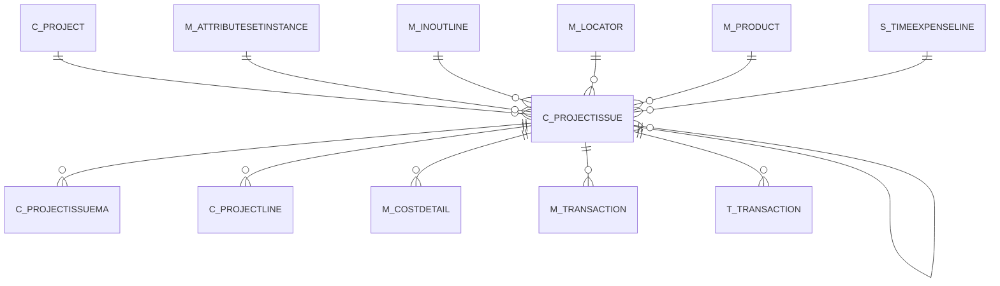

# C_PROJECTISSUE

Area [C](../../data-model/c/index.md) · class **business** (proposed) · read from database `idempiere-db` (owner `ADEMPIERE`) · 0 row(s) when profiled

Application model: `org.compiere.model.X_C_ProjectIssue`, access level 3 - Client - Org.

## Columns

| column | type | key | not null | business name | references (code) | nulls | distinct |
|---|---|---|---|---|---|---|---|
| `C_PROJECTISSUE_ID` | NUMBER(10,0) | PK | yes | Project Issue |  | 0 | 0 |
| `AD_CLIENT_ID` | NUMBER(10,0) |  | yes | Tenant |  | 0 | 0 |
| `AD_ORG_ID` | NUMBER(10,0) |  | yes | Organization |  | 0 | 0 |
| `ISACTIVE` | CHAR(1) |  | yes | Active |  | 0 | 0 |
| `CREATED` | DATE |  | yes | Created |  | 0 | 0 |
| `CREATEDBY` | NUMBER(10,0) |  | yes | Created By |  | 0 | 0 |
| `UPDATED` | DATE |  | yes | Updated |  | 0 | 0 |
| `UPDATEDBY` | NUMBER(10,0) |  | yes | Updated By |  | 0 | 0 |
| `C_PROJECT_ID` | NUMBER(10,0) |  | yes | Project | [C_PROJECT](../../data-model/c/c_project.md) | 0 | 0 |
| `LINE` | NUMBER(10,0) |  | yes | Line No |  | 0 | 0 |
| `M_PRODUCT_ID` | NUMBER(10,0) |  | yes | Product | [M_PRODUCT](../../data-model/m/m_product.md) | 0 | 0 |
| `M_ATTRIBUTESETINSTANCE_ID` | NUMBER(10,0) |  |  | Attribute Set Instance | [M_ATTRIBUTESETINSTANCE](../../data-model/m/m_attributesetinstance.md) | 0 | 0 |
| `M_LOCATOR_ID` | NUMBER(10,0) |  | yes | Locator | [M_LOCATOR](../../data-model/m/m_locator.md) | 0 | 0 |
| `MOVEMENTQTY` | NUMBER |  | yes | Movement Quantity |  | 0 | 0 |
| `DESCRIPTION` | VARCHAR2(255 CHAR) |  |  | Description |  | 0 | 0 |
| `PROCESSED` | CHAR(1) |  | yes | Processed |  | 0 | 0 |
| `POSTED` | CHAR(1) |  | yes | Posted |  | 0 | 0 |
| `MOVEMENTDATE` | DATE |  | yes | Movement Date |  | 0 | 0 |
| `S_TIMEEXPENSELINE_ID` | NUMBER(10,0) |  |  | Expense Line | [S_TIMEEXPENSELINE](../../data-model/s/s_timeexpenseline.md) | 0 | 0 |
| `M_INOUTLINE_ID` | NUMBER(10,0) |  |  | Shipment/Receipt Line | [M_INOUTLINE](../../data-model/m/m_inoutline.md) | 0 | 0 |
| `PROCESSING` | CHAR(1) |  |  | Process Now |  | 0 | 0 |
| `PROCESSEDON` | NUMBER |  |  | Processed On |  | 0 | 0 |
| `C_PROJECTISSUE_UU` | VARCHAR2(36 CHAR) |  |  | C_ProjectIssue_UU |  | 0 | 0 |
| `REVERSAL_ID` | NUMBER(10,0) |  |  | Reversal ID | [C_PROJECTISSUE](../../data-model/c/c_projectissue.md) | 0 | 0 |
| `ISAPPROVED` | CHAR(1) |  | yes | Approved |  | 0 | 0 |
| `DOCACTION` | CHAR(2) |  | yes | Document Action |  | 0 | 0 |
| `DOCSTATUS` | VARCHAR2(2 CHAR) |  | yes | Document Status |  | 0 | 0 |

*references (code)* is the table the application model's code says a column points to; *Foreign keys* below are the constraints the database declares. Counts come from the profile; no value is ever shown.

## Check constraints

| name | expression |
|---|---|
| `SYS_C0019641` | `IsActive in ('Y','N')` |
| `SYS_C0019642` | `IsApproved IN ('Y','N')` |

## Foreign keys

**References**

| table | columns | on delete |
|---|---|---|
| [C_PROJECT](../../data-model/c/c_project.md) | C_PROJECTISSUE.C_PROJECT_ID → C_PROJECT.C_PROJECT_ID | NO ACTION |
| [C_PROJECTISSUE](../../data-model/c/c_projectissue.md) | C_PROJECTISSUE.REVERSAL_ID → C_PROJECTISSUE.C_PROJECTISSUE_ID | NO ACTION |
| [M_ATTRIBUTESETINSTANCE](../../data-model/m/m_attributesetinstance.md) | C_PROJECTISSUE.M_ATTRIBUTESETINSTANCE_ID → M_ATTRIBUTESETINSTANCE.M_ATTRIBUTESETINSTANCE_ID | NO ACTION |
| [M_INOUTLINE](../../data-model/m/m_inoutline.md) | C_PROJECTISSUE.M_INOUTLINE_ID → M_INOUTLINE.M_INOUTLINE_ID | NO ACTION |
| [M_LOCATOR](../../data-model/m/m_locator.md) | C_PROJECTISSUE.M_LOCATOR_ID → M_LOCATOR.M_LOCATOR_ID | NO ACTION |
| [M_PRODUCT](../../data-model/m/m_product.md) | C_PROJECTISSUE.M_PRODUCT_ID → M_PRODUCT.M_PRODUCT_ID | NO ACTION |
| [S_TIMEEXPENSELINE](../../data-model/s/s_timeexpenseline.md) | C_PROJECTISSUE.S_TIMEEXPENSELINE_ID → S_TIMEEXPENSELINE.S_TIMEEXPENSELINE_ID | NO ACTION |

**Referenced by**

| table | columns | on delete |
|---|---|---|
| [C_PROJECTISSUE](../../data-model/c/c_projectissue.md) | C_PROJECTISSUE.REVERSAL_ID → C_PROJECTISSUE.C_PROJECTISSUE_ID | NO ACTION |
| [C_PROJECTISSUEMA](../../data-model/c/c_projectissuema.md) | C_PROJECTISSUEMA.C_PROJECTISSUE_ID → C_PROJECTISSUE.C_PROJECTISSUE_ID | NO ACTION |
| [C_PROJECTLINE](../../data-model/c/c_projectline.md) | C_PROJECTLINE.C_PROJECTISSUE_ID → C_PROJECTISSUE.C_PROJECTISSUE_ID | NO ACTION |
| [M_COSTDETAIL](../../data-model/m/m_costdetail.md) | M_COSTDETAIL.C_PROJECTISSUE_ID → C_PROJECTISSUE.C_PROJECTISSUE_ID | NO ACTION |
| [M_TRANSACTION](../../data-model/m/m_transaction.md) | M_TRANSACTION.C_PROJECTISSUE_ID → C_PROJECTISSUE.C_PROJECTISSUE_ID | NO ACTION |
| `T_TRANSACTION` | T_TRANSACTION.C_PROJECTISSUE_ID → C_PROJECTISSUE.C_PROJECTISSUE_ID | CASCADE |

## Write behaviour

- updates: **po_only**
- deletes: **deleted_by_users**
- change log: **recorded**
- evidence: 1 citation(s)

## Read by

| kind | name |
|---|---|
| View | `M_TRANSACTION_V` |
| View | `RV_PROJECTLINEISSUE` |
| View | `RV_TRANSACTION` |
| View | `RV_UNPOSTED` |
| View | `m_transaction_v` |
| View | `rv_projectlineissue` |
| View | `rv_transaction` |
| View | `rv_unposted` |

## Schema history

34 change(s); the latest:

| applied | release | operation | column | tickets |
|---|---|---|---|---|
| 2023-04-09T15:47 | iD11 | `add_constraint` |  | IDEMPIERE-5567 |
| 2023-04-09T15:47 | iD11 | `add_constraint` |  | IDEMPIERE-5567 |
| 2021-12-05T16:45 | i8.2z | `add_constraint` |  | IDEMPIERE-5075 |
| 2021-12-05T16:45 | i8.2z | `add_constraint` |  | IDEMPIERE-5075 |
| 2021-12-05T16:45 | i8.2z | `drop_constraint` |  | IDEMPIERE-5075 |
| 2021-12-05T16:45 | i8.2z | `add_constraint` |  | IDEMPIERE-5075 |
| 2021-12-05T16:45 | i8.2z | `add_constraint` |  | IDEMPIERE-5075 |
| 2021-12-05T16:45 | i8.2z | `add_constraint` |  | IDEMPIERE-5075 |
| 2021-12-05T16:45 | i8.2z | `add_constraint` |  | IDEMPIERE-5075 |
| 2021-12-05T16:45 | i8.2z | `drop_constraint` |  | IDEMPIERE-5075 |
| 2021-12-05T16:45 | i8.2z | `drop_constraint` |  | IDEMPIERE-5075 |
| 2021-12-05T16:45 | i8.2z | `drop_constraint` |  | IDEMPIERE-5075 |
| 2021-12-05T16:45 | i8.2z | `drop_constraint` |  | IDEMPIERE-5075 |
| 2021-12-05T16:45 | i8.2z | `drop_constraint` |  | IDEMPIERE-5075 |
| 2021-08-17T20:01 | i8.2z | `add_column` | DocStatus | IDEMPIERE-3494 |

## Open conflicts

| type | attribute | explanation |
|---|---|---|
| `mandatory_but_nullable` | `columns.M_AttributeSetInstance_ID.nullable` | unexplained |

## Notes

<!-- ekos:manual id="table.c_projectissue.notes" -->
_Business notes about this table._
<!-- /ekos:manual -->
