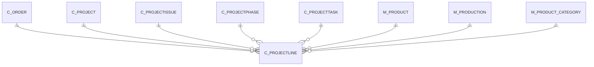

# C_PROJECTLINE

Area [C](../../data-model/c/index.md) · class **business** (proposed) · read from database `idempiere-db` (owner `ADEMPIERE`) · 1 row(s) when profiled

Application model: `org.compiere.model.X_C_ProjectLine`, access level 3 - Client - Org.

## Columns

| column | type | key | not null | business name | references (code) | nulls | distinct |
|---|---|---|---|---|---|---|---|
| `C_PROJECTLINE_ID` | NUMBER(10,0) | PK | yes | Project Line |  | 0 | 1 |
| `AD_CLIENT_ID` | NUMBER(10,0) |  | yes | Tenant |  | 0 | 1 |
| `AD_ORG_ID` | NUMBER(10,0) |  | yes | Organization |  | 0 | 1 |
| `ISACTIVE` | CHAR(1) |  | yes | Active |  | 0 | 1 |
| `CREATED` | DATE |  | yes | Created |  | 0 | 1 |
| `CREATEDBY` | NUMBER(10,0) |  | yes | Created By |  | 0 | 1 |
| `UPDATED` | DATE |  | yes | Updated |  | 0 | 1 |
| `UPDATEDBY` | NUMBER(10,0) |  | yes | Updated By |  | 0 | 1 |
| `C_PROJECT_ID` | NUMBER(10,0) |  | yes | Project | [C_PROJECT](../../data-model/c/c_project.md) | 0 | 1 |
| `LINE` | NUMBER(10,0) |  | yes | Line No |  | 0 | 1 |
| `DESCRIPTION` | VARCHAR2(255 CHAR) |  |  | Description |  | 1 | 0 |
| `PLANNEDQTY` | NUMBER |  | yes | Planned Quantity |  | 0 | 1 |
| `PLANNEDPRICE` | NUMBER |  | yes | Planned Price |  | 0 | 1 |
| `PLANNEDAMT` | NUMBER |  | yes | Planned Amount |  | 0 | 1 |
| `PLANNEDMARGINAMT` | NUMBER |  | yes | Planned Margin |  | 0 | 1 |
| `COMMITTEDAMT` | NUMBER |  |  | Committed Amount |  | 0 | 1 |
| `M_PRODUCT_ID` | NUMBER(10,0) |  |  | Product | [M_PRODUCT](../../data-model/m/m_product.md) | 0 | 1 |
| `M_PRODUCT_CATEGORY_ID` | NUMBER(10,0) |  |  | Product Category | [M_PRODUCT_CATEGORY](../../data-model/m/m_product_category.md) | 0 | 1 |
| `INVOICEDAMT` | NUMBER |  | yes | Invoiced Amount |  | 0 | 1 |
| `INVOICEDQTY` | NUMBER |  | yes | Quantity Invoiced |  | 0 | 1 |
| `COMMITTEDQTY` | NUMBER |  |  | Committed Quantity |  | 0 | 1 |
| `C_PROJECTISSUE_ID` | NUMBER(10,0) |  |  | Project Issue | [C_PROJECTISSUE](../../data-model/c/c_projectissue.md) | 1 | 0 |
| `C_ORDER_ID` | NUMBER(10,0) |  |  | Order | [C_ORDER](../../data-model/c/c_order.md) | 1 | 0 |
| `C_ORDERPO_ID` | NUMBER(10,0) |  |  | Purchase Order | [C_ORDER](../../data-model/c/c_order.md) | 1 | 0 |
| `ISPRINTED` | CHAR(1) |  | yes | Printed |  | 0 | 1 |
| `PROCESSED` | CHAR(1) |  | yes | Processed |  | 0 | 1 |
| `DOPRICING` | CHAR(1) |  |  | Pricing |  | 0 | 1 |
| `C_PROJECTPHASE_ID` | NUMBER(10,0) |  |  | Project Phase | [C_PROJECTPHASE](../../data-model/c/c_projectphase.md) | 1 | 0 |
| `C_PROJECTTASK_ID` | NUMBER(10,0) |  |  | Project Task | [C_PROJECTTASK](../../data-model/c/c_projecttask.md) | 1 | 0 |
| `C_PROJECTLINE_UU` | VARCHAR2(36 CHAR) |  |  | C_ProjectLine_UU |  | 0 | 1 |
| `M_PRODUCTION_ID` | NUMBER(10,0) |  |  | Production | [M_PRODUCTION](../../data-model/m/m_production.md) | 1 | 0 |

*references (code)* is the table the application model's code says a column points to; *Foreign keys* below are the constraints the database declares. Counts come from the profile; no value is ever shown.

## Check constraints

| name | expression |
|---|---|
| `SYS_C0020178` | `IsActive in ('Y','N')` |

## Foreign keys

**References**

| table | columns | on delete |
|---|---|---|
| [C_ORDER](../../data-model/c/c_order.md) | C_PROJECTLINE.C_ORDERPO_ID → C_ORDER.C_ORDER_ID | NO ACTION |
| [C_PROJECT](../../data-model/c/c_project.md) | C_PROJECTLINE.C_PROJECT_ID → C_PROJECT.C_PROJECT_ID | CASCADE |
| [C_PROJECTISSUE](../../data-model/c/c_projectissue.md) | C_PROJECTLINE.C_PROJECTISSUE_ID → C_PROJECTISSUE.C_PROJECTISSUE_ID | NO ACTION |
| [C_PROJECTPHASE](../../data-model/c/c_projectphase.md) | C_PROJECTLINE.C_PROJECTPHASE_ID → C_PROJECTPHASE.C_PROJECTPHASE_ID | SET NULL |
| [C_PROJECTTASK](../../data-model/c/c_projecttask.md) | C_PROJECTLINE.C_PROJECTTASK_ID → C_PROJECTTASK.C_PROJECTTASK_ID | SET NULL |
| [M_PRODUCT](../../data-model/m/m_product.md) | C_PROJECTLINE.M_PRODUCT_ID → M_PRODUCT.M_PRODUCT_ID | NO ACTION |
| [M_PRODUCTION](../../data-model/m/m_production.md) | C_PROJECTLINE.M_PRODUCTION_ID → M_PRODUCTION.M_PRODUCTION_ID | NO ACTION |
| [M_PRODUCT_CATEGORY](../../data-model/m/m_product_category.md) | C_PROJECTLINE.M_PRODUCT_CATEGORY_ID → M_PRODUCT_CATEGORY.M_PRODUCT_CATEGORY_ID | NO ACTION |

**Referenced by**

_None._

## Write behaviour

- updates: **po_only**
- deletes: **deleted_by_users, deleted_by_cascade**
- change log: **recorded**
- evidence: 2 citation(s)

## Read by

| kind | name |
|---|---|
| View | `C_PROJECT_DETAILS_V` |
| View | `C_PROJECT_DETAILS_VT` |
| View | `RV_PROJECTLINEISSUE` |
| View | `c_project_details_v` |
| View | `c_project_details_vt` |
| View | `rv_projectlineissue` |

## Schema history

28 change(s); the latest:

| applied | release | operation | column | tickets |
|---|---|---|---|---|
| 2023-04-09T15:47 | iD11 | `add_constraint` |  | IDEMPIERE-5567 |
| 2023-04-09T15:47 | iD11 | `add_constraint` |  | IDEMPIERE-5567 |
| 2021-12-05T16:45 | i8.2z | `drop_constraint` |  | IDEMPIERE-5075 |
| 2021-12-05T16:45 | i8.2z | `drop_constraint` |  | IDEMPIERE-5075 |
| 2021-12-05T16:45 | i8.2z | `drop_constraint` |  | IDEMPIERE-5075 |
| 2021-12-05T16:45 | i8.2z | `drop_constraint` |  | IDEMPIERE-5075 |
| 2021-12-05T16:45 | i8.2z | `add_constraint` |  | IDEMPIERE-5075 |
| 2021-12-05T16:45 | i8.2z | `add_constraint` |  | IDEMPIERE-5075 |
| 2021-12-05T16:45 | i8.2z | `add_constraint` |  | IDEMPIERE-5075 |
| 2021-12-05T16:45 | i8.2z | `drop_constraint` |  | IDEMPIERE-5075 |
| 2021-12-05T16:45 | i8.2z | `add_constraint` |  | IDEMPIERE-5075 |
| 2021-12-05T16:45 | i8.2z | `drop_constraint` |  | IDEMPIERE-5075 |
| 2021-12-05T16:45 | i8.2z | `add_constraint` |  | IDEMPIERE-5075 |
| 2021-12-05T16:45 | i8.2z | `drop_constraint` |  | IDEMPIERE-5075 |
| 2021-12-05T16:45 | i8.2z | `add_constraint` |  | IDEMPIERE-5075 |

## Notes

<!-- ekos:manual id="table.c_projectline.notes" -->
_Business notes about this table._
<!-- /ekos:manual -->
