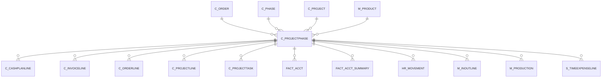

# C_PROJECTPHASE

Area [C](../../data-model/c/index.md) · class **business** (proposed) · read from database `idempiere-db` (owner `ADEMPIERE`) · 0 row(s) when profiled

Application model: `org.compiere.model.X_C_ProjectPhase`, access level 3 - Client - Org.

## Columns

| column | type | key | not null | business name | references (code) | nulls | distinct |
|---|---|---|---|---|---|---|---|
| `C_PROJECT_ID` | NUMBER(10,0) |  | yes | Project | [C_PROJECT](../../data-model/c/c_project.md) | 0 | 0 |
| `AD_CLIENT_ID` | NUMBER(10,0) |  | yes | Tenant |  | 0 | 0 |
| `AD_ORG_ID` | NUMBER(10,0) |  | yes | Organization |  | 0 | 0 |
| `ISACTIVE` | CHAR(1) |  | yes | Active |  | 0 | 0 |
| `CREATED` | DATE |  | yes | Created |  | 0 | 0 |
| `CREATEDBY` | NUMBER(10,0) |  | yes | Created By |  | 0 | 0 |
| `UPDATED` | DATE |  | yes | Updated |  | 0 | 0 |
| `UPDATEDBY` | NUMBER(10,0) |  | yes | Updated By |  | 0 | 0 |
| `DESCRIPTION` | VARCHAR2(255 CHAR) |  |  | Description |  | 0 | 0 |
| `STARTDATE` | DATE |  |  | Start Date |  | 0 | 0 |
| `ENDDATE` | DATE |  |  | End Date |  | 0 | 0 |
| `ISCOMPLETE` | CHAR(1) |  | yes | Complete |  | 0 | 0 |
| `M_PRODUCT_ID` | NUMBER(10,0) |  |  | Product | [M_PRODUCT](../../data-model/m/m_product.md) | 0 | 0 |
| `PRICEACTUAL` | NUMBER |  |  | Unit Price |  | 0 | 0 |
| `GENERATEORDER` | CHAR(1) |  |  | Generate Order |  | 0 | 0 |
| `C_ORDER_ID` | NUMBER(10,0) |  |  | Order | [C_ORDER](../../data-model/c/c_order.md) | 0 | 0 |
| `C_PHASE_ID` | NUMBER(10,0) |  |  | Standard Phase | [C_PHASE](../../data-model/c/c_phase.md) | 0 | 0 |
| `C_PROJECTPHASE_ID` | NUMBER(10,0) | PK | yes | Project Phase |  | 0 | 0 |
| `HELP` | VARCHAR2(2000 CHAR) |  |  | Comment/Help |  | 0 | 0 |
| `NAME` | VARCHAR2(60 CHAR) |  | yes | Name |  | 0 | 0 |
| `QTY` | NUMBER |  |  | Quantity |  | 0 | 0 |
| `SEQNO` | NUMBER(10,0) |  | yes | Sequence |  | 0 | 0 |
| `COMMITTEDAMT` | NUMBER |  | yes | Committed Amount |  | 0 | 0 |
| `ISCOMMITCEILING` | CHAR(1) |  | yes | Commitment is Ceiling |  | 0 | 0 |
| `PROJINVOICERULE` | CHAR(1) |  |  | Invoice Rule |  | 0 | 0 |
| `PLANNEDAMT` | NUMBER |  | yes | Planned Amount |  | 0 | 0 |
| `C_PROJECTPHASE_UU` | VARCHAR2(36 CHAR) |  |  | C_ProjectPhase_UU |  | 0 | 0 |

*references (code)* is the table the application model's code says a column points to; *Foreign keys* below are the constraints the database declares. Counts come from the profile; no value is ever shown.

## Foreign keys

**References**

| table | columns | on delete |
|---|---|---|
| [C_ORDER](../../data-model/c/c_order.md) | C_PROJECTPHASE.C_ORDER_ID → C_ORDER.C_ORDER_ID | NO ACTION |
| [C_PHASE](../../data-model/c/c_phase.md) | C_PROJECTPHASE.C_PHASE_ID → C_PHASE.C_PHASE_ID | NO ACTION |
| [C_PROJECT](../../data-model/c/c_project.md) | C_PROJECTPHASE.C_PROJECT_ID → C_PROJECT.C_PROJECT_ID | NO ACTION |
| [M_PRODUCT](../../data-model/m/m_product.md) | C_PROJECTPHASE.M_PRODUCT_ID → M_PRODUCT.M_PRODUCT_ID | NO ACTION |

**Referenced by**

| table | columns | on delete |
|---|---|---|
| [C_CASHPLANLINE](../../data-model/c/c_cashplanline.md) | C_CASHPLANLINE.C_PROJECTPHASE_ID → C_PROJECTPHASE.C_PROJECTPHASE_ID | NO ACTION |
| [C_INVOICELINE](../../data-model/c/c_invoiceline.md) | C_INVOICELINE.C_PROJECTPHASE_ID → C_PROJECTPHASE.C_PROJECTPHASE_ID | SET NULL |
| [C_ORDERLINE](../../data-model/c/c_orderline.md) | C_ORDERLINE.C_PROJECTPHASE_ID → C_PROJECTPHASE.C_PROJECTPHASE_ID | SET NULL |
| [C_PROJECTLINE](../../data-model/c/c_projectline.md) | C_PROJECTLINE.C_PROJECTPHASE_ID → C_PROJECTPHASE.C_PROJECTPHASE_ID | SET NULL |
| [C_PROJECTTASK](../../data-model/c/c_projecttask.md) | C_PROJECTTASK.C_PROJECTPHASE_ID → C_PROJECTPHASE.C_PROJECTPHASE_ID | CASCADE |
| [FACT_ACCT](../../data-model/fact/fact_acct.md) | FACT_ACCT.C_PROJECTPHASE_ID → C_PROJECTPHASE.C_PROJECTPHASE_ID | SET NULL |
| [FACT_ACCT_SUMMARY](../../data-model/fact/fact_acct_summary.md) | FACT_ACCT_SUMMARY.C_PROJECTPHASE_ID → C_PROJECTPHASE.C_PROJECTPHASE_ID | NO ACTION |
| [HR_MOVEMENT](../../data-model/hr/hr_movement.md) | HR_MOVEMENT.C_PROJECTPHASE_ID → C_PROJECTPHASE.C_PROJECTPHASE_ID | NO ACTION |
| [M_INOUTLINE](../../data-model/m/m_inoutline.md) | M_INOUTLINE.C_PROJECTPHASE_ID → C_PROJECTPHASE.C_PROJECTPHASE_ID | NO ACTION |
| [M_PRODUCTION](../../data-model/m/m_production.md) | M_PRODUCTION.C_PROJECTPHASE_ID → C_PROJECTPHASE.C_PROJECTPHASE_ID | NO ACTION |
| [S_TIMEEXPENSELINE](../../data-model/s/s_timeexpenseline.md) | S_TIMEEXPENSELINE.C_PROJECTPHASE_ID → C_PROJECTPHASE.C_PROJECTPHASE_ID | NO ACTION |

## Write behaviour

- updates: **raw_sql_skips_updated**
- deletes: **deleted_by_users**
- change log: **recorded**
- evidence: 2 citation(s)

## Schema history

24 change(s); the latest:

| applied | release | operation | column | tickets |
|---|---|---|---|---|
| 2023-04-09T15:47 | iD11 | `add_constraint` |  | IDEMPIERE-5567 |
| 2023-04-09T15:47 | iD11 | `add_constraint` |  | IDEMPIERE-5567 |
| 2021-12-05T16:45 | i8.2z | `add_constraint` |  | IDEMPIERE-5075 |
| 2021-12-05T16:45 | i8.2z | `drop_constraint` |  | IDEMPIERE-5075 |
| 2021-12-05T16:45 | i8.2z | `drop_constraint` |  | IDEMPIERE-5075 |
| 2021-12-05T16:45 | i8.2z | `drop_constraint` |  | IDEMPIERE-5075 |
| 2021-12-05T16:45 | i8.2z | `add_constraint` |  | IDEMPIERE-5075 |
| 2021-12-05T16:45 | i8.2z | `add_constraint` |  | IDEMPIERE-5075 |
| 2021-12-05T16:45 | i8.2z | `add_constraint` |  | IDEMPIERE-5075 |
| 2021-12-05T16:45 | i8.2z | `drop_constraint` |  | IDEMPIERE-5075 |
| 2020-08-04T01:00 | i7.1z | `drop_column` | tmp_col_4_tmp | IDEMPIERE-3862 |
| 2020-08-04T01:00 | i7.1z | `modify_column` | DESCRIPTION | IDEMPIERE-3862 |
| 2020-08-04T01:00 | i7.1z | `modify_column` | NAME | IDEMPIERE-3862 |
| 2020-08-04T01:00 | i7.1z | `drop_column` | tmp_col_3_tmp | IDEMPIERE-3862 |
| 2020-08-04T01:00 | i7.1z | `drop_column` | tmp_col_2_tmp | IDEMPIERE-3862 |

## Open conflicts

| type | attribute | explanation |
|---|---|---|
| `mandatory_but_nullable` | `columns.ProjInvoiceRule.nullable` | unexplained |

## Notes

<!-- ekos:manual id="table.c_projectphase.notes" -->
_Business notes about this table._
<!-- /ekos:manual -->
