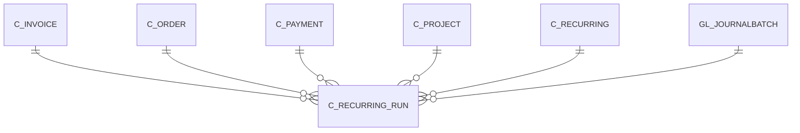

# C_RECURRING_RUN

Area [C](../../data-model/c/index.md) · class **business** (proposed) · read from database `idempiere-db` (owner `ADEMPIERE`) · 0 row(s) when profiled

Application model: `org.compiere.model.X_C_Recurring_Run`, access level 3 - Client - Org.

## Columns

| column | type | key | not null | business name | references (code) | nulls | distinct |
|---|---|---|---|---|---|---|---|
| `C_RECURRING_RUN_ID` | NUMBER(10,0) | PK | yes | Recurring Run |  | 0 | 0 |
| `AD_CLIENT_ID` | NUMBER(10,0) |  | yes | Tenant |  | 0 | 0 |
| `AD_ORG_ID` | NUMBER(10,0) |  | yes | Organization |  | 0 | 0 |
| `ISACTIVE` | CHAR(1) |  | yes | Active |  | 0 | 0 |
| `CREATED` | DATE |  | yes | Created |  | 0 | 0 |
| `CREATEDBY` | NUMBER(10,0) |  | yes | Created By |  | 0 | 0 |
| `UPDATED` | DATE |  | yes | Updated |  | 0 | 0 |
| `UPDATEDBY` | NUMBER(10,0) |  | yes | Updated By |  | 0 | 0 |
| `C_PAYMENT_ID` | NUMBER(10,0) |  |  | Payment | [C_PAYMENT](../../data-model/c/c_payment.md) | 0 | 0 |
| `C_ORDER_ID` | NUMBER(10,0) |  |  | Order | [C_ORDER](../../data-model/c/c_order.md) | 0 | 0 |
| `C_INVOICE_ID` | NUMBER(10,0) |  |  | Invoice | [C_INVOICE](../../data-model/c/c_invoice.md) | 0 | 0 |
| `C_PROJECT_ID` | NUMBER(10,0) |  |  | Project | [C_PROJECT](../../data-model/c/c_project.md) | 0 | 0 |
| `GL_JOURNALBATCH_ID` | NUMBER(10,0) |  |  | Journal Batch | [GL_JOURNALBATCH](../../data-model/gl/gl_journalbatch.md) | 0 | 0 |
| `C_RECURRING_ID` | NUMBER(10,0) |  | yes | Recurring | [C_RECURRING](../../data-model/c/c_recurring.md) | 0 | 0 |
| `DATEDOC` | DATE |  |  | Document Date |  | 0 | 0 |
| `C_RECURRING_RUN_UU` | VARCHAR2(36 CHAR) |  |  | C_Recurring_Run_UU |  | 0 | 0 |

*references (code)* is the table the application model's code says a column points to; *Foreign keys* below are the constraints the database declares. Counts come from the profile; no value is ever shown.

## Check constraints

| name | expression |
|---|---|
| `SYS_C0021322` | `IsActive in ('Y','N')` |

## Foreign keys

**References**

| table | columns | on delete |
|---|---|---|
| [C_INVOICE](../../data-model/c/c_invoice.md) | C_RECURRING_RUN.C_INVOICE_ID → C_INVOICE.C_INVOICE_ID | NO ACTION |
| [C_ORDER](../../data-model/c/c_order.md) | C_RECURRING_RUN.C_ORDER_ID → C_ORDER.C_ORDER_ID | NO ACTION |
| [C_PAYMENT](../../data-model/c/c_payment.md) | C_RECURRING_RUN.C_PAYMENT_ID → C_PAYMENT.C_PAYMENT_ID | NO ACTION |
| [C_PROJECT](../../data-model/c/c_project.md) | C_RECURRING_RUN.C_PROJECT_ID → C_PROJECT.C_PROJECT_ID | NO ACTION |
| [C_RECURRING](../../data-model/c/c_recurring.md) | C_RECURRING_RUN.C_RECURRING_ID → C_RECURRING.C_RECURRING_ID | NO ACTION |
| [GL_JOURNALBATCH](../../data-model/gl/gl_journalbatch.md) | C_RECURRING_RUN.GL_JOURNALBATCH_ID → GL_JOURNALBATCH.GL_JOURNALBATCH_ID | NO ACTION |

**Referenced by**

_None._

## Write behaviour

- updates: **po_only**
- deletes: **soft_delete_only**
- change log: **recorded**
- evidence: 1 citation(s)

## Schema history

47 change(s); the latest:

| applied | release | operation | column | tickets |
|---|---|---|---|---|
| 2025-06-20T09:17 | iD12 | `add_constraint` |  | IDEMPIERE-6591 |
| 2025-06-20T09:17 | iD12 | `drop_constraint` |  | IDEMPIERE-6591 |
| 2025-06-20T09:17 | iD12 | `modify_column` | C_Project_ID | IDEMPIERE-6591 |
| 2025-06-20T09:17 | iD12 | `modify_column` | C_Invoice_ID | IDEMPIERE-6591 |
| 2025-06-20T09:17 | iD12 | `modify_column` | C_Order_ID | IDEMPIERE-6591 |
| 2025-06-20T09:17 | iD12 | `modify_column` | C_Project_ID | IDEMPIERE-6591 |
| 2025-06-20T09:17 | iD12 | `modify_column` | C_Payment_ID | IDEMPIERE-6591 |
| 2025-06-20T09:17 | iD12 | `add_constraint` |  | IDEMPIERE-6591 |
| 2025-06-20T09:17 | iD12 | `drop_constraint` |  | IDEMPIERE-6591 |
| 2025-06-20T09:17 | iD12 | `modify_column` | GL_JournalBatch_ID | IDEMPIERE-6591 |
| 2025-06-20T09:17 | iD12 | `drop_constraint` |  | IDEMPIERE-6591 |
| 2025-06-20T09:17 | iD12 | `add_constraint` |  | IDEMPIERE-6591 |
| 2025-06-20T09:17 | iD12 | `drop_constraint` |  | IDEMPIERE-6591 |
| 2025-06-20T09:17 | iD12 | `add_constraint` |  | IDEMPIERE-6591 |
| 2025-06-20T09:17 | iD12 | `modify_column` | C_Payment_ID | IDEMPIERE-6591 |

## Notes

<!-- ekos:manual id="table.c_recurring_run.notes" -->
_Business notes about this table._
<!-- /ekos:manual -->
