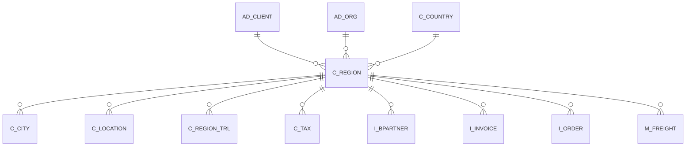

# C_REGION

Area [C](../../data-model/c/index.md) · class **business** (proposed) · read from database `idempiere-db` (owner `ADEMPIERE`) · 399 row(s) when profiled

Application model: `org.compiere.model.X_C_Region`, access level 6 - System - Client.

## Columns

| column | type | key | not null | business name | references (code) | nulls | distinct |
|---|---|---|---|---|---|---|---|
| `C_REGION_ID` | NUMBER(10,0) | PK | yes | Region |  | 0 | 399 |
| `AD_CLIENT_ID` | NUMBER(10,0) |  | yes | Tenant |  | 0 | 1 |
| `AD_ORG_ID` | NUMBER(10,0) |  | yes | Organization |  | 0 | 1 |
| `ISACTIVE` | CHAR(1) |  | yes | Active |  | 0 | 1 |
| `CREATED` | DATE |  | yes | Created |  | 0 | 336 |
| `CREATEDBY` | NUMBER(10,0) |  | yes | Created By |  | 0 | 2 |
| `UPDATED` | DATE |  | yes | Updated |  | 0 | 271 |
| `UPDATEDBY` | NUMBER(10,0) |  | yes | Updated By |  | 0 | 2 |
| `NAME` | VARCHAR2(60 CHAR) |  | yes | Name |  | 0 | 391 |
| `DESCRIPTION` | VARCHAR2(255 CHAR) |  |  | Description |  | 150 | 248 |
| `C_COUNTRY_ID` | NUMBER(10,0) |  | yes | Country | [C_COUNTRY](../../data-model/c/c_country.md) | 0 | 12 |
| `ISDEFAULT` | CHAR(1) |  |  | Default |  | 0 | 2 |
| `C_REGION_UU` | VARCHAR2(36 CHAR) |  |  | C_Region_UU |  | 0 | 399 |

*references (code)* is the table the application model's code says a column points to; *Foreign keys* below are the constraints the database declares. Counts come from the profile; no value is ever shown.

## Check constraints

| name | expression |
|---|---|
| `SYS_C0022674` | `IsDefault in ('Y','N')` |
| `SYS_C0022675` | `IsActive in ('Y','N')` |

## Foreign keys

**References**

| table | columns | on delete |
|---|---|---|
| [AD_CLIENT](../../data-model/ad/ad_client.md) | C_REGION.AD_CLIENT_ID → AD_CLIENT.AD_CLIENT_ID | NO ACTION |
| [AD_ORG](../../data-model/ad/ad_org.md) | C_REGION.AD_ORG_ID → AD_ORG.AD_ORG_ID | NO ACTION |
| [C_COUNTRY](../../data-model/c/c_country.md) | C_REGION.C_COUNTRY_ID → C_COUNTRY.C_COUNTRY_ID | NO ACTION |

**Referenced by**

| table | columns | on delete |
|---|---|---|
| [C_CITY](../../data-model/c/c_city.md) | C_CITY.C_REGION_ID → C_REGION.C_REGION_ID | NO ACTION |
| [C_LOCATION](../../data-model/c/c_location.md) | C_LOCATION.C_REGION_ID → C_REGION.C_REGION_ID | NO ACTION |
| [C_REGION_TRL](../../data-model/c/c_region_trl.md) | C_REGION_TRL.C_REGION_ID → C_REGION.C_REGION_ID | CASCADE |
| [C_TAX](../../data-model/c/c_tax.md) | C_TAX.TO_REGION_ID → C_REGION.C_REGION_ID | NO ACTION |
| `I_BPARTNER` | I_BPARTNER.C_REGION_ID → C_REGION.C_REGION_ID | SET NULL |
| `I_INVOICE` | I_INVOICE.C_REGION_ID → C_REGION.C_REGION_ID | SET NULL |
| `I_ORDER` | I_ORDER.C_REGION_ID → C_REGION.C_REGION_ID | SET NULL |
| [M_FREIGHT](../../data-model/m/m_freight.md) | M_FREIGHT.TO_REGION_ID → C_REGION.C_REGION_ID | NO ACTION |

## Write behaviour

- updates: **po_only**
- deletes: **deleted_by_users**
- change log: **recorded**
- evidence: 1 citation(s)

## Read by

| kind | name |
|---|---|
| View | `RV_BPARTNER` |
| View | `RV_T_1099EXTRACT` |
| View | `rv_bpartner` |
| View | `rv_t_1099extract` |

## Schema history

20 change(s); the latest:

| applied | release | operation | column | tickets |
|---|---|---|---|---|
| 2023-04-09T15:47 | iD11 | `add_constraint` |  | IDEMPIERE-5567 |
| 2023-04-09T15:47 | iD11 | `add_constraint` |  | IDEMPIERE-5567 |
| 2021-12-05T16:45 | i8.2z | `add_constraint` |  | IDEMPIERE-5075 |
| 2021-12-05T16:45 | i8.2z | `add_constraint` |  | IDEMPIERE-5075 |
| 2021-12-05T16:45 | i8.2z | `drop_constraint` |  | IDEMPIERE-5075 |
| 2021-12-05T16:45 | i8.2z | `drop_constraint` |  | IDEMPIERE-5075 |
| 2021-12-05T16:45 | i8.2z | `add_constraint` |  | IDEMPIERE-5075 |
| 2021-12-05T16:45 | i8.2z | `drop_constraint` |  | IDEMPIERE-5075 |
| 2020-08-04T01:00 | i7.1z | `modify_column` | C_REGION_UU | IDEMPIERE-3862 |
| 2020-08-04T01:00 | i7.1z | `create_index` |  | IDEMPIERE-3862 |
| 2020-08-04T01:00 | i7.1z | `modify_column` | NAME | IDEMPIERE-3862 |
| 2020-08-04T01:00 | i7.1z | `drop_column` | tmp_col_2_tmp | IDEMPIERE-3862 |
| 2020-08-04T01:00 | i7.1z | `modify_column` | NAME | IDEMPIERE-3862 |
| 2020-08-04T01:00 | i7.1z | `add_column` | tmp_col_1_tmp | IDEMPIERE-3862 |
| 2020-08-04T01:00 | i7.1z | `modify_column` | DESCRIPTION | IDEMPIERE-3862 |

## Notes

<!-- ekos:manual id="table.c_region.notes" -->
_Business notes about this table._
<!-- /ekos:manual -->
