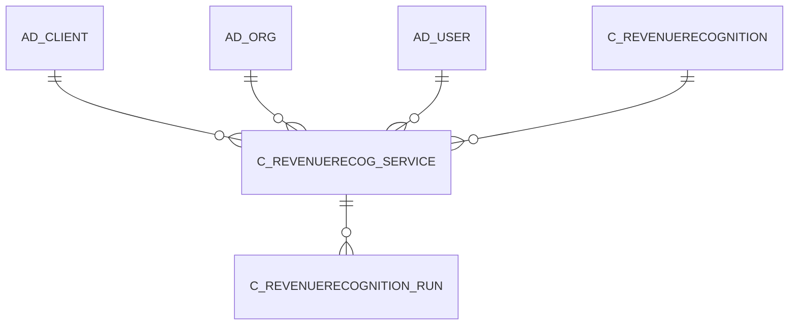

# C_REVENUERECOG_SERVICE

Area [C](../../data-model/c/index.md) · class **business** (proposed) · read from database `idempiere-db` (owner `ADEMPIERE`) · 0 row(s) when profiled

Application model: `org.compiere.model.X_C_RevenueRecog_Service`, access level 3 - Client - Org.

## Columns

| column | type | key | not null | business name | references (code) | nulls | distinct |
|---|---|---|---|---|---|---|---|
| `AD_CLIENT_ID` | NUMBER(10,0) |  | yes | Tenant |  | 0 | 0 |
| `AD_ORG_ID` | NUMBER(10,0) |  | yes | Organization |  | 0 | 0 |
| `CREATED` | DATE |  | yes | Created |  | 0 | 0 |
| `CREATEDBY` | NUMBER(10,0) |  | yes | Created By |  | 0 | 0 |
| `C_REVENUERECOGNITION_ID` | NUMBER(10,0) |  | yes | Revenue Recognition | [C_REVENUERECOGNITION](../../data-model/c/c_revenuerecognition.md) | 0 | 0 |
| `C_REVENUERECOG_SERVICE_ID` | NUMBER(10,0) | PK | yes | Revenue Recognition Service |  | 0 | 0 |
| `DESCRIPTION` | VARCHAR2(255 CHAR) |  |  | Description |  | 0 | 0 |
| `ISACTIVE` | CHAR(1) |  | yes | Active |  | 0 | 0 |
| `LINE` | NUMBER(10,0) |  |  | Line No |  | 0 | 0 |
| `PERCENT` | NUMBER |  |  | Percent |  | 0 | 0 |
| `UPDATED` | DATE |  | yes | Updated |  | 0 | 0 |
| `UPDATEDBY` | NUMBER(10,0) |  | yes | Updated By |  | 0 | 0 |
| `C_REVENUERECOG_SERVICE_UU` | VARCHAR2(36 CHAR) |  |  | C_RevenueRecog_Service_UU |  | 0 | 0 |

*references (code)* is the table the application model's code says a column points to; *Foreign keys* below are the constraints the database declares. Counts come from the profile; no value is ever shown.

## Check constraints

| name | expression |
|---|---|
| `SYS_C0020936` | `IsActive IN ('Y','N')` |

## Foreign keys

**References**

| table | columns | on delete |
|---|---|---|
| [AD_CLIENT](../../data-model/ad/ad_client.md) | C_REVENUERECOG_SERVICE.AD_CLIENT_ID → AD_CLIENT.AD_CLIENT_ID | NO ACTION |
| [AD_ORG](../../data-model/ad/ad_org.md) | C_REVENUERECOG_SERVICE.AD_ORG_ID → AD_ORG.AD_ORG_ID | NO ACTION |
| [AD_USER](../../data-model/ad/ad_user.md) | C_REVENUERECOG_SERVICE.CREATEDBY → AD_USER.AD_USER_ID | NO ACTION |
| [C_REVENUERECOGNITION](../../data-model/c/c_revenuerecognition.md) | C_REVENUERECOG_SERVICE.C_REVENUERECOGNITION_ID → C_REVENUERECOGNITION.C_REVENUERECOGNITION_ID | NO ACTION |

**Referenced by**

| table | columns | on delete |
|---|---|---|
| [C_REVENUERECOGNITION_RUN](../../data-model/c/c_revenuerecognition_run.md) | C_REVENUERECOGNITION_RUN.C_REVENUERECOG_SERVICE_ID → C_REVENUERECOG_SERVICE.C_REVENUERECOG_SERVICE_ID | NO ACTION |

## Write behaviour

- updates: **po_only**
- deletes: **deleted_by_users**
- change log: **recorded**
- evidence: 1 citation(s)

## Schema history

18 change(s); the latest:

| applied | release | operation | column | tickets |
|---|---|---|---|---|
| 2020-08-04T01:00 | i7.1z | `modify_column` | C_REVENUERECOG_SERVICE_UU | IDEMPIERE-3862 |
| 2020-08-04T01:00 | i7.1z | `modify_column` | DESCRIPTION | IDEMPIERE-3862 |
| 2018-11-27T19:28 | i6.1 | `add_constraint` |  |  |
| 2018-11-27T19:28 | i6.1 | `add_constraint` |  |  |
| 2018-11-27T19:28 | i6.1 | `add_constraint` |  |  |
| 2018-11-27T19:28 | i6.1 | `add_constraint` |  |  |
| 2018-11-27T19:28 | i6.1 | `create_table` |  |  |
| 2018-11-27T19:28 | i6.1 | `add_constraint` |  |  |
| 2018-11-27T19:28 | i6.1 | `add_constraint` |  |  |
| 2018-11-27T19:28 | i6.1 | `add_column` | C_RevenueRecog_Service_UU |  |
| 2018-11-27T19:28 | i6.1 | `add_constraint` |  |  |
| 2018-11-27T19:28 | i6.1 | `add_constraint` |  |  |
| 2018-11-27T19:28 | i6.1 | `create_table` |  |  |
| 2018-11-27T19:28 | i6.1 | `add_constraint` |  |  |
| 2018-11-27T19:28 | i6.1 | `add_constraint` |  |  |

## Notes

<!-- ekos:manual id="table.c_revenuerecog_service.notes" -->
_Business notes about this table._
<!-- /ekos:manual -->
