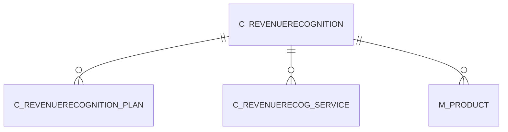

# C_REVENUERECOGNITION

Area [C](../../data-model/c/index.md) · class **business** (proposed) · read from database `idempiere-db` (owner `ADEMPIERE`) · 2 row(s) when profiled

Application model: `org.compiere.model.X_C_RevenueRecognition`, access level 3 - Client - Org.

## Columns

| column | type | key | not null | business name | references (code) | nulls | distinct |
|---|---|---|---|---|---|---|---|
| `C_REVENUERECOGNITION_ID` | NUMBER(10,0) | PK | yes | Revenue Recognition |  | 0 | 2 |
| `AD_CLIENT_ID` | NUMBER(10,0) |  | yes | Tenant |  | 0 | 1 |
| `AD_ORG_ID` | NUMBER(10,0) |  | yes | Organization |  | 0 | 1 |
| `ISACTIVE` | CHAR(1) |  | yes | Active |  | 0 | 1 |
| `CREATED` | DATE |  | yes | Created |  | 0 | 2 |
| `CREATEDBY` | NUMBER(10,0) |  | yes | Created By |  | 0 | 1 |
| `UPDATED` | DATE |  | yes | Updated |  | 0 | 2 |
| `UPDATEDBY` | NUMBER(10,0) |  | yes | Updated By |  | 0 | 1 |
| `NAME` | VARCHAR2(60 CHAR) |  | yes | Name |  | 0 | 2 |
| `DESCRIPTION` | VARCHAR2(255 CHAR) |  |  | Description |  | 0 | 2 |
| `ISTIMEBASED` | CHAR(1) |  | yes | Time based |  | 0 | 2 |
| `RECOGNITIONFREQUENCY` | CHAR(1) |  |  | Recognition frequency |  | 1 | 1 |
| `NOMONTHS` | NUMBER(10,0) |  |  | Number of Months |  | 0 | 2 |
| `C_REVENUERECOGNITION_UU` | VARCHAR2(36 CHAR) |  |  | C_RevenueRecognition_UU |  | 0 | 2 |
| `FIXEDRECOGDAY` | NUMBER(10,0) |  |  | Fixed recognition day |  | 2 | 0 |

*references (code)* is the table the application model's code says a column points to; *Foreign keys* below are the constraints the database declares. Counts come from the profile; no value is ever shown.

## Check constraints

| name | expression |
|---|---|
| `SYS_C0020567` | `IsActive in ('Y','N')` |

## Foreign keys

**References**

_None._

**Referenced by**

| table | columns | on delete |
|---|---|---|
| [C_REVENUERECOGNITION_PLAN](../../data-model/c/c_revenuerecognition_plan.md) | C_REVENUERECOGNITION_PLAN.C_REVENUERECOGNITION_ID → C_REVENUERECOGNITION.C_REVENUERECOGNITION_ID | NO ACTION |
| [C_REVENUERECOG_SERVICE](../../data-model/c/c_revenuerecog_service.md) | C_REVENUERECOG_SERVICE.C_REVENUERECOGNITION_ID → C_REVENUERECOGNITION.C_REVENUERECOGNITION_ID | NO ACTION |
| [M_PRODUCT](../../data-model/m/m_product.md) | M_PRODUCT.C_REVENUERECOGNITION_ID → C_REVENUERECOGNITION.C_REVENUERECOGNITION_ID | NO ACTION |

## Write behaviour

- updates: **po_only**
- deletes: **deleted_by_users**
- change log: **recorded**
- evidence: 1 citation(s)

## Schema history

15 change(s); the latest:

| applied | release | operation | column | tickets |
|---|---|---|---|---|
| 2023-04-09T15:47 | iD11 | `add_constraint` |  | IDEMPIERE-5567 |
| 2023-04-09T15:47 | iD11 | `add_constraint` |  | IDEMPIERE-5567 |
| 2020-08-04T01:00 | i7.1z | `modify_column` | DESCRIPTION | IDEMPIERE-3862 |
| 2020-08-04T01:00 | i7.1z | `add_column` | tmp_col_2_tmp | IDEMPIERE-3862 |
| 2020-08-04T01:00 | i7.1z | `modify_column` | NAME | IDEMPIERE-3862 |
| 2020-08-04T01:00 | i7.1z | `drop_column` | tmp_col_3_tmp | IDEMPIERE-3862 |
| 2020-08-04T01:00 | i7.1z | `drop_column` | tmp_col_2_tmp | IDEMPIERE-3862 |
| 2020-08-04T01:00 | i7.1z | `add_column` | tmp_col_3_tmp | IDEMPIERE-3862 |
| 2020-08-04T01:00 | i7.1z | `drop_column` | tmp_col_1_tmp | IDEMPIERE-3862 |
| 2020-08-04T01:00 | i7.1z | `modify_column` | NAME | IDEMPIERE-3862 |
| 2020-08-04T01:00 | i7.1z | `modify_column` | NAME | IDEMPIERE-3862 |
| 2020-08-04T01:00 | i7.1z | `add_column` | tmp_col_1_tmp | IDEMPIERE-3862 |
| 2020-08-04T01:00 | i7.1z | `modify_column` | C_REVENUERECOGNITION_UU | IDEMPIERE-3862 |
| 2018-11-27T19:28 | i6.1 | `add_column` | FixedRecogDay |  |
| 2018-11-27T19:28 | i6.1 | `add_column` | FixedRecogDay |  |

## Open conflicts

| type | attribute | explanation |
|---|---|---|
| `mandatory_but_nullable` | `columns.RecognitionFrequency.nullable` | unexplained |

## Notes

<!-- ekos:manual id="table.c_revenuerecognition.notes" -->
_Business notes about this table._
<!-- /ekos:manual -->
