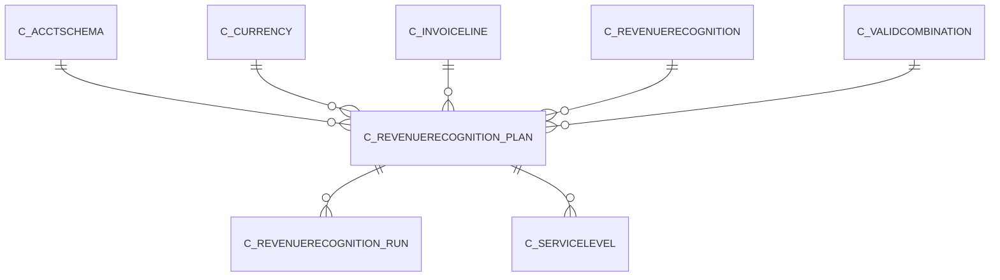

# C_REVENUERECOGNITION_PLAN

Based on on Plan, the GL Journals are generated

Area [C](../../data-model/c/index.md) · class **business** (proposed) · read from database `idempiere-db` (owner `ADEMPIERE`) · 0 row(s) when profiled

Application model: `org.compiere.model.X_C_RevenueRecognition_Plan`, access level 1 - Org.

## Columns

| column | type | key | not null | business name | references (code) | nulls | distinct |
|---|---|---|---|---|---|---|---|
| `C_REVENUERECOGNITION_PLAN_ID` | NUMBER(10,0) | PK | yes | Revenue Recognition Plan |  | 0 | 0 |
| `AD_CLIENT_ID` | NUMBER(10,0) |  | yes | Tenant |  | 0 | 0 |
| `AD_ORG_ID` | NUMBER(10,0) |  | yes | Organization |  | 0 | 0 |
| `ISACTIVE` | CHAR(1) |  | yes | Active |  | 0 | 0 |
| `CREATED` | DATE |  | yes | Created |  | 0 | 0 |
| `CREATEDBY` | NUMBER(10,0) |  | yes | Created By |  | 0 | 0 |
| `UPDATED` | DATE |  | yes | Updated |  | 0 | 0 |
| `UPDATEDBY` | NUMBER(10,0) |  | yes | Updated By |  | 0 | 0 |
| `C_ACCTSCHEMA_ID` | NUMBER(10,0) |  | yes | Accounting Schema | [C_ACCTSCHEMA](../../data-model/c/c_acctschema.md) | 0 | 0 |
| `C_REVENUERECOGNITION_ID` | NUMBER(10,0) |  | yes | Revenue Recognition | [C_REVENUERECOGNITION](../../data-model/c/c_revenuerecognition.md) | 0 | 0 |
| `C_INVOICELINE_ID` | NUMBER(10,0) |  | yes | Invoice Line | [C_INVOICELINE](../../data-model/c/c_invoiceline.md) | 0 | 0 |
| `UNEARNEDREVENUE_ACCT` | NUMBER(10,0) |  | yes | Unearned Revenue |  | 0 | 0 |
| `P_REVENUE_ACCT` | NUMBER(10,0) |  | yes | Product Revenue |  | 0 | 0 |
| `C_CURRENCY_ID` | NUMBER(10,0) |  | yes | Currency | [C_CURRENCY](../../data-model/c/c_currency.md) | 0 | 0 |
| `TOTALAMT` | NUMBER |  | yes | Total Amount |  | 0 | 0 |
| `RECOGNIZEDAMT` | NUMBER |  | yes | Recognized Amount |  | 0 | 0 |
| `C_REVENUERECOGNITION_PLAN_UU` | VARCHAR2(36 CHAR) |  |  | C_RevenueRecognition_Plan_UU |  | 0 | 0 |

*references (code)* is the table the application model's code says a column points to; *Foreign keys* below are the constraints the database declares. Counts come from the profile; no value is ever shown.

## Check constraints

| name | expression |
|---|---|
| `SYS_C0022257` | `IsActive in ('Y','N')` |

## Foreign keys

**References**

| table | columns | on delete |
|---|---|---|
| [C_ACCTSCHEMA](../../data-model/c/c_acctschema.md) | C_REVENUERECOGNITION_PLAN.C_ACCTSCHEMA_ID → C_ACCTSCHEMA.C_ACCTSCHEMA_ID | NO ACTION |
| [C_CURRENCY](../../data-model/c/c_currency.md) | C_REVENUERECOGNITION_PLAN.C_CURRENCY_ID → C_CURRENCY.C_CURRENCY_ID | NO ACTION |
| [C_INVOICELINE](../../data-model/c/c_invoiceline.md) | C_REVENUERECOGNITION_PLAN.C_INVOICELINE_ID → C_INVOICELINE.C_INVOICELINE_ID | NO ACTION |
| [C_REVENUERECOGNITION](../../data-model/c/c_revenuerecognition.md) | C_REVENUERECOGNITION_PLAN.C_REVENUERECOGNITION_ID → C_REVENUERECOGNITION.C_REVENUERECOGNITION_ID | NO ACTION |
| [C_VALIDCOMBINATION](../../data-model/c/c_validcombination.md) | C_REVENUERECOGNITION_PLAN.P_REVENUE_ACCT → C_VALIDCOMBINATION.C_VALIDCOMBINATION_ID | NO ACTION |

**Referenced by**

| table | columns | on delete |
|---|---|---|
| [C_REVENUERECOGNITION_RUN](../../data-model/c/c_revenuerecognition_run.md) | C_REVENUERECOGNITION_RUN.C_REVENUERECOGNITION_PLAN_ID → C_REVENUERECOGNITION_PLAN.C_REVENUERECOGNITION_PLAN_ID | NO ACTION |
| [C_SERVICELEVEL](../../data-model/c/c_servicelevel.md) | C_SERVICELEVEL.C_REVENUERECOGNITION_PLAN_ID → C_REVENUERECOGNITION_PLAN.C_REVENUERECOGNITION_PLAN_ID | NO ACTION |

## Write behaviour

- updates: **po_only**
- deletes: **deleted_by_users**
- change log: **recorded**
- evidence: 1 citation(s)

## Schema history

17 change(s); the latest:

| applied | release | operation | column | tickets |
|---|---|---|---|---|
| 2023-04-09T15:47 | iD11 | `add_constraint` |  | IDEMPIERE-5567 |
| 2023-04-09T15:47 | iD11 | `add_constraint` |  | IDEMPIERE-5567 |
| 2021-12-05T16:45 | i8.2z | `add_constraint` |  | IDEMPIERE-5075 |
| 2021-12-05T16:45 | i8.2z | `add_constraint` |  | IDEMPIERE-5075 |
| 2021-12-05T16:45 | i8.2z | `add_constraint` |  | IDEMPIERE-5075 |
| 2021-12-05T16:45 | i8.2z | `drop_constraint` |  | IDEMPIERE-5075 |
| 2021-12-05T16:45 | i8.2z | `drop_constraint` |  | IDEMPIERE-5075 |
| 2021-12-05T16:45 | i8.2z | `drop_constraint` |  | IDEMPIERE-5075 |
| 2021-12-05T16:45 | i8.2z | `drop_constraint` |  | IDEMPIERE-5075 |
| 2021-12-05T16:45 | i8.2z | `add_constraint` |  | IDEMPIERE-5075 |
| 2021-12-05T16:45 | i8.2z | `add_constraint` |  | IDEMPIERE-5075 |
| 2021-12-05T16:45 | i8.2z | `add_constraint` |  | IDEMPIERE-5075 |
| 2021-12-05T16:45 | i8.2z | `drop_constraint` |  | IDEMPIERE-5075 |
| 2021-12-05T16:45 | i8.2z | `drop_constraint` |  | IDEMPIERE-5075 |
| 2020-08-04T01:00 | i7.1z | `modify_column` | C_REVENUERECOGNITION_PLAN_UU | IDEMPIERE-3862 |

## Notes

<!-- ekos:manual id="table.c_revenuerecognition_plan.notes" -->
_Business notes about this table._
<!-- /ekos:manual -->
