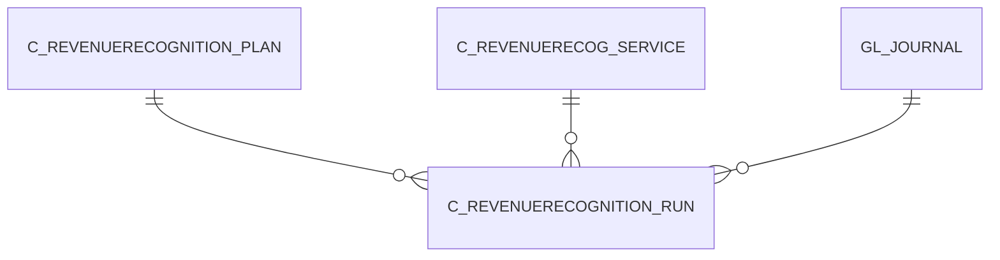

# C_REVENUERECOGNITION_RUN

Area [C](../../data-model/c/index.md) · class **business** (proposed) · read from database `idempiere-db` (owner `ADEMPIERE`) · 0 row(s) when profiled

Application model: `org.compiere.model.X_C_RevenueRecognition_Run`, access level 1 - Org.

## Columns

| column | type | key | not null | business name | references (code) | nulls | distinct |
|---|---|---|---|---|---|---|---|
| `C_REVENUERECOGNITION_RUN_ID` | NUMBER(10,0) | PK | yes | Revenue Recognition Run |  | 0 | 0 |
| `AD_CLIENT_ID` | NUMBER(10,0) |  | yes | Tenant |  | 0 | 0 |
| `AD_ORG_ID` | NUMBER(10,0) |  | yes | Organization |  | 0 | 0 |
| `ISACTIVE` | CHAR(1) |  | yes | Active |  | 0 | 0 |
| `CREATED` | DATE |  | yes | Created |  | 0 | 0 |
| `CREATEDBY` | NUMBER(10,0) |  | yes | Created By |  | 0 | 0 |
| `UPDATED` | DATE |  | yes | Updated |  | 0 | 0 |
| `UPDATEDBY` | NUMBER(10,0) |  | yes | Updated By |  | 0 | 0 |
| `C_REVENUERECOGNITION_PLAN_ID` | NUMBER(10,0) |  | yes | Revenue Recognition Plan | [C_REVENUERECOGNITION_PLAN](../../data-model/c/c_revenuerecognition_plan.md) | 0 | 0 |
| `GL_JOURNAL_ID` | NUMBER(10,0) |  |  | Journal | [GL_JOURNAL](../../data-model/gl/gl_journal.md) | 0 | 0 |
| `RECOGNIZEDAMT` | NUMBER |  | yes | Recognized Amount |  | 0 | 0 |
| `C_REVENUERECOGNITION_RUN_UU` | VARCHAR2(36 CHAR) |  |  | C_RevenueRecognition_Run_UU |  | 0 | 0 |
| `DATERECOGNIZED` | DATE |  |  | Recognition Date |  | 0 | 0 |
| `C_REVENUERECOG_SERVICE_ID` | NUMBER(10,0) |  |  | Revenue Recognition Service | [C_REVENUERECOG_SERVICE](../../data-model/c/c_revenuerecog_service.md) | 0 | 0 |

*references (code)* is the table the application model's code says a column points to; *Foreign keys* below are the constraints the database declares. Counts come from the profile; no value is ever shown.

## Check constraints

| name | expression |
|---|---|
| `SYS_C0020572` | `IsActive in ('Y','N')` |

## Foreign keys

**References**

| table | columns | on delete |
|---|---|---|
| [C_REVENUERECOGNITION_PLAN](../../data-model/c/c_revenuerecognition_plan.md) | C_REVENUERECOGNITION_RUN.C_REVENUERECOGNITION_PLAN_ID → C_REVENUERECOGNITION_PLAN.C_REVENUERECOGNITION_PLAN_ID | NO ACTION |
| [C_REVENUERECOG_SERVICE](../../data-model/c/c_revenuerecog_service.md) | C_REVENUERECOGNITION_RUN.C_REVENUERECOG_SERVICE_ID → C_REVENUERECOG_SERVICE.C_REVENUERECOG_SERVICE_ID | NO ACTION |
| [GL_JOURNAL](../../data-model/gl/gl_journal.md) | C_REVENUERECOGNITION_RUN.GL_JOURNAL_ID → GL_JOURNAL.GL_JOURNAL_ID | NO ACTION |

**Referenced by**

_None._

## Write behaviour

- updates: **po_only**
- deletes: **deleted_by_users**
- change log: **recorded**
- evidence: 1 citation(s)

## Schema history

21 change(s); the latest:

| applied | release | operation | column | tickets |
|---|---|---|---|---|
| 2023-04-09T15:47 | iD11 | `add_constraint` |  | IDEMPIERE-5567 |
| 2023-04-09T15:47 | iD11 | `add_constraint` |  | IDEMPIERE-5567 |
| 2021-12-05T16:45 | i8.2z | `add_constraint` |  | IDEMPIERE-5075 |
| 2021-12-05T16:45 | i8.2z | `drop_constraint` |  | IDEMPIERE-5075 |
| 2021-12-05T16:45 | i8.2z | `drop_constraint` |  | IDEMPIERE-5075 |
| 2021-12-05T16:45 | i8.2z | `add_constraint` |  | IDEMPIERE-5075 |
| 2020-08-04T01:00 | i7.1z | `add_column` | tmp_col_1_tmp | IDEMPIERE-3862 |
| 2020-08-04T01:00 | i7.1z | `drop_column` | tmp_col_1_tmp | IDEMPIERE-3862 |
| 2020-08-04T01:00 | i7.1z | `modify_column` | C_REVENUERECOGNITION_RUN_UU | IDEMPIERE-3862 |
| 2018-11-27T19:28 | i6.1 | `modify_column` | GL_Journal_ID |  |
| 2018-11-27T19:28 | i6.1 | `modify_column` | GL_Journal_ID |  |
| 2018-11-27T19:28 | i6.1 | `modify_column` | GL_Journal_ID |  |
| 2018-11-27T19:28 | i6.1 | `modify_column` | GL_Journal_ID |  |
| 2018-11-27T19:28 | i6.1 | `add_column` | C_RevenueRecog_Service_ID |  |
| 2018-11-27T19:28 | i6.1 | `add_column` | C_RevenueRecog_Service_ID |  |

## Notes

<!-- ekos:manual id="table.c_revenuerecognition_run.notes" -->
_Business notes about this table._
<!-- /ekos:manual -->
