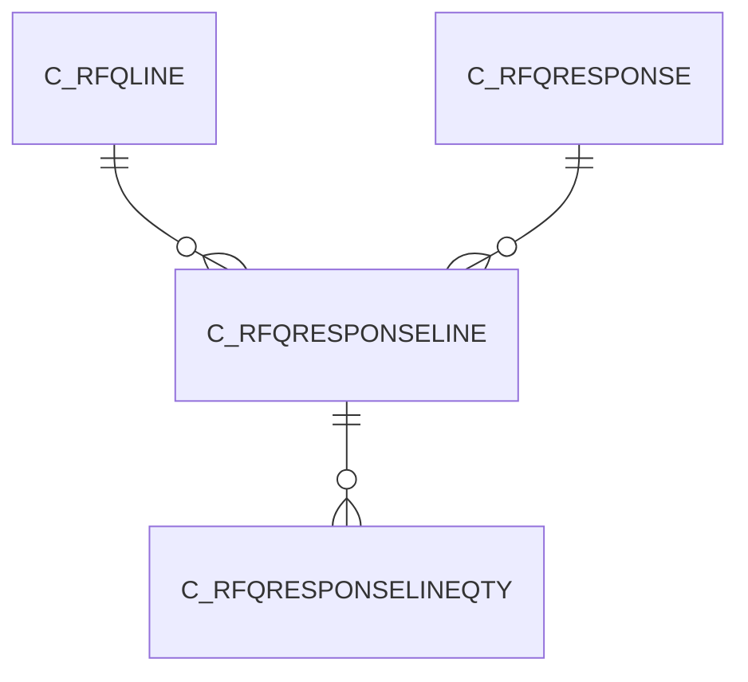

# C_RFQRESPONSELINE

Area [C](../../data-model/c/index.md) · class **business** (proposed) · read from database `idempiere-db` (owner `ADEMPIERE`) · 0 row(s) when profiled

Application model: `org.compiere.model.X_C_RfQResponseLine`, access level 1 - Org.

## Columns

| column | type | key | not null | business name | references (code) | nulls | distinct |
|---|---|---|---|---|---|---|---|
| `C_RFQRESPONSELINE_ID` | NUMBER(10,0) | PK | yes | RfQ Response Line |  | 0 | 0 |
| `AD_CLIENT_ID` | NUMBER(10,0) |  | yes | Tenant |  | 0 | 0 |
| `AD_ORG_ID` | NUMBER(10,0) |  | yes | Organization |  | 0 | 0 |
| `ISACTIVE` | CHAR(1) |  | yes | Active |  | 0 | 0 |
| `CREATED` | DATE |  | yes | Created |  | 0 | 0 |
| `CREATEDBY` | NUMBER(10,0) |  | yes | Created By |  | 0 | 0 |
| `UPDATED` | DATE |  | yes | Updated |  | 0 | 0 |
| `UPDATEDBY` | NUMBER(10,0) |  | yes | Updated By |  | 0 | 0 |
| `C_RFQLINE_ID` | NUMBER(10,0) |  | yes | RfQ Line | [C_RFQLINE](../../data-model/c/c_rfqline.md) | 0 | 0 |
| `C_RFQRESPONSE_ID` | NUMBER(10,0) |  | yes | RfQ Response | [C_RFQRESPONSE](../../data-model/c/c_rfqresponse.md) | 0 | 0 |
| `ISSELFSERVICE` | CHAR(1) |  | yes | Self-Service |  | 0 | 0 |
| `ISSELECTEDWINNER` | CHAR(1) |  | yes | Selected Winner |  | 0 | 0 |
| `DESCRIPTION` | VARCHAR2(255 CHAR) |  |  | Description |  | 0 | 0 |
| `HELP` | VARCHAR2(2000 CHAR) |  |  | Comment/Help |  | 0 | 0 |
| `DATEWORKSTART` | DATE |  |  | Work Start |  | 0 | 0 |
| `DELIVERYDAYS` | NUMBER(10,0) |  |  | Delivery Days |  | 0 | 0 |
| `DATEWORKCOMPLETE` | DATE |  |  | Work Complete |  | 0 | 0 |
| `C_RFQRESPONSELINE_UU` | VARCHAR2(36 CHAR) |  |  | C_RfQResponseLine_UU |  | 0 | 0 |

*references (code)* is the table the application model's code says a column points to; *Foreign keys* below are the constraints the database declares. Counts come from the profile; no value is ever shown.

## Check constraints

| name | expression |
|---|---|
| `SYS_C0020869` | `IsSelectedWinner in ('Y','N')` |
| `SYS_C0020871` | `IsActive in ('Y','N')` |
| `SYS_C0020872` | `IsSelfService in ('Y','N')` |

## Foreign keys

**References**

| table | columns | on delete |
|---|---|---|
| [C_RFQLINE](../../data-model/c/c_rfqline.md) | C_RFQRESPONSELINE.C_RFQLINE_ID → C_RFQLINE.C_RFQLINE_ID | CASCADE |
| [C_RFQRESPONSE](../../data-model/c/c_rfqresponse.md) | C_RFQRESPONSELINE.C_RFQRESPONSE_ID → C_RFQRESPONSE.C_RFQRESPONSE_ID | CASCADE |

**Referenced by**

| table | columns | on delete |
|---|---|---|
| [C_RFQRESPONSELINEQTY](../../data-model/c/c_rfqresponselineqty.md) | C_RFQRESPONSELINEQTY.C_RFQRESPONSELINE_ID → C_RFQRESPONSELINE.C_RFQRESPONSELINE_ID | CASCADE |

## Write behaviour

- updates: **po_only**
- deletes: **deleted_by_users, deleted_by_cascade**
- change log: **recorded**
- evidence: 3 citation(s)

## Read by

| kind | name |
|---|---|
| View | `C_RFQRESPONSELINE_V` |
| View | `C_RFQRESPONSELINE_VT` |
| View | `RV_C_RFQRESPONSE` |
| View | `c_rfqresponseline_v` |
| View | `c_rfqresponseline_vt` |
| View | `rv_c_rfqresponse` |

## Schema history

15 change(s); the latest:

| applied | release | operation | column | tickets |
|---|---|---|---|---|
| 2023-04-09T15:47 | iD11 | `add_constraint` |  | IDEMPIERE-5567 |
| 2023-04-09T15:47 | iD11 | `add_constraint` |  | IDEMPIERE-5567 |
| 2021-12-05T16:45 | i8.2z | `drop_constraint` |  | IDEMPIERE-5075 |
| 2021-12-05T16:45 | i8.2z | `add_constraint` |  | IDEMPIERE-5075 |
| 2021-12-05T16:45 | i8.2z | `add_constraint` |  | IDEMPIERE-5075 |
| 2021-12-05T16:45 | i8.2z | `drop_constraint` |  | IDEMPIERE-5075 |
| 2020-08-04T01:00 | i7.1z | `add_column` | tmp_col_2_tmp | IDEMPIERE-3862 |
| 2020-08-04T01:00 | i7.1z | `drop_column` | tmp_col_2_tmp | IDEMPIERE-3862 |
| 2020-08-04T01:00 | i7.1z | `modify_column` | DESCRIPTION | IDEMPIERE-3862 |
| 2020-08-04T01:00 | i7.1z | `add_column` | tmp_col_3_tmp | IDEMPIERE-3862 |
| 2020-08-04T01:00 | i7.1z | `add_column` | tmp_col_1_tmp | IDEMPIERE-3862 |
| 2020-08-04T01:00 | i7.1z | `modify_column` | C_RFQRESPONSELINE_UU | IDEMPIERE-3862 |
| 2020-08-04T01:00 | i7.1z | `drop_column` | tmp_col_1_tmp | IDEMPIERE-3862 |
| 2020-08-04T01:00 | i7.1z | `drop_column` | tmp_col_3_tmp | IDEMPIERE-3862 |
| 2020-08-04T01:00 | i7.1z | `modify_column` | HELP | IDEMPIERE-3862 |

## Notes

<!-- ekos:manual id="table.c_rfqresponseline.notes" -->
_Business notes about this table._
<!-- /ekos:manual -->
