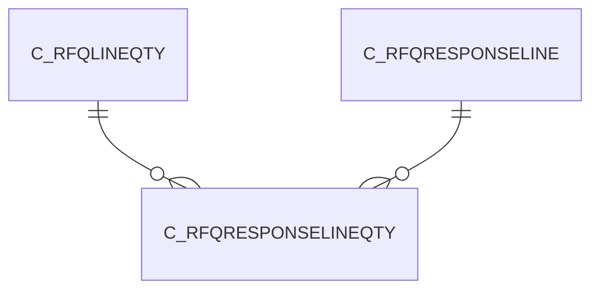

# C_RFQRESPONSELINEQTY

Area [C](../../data-model/c/index.md) · class **business** (proposed) · read from database `idempiere-db` (owner `ADEMPIERE`) · 0 row(s) when profiled

Application model: `org.compiere.model.X_C_RfQResponseLineQty`, access level 1 - Org.

## Columns

| column | type | key | not null | business name | references (code) | nulls | distinct |
|---|---|---|---|---|---|---|---|
| `C_RFQRESPONSELINEQTY_ID` | NUMBER(10,0) | PK | yes | RfQ Response Line Qty |  | 0 | 0 |
| `AD_CLIENT_ID` | NUMBER(10,0) |  | yes | Tenant |  | 0 | 0 |
| `AD_ORG_ID` | NUMBER(10,0) |  | yes | Organization |  | 0 | 0 |
| `ISACTIVE` | CHAR(1) |  | yes | Active |  | 0 | 0 |
| `CREATED` | DATE |  | yes | Created |  | 0 | 0 |
| `CREATEDBY` | NUMBER(10,0) |  | yes | Created By |  | 0 | 0 |
| `UPDATED` | DATE |  | yes | Updated |  | 0 | 0 |
| `UPDATEDBY` | NUMBER(10,0) |  | yes | Updated By |  | 0 | 0 |
| `C_RFQRESPONSELINE_ID` | NUMBER(10,0) |  | yes | RfQ Response Line | [C_RFQRESPONSELINE](../../data-model/c/c_rfqresponseline.md) | 0 | 0 |
| `C_RFQLINEQTY_ID` | NUMBER(10,0) |  | yes | RfQ Line Quantity | [C_RFQLINEQTY](../../data-model/c/c_rfqlineqty.md) | 0 | 0 |
| `PRICE` | NUMBER |  | yes | Price |  | 0 | 0 |
| `DISCOUNT` | NUMBER |  |  | Discount % |  | 0 | 0 |
| `RANKING` | NUMBER(10,0) |  |  | Ranking |  | 0 | 0 |
| `C_RFQRESPONSELINEQTY_UU` | VARCHAR2(36 CHAR) |  |  | C_RfQResponseLineQty_UU |  | 0 | 0 |

*references (code)* is the table the application model's code says a column points to; *Foreign keys* below are the constraints the database declares. Counts come from the profile; no value is ever shown.

## Check constraints

| name | expression |
|---|---|
| `SYS_C0021199` | `IsActive in ('Y','N')` |

## Foreign keys

**References**

| table | columns | on delete |
|---|---|---|
| [C_RFQLINEQTY](../../data-model/c/c_rfqlineqty.md) | C_RFQRESPONSELINEQTY.C_RFQLINEQTY_ID → C_RFQLINEQTY.C_RFQLINEQTY_ID | CASCADE |
| [C_RFQRESPONSELINE](../../data-model/c/c_rfqresponseline.md) | C_RFQRESPONSELINEQTY.C_RFQRESPONSELINE_ID → C_RFQRESPONSELINE.C_RFQRESPONSELINE_ID | CASCADE |

**Referenced by**

_None._

## Write behaviour

- updates: **po_only**
- deletes: **deleted_by_users, deleted_by_cascade**
- change log: **recorded**
- evidence: 3 citation(s)

## Read by

| kind | name |
|---|---|
| View | `C_RFQRESPONSELINEQTY_V` |
| View | `C_RFQRESPONSELINEQTY_VT` |
| View | `C_RFQRESPONSELINE_V` |
| View | `C_RFQRESPONSELINE_VT` |
| View | `RV_C_RFQRESPONSE` |
| View | `c_rfqresponseline_v` |
| View | `c_rfqresponseline_vt` |
| View | `c_rfqresponselineqty_v` |
| View | `c_rfqresponselineqty_vt` |
| View | `rv_c_rfqresponse` |

## Schema history

9 change(s); the latest:

| applied | release | operation | column | tickets |
|---|---|---|---|---|
| 2023-04-09T15:47 | iD11 | `add_constraint` |  | IDEMPIERE-5567 |
| 2023-04-09T15:47 | iD11 | `add_constraint` |  | IDEMPIERE-5567 |
| 2021-12-05T16:45 | i8.2z | `drop_constraint` |  | IDEMPIERE-5075 |
| 2021-12-05T16:45 | i8.2z | `add_constraint` |  | IDEMPIERE-5075 |
| 2021-12-05T16:45 | i8.2z | `add_constraint` |  | IDEMPIERE-5075 |
| 2021-12-05T16:45 | i8.2z | `drop_constraint` |  | IDEMPIERE-5075 |
| 2020-08-04T01:00 | i7.1z | `modify_column` | C_RFQRESPONSELINEQTY_UU | IDEMPIERE-3862 |
| 2020-08-04T01:00 | i7.1z | `drop_column` | tmp_col_1_tmp | IDEMPIERE-3862 |
| 2020-08-04T01:00 | i7.1z | `add_column` | tmp_col_1_tmp | IDEMPIERE-3862 |

## Notes

<!-- ekos:manual id="table.c_rfqresponselineqty.notes" -->
_Business notes about this table._
<!-- /ekos:manual -->
