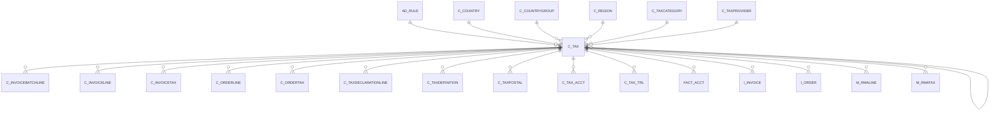

# C_TAX

Area [C](../../data-model/c/index.md) · class **business** (proposed) · read from database `idempiere-db` (owner `ADEMPIERE`) · 6 row(s) when profiled

Application model: `org.compiere.model.X_C_Tax`, access level 2 - Client.

## Columns

| column | type | key | not null | business name | references (code) | nulls | distinct |
|---|---|---|---|---|---|---|---|
| `C_TAX_ID` | NUMBER(10,0) | PK | yes | Tax |  | 0 | 6 |
| `AD_CLIENT_ID` | NUMBER(10,0) |  | yes | Tenant |  | 0 | 1 |
| `AD_ORG_ID` | NUMBER(10,0) |  | yes | Organization |  | 0 | 1 |
| `ISACTIVE` | CHAR(1) |  | yes | Active |  | 0 | 1 |
| `CREATED` | DATE |  | yes | Created |  | 0 | 6 |
| `CREATEDBY` | NUMBER(10,0) |  | yes | Created By |  | 0 | 2 |
| `UPDATED` | DATE |  | yes | Updated |  | 0 | 2 |
| `NAME` | VARCHAR2(60 CHAR) |  | yes | Name |  | 0 | 6 |
| `UPDATEDBY` | NUMBER(10,0) |  | yes | Updated By |  | 0 | 1 |
| `DESCRIPTION` | VARCHAR2(255 CHAR) |  |  | Description |  | 2 | 4 |
| `TAXINDICATOR` | VARCHAR2(10 CHAR) |  |  | Tax Indicator |  | 2 | 4 |
| `ISDOCUMENTLEVEL` | CHAR(1) |  | yes | Document Level |  | 0 | 2 |
| `VALIDFROM` | DATE |  | yes | Valid from |  | 0 | 5 |
| `ISSUMMARY` | CHAR(1) |  | yes | Summary Level |  | 0 | 2 |
| `REQUIRESTAXCERTIFICATE` | CHAR(1) |  | yes | Requires Tax Certificate |  | 0 | 2 |
| `RATE` | NUMBER |  | yes | Rate |  | 0 | 5 |
| `PARENT_TAX_ID` | NUMBER(10,0) |  |  | Parent Tax | [C_TAX](../../data-model/c/c_tax.md) | 4 | 1 |
| `C_COUNTRY_ID` | NUMBER(10,0) |  |  | Country |  | 1 | 2 |
| `C_REGION_ID` | NUMBER(10,0) |  |  | Region | [C_REGION](../../data-model/c/c_region.md) | 5 | 1 |
| `TO_COUNTRY_ID` | NUMBER(10,0) |  |  | To |  | 1 | 2 |
| `TO_REGION_ID` | NUMBER(10,0) |  |  | To | [C_REGION](../../data-model/c/c_region.md) | 5 | 1 |
| `C_TAXCATEGORY_ID` | NUMBER(10,0) |  | yes | Tax Category | [C_TAXCATEGORY](../../data-model/c/c_taxcategory.md) | 0 | 1 |
| `ISDEFAULT` | CHAR(1) |  | yes | Default |  | 0 | 2 |
| `ISTAXEXEMPT` | CHAR(1) |  | yes | SO Tax exempt |  | 0 | 2 |
| `SOPOTYPE` | CHAR(1) |  | yes | SO/PO Type |  | 0 | 1 |
| `ISSALESTAX` | CHAR(1) |  | yes | Sales Tax |  | 0 | 1 |
| `AD_RULE_ID` | NUMBER(10,0) |  |  | Rule | [AD_RULE](../../data-model/ad/ad_rule.md) | 6 | 0 |
| `C_TAX_UU` | VARCHAR2(36 CHAR) |  |  | C_Tax_UU |  | 0 | 6 |
| `C_TAXPROVIDER_ID` | NUMBER(10,0) |  |  | Tax Provider | [C_TAXPROVIDER](../../data-model/c/c_taxprovider.md) | 6 | 0 |
| `C_COUNTRYGROUPFROM_ID` | NUMBER(10,0) |  |  | Country Group From | [C_COUNTRYGROUP](../../data-model/c/c_countrygroup.md) | 6 | 0 |
| `C_COUNTRYGROUPTO_ID` | NUMBER(10,0) |  |  | Country Group To | [C_COUNTRYGROUP](../../data-model/c/c_countrygroup.md) | 6 | 0 |
| `TAXPOSTINGINDICATOR` | CHAR(1) |  |  | Posting Indicator |  | 0 | 1 |

*references (code)* is the table the application model's code says a column points to; *Foreign keys* below are the constraints the database declares. Counts come from the profile; no value is ever shown.

## Check constraints

| name | expression |
|---|---|
| `SYS_C0022785` | `IsActive in ('Y','N')` |
| `SYS_C0022787` | `IsDocumentLevel in ('Y','N')` |
| `SYS_C0022788` | `RequiresTaxCertificate in ('Y','N')` |

## Foreign keys

**References**

| table | columns | on delete |
|---|---|---|
| [AD_RULE](../../data-model/ad/ad_rule.md) | C_TAX.AD_RULE_ID → AD_RULE.AD_RULE_ID | NO ACTION |
| [C_COUNTRY](../../data-model/c/c_country.md) | C_TAX.TO_COUNTRY_ID → C_COUNTRY.C_COUNTRY_ID | NO ACTION |
| [C_COUNTRYGROUP](../../data-model/c/c_countrygroup.md) | C_TAX.C_COUNTRYGROUPFROM_ID → C_COUNTRYGROUP.C_COUNTRYGROUP_ID | NO ACTION |
| [C_REGION](../../data-model/c/c_region.md) | C_TAX.TO_REGION_ID → C_REGION.C_REGION_ID | NO ACTION |
| [C_TAX](../../data-model/c/c_tax.md) | C_TAX.PARENT_TAX_ID → C_TAX.C_TAX_ID | NO ACTION |
| [C_TAXCATEGORY](../../data-model/c/c_taxcategory.md) | C_TAX.C_TAXCATEGORY_ID → C_TAXCATEGORY.C_TAXCATEGORY_ID | CASCADE |
| [C_TAXPROVIDER](../../data-model/c/c_taxprovider.md) | C_TAX.C_TAXPROVIDER_ID → C_TAXPROVIDER.C_TAXPROVIDER_ID | NO ACTION |

**Referenced by**

| table | columns | on delete |
|---|---|---|
| [C_INVOICEBATCHLINE](../../data-model/c/c_invoicebatchline.md) | C_INVOICEBATCHLINE.C_TAX_ID → C_TAX.C_TAX_ID | NO ACTION |
| [C_INVOICELINE](../../data-model/c/c_invoiceline.md) | C_INVOICELINE.C_TAX_ID → C_TAX.C_TAX_ID | NO ACTION |
| [C_INVOICETAX](../../data-model/c/c_invoicetax.md) | C_INVOICETAX.C_TAX_ID → C_TAX.C_TAX_ID | NO ACTION |
| [C_ORDERLINE](../../data-model/c/c_orderline.md) | C_ORDERLINE.C_TAX_ID → C_TAX.C_TAX_ID | NO ACTION |
| [C_ORDERTAX](../../data-model/c/c_ordertax.md) | C_ORDERTAX.C_TAX_ID → C_TAX.C_TAX_ID | NO ACTION |
| [C_TAX](../../data-model/c/c_tax.md) | C_TAX.PARENT_TAX_ID → C_TAX.C_TAX_ID | NO ACTION |
| [C_TAXDECLARATIONLINE](../../data-model/c/c_taxdeclarationline.md) | C_TAXDECLARATIONLINE.C_TAX_ID → C_TAX.C_TAX_ID | NO ACTION |
| [C_TAXDEFINITION](../../data-model/c/c_taxdefinition.md) | C_TAXDEFINITION.C_TAX_ID → C_TAX.C_TAX_ID | NO ACTION |
| [C_TAXPOSTAL](../../data-model/c/c_taxpostal.md) | C_TAXPOSTAL.C_TAX_ID → C_TAX.C_TAX_ID | NO ACTION |
| [C_TAX_ACCT](../../data-model/c/c_tax_acct.md) | C_TAX_ACCT.C_TAX_ID → C_TAX.C_TAX_ID | CASCADE |
| [C_TAX_TRL](../../data-model/c/c_tax_trl.md) | C_TAX_TRL.C_TAX_ID → C_TAX.C_TAX_ID | CASCADE |
| [FACT_ACCT](../../data-model/fact/fact_acct.md) | FACT_ACCT.C_TAX_ID → C_TAX.C_TAX_ID | NO ACTION |
| `I_INVOICE` | I_INVOICE.C_TAX_ID → C_TAX.C_TAX_ID | SET NULL |
| `I_ORDER` | I_ORDER.C_TAX_ID → C_TAX.C_TAX_ID | SET NULL |
| [M_RMALINE](../../data-model/m/m_rmaline.md) | M_RMALINE.C_TAX_ID → C_TAX.C_TAX_ID | NO ACTION |
| [M_RMATAX](../../data-model/m/m_rmatax.md) | M_RMATAX.C_TAX_ID → C_TAX.C_TAX_ID | NO ACTION |

## Write behaviour

- updates: **po_only**
- deletes: **deleted_by_users, deleted_by_cascade**
- change log: **recorded**
- evidence: 2 citation(s)

## Read by

| kind | name |
|---|---|
| Procedure | [C_AcctSchema_Default_Copy](../../logic/c_acctschema_default_copy.md) |
| View | `C_INVOICE_LINETAX_V` |
| View | `C_INVOICE_LINETAX_VT` |
| View | `C_ORDER_LINETAX_V` |
| View | `C_ORDER_LINETAX_VT` |
| View | `RV_FACT_ADAXA` |
| View | `c_invoice_linetax_v` |
| View | `c_invoice_linetax_vt` |
| View | `c_order_linetax_v` |
| View | `c_order_linetax_vt` |
| View | `rv_fact_adaxa` |

## Schema history

49 change(s); the latest:

| applied | release | operation | column | tickets |
|---|---|---|---|---|
| 2023-04-09T15:47 | iD11 | `add_constraint` |  | IDEMPIERE-5567 |
| 2023-04-09T15:47 | iD11 | `add_constraint` |  | IDEMPIERE-5567 |
| 2022-03-29T07:00 | iD10 | `add_column` | TaxPostingIndicator | IDEMPIERE-5057 |
| 2022-03-29T07:00 | iD10 | `add_column` | TaxPostingIndicator | IDEMPIERE-5057 |
| 2021-12-05T16:45 | i8.2z | `add_constraint` |  | IDEMPIERE-5075 |
| 2021-12-05T16:45 | i8.2z | `add_constraint` |  | IDEMPIERE-5075 |
| 2021-12-05T16:45 | i8.2z | `add_constraint` |  | IDEMPIERE-5075 |
| 2021-12-05T16:45 | i8.2z | `drop_constraint` |  | IDEMPIERE-5075 |
| 2021-12-05T16:45 | i8.2z | `drop_constraint` |  | IDEMPIERE-5075 |
| 2021-12-05T16:45 | i8.2z | `add_constraint` |  | IDEMPIERE-5075 |
| 2021-12-05T16:45 | i8.2z | `drop_constraint` |  | IDEMPIERE-5075 |
| 2021-12-05T16:45 | i8.2z | `drop_constraint` |  | IDEMPIERE-5075 |
| 2021-12-05T16:45 | i8.2z | `add_constraint` |  | IDEMPIERE-5075 |
| 2021-12-05T16:45 | i8.2z | `add_constraint` |  | IDEMPIERE-5075 |
| 2021-12-05T16:45 | i8.2z | `drop_constraint` |  | IDEMPIERE-5075 |

## Notes

<!-- ekos:manual id="table.c_tax.notes" -->
_Business notes about this table._
<!-- /ekos:manual -->
