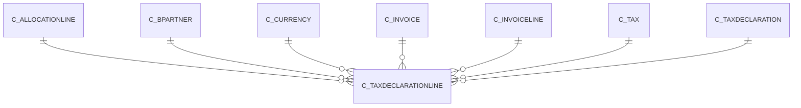

# C_TAXDECLARATIONLINE

Area [C](../../data-model/c/index.md) · class **business** (proposed) · read from database `idempiere-db` (owner `ADEMPIERE`) · 0 row(s) when profiled

Application model: `org.compiere.model.X_C_TaxDeclarationLine`, access level 3 - Client - Org.

## Columns

| column | type | key | not null | business name | references (code) | nulls | distinct |
|---|---|---|---|---|---|---|---|
| `C_TAXDECLARATIONLINE_ID` | NUMBER(10,0) | PK | yes | Tax Declaration Line |  | 0 | 0 |
| `AD_CLIENT_ID` | NUMBER(10,0) |  | yes | Tenant |  | 0 | 0 |
| `AD_ORG_ID` | NUMBER(10,0) |  | yes | Organization |  | 0 | 0 |
| `ISACTIVE` | CHAR(1) |  | yes | Active |  | 0 | 0 |
| `CREATED` | DATE |  | yes | Created |  | 0 | 0 |
| `CREATEDBY` | NUMBER(10,0) |  | yes | Created By |  | 0 | 0 |
| `UPDATED` | DATE |  | yes | Updated |  | 0 | 0 |
| `UPDATEDBY` | NUMBER(10,0) |  | yes | Updated By |  | 0 | 0 |
| `LINE` | NUMBER(10,0) |  | yes | Line No |  | 0 | 0 |
| `DESCRIPTION` | VARCHAR2(255 CHAR) |  |  | Description |  | 0 | 0 |
| `ISMANUAL` | CHAR(1) |  | yes | Manual |  | 0 | 0 |
| `C_TAXDECLARATION_ID` | NUMBER(10,0) |  | yes | Tax Declaration | [C_TAXDECLARATION](../../data-model/c/c_taxdeclaration.md) | 0 | 0 |
| `C_BPARTNER_ID` | NUMBER(10,0) |  | yes | Business Partner | [C_BPARTNER](../../data-model/c/c_bpartner.md) | 0 | 0 |
| `C_TAX_ID` | NUMBER(10,0) |  | yes | Tax | [C_TAX](../../data-model/c/c_tax.md) | 0 | 0 |
| `C_INVOICE_ID` | NUMBER(10,0) |  |  | Invoice | [C_INVOICE](../../data-model/c/c_invoice.md) | 0 | 0 |
| `C_INVOICELINE_ID` | NUMBER(10,0) |  |  | Invoice Line | [C_INVOICELINE](../../data-model/c/c_invoiceline.md) | 0 | 0 |
| `C_ALLOCATIONLINE_ID` | NUMBER(10,0) |  |  | Allocation Line | [C_ALLOCATIONLINE](../../data-model/c/c_allocationline.md) | 0 | 0 |
| `C_CURRENCY_ID` | NUMBER(10,0) |  | yes | Currency | [C_CURRENCY](../../data-model/c/c_currency.md) | 0 | 0 |
| `TAXBASEAMT` | NUMBER |  | yes | Tax base Amount |  | 0 | 0 |
| `TAXAMT` | NUMBER |  | yes | Tax Amount |  | 0 | 0 |
| `DATEACCT` | DATE |  | yes | Account Date |  | 0 | 0 |
| `C_TAXDECLARATIONLINE_UU` | VARCHAR2(36 CHAR) |  |  | C_TaxDeclarationLine_UU |  | 0 | 0 |

*references (code)* is the table the application model's code says a column points to; *Foreign keys* below are the constraints the database declares. Counts come from the profile; no value is ever shown.

## Check constraints

| name | expression |
|---|---|
| `SYS_C0022979` | `IsActive in ('Y','N')` |
| `SYS_C0022980` | `IsManual in ('Y','N')` |

## Foreign keys

**References**

| table | columns | on delete |
|---|---|---|
| [C_ALLOCATIONLINE](../../data-model/c/c_allocationline.md) | C_TAXDECLARATIONLINE.C_ALLOCATIONLINE_ID → C_ALLOCATIONLINE.C_ALLOCATIONLINE_ID | NO ACTION |
| [C_BPARTNER](../../data-model/c/c_bpartner.md) | C_TAXDECLARATIONLINE.C_BPARTNER_ID → C_BPARTNER.C_BPARTNER_ID | NO ACTION |
| [C_CURRENCY](../../data-model/c/c_currency.md) | C_TAXDECLARATIONLINE.C_CURRENCY_ID → C_CURRENCY.C_CURRENCY_ID | NO ACTION |
| [C_INVOICE](../../data-model/c/c_invoice.md) | C_TAXDECLARATIONLINE.C_INVOICE_ID → C_INVOICE.C_INVOICE_ID | NO ACTION |
| [C_INVOICELINE](../../data-model/c/c_invoiceline.md) | C_TAXDECLARATIONLINE.C_INVOICELINE_ID → C_INVOICELINE.C_INVOICELINE_ID | NO ACTION |
| [C_TAX](../../data-model/c/c_tax.md) | C_TAXDECLARATIONLINE.C_TAX_ID → C_TAX.C_TAX_ID | NO ACTION |
| [C_TAXDECLARATION](../../data-model/c/c_taxdeclaration.md) | C_TAXDECLARATIONLINE.C_TAXDECLARATION_ID → C_TAXDECLARATION.C_TAXDECLARATION_ID | CASCADE |

**Referenced by**

_None._

## Write behaviour

- updates: **po_only**
- deletes: **deleted_by_app, deleted_by_cascade**
- change log: **recorded**
- evidence: 3 citation(s)

## Schema history

22 change(s); the latest:

| applied | release | operation | column | tickets |
|---|---|---|---|---|
| 2023-04-09T15:47 | iD11 | `add_constraint` |  | IDEMPIERE-5567 |
| 2023-04-09T15:47 | iD11 | `add_constraint` |  | IDEMPIERE-5567 |
| 2021-12-05T16:45 | i8.2z | `add_constraint` |  | IDEMPIERE-5075 |
| 2021-12-05T16:45 | i8.2z | `drop_constraint` |  | IDEMPIERE-5075 |
| 2021-12-05T16:45 | i8.2z | `drop_constraint` |  | IDEMPIERE-5075 |
| 2021-12-05T16:45 | i8.2z | `drop_constraint` |  | IDEMPIERE-5075 |
| 2021-12-05T16:45 | i8.2z | `add_constraint` |  | IDEMPIERE-5075 |
| 2021-12-05T16:45 | i8.2z | `add_constraint` |  | IDEMPIERE-5075 |
| 2021-12-05T16:45 | i8.2z | `drop_constraint` |  | IDEMPIERE-5075 |
| 2021-12-05T16:45 | i8.2z | `drop_constraint` |  | IDEMPIERE-5075 |
| 2021-12-05T16:45 | i8.2z | `add_constraint` |  | IDEMPIERE-5075 |
| 2021-12-05T16:45 | i8.2z | `add_constraint` |  | IDEMPIERE-5075 |
| 2021-12-05T16:45 | i8.2z | `drop_constraint` |  | IDEMPIERE-5075 |
| 2021-12-05T16:45 | i8.2z | `drop_constraint` |  | IDEMPIERE-5075 |
| 2021-12-05T16:45 | i8.2z | `add_constraint` |  | IDEMPIERE-5075 |

## Notes

<!-- ekos:manual id="table.c_taxdeclarationline.notes" -->
_Business notes about this table._
<!-- /ekos:manual -->
