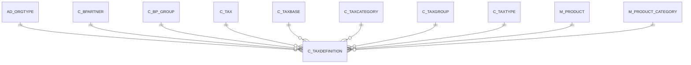

# C_TAXDEFINITION

Area [C](../../data-model/c/index.md) · class **business** (proposed) · read from database `idempiere-db` (owner `ADEMPIERE`) · 0 row(s) when profiled

Application model: `org.eevolution.model.X_C_TaxDefinition`, access level 3 - Client - Org.

## Columns

| column | type | key | not null | business name | references (code) | nulls | distinct |
|---|---|---|---|---|---|---|---|
| `VALIDFROM` | DATE |  |  | Valid from |  | 0 | 0 |
| `VALIDTO` | DATE |  |  | Valid to |  | 0 | 0 |
| `NAME` | VARCHAR2(60 CHAR) |  | yes | Name |  | 0 | 0 |
| `C_BP_GROUP_ID` | NUMBER(10,0) |  |  | Business Partner Group | [C_BP_GROUP](../../data-model/c/c_bp_group.md) | 0 | 0 |
| `C_BPARTNER_ID` | NUMBER(10,0) |  |  | Business Partner | [C_BPARTNER](../../data-model/c/c_bpartner.md) | 0 | 0 |
| `C_TAXBASE_ID` | NUMBER(10,0) |  |  | Tax Base | [C_TAXBASE](../../data-model/c/c_taxbase.md) | 0 | 0 |
| `C_TAXCATEGORY_ID` | NUMBER(10,0) |  |  | Tax Category | [C_TAXCATEGORY](../../data-model/c/c_taxcategory.md) | 0 | 0 |
| `C_TAXDEFINITION_ID` | NUMBER(10,0) | PK | yes | Tax Definition |  | 0 | 0 |
| `C_TAXGROUP_ID` | NUMBER(10,0) |  |  | Tax Group | [C_TAXGROUP](../../data-model/c/c_taxgroup.md) | 0 | 0 |
| `C_TAXTYPE_ID` | NUMBER(10,0) |  |  | Tax Type | [C_TAXTYPE](../../data-model/c/c_taxtype.md) | 0 | 0 |
| `C_TAX_ID` | NUMBER(10,0) |  |  | Tax | [C_TAX](../../data-model/c/c_tax.md) | 0 | 0 |
| `CREATED` | DATE |  | yes | Created |  | 0 | 0 |
| `CREATEDBY` | NUMBER(10,0) |  | yes | Created By |  | 0 | 0 |
| `DESCRIPTION` | VARCHAR2(255 CHAR) |  |  | Description |  | 0 | 0 |
| `HELP` | VARCHAR2(2000 CHAR) |  |  | Comment/Help |  | 0 | 0 |
| `ISACTIVE` | CHAR(1) |  | yes | Active |  | 0 | 0 |
| `ISINVOICED` | CHAR(1) |  |  | Invoiced |  | 0 | 0 |
| `M_PRODUCT_CATEGORY_ID` | NUMBER(10,0) |  |  | Product Category | [M_PRODUCT_CATEGORY](../../data-model/m/m_product_category.md) | 0 | 0 |
| `M_PRODUCT_ID` | NUMBER(10,0) |  |  | Product | [M_PRODUCT](../../data-model/m/m_product.md) | 0 | 0 |
| `MAXTAXABLE` | NUMBER(10,0) |  |  | Max Taxable |  | 0 | 0 |
| `MINTAXABLE` | NUMBER(10,0) |  |  | Min Taxable |  | 0 | 0 |
| `SEQNO` | NUMBER(10,0) |  |  | Sequence |  | 0 | 0 |
| `UPDATED` | DATE |  | yes | Updated |  | 0 | 0 |
| `UPDATEDBY` | NUMBER(10,0) |  | yes | Updated By |  | 0 | 0 |
| `AD_CLIENT_ID` | NUMBER(10,0) |  | yes | Tenant |  | 0 | 0 |
| `VALUE` | VARCHAR2(40 CHAR) |  | yes | Search Key |  | 0 | 0 |
| `AD_ORGTYPE_ID` | NUMBER(10,0) |  |  | Organization Type | [AD_ORGTYPE](../../data-model/ad/ad_orgtype.md) | 0 | 0 |
| `AD_ORG_ID` | NUMBER(10,0) |  | yes | Organization |  | 0 | 0 |
| `C_TAXDEFINITION_UU` | VARCHAR2(36 CHAR) |  |  | C_TaxDefinition_UU |  | 0 | 0 |

*references (code)* is the table the application model's code says a column points to; *Foreign keys* below are the constraints the database declares. Counts come from the profile; no value is ever shown.

## Check constraints

| name | expression |
|---|---|
| `SYS_C0020661` | `IsInvoiced IN ('Y','N')` |
| `SYS_C0020662` | `IsActive IN ('Y','N')` |

## Foreign keys

**References**

| table | columns | on delete |
|---|---|---|
| [AD_ORGTYPE](../../data-model/ad/ad_orgtype.md) | C_TAXDEFINITION.AD_ORGTYPE_ID → AD_ORGTYPE.AD_ORGTYPE_ID | NO ACTION |
| [C_BPARTNER](../../data-model/c/c_bpartner.md) | C_TAXDEFINITION.C_BPARTNER_ID → C_BPARTNER.C_BPARTNER_ID | NO ACTION |
| [C_BP_GROUP](../../data-model/c/c_bp_group.md) | C_TAXDEFINITION.C_BP_GROUP_ID → C_BP_GROUP.C_BP_GROUP_ID | NO ACTION |
| [C_TAX](../../data-model/c/c_tax.md) | C_TAXDEFINITION.C_TAX_ID → C_TAX.C_TAX_ID | NO ACTION |
| [C_TAXBASE](../../data-model/c/c_taxbase.md) | C_TAXDEFINITION.C_TAXBASE_ID → C_TAXBASE.C_TAXBASE_ID | NO ACTION |
| [C_TAXCATEGORY](../../data-model/c/c_taxcategory.md) | C_TAXDEFINITION.C_TAXCATEGORY_ID → C_TAXCATEGORY.C_TAXCATEGORY_ID | NO ACTION |
| [C_TAXGROUP](../../data-model/c/c_taxgroup.md) | C_TAXDEFINITION.C_TAXGROUP_ID → C_TAXGROUP.C_TAXGROUP_ID | NO ACTION |
| [C_TAXTYPE](../../data-model/c/c_taxtype.md) | C_TAXDEFINITION.C_TAXTYPE_ID → C_TAXTYPE.C_TAXTYPE_ID | NO ACTION |
| [M_PRODUCT](../../data-model/m/m_product.md) | C_TAXDEFINITION.M_PRODUCT_ID → M_PRODUCT.M_PRODUCT_ID | NO ACTION |
| [M_PRODUCT_CATEGORY](../../data-model/m/m_product_category.md) | C_TAXDEFINITION.M_PRODUCT_CATEGORY_ID → M_PRODUCT_CATEGORY.M_PRODUCT_CATEGORY_ID | NO ACTION |

**Referenced by**

_None._

## Write behaviour

- updates: **po_only**
- deletes: **deleted_by_users**
- change log: **recorded**
- evidence: 1 citation(s)

## Schema history

49 change(s); the latest:

| applied | release | operation | column | tickets |
|---|---|---|---|---|
| 2023-04-09T15:47 | iD11 | `add_constraint` |  | IDEMPIERE-5567 |
| 2023-04-09T15:47 | iD11 | `add_constraint` |  | IDEMPIERE-5567 |
| 2021-12-05T16:45 | i8.2z | `add_constraint` |  | IDEMPIERE-5075 |
| 2021-12-05T16:45 | i8.2z | `drop_constraint` |  | IDEMPIERE-5075 |
| 2021-12-05T16:45 | i8.2z | `add_constraint` |  | IDEMPIERE-5075 |
| 2021-12-05T16:45 | i8.2z | `add_constraint` |  | IDEMPIERE-5075 |
| 2021-12-05T16:45 | i8.2z | `drop_constraint` |  | IDEMPIERE-5075 |
| 2021-12-05T16:45 | i8.2z | `add_constraint` |  | IDEMPIERE-5075 |
| 2021-12-05T16:45 | i8.2z | `add_constraint` |  | IDEMPIERE-5075 |
| 2021-12-05T16:45 | i8.2z | `drop_constraint` |  | IDEMPIERE-5075 |
| 2021-12-05T16:45 | i8.2z | `drop_constraint` |  | IDEMPIERE-5075 |
| 2021-12-05T16:45 | i8.2z | `drop_constraint` |  | IDEMPIERE-5075 |
| 2021-12-05T16:45 | i8.2z | `drop_constraint` |  | IDEMPIERE-5075 |
| 2021-12-05T16:45 | i8.2z | `add_constraint` |  | IDEMPIERE-5075 |
| 2021-12-05T16:45 | i8.2z | `add_constraint` |  | IDEMPIERE-5075 |

## Notes

<!-- ekos:manual id="table.c_taxdefinition.notes" -->
_Business notes about this table._
<!-- /ekos:manual -->
