# C_UOM

Area [C](../../data-model/c/index.md) · class **business** (proposed) · read from database `idempiere-db` (owner `ADEMPIERE`) · 15 row(s) when profiled

Application model: `org.compiere.model.X_C_UOM`, access level 6 - System - Client.

## Columns

| column | type | key | not null | business name | references (code) | nulls | distinct |
|---|---|---|---|---|---|---|---|
| `C_UOM_ID` | NUMBER(10,0) | PK | yes | UOM |  | 0 | 15 |
| `AD_CLIENT_ID` | NUMBER(10,0) |  | yes | Tenant |  | 0 | 2 |
| `AD_ORG_ID` | NUMBER(10,0) |  | yes | Organization |  | 0 | 1 |
| `ISACTIVE` | CHAR(1) |  | yes | Active |  | 0 | 1 |
| `CREATED` | DATE |  | yes | Created |  | 0 | 15 |
| `UPDATED` | DATE |  | yes | Updated |  | 0 | 15 |
| `CREATEDBY` | NUMBER(10,0) |  | yes | Created By |  | 0 | 2 |
| `UPDATEDBY` | NUMBER(10,0) |  | yes | Updated By |  | 0 | 1 |
| `X12DE355` | VARCHAR2(4 CHAR) |  | yes | UOM Code |  | 0 | 15 |
| `UOMSYMBOL` | VARCHAR2(10 CHAR) |  |  | Symbol |  | 0 | 14 |
| `NAME` | VARCHAR2(60 CHAR) |  | yes | Name |  | 0 | 15 |
| `DESCRIPTION` | VARCHAR2(255 CHAR) |  |  | Description |  | 11 | 4 |
| `STDPRECISION` | NUMBER(10,0) |  | yes | Standard Precision |  | 0 | 4 |
| `COSTINGPRECISION` | NUMBER(10,0) |  | yes | Costing Precision |  | 0 | 4 |
| `ISDEFAULT` | CHAR(1) |  | yes | Default |  | 0 | 2 |
| `UOMTYPE` | VARCHAR2(2 CHAR) |  |  | UOM Type |  | 9 | 4 |
| `C_UOM_UU` | VARCHAR2(36 CHAR) |  |  | C_UOM_UU |  | 0 | 15 |
| `UNCEFACT` | VARCHAR2(10 CHAR) |  |  | UN/CEFACT Code |  | 1 | 14 |

*references (code)* is the table the application model's code says a column points to; *Foreign keys* below are the constraints the database declares. Counts come from the profile; no value is ever shown.

## Check constraints

| name | expression |
|---|---|
| `SYS_C0021180` | `IsActive in ('Y','N')` |

## Foreign keys

**References**

| table | columns | on delete |
|---|---|---|
| [AD_CLIENT](../../data-model/ad/ad_client.md) | C_UOM.AD_CLIENT_ID → AD_CLIENT.AD_CLIENT_ID | NO ACTION |
| [AD_ORG](../../data-model/ad/ad_org.md) | C_UOM.AD_ORG_ID → AD_ORG.AD_ORG_ID | NO ACTION |

**Referenced by**

| table | columns | on delete |
|---|---|---|
| [AD_CLIENTINFO](../../data-model/ad/ad_clientinfo.md) | AD_CLIENTINFO.C_UOM_LENGTH_ID → C_UOM.C_UOM_ID | NO ACTION |
| [C_INVOICELINE](../../data-model/c/c_invoiceline.md) | C_INVOICELINE.C_UOM_ID → C_UOM.C_UOM_ID | NO ACTION |
| [C_ORDERLINE](../../data-model/c/c_orderline.md) | C_ORDERLINE.C_UOM_ID → C_UOM.C_UOM_ID | NO ACTION |
| [C_RFQLINEQTY](../../data-model/c/c_rfqlineqty.md) | C_RFQLINEQTY.C_UOM_ID → C_UOM.C_UOM_ID | NO ACTION |
| [C_UOM_CONVERSION](../../data-model/c/c_uom_conversion.md) | C_UOM_CONVERSION.C_UOM_ID → C_UOM.C_UOM_ID | NO ACTION |
| [C_UOM_TRL](../../data-model/c/c_uom_trl.md) | C_UOM_TRL.C_UOM_ID → C_UOM.C_UOM_ID | CASCADE |
| [DD_ORDERLINE](../../data-model/dd/dd_orderline.md) | DD_ORDERLINE.C_UOM_ID → C_UOM.C_UOM_ID | NO ACTION |
| [FACT_ACCT](../../data-model/fact/fact_acct.md) | FACT_ACCT.C_UOM_ID → C_UOM.C_UOM_ID | NO ACTION |
| [GL_JOURNALLINE](../../data-model/gl/gl_journalline.md) | GL_JOURNALLINE.C_UOM_ID → C_UOM.C_UOM_ID | NO ACTION |
| `I_FAJOURNAL` | I_FAJOURNAL.C_UOM_ID → C_UOM.C_UOM_ID | NO ACTION |
| `I_FIXEDASSET` | I_FIXEDASSET.C_UOM_ID → C_UOM.C_UOM_ID | NO ACTION |
| `I_GLJOURNAL` | I_GLJOURNAL.C_UOM_ID → C_UOM.C_UOM_ID | NO ACTION |
| `I_ORDER` | I_ORDER.C_UOM_ID → C_UOM.C_UOM_ID | SET NULL |
| `I_PRICELIST` | I_PRICELIST.C_UOM_ID → C_UOM.C_UOM_ID | NO ACTION |
| `I_PRODUCT` | I_PRODUCT.C_UOM_ID → C_UOM.C_UOM_ID | SET NULL |
| [M_INOUTLINE](../../data-model/m/m_inoutline.md) | M_INOUTLINE.C_UOM_ID → C_UOM.C_UOM_ID | NO ACTION |
| [M_PACKAGE](../../data-model/m/m_package.md) | M_PACKAGE.C_UOM_LENGTH_ID → C_UOM.C_UOM_ID | NO ACTION |
| [M_PACKAGEMPS](../../data-model/m/m_packagemps.md) | M_PACKAGEMPS.C_UOM_LENGTH_ID → C_UOM.C_UOM_ID | NO ACTION |
| [M_PRODUCT](../../data-model/m/m_product.md) | M_PRODUCT.C_UOM_ID → C_UOM.C_UOM_ID | NO ACTION |
| [M_PRODUCT_PO](../../data-model/m/m_product_po.md) | M_PRODUCT_PO.C_UOM_ID → C_UOM.C_UOM_ID | NO ACTION |
| [M_REQUISITIONLINE](../../data-model/m/m_requisitionline.md) | M_REQUISITIONLINE.C_UOM_ID → C_UOM.C_UOM_ID | NO ACTION |
| [M_SHIPPINGTRANSACTION](../../data-model/m/m_shippingtransaction.md) | M_SHIPPINGTRANSACTION.C_UOM_LENGTH_ID → C_UOM.C_UOM_ID | NO ACTION |
| [M_SHIPPINGTRANSACTIONLINE](../../data-model/m/m_shippingtransactionline.md) | M_SHIPPINGTRANSACTIONLINE.C_UOM_LENGTH_ID → C_UOM.C_UOM_ID | NO ACTION |
| [PP_COST_COLLECTOR](../../data-model/pp/pp_cost_collector.md) | PP_COST_COLLECTOR.C_UOM_ID → C_UOM.C_UOM_ID | NO ACTION |
| [PP_ORDER](../../data-model/pp/pp_order.md) | PP_ORDER.C_UOM_ID → C_UOM.C_UOM_ID | NO ACTION |
| [PP_ORDER_BOM](../../data-model/pp/pp_order_bom.md) | PP_ORDER_BOM.C_UOM_ID → C_UOM.C_UOM_ID | NO ACTION |
| [PP_ORDER_BOMLINE](../../data-model/pp/pp_order_bomline.md) | PP_ORDER_BOMLINE.C_UOM_ID → C_UOM.C_UOM_ID | NO ACTION |
| [PP_PRODUCT_BOM](../../data-model/pp/pp_product_bom.md) | PP_PRODUCT_BOM.C_UOM_ID → C_UOM.C_UOM_ID | NO ACTION |
| [PP_PRODUCT_BOMLINE](../../data-model/pp/pp_product_bomline.md) | PP_PRODUCT_BOMLINE.C_UOM_ID → C_UOM.C_UOM_ID | NO ACTION |
| [S_EXPENSETYPE](../../data-model/s/s_expensetype.md) | S_EXPENSETYPE.C_UOM_ID → C_UOM.C_UOM_ID | NO ACTION |
| [S_RESOURCETYPE](../../data-model/s/s_resourcetype.md) | S_RESOURCETYPE.C_UOM_ID → C_UOM.C_UOM_ID | NO ACTION |
| [S_TIMEEXPENSELINE](../../data-model/s/s_timeexpenseline.md) | S_TIMEEXPENSELINE.C_UOM_ID → C_UOM.C_UOM_ID | NO ACTION |
| [S_TRAINING](../../data-model/s/s_training.md) | S_TRAINING.C_UOM_ID → C_UOM.C_UOM_ID | NO ACTION |

```mermaid
erDiagram
  AD_CLIENT ||--o{ C_UOM : ""
  AD_ORG ||--o{ C_UOM : ""
  C_UOM ||--o{ AD_CLIENTINFO : ""
  C_UOM ||--o{ C_INVOICELINE : ""
  C_UOM ||--o{ C_ORDERLINE : ""
  C_UOM ||--o{ C_RFQLINEQTY : ""
  C_UOM ||--o{ C_UOM_CONVERSION : ""
  C_UOM ||--o{ C_UOM_TRL : ""
  C_UOM ||--o{ DD_ORDERLINE : ""
  C_UOM ||--o{ FACT_ACCT : ""
  C_UOM ||--o{ GL_JOURNALLINE : ""
  C_UOM ||--o{ I_FAJOURNAL : ""
  C_UOM ||--o{ I_FIXEDASSET : ""
  C_UOM ||--o{ I_GLJOURNAL : ""
  C_UOM ||--o{ I_ORDER : ""
  C_UOM ||--o{ I_PRICELIST : ""
  C_UOM ||--o{ I_PRODUCT : ""
  C_UOM ||--o{ M_INOUTLINE : ""
  C_UOM ||--o{ M_PACKAGE : ""
  C_UOM ||--o{ M_PACKAGEMPS : ""
  C_UOM ||--o{ M_PRODUCT : ""
  C_UOM ||--o{ M_PRODUCT_PO : ""
  C_UOM ||--o{ M_REQUISITIONLINE : ""
  C_UOM ||--o{ M_SHIPPINGTRANSACTION : ""
  C_UOM ||--o{ M_SHIPPINGTRANSACTIONLINE : ""
  C_UOM ||--o{ PP_COST_COLLECTOR : ""
  C_UOM ||--o{ PP_ORDER : ""
  C_UOM ||--o{ PP_ORDER_BOM : ""
  C_UOM ||--o{ PP_ORDER_BOMLINE : ""
```

6 more neighbour(s) not drawn.

## Write behaviour

- updates: **po_only**
- deletes: **deleted_by_users**
- change log: **recorded**
- evidence: 1 citation(s)

## Read by

| kind | name |
|---|---|
| Procedure | [BOMQTYONHAND](../../logic/bomqtyonhand.md) |
| Procedure | [BOMQTYONHANDFORRESERVATION](../../logic/bomqtyonhandforreservation.md) |
| Procedure | [BOMQTYORDERED](../../logic/bomqtyordered.md) |
| Procedure | [BOMQTYRESERVED](../../logic/bomqtyreserved.md) |
| Procedure | [BOMQtyOnHand](../../logic/bomqtyonhand.md) |
| Procedure | [BOMQtyOnHandForReservation](../../logic/bomqtyonhandforreservation.md) |
| Procedure | [Bomqtyonhand](../../logic/bomqtyonhand.md) |
| Procedure | [BomqtyonhandASI](../../logic/bomqtyonhandasi.md) |
| Procedure | [Bomqtyordered](../../logic/bomqtyordered.md) |
| Procedure | [BomqtyorderedASI](../../logic/bomqtyorderedasi.md) |
| Procedure | [Bomqtyreserved](../../logic/bomqtyreserved.md) |
| Procedure | [BomqtyreservedASI](../../logic/bomqtyreservedasi.md) |
| Procedure | [bomqtyonhand](../../logic/bomqtyonhand.md) |
| Procedure | [bomqtyordered](../../logic/bomqtyordered.md) |
| Procedure | [bomqtyreserved](../../logic/bomqtyreserved.md) |
| Procedure | [prodqtyordered](../../logic/prodqtyordered.md) |
| Procedure | [prodqtyreserved](../../logic/prodqtyreserved.md) |
| View | `C_INVOICE_CREATEFROM_V` |
| View | `C_INVOICE_LINETAX_V` |
| View | `C_INVOICE_LINETAX_VT` |
| View | `C_ORDER_LINETAX_V` |
| View | `C_ORDER_LINETAX_VT` |
| View | `C_RFQRESPONSELINEQTY_V` |
| View | `C_RFQRESPONSELINEQTY_VT` |
| View | `C_RFQRESPONSELINE_V` |
| View | `C_RFQRESPONSELINE_VT` |
| View | `M_INOUT_CREATEFROM_V` |
| View | `M_INOUT_LINECONFIRM_V` |
| View | `M_INOUT_LINE_V` |
| View | `M_INOUT_LINE_VT` |
| View | `M_PACKAGELINES_AVAIL_V` |
| View | `RV_FACT_ADAXA` |
| View | `RV_PP_ORDER_RECEIPT_ISSUE` |
| View | `RV_WAREHOUSEPRICE` |
| View | `c_invoice_createfrom_v` |
| View | `c_invoice_linetax_v` |
| View | `c_invoice_linetax_vt` |
| View | `c_order_linetax_v` |
| View | `c_order_linetax_vt` |
| View | `c_rfqresponseline_v` |
| View | `c_rfqresponseline_vt` |
| View | `c_rfqresponselineqty_v` |
| View | `c_rfqresponselineqty_vt` |
| View | `m_inout_createfrom_v` |
| View | `m_inout_line_v` |
| View | `m_inout_line_vt` |
| View | `m_inout_lineconfirm_v` |
| View | `m_packagelines_avail_v` |
| View | `rv_fact_adaxa` |
| View | `rv_pp_order_receipt_issue` |
| View | `rv_warehouseprice` |

## Schema history

31 change(s); the latest:

| applied | release | operation | column | tickets |
|---|---|---|---|---|
| 2024-03-19T14:08 | iD11 | `add_column` | UNCEFACT | IDEMPIERE-6068 |
| 2024-03-19T14:08 | iD11 | `add_column` | UNCEFACT | IDEMPIERE-6068 |
| 2023-04-09T15:47 | iD11 | `add_constraint` |  | IDEMPIERE-5567 |
| 2023-04-09T15:47 | iD11 | `add_constraint` |  | IDEMPIERE-5567 |
| 2021-12-05T16:45 | i8.2z | `drop_constraint` |  | IDEMPIERE-5075 |
| 2021-12-05T16:45 | i8.2z | `add_constraint` |  | IDEMPIERE-5075 |
| 2021-12-05T16:45 | i8.2z | `drop_constraint` |  | IDEMPIERE-5075 |
| 2021-12-05T16:45 | i8.2z | `add_constraint` |  | IDEMPIERE-5075 |
| 2020-08-04T01:00 | i7.1z | `drop_column` | tmp_col_4_tmp | IDEMPIERE-3862 |
| 2020-08-04T01:00 | i7.1z | `drop_column` | tmp_col_6_tmp | IDEMPIERE-3862 |
| 2020-08-04T01:00 | i7.1z | `modify_column` | X12DE355 | IDEMPIERE-3862 |
| 2020-08-04T01:00 | i7.1z | `add_column` | tmp_col_2_tmp | IDEMPIERE-3862 |
| 2020-08-04T01:00 | i7.1z | `add_column` | tmp_col_6_tmp | IDEMPIERE-3862 |
| 2020-08-04T01:00 | i7.1z | `modify_column` | C_UOM_UU | IDEMPIERE-3862 |
| 2020-08-04T01:00 | i7.1z | `modify_column` | NAME | IDEMPIERE-3862 |

## Notes

<!-- ekos:manual id="table.c_uom.notes" -->
_Business notes about this table._
<!-- /ekos:manual -->
