# C_VALIDCOMBINATION

Area [C](../../data-model/c/index.md) · class **business** (proposed) · read from database `idempiere-db` (owner `ADEMPIERE`) · 157 row(s) when profiled

Application model: `org.compiere.model.X_C_ValidCombination`, access level 2 - Client.

## Columns

| column | type | key | not null | business name | references (code) | nulls | distinct |
|---|---|---|---|---|---|---|---|
| `C_VALIDCOMBINATION_ID` | NUMBER(10,0) | PK | yes | Combination |  | 0 | 157 |
| `AD_CLIENT_ID` | NUMBER(10,0) |  | yes | Tenant |  | 0 | 1 |
| `AD_ORG_ID` | NUMBER(10,0) |  | yes | Organization |  | 0 | 3 |
| `ISACTIVE` | CHAR(1) |  | yes | Active |  | 0 | 1 |
| `CREATED` | DATE |  | yes | Created |  | 0 | 100 |
| `CREATEDBY` | NUMBER(10,0) |  | yes | Created By |  | 0 | 1 |
| `UPDATED` | DATE |  | yes | Updated |  | 0 | 99 |
| `UPDATEDBY` | NUMBER(10,0) |  | yes | Updated By |  | 0 | 2 |
| `ALIAS` | VARCHAR2(40 CHAR) |  |  | Alias |  | 157 | 0 |
| `COMBINATION` | VARCHAR2(60 CHAR) |  |  | Combination |  | 0 | 108 |
| `DESCRIPTION` | VARCHAR2(255 CHAR) |  |  | Description |  | 0 | 107 |
| `ISFULLYQUALIFIED` | CHAR(1) |  | yes | Fully Qualified |  | 0 | 1 |
| `C_ACCTSCHEMA_ID` | NUMBER(10,0) |  | yes | Accounting Schema | [C_ACCTSCHEMA](../../data-model/c/c_acctschema.md) | 0 | 2 |
| `ACCOUNT_ID` | NUMBER(10,0) |  | yes | Account | [C_ELEMENTVALUE](../../data-model/c/c_elementvalue.md) | 0 | 98 |
| `M_PRODUCT_ID` | NUMBER(10,0) |  |  | Product | [M_PRODUCT](../../data-model/m/m_product.md) | 157 | 0 |
| `C_BPARTNER_ID` | NUMBER(10,0) |  |  | Business Partner | [C_BPARTNER](../../data-model/c/c_bpartner.md) | 157 | 0 |
| `AD_ORGTRX_ID` | NUMBER(10,0) |  |  | Trx Organization |  | 157 | 0 |
| `C_LOCFROM_ID` | NUMBER(10,0) |  |  | Location From | [C_LOCATION](../../data-model/c/c_location.md) | 157 | 0 |
| `C_LOCTO_ID` | NUMBER(10,0) |  |  | Location To | [C_LOCATION](../../data-model/c/c_location.md) | 157 | 0 |
| `C_SALESREGION_ID` | NUMBER(10,0) |  |  | Sales Region | [C_SALESREGION](../../data-model/c/c_salesregion.md) | 157 | 0 |
| `C_PROJECT_ID` | NUMBER(10,0) |  |  | Project | [C_PROJECT](../../data-model/c/c_project.md) | 157 | 0 |
| `C_CAMPAIGN_ID` | NUMBER(10,0) |  |  | Campaign | [C_CAMPAIGN](../../data-model/c/c_campaign.md) | 157 | 0 |
| `C_ACTIVITY_ID` | NUMBER(10,0) |  |  | Activity | [C_ACTIVITY](../../data-model/c/c_activity.md) | 157 | 0 |
| `USER1_ID` | NUMBER(10,0) |  |  | User Element List 1 | [C_ELEMENTVALUE](../../data-model/c/c_elementvalue.md) | 157 | 0 |
| `USER2_ID` | NUMBER(10,0) |  |  | User Element List 2 | [C_ELEMENTVALUE](../../data-model/c/c_elementvalue.md) | 157 | 0 |
| `C_SUBACCT_ID` | NUMBER(10,0) |  |  | Sub Account | [C_SUBACCT](../../data-model/c/c_subacct.md) | 157 | 0 |
| `USERELEMENT1_ID` | NUMBER(10,0) |  |  | User Column 1 |  | 157 | 0 |
| `USERELEMENT2_ID` | NUMBER(10,0) |  |  | User Column 2 |  | 157 | 0 |
| `C_VALIDCOMBINATION_UU` | VARCHAR2(36 CHAR) |  |  | C_ValidCombination_UU |  | 0 | 157 |

*references (code)* is the table the application model's code says a column points to; *Foreign keys* below are the constraints the database declares. Counts come from the profile; no value is ever shown.

## Check constraints

| name | expression |
|---|---|
| `SYS_C0022466` | `IsFullyQualified in ('Y','N')` |
| `SYS_C0022467` | `IsActive in ('Y','N')` |

## Foreign keys

**References**

| table | columns | on delete |
|---|---|---|
| [AD_CLIENT](../../data-model/ad/ad_client.md) | C_VALIDCOMBINATION.AD_CLIENT_ID → AD_CLIENT.AD_CLIENT_ID | NO ACTION |
| [AD_ORG](../../data-model/ad/ad_org.md) | C_VALIDCOMBINATION.AD_ORGTRX_ID → AD_ORG.AD_ORG_ID | NO ACTION |
| [C_ACCTSCHEMA](../../data-model/c/c_acctschema.md) | C_VALIDCOMBINATION.C_ACCTSCHEMA_ID → C_ACCTSCHEMA.C_ACCTSCHEMA_ID | CASCADE |
| [C_ACTIVITY](../../data-model/c/c_activity.md) | C_VALIDCOMBINATION.C_ACTIVITY_ID → C_ACTIVITY.C_ACTIVITY_ID | NO ACTION |
| [C_BPARTNER](../../data-model/c/c_bpartner.md) | C_VALIDCOMBINATION.C_BPARTNER_ID → C_BPARTNER.C_BPARTNER_ID | NO ACTION |
| [C_CAMPAIGN](../../data-model/c/c_campaign.md) | C_VALIDCOMBINATION.C_CAMPAIGN_ID → C_CAMPAIGN.C_CAMPAIGN_ID | NO ACTION |
| [C_ELEMENTVALUE](../../data-model/c/c_elementvalue.md) | C_VALIDCOMBINATION.ACCOUNT_ID → C_ELEMENTVALUE.C_ELEMENTVALUE_ID | CASCADE |
| [C_LOCATION](../../data-model/c/c_location.md) | C_VALIDCOMBINATION.C_LOCFROM_ID → C_LOCATION.C_LOCATION_ID | NO ACTION |
| [C_PROJECT](../../data-model/c/c_project.md) | C_VALIDCOMBINATION.C_PROJECT_ID → C_PROJECT.C_PROJECT_ID | NO ACTION |
| [C_SALESREGION](../../data-model/c/c_salesregion.md) | C_VALIDCOMBINATION.C_SALESREGION_ID → C_SALESREGION.C_SALESREGION_ID | NO ACTION |
| [C_SUBACCT](../../data-model/c/c_subacct.md) | C_VALIDCOMBINATION.C_SUBACCT_ID → C_SUBACCT.C_SUBACCT_ID | NO ACTION |
| [M_PRODUCT](../../data-model/m/m_product.md) | C_VALIDCOMBINATION.M_PRODUCT_ID → M_PRODUCT.M_PRODUCT_ID | NO ACTION |

**Referenced by**

| table | columns | on delete |
|---|---|---|
| [A_ASSET_ACCT](../../data-model/a/a_asset_acct.md) | A_ASSET_ACCT.A_ACCUMDEPRECIATION_ACCT → C_VALIDCOMBINATION.C_VALIDCOMBINATION_ID | NO ACTION |
| [A_ASSET_CHANGE](../../data-model/a/a_asset_change.md) | A_ASSET_CHANGE.A_ACCUMDEPRECIATION_ACCT → C_VALIDCOMBINATION.C_VALIDCOMBINATION_ID | NO ACTION |
| [A_ASSET_GROUP_ACCT](../../data-model/a/a_asset_group_acct.md) | A_ASSET_GROUP_ACCT.A_ACCUMDEPRECIATION_ACCT → C_VALIDCOMBINATION.C_VALIDCOMBINATION_ID | NO ACTION |
| [A_ASSET_TRANSFER](../../data-model/a/a_asset_transfer.md) | A_ASSET_TRANSFER.A_ACCUMDEPRECIATION_NEW_ACCT → C_VALIDCOMBINATION.C_VALIDCOMBINATION_ID | NO ACTION |
| [A_DEPRECIATION_EXP](../../data-model/a/a_depreciation_exp.md) | A_DEPRECIATION_EXP.A_ACCOUNT_NUMBER_ACCT → C_VALIDCOMBINATION.C_VALIDCOMBINATION_ID | NO ACTION |
| [A_FUNDINGMODE_ACCT](../../data-model/a/a_fundingmode_acct.md) | A_FUNDINGMODE_ACCT.A_FUNDINGMODE_ACCT → C_VALIDCOMBINATION.C_VALIDCOMBINATION_ID | NO ACTION |
| [C_ACCTSCHEMA_DEFAULT](../../data-model/c/c_acctschema_default.md) | C_ACCTSCHEMA_DEFAULT.CH_REVENUE_ACCT → C_VALIDCOMBINATION.C_VALIDCOMBINATION_ID | NO ACTION |
| [C_ACCTSCHEMA_GL](../../data-model/c/c_acctschema_gl.md) | C_ACCTSCHEMA_GL.COMMITMENTOFFSETSALES_ACCT → C_VALIDCOMBINATION.C_VALIDCOMBINATION_ID | NO ACTION |
| [C_BANKACCOUNT_ACCT](../../data-model/c/c_bankaccount_acct.md) | C_BANKACCOUNT_ACCT.B_ASSET_ACCT → C_VALIDCOMBINATION.C_VALIDCOMBINATION_ID | NO ACTION |
| [C_BP_CUSTOMER_ACCT](../../data-model/c/c_bp_customer_acct.md) | C_BP_CUSTOMER_ACCT.C_RECEIVABLE_SERVICES_ACCT → C_VALIDCOMBINATION.C_VALIDCOMBINATION_ID | NO ACTION |
| [C_BP_EMPLOYEE_ACCT](../../data-model/c/c_bp_employee_acct.md) | C_BP_EMPLOYEE_ACCT.E_EXPENSE_ACCT → C_VALIDCOMBINATION.C_VALIDCOMBINATION_ID | NO ACTION |
| [C_BP_GROUP_ACCT](../../data-model/c/c_bp_group_acct.md) | C_BP_GROUP_ACCT.C_RECEIVABLE_SERVICES_ACCT → C_VALIDCOMBINATION.C_VALIDCOMBINATION_ID | NO ACTION |
| [C_BP_VENDOR_ACCT](../../data-model/c/c_bp_vendor_acct.md) | C_BP_VENDOR_ACCT.V_LIABILITY_SERVICES_ACCT → C_VALIDCOMBINATION.C_VALIDCOMBINATION_ID | NO ACTION |
| [C_CASHBOOK_ACCT](../../data-model/c/c_cashbook_acct.md) | C_CASHBOOK_ACCT.CB_ASSET_ACCT → C_VALIDCOMBINATION.C_VALIDCOMBINATION_ID | NO ACTION |
| [C_CHARGE_ACCT](../../data-model/c/c_charge_acct.md) | C_CHARGE_ACCT.CH_REVENUE_ACCT → C_VALIDCOMBINATION.C_VALIDCOMBINATION_ID | NO ACTION |
| [C_CURRENCY_ACCT](../../data-model/c/c_currency_acct.md) | C_CURRENCY_ACCT.REALIZEDGAIN_ACCT → C_VALIDCOMBINATION.C_VALIDCOMBINATION_ID | NO ACTION |
| [C_INTERORG_ACCT](../../data-model/c/c_interorg_acct.md) | C_INTERORG_ACCT.INTERCOMPANYDUEFROM_ACCT → C_VALIDCOMBINATION.C_VALIDCOMBINATION_ID | NO ACTION |
| [C_PROJECT_ACCT](../../data-model/c/c_project_acct.md) | C_PROJECT_ACCT.PJ_ASSET_ACCT → C_VALIDCOMBINATION.C_VALIDCOMBINATION_ID | NO ACTION |
| [C_REVENUERECOGNITION_PLAN](../../data-model/c/c_revenuerecognition_plan.md) | C_REVENUERECOGNITION_PLAN.P_REVENUE_ACCT → C_VALIDCOMBINATION.C_VALIDCOMBINATION_ID | NO ACTION |
| [C_TAX_ACCT](../../data-model/c/c_tax_acct.md) | C_TAX_ACCT.T_CREDIT_ACCT → C_VALIDCOMBINATION.C_VALIDCOMBINATION_ID | NO ACTION |
| [C_WITHHOLDING_ACCT](../../data-model/c/c_withholding_acct.md) | C_WITHHOLDING_ACCT.WITHHOLDING_ACCT → C_VALIDCOMBINATION.C_VALIDCOMBINATION_ID | NO ACTION |
| [GL_JOURNALLINE](../../data-model/gl/gl_journalline.md) | GL_JOURNALLINE.ALIAS_VALIDCOMBINATION_ID → C_VALIDCOMBINATION.C_VALIDCOMBINATION_ID | NO ACTION |
| [HR_ATTRIBUTE](../../data-model/hr/hr_attribute.md) | HR_ATTRIBUTE.HR_ATTRIBUTE_ACCT → C_VALIDCOMBINATION.C_VALIDCOMBINATION_ID | NO ACTION |
| [HR_CONCEPT_ACCT](../../data-model/hr/hr_concept_acct.md) | HR_CONCEPT_ACCT.HR_EXPENSE_ACCT → C_VALIDCOMBINATION.C_VALIDCOMBINATION_ID | NO ACTION |
| [HR_CONCEPT_CATEGORY](../../data-model/hr/hr_concept_category.md) | HR_CONCEPT_CATEGORY.HR_CONCEPT_ACCT → C_VALIDCOMBINATION.C_VALIDCOMBINATION_ID | NO ACTION |
| `I_ASSET` | I_ASSET.A_ACCUMDEPRECIATION_ACCT → C_VALIDCOMBINATION.C_VALIDCOMBINATION_ID | NO ACTION |
| `I_FAJOURNAL` | I_FAJOURNAL.C_VALIDCOMBINATION_ID → C_VALIDCOMBINATION.C_VALIDCOMBINATION_ID | NO ACTION |
| `I_GLJOURNAL` | I_GLJOURNAL.C_VALIDCOMBINATION_ID → C_VALIDCOMBINATION.C_VALIDCOMBINATION_ID | SET NULL |
| [M_PRODUCT_ACCT](../../data-model/m/m_product_acct.md) | M_PRODUCT_ACCT.P_AVERAGECOSTVARIANCE_ACCT → C_VALIDCOMBINATION.C_VALIDCOMBINATION_ID | NO ACTION |
| [M_PRODUCT_CATEGORY_ACCT](../../data-model/m/m_product_category_acct.md) | M_PRODUCT_CATEGORY_ACCT.P_AVERAGECOSTVARIANCE_ACCT → C_VALIDCOMBINATION.C_VALIDCOMBINATION_ID | NO ACTION |
| [M_WAREHOUSE_ACCT](../../data-model/m/m_warehouse_acct.md) | M_WAREHOUSE_ACCT.W_DIFFERENCES_ACCT → C_VALIDCOMBINATION.C_VALIDCOMBINATION_ID | NO ACTION |
| [TEST](../../data-model/other/test.md) | TEST.ACCOUNT_ACCT → C_VALIDCOMBINATION.C_VALIDCOMBINATION_ID | NO ACTION |

```mermaid
erDiagram
  AD_CLIENT ||--o{ C_VALIDCOMBINATION : ""
  AD_ORG ||--o{ C_VALIDCOMBINATION : ""
  C_ACCTSCHEMA ||--o{ C_VALIDCOMBINATION : ""
  C_ACTIVITY ||--o{ C_VALIDCOMBINATION : ""
  C_BPARTNER ||--o{ C_VALIDCOMBINATION : ""
  C_CAMPAIGN ||--o{ C_VALIDCOMBINATION : ""
  C_ELEMENTVALUE ||--o{ C_VALIDCOMBINATION : ""
  C_LOCATION ||--o{ C_VALIDCOMBINATION : ""
  C_PROJECT ||--o{ C_VALIDCOMBINATION : ""
  C_SALESREGION ||--o{ C_VALIDCOMBINATION : ""
  C_VALIDCOMBINATION ||--o{ A_ASSET_ACCT : ""
  C_VALIDCOMBINATION ||--o{ A_ASSET_CHANGE : ""
  C_VALIDCOMBINATION ||--o{ A_ASSET_GROUP_ACCT : ""
  C_VALIDCOMBINATION ||--o{ A_ASSET_TRANSFER : ""
  C_VALIDCOMBINATION ||--o{ A_DEPRECIATION_EXP : ""
  C_VALIDCOMBINATION ||--o{ A_FUNDINGMODE_ACCT : ""
  C_VALIDCOMBINATION ||--o{ C_ACCTSCHEMA_DEFAULT : ""
  C_VALIDCOMBINATION ||--o{ C_ACCTSCHEMA_GL : ""
  C_VALIDCOMBINATION ||--o{ C_BANKACCOUNT_ACCT : ""
  C_VALIDCOMBINATION ||--o{ C_BP_CUSTOMER_ACCT : ""
  C_VALIDCOMBINATION ||--o{ C_BP_EMPLOYEE_ACCT : ""
  C_VALIDCOMBINATION ||--o{ C_BP_GROUP_ACCT : ""
  C_VALIDCOMBINATION ||--o{ C_BP_VENDOR_ACCT : ""
  C_VALIDCOMBINATION ||--o{ C_CASHBOOK_ACCT : ""
  C_VALIDCOMBINATION ||--o{ C_CHARGE_ACCT : ""
  C_VALIDCOMBINATION ||--o{ C_CURRENCY_ACCT : ""
  C_VALIDCOMBINATION ||--o{ C_INTERORG_ACCT : ""
  C_VALIDCOMBINATION ||--o{ C_PROJECT_ACCT : ""
  C_VALIDCOMBINATION ||--o{ C_REVENUERECOGNITION_PLAN : ""
```

15 more neighbour(s) not drawn.

## Write behaviour

- updates: **raw_sql_skips_updated**
- deletes: **deleted_by_cascade**
- change log: **recorded**
- evidence: 5 citation(s)

## Read by

| kind | name |
|---|---|
| View | `GL_JOURNALLINE_ACCT_V` |
| View | `gl_journalline_acct_v` |

## Schema history

46 change(s); the latest:

| applied | release | operation | column | tickets |
|---|---|---|---|---|
| 2023-04-09T15:47 | iD11 | `add_constraint` |  | IDEMPIERE-5567 |
| 2023-04-09T15:47 | iD11 | `add_constraint` |  | IDEMPIERE-5567 |
| 2021-12-05T16:45 | i8.2z | `add_constraint` |  | IDEMPIERE-5075 |
| 2021-12-05T16:45 | i8.2z | `drop_constraint` |  | IDEMPIERE-5075 |
| 2021-12-05T16:45 | i8.2z | `drop_constraint` |  | IDEMPIERE-5075 |
| 2021-12-05T16:45 | i8.2z | `add_constraint` |  | IDEMPIERE-5075 |
| 2021-12-05T16:45 | i8.2z | `drop_constraint` |  | IDEMPIERE-5075 |
| 2021-12-05T16:45 | i8.2z | `drop_constraint` |  | IDEMPIERE-5075 |
| 2021-12-05T16:45 | i8.2z | `drop_constraint` |  | IDEMPIERE-5075 |
| 2021-12-05T16:45 | i8.2z | `add_constraint` |  | IDEMPIERE-5075 |
| 2021-12-05T16:45 | i8.2z | `drop_constraint` |  | IDEMPIERE-5075 |
| 2021-12-05T16:45 | i8.2z | `drop_constraint` |  | IDEMPIERE-5075 |
| 2021-12-05T16:45 | i8.2z | `drop_constraint` |  | IDEMPIERE-5075 |
| 2021-12-05T16:45 | i8.2z | `drop_constraint` |  | IDEMPIERE-5075 |
| 2021-12-05T16:45 | i8.2z | `drop_constraint` |  | IDEMPIERE-5075 |

## Notes

<!-- ekos:manual id="table.c_validcombination.notes" -->
_Business notes about this table._
<!-- /ekos:manual -->
