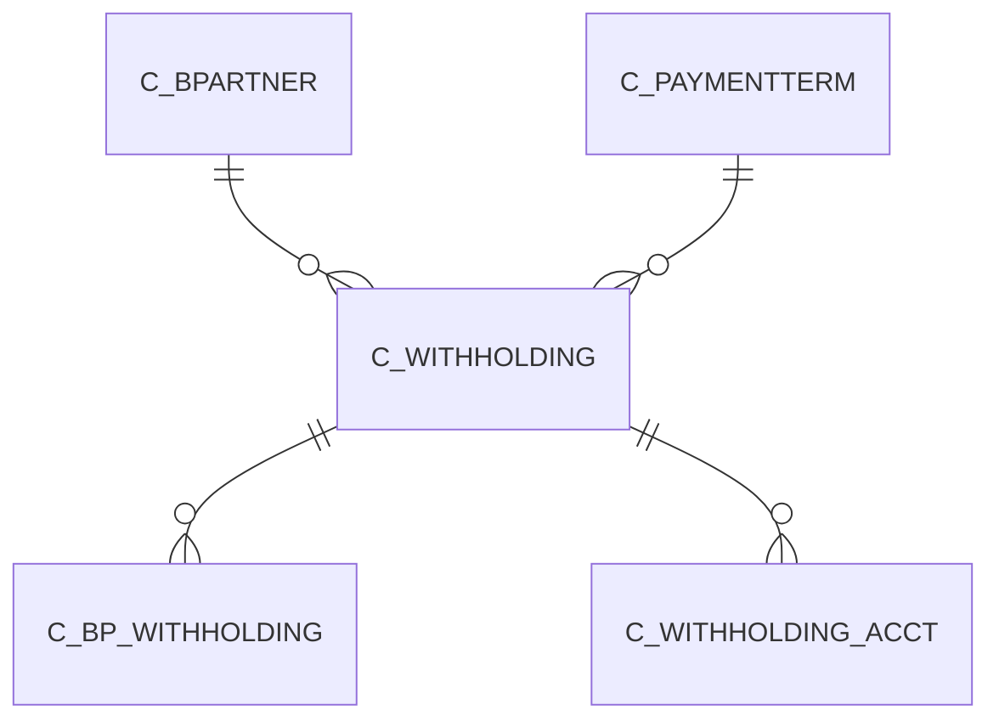

# C_WITHHOLDING

Withholding Certificate

Area [C](../../data-model/c/index.md) · class **business** (proposed) · read from database `idempiere-db` (owner `ADEMPIERE`) · 0 row(s) when profiled

Application model: `org.compiere.model.X_C_Withholding`, access level 3 - Client - Org.

## Columns

| column | type | key | not null | business name | references (code) | nulls | distinct |
|---|---|---|---|---|---|---|---|
| `C_WITHHOLDING_ID` | NUMBER(10,0) | PK | yes | Withholding |  | 0 | 0 |
| `AD_CLIENT_ID` | NUMBER(10,0) |  | yes | Tenant |  | 0 | 0 |
| `AD_ORG_ID` | NUMBER(10,0) |  | yes | Organization |  | 0 | 0 |
| `ISACTIVE` | CHAR(1) |  | yes | Active |  | 0 | 0 |
| `CREATED` | DATE |  | yes | Created |  | 0 | 0 |
| `CREATEDBY` | NUMBER(10,0) |  | yes | Created By |  | 0 | 0 |
| `UPDATED` | DATE |  | yes | Updated |  | 0 | 0 |
| `UPDATEDBY` | NUMBER(10,0) |  | yes | Updated By |  | 0 | 0 |
| `NAME` | VARCHAR2(60 CHAR) |  | yes | Name |  | 0 | 0 |
| `DESCRIPTION` | VARCHAR2(255 CHAR) |  |  | Description |  | 0 | 0 |
| `C_PAYMENTTERM_ID` | NUMBER(10,0) |  | yes | Payment Term | [C_PAYMENTTERM](../../data-model/c/c_paymentterm.md) | 0 | 0 |
| `ISTAXWITHHOLDING` | CHAR(1) |  | yes | Tax withholding |  | 0 | 0 |
| `ISTAXPRORATED` | CHAR(1) |  | yes | Prorate tax |  | 0 | 0 |
| `ISPAIDTO3PARTY` | CHAR(1) |  | yes | Paid to third party |  | 0 | 0 |
| `BENEFICIARY` | NUMBER(10,0) |  |  | Beneficiary |  | 0 | 0 |
| `ISPERCENTWITHHOLDING` | CHAR(1) |  | yes | Percent withholding |  | 0 | 0 |
| `PERCENT` | NUMBER |  |  | Percent |  | 0 | 0 |
| `FIXAMT` | NUMBER |  |  | Fix amount |  | 0 | 0 |
| `THRESHOLDMIN` | NUMBER |  |  | Threshold min |  | 0 | 0 |
| `THRESHOLDMAX` | NUMBER |  |  | Threshold max |  | 0 | 0 |
| `MINAMT` | NUMBER |  |  | Min Amount |  | 0 | 0 |
| `MAXAMT` | NUMBER |  |  | Max Amount |  | 0 | 0 |
| `C_WITHHOLDING_UU` | VARCHAR2(36 CHAR) |  |  | C_Withholding_UU |  | 0 | 0 |

*references (code)* is the table the application model's code says a column points to; *Foreign keys* below are the constraints the database declares. Counts come from the profile; no value is ever shown.

## Check constraints

| name | expression |
|---|---|
| `SYS_C0019794` | `IsTaxProrated in ('Y','N')` |
| `SYS_C0019796` | `IsPercentWithholding in ('Y','N')` |
| `SYS_C0019798` | `IsPaidTo3Party in ('Y','N')` |
| `SYS_C0019799` | `IsTaxWithholding in ('Y','N')` |
| `SYS_C0019800` | `IsActive in ('Y','N')` |

## Foreign keys

**References**

| table | columns | on delete |
|---|---|---|
| [C_BPARTNER](../../data-model/c/c_bpartner.md) | C_WITHHOLDING.BENEFICIARY → C_BPARTNER.C_BPARTNER_ID | NO ACTION |
| [C_PAYMENTTERM](../../data-model/c/c_paymentterm.md) | C_WITHHOLDING.C_PAYMENTTERM_ID → C_PAYMENTTERM.C_PAYMENTTERM_ID | NO ACTION |

**Referenced by**

| table | columns | on delete |
|---|---|---|
| [C_BP_WITHHOLDING](../../data-model/c/c_bp_withholding.md) | C_BP_WITHHOLDING.C_WITHHOLDING_ID → C_WITHHOLDING.C_WITHHOLDING_ID | NO ACTION |
| [C_WITHHOLDING_ACCT](../../data-model/c/c_withholding_acct.md) | C_WITHHOLDING_ACCT.C_WITHHOLDING_ID → C_WITHHOLDING.C_WITHHOLDING_ID | NO ACTION |

## Write behaviour

- updates: **po_only**
- deletes: **deleted_by_users**
- change log: **recorded**
- evidence: 1 citation(s)

## Read by

| kind | name |
|---|---|
| Procedure | [C_AcctSchema_Default_Copy](../../logic/c_acctschema_default_copy.md) |

## Schema history

17 change(s); the latest:

| applied | release | operation | column | tickets |
|---|---|---|---|---|
| 2023-04-09T15:47 | iD11 | `add_constraint` |  | IDEMPIERE-5567 |
| 2023-04-09T15:47 | iD11 | `add_constraint` |  | IDEMPIERE-5567 |
| 2021-12-05T16:45 | i8.2z | `add_constraint` |  | IDEMPIERE-5075 |
| 2021-12-05T16:45 | i8.2z | `add_constraint` |  | IDEMPIERE-5075 |
| 2021-12-05T16:45 | i8.2z | `drop_constraint` |  | IDEMPIERE-5075 |
| 2021-12-05T16:45 | i8.2z | `drop_constraint` |  | IDEMPIERE-5075 |
| 2020-08-04T01:00 | i7.1z | `add_column` | tmp_col_2_tmp | IDEMPIERE-3862 |
| 2020-08-04T01:00 | i7.1z | `modify_column` | NAME | IDEMPIERE-3862 |
| 2020-08-04T01:00 | i7.1z | `modify_column` | DESCRIPTION | IDEMPIERE-3862 |
| 2020-08-04T01:00 | i7.1z | `drop_column` | tmp_col_1_tmp | IDEMPIERE-3862 |
| 2020-08-04T01:00 | i7.1z | `add_column` | tmp_col_3_tmp | IDEMPIERE-3862 |
| 2020-08-04T01:00 | i7.1z | `modify_column` | NAME | IDEMPIERE-3862 |
| 2020-08-04T01:00 | i7.1z | `add_column` | tmp_col_1_tmp | IDEMPIERE-3862 |
| 2020-08-04T01:00 | i7.1z | `modify_column` | C_WITHHOLDING_UU | IDEMPIERE-3862 |
| 2020-08-04T01:00 | i7.1z | `drop_column` | tmp_col_2_tmp | IDEMPIERE-3862 |

## Open conflicts

| type | attribute | explanation |
|---|---|---|
| `mandatory_but_nullable` | `columns.Beneficiary.nullable` | unexplained |

## Notes

<!-- ekos:manual id="table.c_withholding.notes" -->
_Business notes about this table._
<!-- /ekos:manual -->
