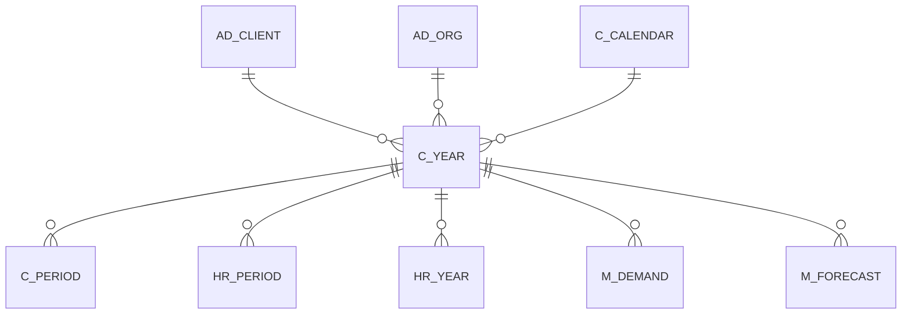

# C_YEAR

Area [C](../../data-model/c/index.md) · class **business** (proposed) · read from database `idempiere-db` (owner `ADEMPIERE`) · 30 row(s) when profiled

Application model: `org.compiere.model.X_C_Year`, access level 2 - Client.

## Columns

| column | type | key | not null | business name | references (code) | nulls | distinct |
|---|---|---|---|---|---|---|---|
| `C_YEAR_ID` | NUMBER(10,0) | PK | yes | Year |  | 0 | 30 |
| `AD_CLIENT_ID` | NUMBER(10,0) |  | yes | Tenant |  | 0 | 1 |
| `AD_ORG_ID` | NUMBER(10,0) |  | yes | Organization |  | 0 | 1 |
| `ISACTIVE` | CHAR(1) |  | yes | Active |  | 0 | 1 |
| `CREATED` | DATE |  | yes | Created |  | 0 | 30 |
| `CREATEDBY` | NUMBER(10,0) |  | yes | Created By |  | 0 | 2 |
| `UPDATED` | DATE |  | yes | Updated |  | 0 | 30 |
| `UPDATEDBY` | NUMBER(10,0) |  | yes | Updated By |  | 0 | 2 |
| `FISCALYEAR` | VARCHAR2(10 CHAR) |  | yes | Year |  | 0 | 30 |
| `DESCRIPTION` | VARCHAR2(255 CHAR) |  |  | Description |  | 30 | 0 |
| `C_CALENDAR_ID` | NUMBER(10,0) |  | yes | Calendar | [C_CALENDAR](../../data-model/c/c_calendar.md) | 0 | 1 |
| `PROCESSING` | CHAR(1) |  |  | Process Now |  | 1 | 1 |
| `C_YEAR_UU` | VARCHAR2(36 CHAR) |  |  | C_Year_UU |  | 0 | 30 |

*references (code)* is the table the application model's code says a column points to; *Foreign keys* below are the constraints the database declares. Counts come from the profile; no value is ever shown.

## Check constraints

| name | expression |
|---|---|
| `SYS_C0022350` | `IsActive in ('Y','N')` |

## Foreign keys

**References**

| table | columns | on delete |
|---|---|---|
| [AD_CLIENT](../../data-model/ad/ad_client.md) | C_YEAR.AD_CLIENT_ID → AD_CLIENT.AD_CLIENT_ID | NO ACTION |
| [AD_ORG](../../data-model/ad/ad_org.md) | C_YEAR.AD_ORG_ID → AD_ORG.AD_ORG_ID | NO ACTION |
| [C_CALENDAR](../../data-model/c/c_calendar.md) | C_YEAR.C_CALENDAR_ID → C_CALENDAR.C_CALENDAR_ID | NO ACTION |

**Referenced by**

| table | columns | on delete |
|---|---|---|
| [C_PERIOD](../../data-model/c/c_period.md) | C_PERIOD.C_YEAR_ID → C_YEAR.C_YEAR_ID | NO ACTION |
| [HR_PERIOD](../../data-model/hr/hr_period.md) | HR_PERIOD.C_YEAR_ID → C_YEAR.C_YEAR_ID | NO ACTION |
| [HR_YEAR](../../data-model/hr/hr_year.md) | HR_YEAR.C_YEAR_ID → C_YEAR.C_YEAR_ID | NO ACTION |
| [M_DEMAND](../../data-model/m/m_demand.md) | M_DEMAND.C_YEAR_ID → C_YEAR.C_YEAR_ID | NO ACTION |
| [M_FORECAST](../../data-model/m/m_forecast.md) | M_FORECAST.C_YEAR_ID → C_YEAR.C_YEAR_ID | NO ACTION |

## Write behaviour

- updates: **po_only**
- deletes: **soft_delete_only**
- change log: **recorded**
- evidence: 1 citation(s)

## Schema history

15 change(s); the latest:

| applied | release | operation | column | tickets |
|---|---|---|---|---|
| 2023-04-09T15:47 | iD11 | `add_constraint` |  | IDEMPIERE-5567 |
| 2023-04-09T15:47 | iD11 | `add_constraint` |  | IDEMPIERE-5567 |
| 2021-12-05T16:45 | i8.2z | `drop_constraint` |  | IDEMPIERE-5075 |
| 2021-12-05T16:45 | i8.2z | `add_constraint` |  | IDEMPIERE-5075 |
| 2021-12-05T16:45 | i8.2z | `add_constraint` |  | IDEMPIERE-5075 |
| 2021-12-05T16:45 | i8.2z | `add_constraint` |  | IDEMPIERE-5075 |
| 2021-12-05T16:45 | i8.2z | `drop_constraint` |  | IDEMPIERE-5075 |
| 2021-12-05T16:45 | i8.2z | `drop_constraint` |  | IDEMPIERE-5075 |
| 2020-08-04T01:00 | i7.1z | `drop_column` | tmp_col_2_tmp | IDEMPIERE-3862 |
| 2020-08-04T01:00 | i7.1z | `modify_column` | FISCALYEAR | IDEMPIERE-3862 |
| 2020-08-04T01:00 | i7.1z | `drop_column` | tmp_col_1_tmp | IDEMPIERE-3862 |
| 2020-08-04T01:00 | i7.1z | `add_column` | tmp_col_1_tmp | IDEMPIERE-3862 |
| 2020-08-04T01:00 | i7.1z | `modify_column` | DESCRIPTION | IDEMPIERE-3862 |
| 2020-08-04T01:00 | i7.1z | `add_column` | tmp_col_2_tmp | IDEMPIERE-3862 |
| 2020-08-04T01:00 | i7.1z | `modify_column` | C_YEAR_UU | IDEMPIERE-3862 |

## Notes

<!-- ekos:manual id="table.c_year.notes" -->
_Business notes about this table._
<!-- /ekos:manual -->
