# Area C

198 table(s), 197 in scope.

```mermaid
erDiagram
  C_ACCTSCHEMA ||--o{ C_ACCTSCHEMA_ELEMENT : ""
  C_ACCTSCHEMA ||--o{ C_VALIDCOMBINATION : ""
  C_ACTIVITY ||--o{ C_ACCTSCHEMA_ELEMENT : ""
  C_ACTIVITY ||--o{ C_CASHPLANLINE : ""
  C_ACTIVITY ||--o{ C_INVOICE : ""
  C_ACTIVITY ||--o{ C_INVOICEBATCHLINE : ""
  C_ACTIVITY ||--o{ C_INVOICELINE : ""
  C_ACTIVITY ||--o{ C_ORDER : ""
  C_ACTIVITY ||--o{ C_ORDERLINE : ""
  C_ACTIVITY ||--o{ C_PAYMENT : ""
  C_ACTIVITY ||--o{ C_PAYMENTTRANSACTION : ""
  C_ACTIVITY ||--o{ C_PROJECT : ""
  C_ACTIVITY ||--o{ C_VALIDCOMBINATION : ""
  C_BANKACCOUNT ||--o{ C_BANKTRANSFER : ""
  C_BANKACCOUNT ||--o{ C_CASHLINE : ""
  C_BANKACCOUNT ||--o{ C_ELEMENTVALUE : ""
  C_BANKACCOUNT ||--o{ C_PAYMENT : ""
  C_BANKACCOUNT ||--o{ C_PAYMENTTRANSACTION : ""
  C_BANKTRANSFER ||--o{ C_ALLOCATIONLINE : ""
  C_BANKTRANSFER ||--o{ C_PAYMENT : ""
  C_BPARTNER ||--o{ C_ACCTSCHEMA_ELEMENT : ""
  C_BPARTNER ||--o{ C_ALLOCATIONLINE : ""
  C_BPARTNER ||--o{ C_BANKSTATEMENTLINE : ""
  C_BPARTNER ||--o{ C_BANKTRANSFER : ""
  C_BPARTNER ||--o{ C_BPARTNER : ""
  C_BPARTNER ||--o{ C_BPARTNER_LOCATION : ""
  C_BPARTNER ||--o{ C_CASHPLANLINE : ""
  C_BPARTNER ||--o{ C_CHARGE : ""
  C_BPARTNER ||--o{ C_INVOICE : ""
  C_BPARTNER ||--o{ C_INVOICEBATCHLINE : ""
  C_BPARTNER ||--o{ C_ORDER : ""
  C_BPARTNER ||--o{ C_ORDERLINE : ""
  C_BPARTNER ||--o{ C_PAYMENT : ""
  C_BPARTNER ||--o{ C_PAYMENTTRANSACTION : ""
  C_BPARTNER ||--o{ C_PROJECT : ""
  C_BPARTNER ||--o{ C_VALIDCOMBINATION : ""
  C_BPARTNER_LOCATION ||--o{ C_INVOICE : ""
  C_BPARTNER_LOCATION ||--o{ C_INVOICEBATCHLINE : ""
  C_BPARTNER_LOCATION ||--o{ C_ORDER : ""
  C_BPARTNER_LOCATION ||--o{ C_ORDERLINE : ""
  C_BPARTNER_LOCATION ||--o{ C_PROJECT : ""
  C_CAMPAIGN ||--o{ C_ACCTSCHEMA_ELEMENT : ""
  C_CAMPAIGN ||--o{ C_CASHPLANLINE : ""
  C_CAMPAIGN ||--o{ C_INVOICE : ""
  C_CAMPAIGN ||--o{ C_INVOICELINE : ""
  C_CAMPAIGN ||--o{ C_ORDER : ""
  C_CAMPAIGN ||--o{ C_ORDERLINE : ""
  C_CAMPAIGN ||--o{ C_PAYMENT : ""
  C_CAMPAIGN ||--o{ C_PAYMENTTRANSACTION : ""
  C_CAMPAIGN ||--o{ C_PROJECT : ""
  C_CAMPAIGN ||--o{ C_VALIDCOMBINATION : ""
  C_CASHLINE ||--o{ C_ALLOCATIONLINE : ""
  C_CASHLINE ||--o{ C_INVOICE : ""
  C_CASHLINE ||--o{ C_ORDER : ""
  C_CASHPLANLINE ||--o{ C_INVOICE : ""
  C_CASHPLANLINE ||--o{ C_ORDER : ""
  C_CHARGE ||--o{ C_ALLOCATIONLINE : ""
  C_CHARGE ||--o{ C_BANKSTATEMENTLINE : ""
  C_CHARGE ||--o{ C_BANKTRANSFER : ""
  C_CHARGE ||--o{ C_CASHLINE : ""
  C_CHARGE ||--o{ C_CASHPLANLINE : ""
  C_CHARGE ||--o{ C_INVOICE : ""
  C_CHARGE ||--o{ C_INVOICEBATCHLINE : ""
  C_CHARGE ||--o{ C_INVOICELINE : ""
  C_CHARGE ||--o{ C_ORDER : ""
  C_CHARGE ||--o{ C_ORDERLINE : ""
  C_CHARGE ||--o{ C_PAYMENT : ""
  C_CHARGE ||--o{ C_PAYMENTTRANSACTION : ""
  C_COUNTRY ||--o{ C_COUNTRY : ""
  C_COUNTRY ||--o{ C_LOCATION : ""
  C_COUNTRY ||--o{ C_TAX : ""
  C_CURRENCY ||--o{ C_ACCTSCHEMA : ""
  C_CURRENCY ||--o{ C_BANKACCOUNT : ""
  C_CURRENCY ||--o{ C_BANKSTATEMENTLINE : ""
  C_CURRENCY ||--o{ C_BANKTRANSFER : ""
  C_CURRENCY ||--o{ C_CASHLINE : ""
  C_CURRENCY ||--o{ C_COUNTRY : ""
  C_CURRENCY ||--o{ C_ELEMENTVALUE : ""
  C_CURRENCY ||--o{ C_INVOICE : ""
  C_CURRENCY ||--o{ C_ORDER : ""
  C_CURRENCY ||--o{ C_ORDERLINE : ""
  C_CURRENCY ||--o{ C_PAYMENT : ""
  C_CURRENCY ||--o{ C_PAYMENTTRANSACTION : ""
  C_CURRENCY ||--o{ C_PROJECT : ""
  C_DOCTYPE ||--o{ C_DOCTYPE : ""
  C_DOCTYPE ||--o{ C_INVOICE : ""
  C_DOCTYPE ||--o{ C_INVOICEBATCHLINE : ""
  C_DOCTYPE ||--o{ C_ORDER : ""
  C_DOCTYPE ||--o{ C_PAYMENT : ""
  C_ELEMENTVALUE ||--o{ C_ACCTSCHEMA_ELEMENT : ""
  C_ELEMENTVALUE ||--o{ C_CASHPLANLINE : ""
  C_ELEMENTVALUE ||--o{ C_INVOICE : ""
  C_ELEMENTVALUE ||--o{ C_INVOICEBATCHLINE : ""
  C_ELEMENTVALUE ||--o{ C_INVOICELINE : ""
  C_ELEMENTVALUE ||--o{ C_ORDER : ""
  C_ELEMENTVALUE ||--o{ C_ORDERLINE : ""
  C_ELEMENTVALUE ||--o{ C_PAYMENT : ""
  C_ELEMENTVALUE ||--o{ C_PAYMENTTRANSACTION : ""
  C_ELEMENTVALUE ||--o{ C_VALIDCOMBINATION : ""
  C_INVOICE ||--o{ C_ALLOCATIONLINE : ""
  C_INVOICE ||--o{ C_BANKSTATEMENTLINE : ""
  C_INVOICE ||--o{ C_CASHLINE : ""
  C_INVOICE ||--o{ C_INVOICE : ""
  C_INVOICE ||--o{ C_INVOICEBATCHLINE : ""
  C_INVOICE ||--o{ C_INVOICELINE : ""
  C_INVOICE ||--o{ C_PAYMENT : ""
  C_INVOICE ||--o{ C_PAYMENTTRANSACTION : ""
  C_INVOICELINE ||--o{ C_INVOICEBATCHLINE : ""
  C_INVOICELINE ||--o{ C_INVOICELINE : ""
  C_LOCATION ||--o{ C_ACCTSCHEMA_ELEMENT : ""
  C_LOCATION ||--o{ C_BPARTNER_LOCATION : ""
  C_LOCATION ||--o{ C_VALIDCOMBINATION : ""
  C_ORDER ||--o{ C_ALLOCATIONLINE : ""
  C_ORDER ||--o{ C_INVOICE : ""
  C_ORDER ||--o{ C_ORDER : ""
  C_ORDER ||--o{ C_ORDERLINE : ""
  C_ORDER ||--o{ C_PAYMENT : ""
  C_ORDER ||--o{ C_PAYMENTTRANSACTION : ""
  C_ORDER ||--o{ C_PROJECTPHASE : ""
  C_ORDERLINE ||--o{ C_INVOICELINE : ""
  C_ORDERLINE ||--o{ C_ORDERLINE : ""
  C_PAYMENT ||--o{ C_ALLOCATIONLINE : ""
  C_PAYMENT ||--o{ C_BANKSTATEMENTLINE : ""
  C_PAYMENT ||--o{ C_CASHLINE : ""
  C_PAYMENT ||--o{ C_INVOICE : ""
  C_PAYMENT ||--o{ C_ORDER : ""
  C_PAYMENT ||--o{ C_PAYMENT : ""
  C_PAYMENT ||--o{ C_PAYMENTTRANSACTION : ""
  C_PAYMENTTERM ||--o{ C_BPARTNER : ""
  C_PAYMENTTERM ||--o{ C_INVOICE : ""
  C_PAYMENTTERM ||--o{ C_ORDER : ""
  C_PAYMENTTERM ||--o{ C_PROJECT : ""
  C_PAYMENTTRANSACTION ||--o{ C_PAYMENTTRANSACTION : ""
  C_PROJECT ||--o{ C_ACCTSCHEMA_ELEMENT : ""
  C_PROJECT ||--o{ C_CASHPLANLINE : ""
  C_PROJECT ||--o{ C_INVOICE : ""
  C_PROJECT ||--o{ C_INVOICEBATCHLINE : ""
  C_PROJECT ||--o{ C_INVOICELINE : ""
  C_PROJECT ||--o{ C_ORDER : ""
  C_PROJECT ||--o{ C_ORDERLINE : ""
  C_PROJECT ||--o{ C_PAYMENT : ""
  C_PROJECT ||--o{ C_PAYMENTTRANSACTION : ""
  C_PROJECT ||--o{ C_PROJECTPHASE : ""
  C_PROJECT ||--o{ C_VALIDCOMBINATION : ""
  C_PROJECTPHASE ||--o{ C_CASHPLANLINE : ""
  C_PROJECTPHASE ||--o{ C_INVOICELINE : ""
  C_PROJECTPHASE ||--o{ C_ORDERLINE : ""
  C_TAX ||--o{ C_INVOICEBATCHLINE : ""
  C_TAX ||--o{ C_INVOICELINE : ""
  C_TAX ||--o{ C_ORDERLINE : ""
  C_TAX ||--o{ C_TAX : ""
```

The diagram shows the 30 most connected tables; 167 more are listed below.

| table | class | scope | rows | description |
|---|---|---|---|---|
| [C_1099BOX](../../data-model/c/c_1099box.md) | business | in | 0 |  |
| [C_ACCTPROCESSOR](../../data-model/c/c_acctprocessor.md) | business | in | 1 |  |
| `C_ACCTPROCESSORLOG` | log | out | 0 |  |
| [C_ACCTSCHEMA](../../data-model/c/c_acctschema.md) | business | in | 2 |  |
| [C_ACCTSCHEMA_DEFAULT](../../data-model/c/c_acctschema_default.md) | business | in | 2 |  |
| [C_ACCTSCHEMA_ELEMENT](../../data-model/c/c_acctschema_element.md) | business | in | 12 |  |
| [C_ACCTSCHEMA_GL](../../data-model/c/c_acctschema_gl.md) | business | in | 2 |  |
| [C_ACTIVITY](../../data-model/c/c_activity.md) | business | in | 0 |  |
| [C_ACTIVITY_TRL](../../data-model/c/c_activity_trl.md) | translation | in | 0 |  |
| [C_ADDRESSTRANSACTION](../../data-model/c/c_addresstransaction.md) | business | in | 0 |  |
| [C_ADDRESSVALIDATION](../../data-model/c/c_addressvalidation.md) | business | in | 0 |  |
| [C_ADDRESSVALIDATIONCFG](../../data-model/c/c_addressvalidationcfg.md) | business | in | 0 |  |
| [C_ALLOCATIONHDR](../../data-model/c/c_allocationhdr.md) | business | in | 2 |  |
| [C_ALLOCATIONLINE](../../data-model/c/c_allocationline.md) | business | in | 2 | The total of Amount+DiscountAmt+WriteOffAmt is the receivables/payables |
| [C_BANK](../../data-model/c/c_bank.md) | business | in | 2 |  |
| [C_BANKACCOUNT](../../data-model/c/c_bankaccount.md) | business | in | 3 | Own Bank Account |
| [C_BANKACCOUNTDOC](../../data-model/c/c_bankaccountdoc.md) | business | in | 2 |  |
| [C_BANKACCOUNT_ACCT](../../data-model/c/c_bankaccount_acct.md) | business | in | 6 |  |
| [C_BANKACCOUNT_PROCESSOR](../../data-model/c/c_bankaccount_processor.md) | business | in | 2 |  |
| [C_BANKSTATEMENT](../../data-model/c/c_bankstatement.md) | business | in | 2 |  |
| [C_BANKSTATEMENTLINE](../../data-model/c/c_bankstatementline.md) | business | in | 2 |  |
| [C_BANKSTATEMENTLOADER](../../data-model/c/c_bankstatementloader.md) | business | in | 0 |  |
| [C_BANKSTATEMENTMATCHER](../../data-model/c/c_bankstatementmatcher.md) | business | in | 0 |  |
| [C_BANKTRANSFER](../../data-model/c/c_banktransfer.md) | business | in | 0 |  |
| [C_BPARTNER](../../data-model/c/c_bpartner.md) | business | in | 18 |  |
| [C_BPARTNER_LOCATION](../../data-model/c/c_bpartner_location.md) | business | in | 16 |  |
| [C_BPARTNER_PRODUCT](../../data-model/c/c_bpartner_product.md) | business | in | 1 |  |
| [C_BP_BANKACCOUNT](../../data-model/c/c_bp_bankaccount.md) | business | in | 1 | Default Payment Info |
| [C_BP_CUSTOMER_ACCT](../../data-model/c/c_bp_customer_acct.md) | business | in | 36 |  |
| [C_BP_EDI](../../data-model/c/c_bp_edi.md) | business | in | 0 |  |
| [C_BP_EMPLOYEE_ACCT](../../data-model/c/c_bp_employee_acct.md) | business | in | 17 |  |
| [C_BP_GROUP](../../data-model/c/c_bp_group.md) | business | in | 3 |  |
| [C_BP_GROUP_ACCT](../../data-model/c/c_bp_group_acct.md) | business | in | 6 |  |
| [C_BP_RELATION](../../data-model/c/c_bp_relation.md) | business | in | 1 |  |
| [C_BP_SHIPPINGACCT](../../data-model/c/c_bp_shippingacct.md) | business | in | 0 |  |
| [C_BP_VENDOR_ACCT](../../data-model/c/c_bp_vendor_acct.md) | business | in | 36 |  |
| [C_BP_WITHHOLDING](../../data-model/c/c_bp_withholding.md) | business | in | 0 |  |
| [C_CALENDAR](../../data-model/c/c_calendar.md) | business | in | 1 |  |
| [C_CAMPAIGN](../../data-model/c/c_campaign.md) | business | in | 2 |  |
| [C_CAMPAIGN_TRL](../../data-model/c/c_campaign_trl.md) | translation | in | 2 |  |
| [C_CASH](../../data-model/c/c_cash.md) | business | in | 3 |  |
| [C_CASHBOOK](../../data-model/c/c_cashbook.md) | business | in | 2 |  |
| [C_CASHBOOK_ACCT](../../data-model/c/c_cashbook_acct.md) | business | in | 4 |  |
| [C_CASHLINE](../../data-model/c/c_cashline.md) | business | in | 5 |  |
| [C_CASHPLAN](../../data-model/c/c_cashplan.md) | business | in | 0 |  |
| [C_CASHPLANLINE](../../data-model/c/c_cashplanline.md) | business | in | 0 |  |
| [C_CHANNEL](../../data-model/c/c_channel.md) | business | in | 2 |  |
| [C_CHARGE](../../data-model/c/c_charge.md) | business | in | 3 |  |
| [C_CHARGETYPE](../../data-model/c/c_chargetype.md) | business | in | 0 |  |
| [C_CHARGETYPE_DOCTYPE](../../data-model/c/c_chargetype_doctype.md) | business | in | 0 |  |
| [C_CHARGE_ACCT](../../data-model/c/c_charge_acct.md) | business | in | 6 |  |
| [C_CHARGE_TRL](../../data-model/c/c_charge_trl.md) | translation | in | 3 |  |
| [C_CITY](../../data-model/c/c_city.md) | business | in | 1 |  |
| [C_COMMISSION](../../data-model/c/c_commission.md) | business | in | 1 |  |
| [C_COMMISSIONAMT](../../data-model/c/c_commissionamt.md) | business | in | 0 |  |
| [C_COMMISSIONDETAIL](../../data-model/c/c_commissiondetail.md) | business | in | 0 |  |
| [C_COMMISSIONLINE](../../data-model/c/c_commissionline.md) | business | in | 1 |  |
| [C_COMMISSIONRUN](../../data-model/c/c_commissionrun.md) | business | in | 0 |  |
| [C_CONTACTACTIVITY](../../data-model/c/c_contactactivity.md) | business | in | 0 |  |
| [C_CONVERSIONTYPE](../../data-model/c/c_conversiontype.md) | business | in | 4 |  |
| [C_CONVERSION_RATE](../../data-model/c/c_conversion_rate.md) | business | in | 4 |  |
| [C_COSTCENTER](../../data-model/c/c_costcenter.md) | unclassified | in |  |  |
| [C_COUNTRY](../../data-model/c/c_country.md) | business | in | 251 |  |
| [C_COUNTRYGROUP](../../data-model/c/c_countrygroup.md) | business | in | 0 |  |
| [C_COUNTRYGROUPCOUNTRY](../../data-model/c/c_countrygroupcountry.md) | business | in | 0 |  |
| [C_COUNTRYGROUP_TRL](../../data-model/c/c_countrygroup_trl.md) | translation | in | 0 |  |
| [C_COUNTRY_TRL](../../data-model/c/c_country_trl.md) | translation | in | 251 |  |
| [C_CURRENCY](../../data-model/c/c_currency.md) | business | in | 175 |  |
| [C_CURRENCY_ACCT](../../data-model/c/c_currency_acct.md) | business | in | 0 |  |
| [C_CURRENCY_TRL](../../data-model/c/c_currency_trl.md) | translation | in | 175 |  |
| [C_CYCLE](../../data-model/c/c_cycle.md) | business | in | 2 |  |
| [C_CYCLEPHASE](../../data-model/c/c_cyclephase.md) | business | in | 10 |  |
| [C_CYCLESTEP](../../data-model/c/c_cyclestep.md) | business | in | 4 |  |
| [C_DEPARTMENT](../../data-model/c/c_department.md) | unclassified | in |  |  |
| [C_DEPOSITBATCH](../../data-model/c/c_depositbatch.md) | business | in | 0 |  |
| [C_DEPOSITBATCHLINE](../../data-model/c/c_depositbatchline.md) | business | in | 0 |  |
| [C_DOCBASEGROUP](../../data-model/c/c_docbasegroup.md) | business | in | 0 |  |
| [C_DOCBASEGROUPLINE](../../data-model/c/c_docbasegroupline.md) | business | in | 0 |  |
| [C_DOCTYPE](../../data-model/c/c_doctype.md) | business | in | 52 |  |
| [C_DOCTYPECOUNTER](../../data-model/c/c_doctypecounter.md) | business | in | 1 |  |
| [C_DOCTYPE_TRL](../../data-model/c/c_doctype_trl.md) | translation | in | 52 |  |
| [C_DUNNING](../../data-model/c/c_dunning.md) | business | in | 2 |  |
| [C_DUNNINGLEVEL](../../data-model/c/c_dunninglevel.md) | business | in | 2 |  |
| [C_DUNNINGLEVEL_TRL](../../data-model/c/c_dunninglevel_trl.md) | translation | in | 2 |  |
| [C_DUNNINGRUN](../../data-model/c/c_dunningrun.md) | business | in | 0 |  |
| [C_DUNNINGRUNENTRY](../../data-model/c/c_dunningrunentry.md) | business | in | 0 |  |
| [C_DUNNINGRUNLINE](../../data-model/c/c_dunningrunline.md) | business | in | 0 |  |
| [C_ELEMENT](../../data-model/c/c_element.md) | business | in | 1 | Defines the element of an account key |
| [C_ELEMENTVALUE](../../data-model/c/c_elementvalue.md) | business | in | 379 | Element Values |
| [C_ELEMENTVALUE_TRL](../../data-model/c/c_elementvalue_trl.md) | translation | in | 379 |  |
| [C_GREETING](../../data-model/c/c_greeting.md) | business | in | 1 |  |
| [C_GREETING_TRL](../../data-model/c/c_greeting_trl.md) | translation | in | 1 |  |
| [C_INTERORG_ACCT](../../data-model/c/c_interorg_acct.md) | business | in | 0 |  |
| [C_INVOICE](../../data-model/c/c_invoice.md) | business | in | 8 |  |
| [C_INVOICEBATCH](../../data-model/c/c_invoicebatch.md) | business | in | 0 |  |
| [C_INVOICEBATCHLINE](../../data-model/c/c_invoicebatchline.md) | business | in | 0 |  |
| [C_INVOICELINE](../../data-model/c/c_invoiceline.md) | business | in | 24 |  |
| [C_INVOICEPAYSCHEDULE](../../data-model/c/c_invoicepayschedule.md) | business | in | 2 |  |
| [C_INVOICESCHEDULE](../../data-model/c/c_invoiceschedule.md) | business | in | 1 |  |
| [C_INVOICETAX](../../data-model/c/c_invoicetax.md) | business | in | 8 |  |
| [C_JOB](../../data-model/c/c_job.md) | business | in | 4 |  |
| [C_JOBASSIGNMENT](../../data-model/c/c_jobassignment.md) | business | in | 0 |  |
| [C_JOBCATEGORY](../../data-model/c/c_jobcategory.md) | business | in | 4 |  |
| [C_JOBREMUNERATION](../../data-model/c/c_jobremuneration.md) | business | in | 0 |  |
| [C_LANDEDCOST](../../data-model/c/c_landedcost.md) | business | in | 0 |  |
| [C_LANDEDCOSTALLOCATION](../../data-model/c/c_landedcostallocation.md) | business | in | 0 |  |
| [C_LOCATION](../../data-model/c/c_location.md) | business | in | 34 |  |
| [C_NONBUSINESSDAY](../../data-model/c/c_nonbusinessday.md) | business | in | 1 |  |
| [C_ONLINETRXHISTORY](../../data-model/c/c_onlinetrxhistory.md) | business | in | 0 |  |
| [C_OPPORTUNITY](../../data-model/c/c_opportunity.md) | business | in | 0 |  |
| [C_ORDER](../../data-model/c/c_order.md) | business | in | 8 | Sales & Purchase Order |
| [C_ORDERLANDEDCOST](../../data-model/c/c_orderlandedcost.md) | business | in | 0 |  |
| [C_ORDERLANDEDCOSTALLOCATION](../../data-model/c/c_orderlandedcostallocation.md) | business | in | 0 |  |
| [C_ORDERLINE](../../data-model/c/c_orderline.md) | business | in | 27 |  |
| [C_ORDERPAYSCHEDULE](../../data-model/c/c_orderpayschedule.md) | business | in | 0 |  |
| [C_ORDERSOURCE](../../data-model/c/c_ordersource.md) | business | in | 0 |  |
| [C_ORDERTAX](../../data-model/c/c_ordertax.md) | business | in | 8 |  |
| [C_ORGASSIGNMENT](../../data-model/c/c_orgassignment.md) | business | in | 0 |  |
| [C_PAYMENT](../../data-model/c/c_payment.md) | business | in | 2 | The Payment Line |
| [C_PAYMENTALLOCATE](../../data-model/c/c_paymentallocate.md) | business | in | 0 |  |
| [C_PAYMENTBATCH](../../data-model/c/c_paymentbatch.md) | business | in | 0 | For Batch Processing (usually payments or direct debit) |
| [C_PAYMENTPROCESSOR](../../data-model/c/c_paymentprocessor.md) | business | in | 2 | Process Definition for Payments/Receipts (Check, CC, etc.) |
| [C_PAYMENTTERM](../../data-model/c/c_paymentterm.md) | business | in | 5 |  |
| [C_PAYMENTTERM_TRL](../../data-model/c/c_paymentterm_trl.md) | translation | in | 5 |  |
| [C_PAYMENTTRANSACTION](../../data-model/c/c_paymenttransaction.md) | business | in | 0 |  |
| [C_PAYSCHEDULE](../../data-model/c/c_payschedule.md) | business | in | 2 |  |
| [C_PAYSELECTION](../../data-model/c/c_payselection.md) | business | in | 1 | Default values for PaySelectionLine |
| [C_PAYSELECTIONCHECK](../../data-model/c/c_payselectioncheck.md) | business | in | 1 |  |
| [C_PAYSELECTIONLINE](../../data-model/c/c_payselectionline.md) | business | in | 1 |  |
| [C_PERIOD](../../data-model/c/c_period.md) | business | in | 360 |  |
| [C_PERIODCONTROL](../../data-model/c/c_periodcontrol.md) | business | in | 10464 |  |
| [C_PHASE](../../data-model/c/c_phase.md) | business | in | 13 |  |
| [C_POS](../../data-model/c/c_pos.md) | business | in | 1 |  |
| [C_POSKEY](../../data-model/c/c_poskey.md) | business | in | 163 |  |
| [C_POSKEYLAYOUT](../../data-model/c/c_poskeylayout.md) | business | in | 5 |  |
| [C_POSPAYMENT](../../data-model/c/c_pospayment.md) | business | in | 0 |  |
| [C_POSTENDERTYPE](../../data-model/c/c_postendertype.md) | business | in | 0 |  |
| [C_PROJECT](../../data-model/c/c_project.md) | business | in | 2 |  |
| [C_PROJECTISSUE](../../data-model/c/c_projectissue.md) | business | in | 0 |  |
| [C_PROJECTISSUEMA](../../data-model/c/c_projectissuema.md) | business | in | 0 |  |
| [C_PROJECTLINE](../../data-model/c/c_projectline.md) | business | in | 1 |  |
| [C_PROJECTPHASE](../../data-model/c/c_projectphase.md) | business | in | 0 |  |
| [C_PROJECTTASK](../../data-model/c/c_projecttask.md) | business | in | 0 |  |
| [C_PROJECTTYPE](../../data-model/c/c_projecttype.md) | business | in | 4 |  |
| [C_PROJECT_ACCT](../../data-model/c/c_project_acct.md) | business | in | 4 |  |
| [C_RECURRING](../../data-model/c/c_recurring.md) | business | in | 1 |  |
| [C_RECURRINGGROUP](../../data-model/c/c_recurringgroup.md) | business | in | 0 |  |
| [C_RECURRING_RUN](../../data-model/c/c_recurring_run.md) | business | in | 0 |  |
| [C_REGION](../../data-model/c/c_region.md) | business | in | 399 |  |
| [C_REGION_TRL](../../data-model/c/c_region_trl.md) | translation | in | 399 |  |
| [C_REMUNERATION](../../data-model/c/c_remuneration.md) | business | in | 0 |  |
| [C_REVENUERECOGNITION](../../data-model/c/c_revenuerecognition.md) | business | in | 2 |  |
| [C_REVENUERECOGNITION_PLAN](../../data-model/c/c_revenuerecognition_plan.md) | business | in | 0 | Based on on Plan, the GL Journals are generated |
| [C_REVENUERECOGNITION_RUN](../../data-model/c/c_revenuerecognition_run.md) | business | in | 0 |  |
| [C_REVENUERECOG_SERVICE](../../data-model/c/c_revenuerecog_service.md) | business | in | 0 |  |
| [C_RFQ](../../data-model/c/c_rfq.md) | business | in | 1 |  |
| [C_RFQLINE](../../data-model/c/c_rfqline.md) | business | in | 2 |  |
| [C_RFQLINEQTY](../../data-model/c/c_rfqlineqty.md) | business | in | 2 |  |
| [C_RFQRESPONSE](../../data-model/c/c_rfqresponse.md) | business | in | 0 |  |
| [C_RFQRESPONSELINE](../../data-model/c/c_rfqresponseline.md) | business | in | 0 |  |
| [C_RFQRESPONSELINEQTY](../../data-model/c/c_rfqresponselineqty.md) | business | in | 0 |  |
| [C_RFQ_TOPIC](../../data-model/c/c_rfq_topic.md) | business | in | 1 |  |
| [C_RFQ_TOPICSUBSCRIBER](../../data-model/c/c_rfq_topicsubscriber.md) | business | in | 2 |  |
| [C_RFQ_TOPICSUBSCRIBERONLY](../../data-model/c/c_rfq_topicsubscriberonly.md) | business | in | 0 |  |
| [C_SALESREGION](../../data-model/c/c_salesregion.md) | business | in | 2 |  |
| [C_SALESREGION_TRL](../../data-model/c/c_salesregion_trl.md) | translation | in | 2 |  |
| [C_SALESSTAGE](../../data-model/c/c_salesstage.md) | business | in | 0 |  |
| [C_SALESSTAGE_TRL](../../data-model/c/c_salesstage_trl.md) | translation | in | 0 |  |
| [C_SERVICELEVEL](../../data-model/c/c_servicelevel.md) | business | in | 0 |  |
| [C_SERVICELEVELLINE](../../data-model/c/c_servicelevelline.md) | business | in | 0 |  |
| [C_SUBACCT](../../data-model/c/c_subacct.md) | business | in | 0 |  |
| [C_SUBSCRIPTION](../../data-model/c/c_subscription.md) | business | in | 0 |  |
| [C_SUBSCRIPTIONTYPE](../../data-model/c/c_subscriptiontype.md) | business | in | 0 |  |
| [C_SUBSCRIPTION_DELIVERY](../../data-model/c/c_subscription_delivery.md) | business | in | 0 |  |
| [C_TASK](../../data-model/c/c_task.md) | business | in | 9 |  |
| [C_TAX](../../data-model/c/c_tax.md) | business | in | 6 |  |
| [C_TAXBASE](../../data-model/c/c_taxbase.md) | business | in | 0 |  |
| [C_TAXCATEGORY](../../data-model/c/c_taxcategory.md) | business | in | 1 |  |
| [C_TAXCATEGORY_TRL](../../data-model/c/c_taxcategory_trl.md) | translation | in | 1 |  |
| [C_TAXDECLARATION](../../data-model/c/c_taxdeclaration.md) | business | in | 0 |  |
| [C_TAXDECLARATIONACCT](../../data-model/c/c_taxdeclarationacct.md) | business | in | 0 |  |
| [C_TAXDECLARATIONLINE](../../data-model/c/c_taxdeclarationline.md) | business | in | 0 |  |
| [C_TAXDEFINITION](../../data-model/c/c_taxdefinition.md) | business | in | 0 |  |
| [C_TAXGROUP](../../data-model/c/c_taxgroup.md) | business | in | 0 |  |
| [C_TAXPOSTAL](../../data-model/c/c_taxpostal.md) | business | in | 0 |  |
| [C_TAXPROVIDER](../../data-model/c/c_taxprovider.md) | business | in | 0 |  |
| [C_TAXPROVIDERCFG](../../data-model/c/c_taxprovidercfg.md) | business | in | 0 |  |
| [C_TAXTYPE](../../data-model/c/c_taxtype.md) | business | in | 0 |  |
| [C_TAX_ACCT](../../data-model/c/c_tax_acct.md) | business | in | 12 |  |
| [C_TAX_TRL](../../data-model/c/c_tax_trl.md) | translation | in | 6 |  |
| [C_UOM](../../data-model/c/c_uom.md) | business | in | 15 |  |
| [C_UOM_CONVERSION](../../data-model/c/c_uom_conversion.md) | business | in | 1 |  |
| [C_UOM_TRL](../../data-model/c/c_uom_trl.md) | translation | in | 15 |  |
| [C_USERREMUNERATION](../../data-model/c/c_userremuneration.md) | business | in | 0 |  |
| [C_VALIDCOMBINATION](../../data-model/c/c_validcombination.md) | business | in | 157 |  |
| [C_WITHHOLDING](../../data-model/c/c_withholding.md) | business | in | 0 | Withholding Certificate |
| [C_WITHHOLDING_ACCT](../../data-model/c/c_withholding_acct.md) | business | in | 0 |  |
| [C_YEAR](../../data-model/c/c_year.md) | business | in | 30 |  |
