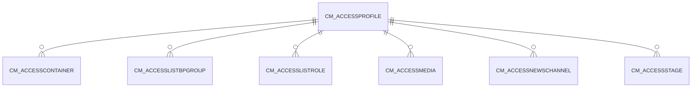

# CM_ACCESSPROFILE

Area [CM](../../data-model/cm/index.md) · class **business** (proposed) · read from database `idempiere-db` (owner `ADEMPIERE`) · 0 row(s) when profiled

## Columns

| column | type | key | not null | business name | references (code) | nulls | distinct |
|---|---|---|---|---|---|---|---|
| `CM_ACCESSPROFILE_ID` | NUMBER(10,0) | PK | yes |  |  | 0 | 0 |
| `AD_CLIENT_ID` | NUMBER(10,0) |  | yes |  |  | 0 | 0 |
| `AD_ORG_ID` | NUMBER(10,0) |  | yes |  |  | 0 | 0 |
| `ISACTIVE` | CHAR(1) |  | yes |  |  | 0 | 0 |
| `CREATED` | DATE |  | yes |  |  | 0 | 0 |
| `CREATEDBY` | NUMBER(10,0) |  | yes |  |  | 0 | 0 |
| `UPDATED` | DATE |  | yes |  |  | 0 | 0 |
| `UPDATEDBY` | NUMBER(10,0) |  | yes |  |  | 0 | 0 |
| `NAME` | VARCHAR2(60 CHAR) |  | yes |  |  | 0 | 0 |
| `DESCRIPTION` | VARCHAR2(255 CHAR) |  |  |  |  | 0 | 0 |
| `HELP` | VARCHAR2(2000 CHAR) |  |  |  |  | 0 | 0 |
| `ISEXCLUDE` | CHAR(1) |  | yes |  |  | 0 | 0 |
| `CM_ACCESSPROFILE_UU` | VARCHAR2(36 CHAR) |  |  |  |  | 0 | 0 |

*references (code)* is the table the application model's code says a column points to; *Foreign keys* below are the constraints the database declares. Counts come from the profile; no value is ever shown.

## Check constraints

| name | expression |
|---|---|
| `SYS_C0019884` | `IsExclude in ('Y','N')` |
| `SYS_C0019885` | `IsActive in ('Y','N')` |

## Foreign keys

**References**

_None._

**Referenced by**

| table | columns | on delete |
|---|---|---|
| [CM_ACCESSCONTAINER](../../data-model/cm/cm_accesscontainer.md) | CM_ACCESSCONTAINER.CM_ACCESSPROFILE_ID → CM_ACCESSPROFILE.CM_ACCESSPROFILE_ID | CASCADE |
| [CM_ACCESSLISTBPGROUP](../../data-model/cm/cm_accesslistbpgroup.md) | CM_ACCESSLISTBPGROUP.CM_ACCESSPROFILE_ID → CM_ACCESSPROFILE.CM_ACCESSPROFILE_ID | CASCADE |
| [CM_ACCESSLISTROLE](../../data-model/cm/cm_accesslistrole.md) | CM_ACCESSLISTROLE.CM_ACCESSPROFILE_ID → CM_ACCESSPROFILE.CM_ACCESSPROFILE_ID | CASCADE |
| [CM_ACCESSMEDIA](../../data-model/cm/cm_accessmedia.md) | CM_ACCESSMEDIA.CM_ACCESSPROFILE_ID → CM_ACCESSPROFILE.CM_ACCESSPROFILE_ID | CASCADE |
| [CM_ACCESSNEWSCHANNEL](../../data-model/cm/cm_accessnewschannel.md) | CM_ACCESSNEWSCHANNEL.CM_ACCESSPROFILE_ID → CM_ACCESSPROFILE.CM_ACCESSPROFILE_ID | CASCADE |
| [CM_ACCESSSTAGE](../../data-model/cm/cm_accessstage.md) | CM_ACCESSSTAGE.CM_ACCESSPROFILE_ID → CM_ACCESSPROFILE.CM_ACCESSPROFILE_ID | CASCADE |

## Write behaviour

- updates: **po_only**
- deletes: **deleted_by_users**
- change log: **recorded**
- evidence: 1 citation(s)

## Schema history

16 change(s); the latest:

| applied | release | operation | column | tickets |
|---|---|---|---|---|
| 2023-04-09T15:47 | iD11 | `add_constraint` |  | IDEMPIERE-5567 |
| 2023-04-09T15:47 | iD11 | `add_constraint` |  | IDEMPIERE-5567 |
| 2020-08-04T01:00 | i7.1z | `modify_column` | CM_ACCESSPROFILE_UU | IDEMPIERE-3862 |
| 2020-08-04T01:00 | i7.1z | `add_column` | tmp_col_3_tmp | IDEMPIERE-3862 |
| 2020-08-04T01:00 | i7.1z | `drop_column` | tmp_col_1_tmp | IDEMPIERE-3862 |
| 2020-08-04T01:00 | i7.1z | `modify_column` | NAME | IDEMPIERE-3862 |
| 2020-08-04T01:00 | i7.1z | `add_column` | tmp_col_1_tmp | IDEMPIERE-3862 |
| 2020-08-04T01:00 | i7.1z | `modify_column` | NAME | IDEMPIERE-3862 |
| 2020-08-04T01:00 | i7.1z | `modify_column` | HELP | IDEMPIERE-3862 |
| 2020-08-04T01:00 | i7.1z | `add_column` | tmp_col_2_tmp | IDEMPIERE-3862 |
| 2020-08-04T01:00 | i7.1z | `modify_column` | DESCRIPTION | IDEMPIERE-3862 |
| 2020-08-04T01:00 | i7.1z | `drop_column` | tmp_col_3_tmp | IDEMPIERE-3862 |
| 2020-08-04T01:00 | i7.1z | `drop_column` | tmp_col_2_tmp | IDEMPIERE-3862 |
| 2020-08-04T01:00 | i7.1z | `add_column` | tmp_col_4_tmp | IDEMPIERE-3862 |
| 2020-08-04T01:00 | i7.1z | `modify_column` | NAME | IDEMPIERE-3862 |

## Open conflicts

| type | attribute | explanation |
|---|---|---|
| `table_without_model` | `model_class` | unexplained |

## Notes

<!-- ekos:manual id="table.cm_accessprofile.notes" -->
_Business notes about this table._
<!-- /ekos:manual -->
