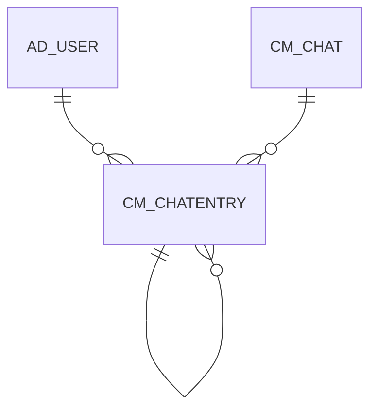

# CM_CHATENTRY

Area [CM](../../data-model/cm/index.md) · class **business** (proposed) · read from database `idempiere-db` (owner `ADEMPIERE`) · 0 row(s) when profiled

Application model: `org.compiere.model.X_CM_ChatEntry`, access level 7 - System - Client - Org.

## Columns

| column | type | key | not null | business name | references (code) | nulls | distinct |
|---|---|---|---|---|---|---|---|
| `CM_CHATENTRY_ID` | NUMBER(10,0) | PK | yes | Chat Entry |  | 0 | 0 |
| `AD_CLIENT_ID` | NUMBER(10,0) |  | yes | Tenant |  | 0 | 0 |
| `AD_ORG_ID` | NUMBER(10,0) |  | yes | Organization |  | 0 | 0 |
| `ISACTIVE` | CHAR(1) |  | yes | Active |  | 0 | 0 |
| `CREATED` | DATE |  | yes | Created |  | 0 | 0 |
| `CREATEDBY` | NUMBER(10,0) |  | yes | Created By |  | 0 | 0 |
| `UPDATED` | DATE |  | yes | Updated |  | 0 | 0 |
| `UPDATEDBY` | NUMBER(10,0) |  | yes | Updated By |  | 0 | 0 |
| `CM_CHAT_ID` | NUMBER(10,0) |  | yes | Chat | [CM_CHAT](../../data-model/cm/cm_chat.md) | 0 | 0 |
| `CONFIDENTIALTYPE` | CHAR(1) |  | yes | Confidentiality |  | 0 | 0 |
| `CHARACTERDATA` | CLOB |  |  | Character Data |  | 0 |  |
| `CM_CHATENTRYPARENT_ID` | NUMBER(10,0) |  |  | Chat Entry Parent | [CM_CHATENTRY](../../data-model/cm/cm_chatentry.md) | 0 | 0 |
| `CM_CHATENTRYGRANDPARENT_ID` | NUMBER(10,0) |  |  | Chat Entry Grandparent | [CM_CHATENTRY](../../data-model/cm/cm_chatentry.md) | 0 | 0 |
| `CHATENTRYTYPE` | CHAR(1) |  | yes | Chat Entry Type |  | 0 | 0 |
| `MODERATORSTATUS` | CHAR(1) |  |  | Moderation Status |  | 0 | 0 |
| `SUBJECT` | VARCHAR2(255 CHAR) |  |  | Subject |  | 0 | 0 |
| `AD_USER_ID` | NUMBER(10,0) |  |  | User/Contact | [AD_USER](../../data-model/ad/ad_user.md) | 0 | 0 |
| `CM_CHATENTRY_UU` | VARCHAR2(36 CHAR) |  |  | CM_ChatEntry_UU |  | 0 | 0 |

*references (code)* is the table the application model's code says a column points to; *Foreign keys* below are the constraints the database declares. Counts come from the profile; no value is ever shown.

## Check constraints

| name | expression |
|---|---|
| `SYS_C0023048` | `IsActive in ('Y','N')` |

## Foreign keys

**References**

| table | columns | on delete |
|---|---|---|
| [AD_USER](../../data-model/ad/ad_user.md) | CM_CHATENTRY.AD_USER_ID → AD_USER.AD_USER_ID | NO ACTION |
| [CM_CHAT](../../data-model/cm/cm_chat.md) | CM_CHATENTRY.CM_CHAT_ID → CM_CHAT.CM_CHAT_ID | CASCADE |
| [CM_CHATENTRY](../../data-model/cm/cm_chatentry.md) | CM_CHATENTRY.CM_CHATENTRYGRANDPARENT_ID → CM_CHATENTRY.CM_CHATENTRY_ID | NO ACTION |

**Referenced by**

| table | columns | on delete |
|---|---|---|
| [CM_CHATENTRY](../../data-model/cm/cm_chatentry.md) | CM_CHATENTRY.CM_CHATENTRYGRANDPARENT_ID → CM_CHATENTRY.CM_CHATENTRY_ID | NO ACTION |

## Write behaviour

- updates: **po_only**
- deletes: **deleted_by_cascade**
- change log: **recorded**
- evidence: 2 citation(s)

## Schema history

16 change(s); the latest:

| applied | release | operation | column | tickets |
|---|---|---|---|---|
| 2023-04-09T15:47 | iD11 | `add_constraint` |  | IDEMPIERE-5567 |
| 2023-04-09T15:47 | iD11 | `add_constraint` |  | IDEMPIERE-5567 |
| 2021-12-05T16:45 | i8.2z | `drop_constraint` |  | IDEMPIERE-5075 |
| 2021-12-05T16:45 | i8.2z | `add_constraint` |  | IDEMPIERE-5075 |
| 2021-12-05T16:45 | i8.2z | `add_constraint` |  | IDEMPIERE-5075 |
| 2021-12-05T16:45 | i8.2z | `drop_constraint` |  | IDEMPIERE-5075 |
| 2021-12-05T16:45 | i8.2z | `add_constraint` |  | IDEMPIERE-5075 |
| 2021-12-05T16:45 | i8.2z | `add_constraint` |  | IDEMPIERE-5075 |
| 2021-12-05T16:45 | i8.2z | `drop_constraint` |  | IDEMPIERE-5075 |
| 2021-12-05T16:45 | i8.2z | `drop_constraint` |  | IDEMPIERE-5075 |
| 2020-08-04T01:00 | i7.1z | `modify_column` | CM_CHATENTRY_UU | IDEMPIERE-3862 |
| 2020-08-04T01:00 | i7.1z | `add_column` | tmp_col_1_tmp | IDEMPIERE-3862 |
| 2020-08-04T01:00 | i7.1z | `drop_column` | tmp_col_2_tmp | IDEMPIERE-3862 |
| 2020-08-04T01:00 | i7.1z | `drop_column` | tmp_col_1_tmp | IDEMPIERE-3862 |
| 2020-08-04T01:00 | i7.1z | `add_column` | tmp_col_2_tmp | IDEMPIERE-3862 |

## Open conflicts

| type | attribute | explanation |
|---|---|---|
| `mandatory_but_nullable` | `columns.CharacterData.nullable` | unexplained |

## Notes

<!-- ekos:manual id="table.cm_chatentry.notes" -->
_Business notes about this table._
<!-- /ekos:manual -->
