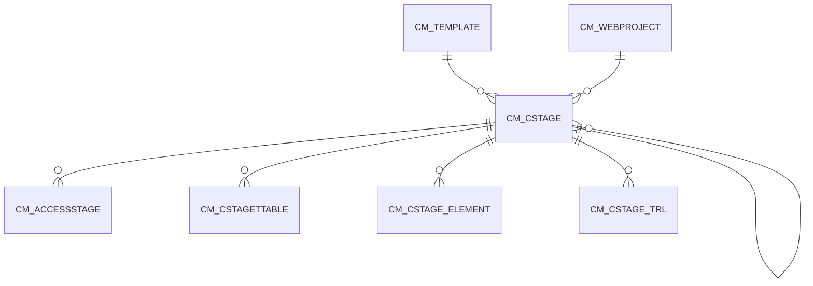

# CM_CSTAGE

Area [CM](../../data-model/cm/index.md) · class **business** (proposed) · read from database `idempiere-db` (owner `ADEMPIERE`) · 5 row(s) when profiled

## Columns

| column | type | key | not null | business name | references (code) | nulls | distinct |
|---|---|---|---|---|---|---|---|
| `CM_CSTAGE_ID` | NUMBER(10,0) | PK | yes |  |  | 0 | 5 |
| `AD_CLIENT_ID` | NUMBER(10,0) |  | yes |  |  | 0 | 1 |
| `AD_ORG_ID` | NUMBER(10,0) |  | yes |  |  | 0 | 1 |
| `ISACTIVE` | CHAR(1) |  | yes |  |  | 0 | 1 |
| `CREATED` | DATE |  | yes |  |  | 0 | 5 |
| `CREATEDBY` | NUMBER(10,0) |  | yes |  |  | 0 | 1 |
| `UPDATED` | DATE |  | yes |  |  | 0 | 2 |
| `UPDATEDBY` | NUMBER(10,0) |  | yes |  |  | 0 | 1 |
| `NAME` | VARCHAR2(60 CHAR) |  | yes |  |  | 0 | 5 |
| `DESCRIPTION` | VARCHAR2(2000 CHAR) |  |  |  |  | 4 | 1 |
| `HELP` | VARCHAR2(2000 CHAR) |  |  |  |  | 5 | 0 |
| `CM_WEBPROJECT_ID` | NUMBER(10,0) |  | yes |  |  | 0 | 1 |
| `CM_TEMPLATE_ID` | NUMBER(10,0) |  |  |  |  | 1 | 2 |
| `TITLE` | VARCHAR2(60 CHAR) |  |  |  |  | 3 | 2 |
| `NOTICE` | VARCHAR2(2000 CHAR) |  |  |  |  | 1 | 3 |
| `CONTAINERTYPE` | CHAR(1) |  |  |  |  | 0 | 1 |
| `CONTAINERLINKURL` | VARCHAR2(60 CHAR) |  |  |  |  | 5 | 0 |
| `RELATIVEURL` | VARCHAR2(120 CHAR) |  |  |  |  | 0 | 5 |
| `PRIORITY` | NUMBER(10,0) |  |  |  |  | 0 | 1 |
| `ISINDEXED` | CHAR(1) |  | yes |  |  | 0 | 2 |
| `ISSECURE` | CHAR(1) |  | yes |  |  | 0 | 1 |
| `META_ROBOTSTAG` | VARCHAR2(2000 CHAR) |  |  |  |  | 4 | 1 |
| `META_AUTHOR` | VARCHAR2(2000 CHAR) |  |  |  |  | 5 | 0 |
| `META_COPYRIGHT` | VARCHAR2(2000 CHAR) |  |  |  |  | 5 | 0 |
| `META_CONTENT` | VARCHAR2(2000 CHAR) |  |  |  |  | 5 | 0 |
| `META_DESCRIPTION` | VARCHAR2(2000 CHAR) |  |  |  |  | 1 | 4 |
| `META_KEYWORDS` | VARCHAR2(2000 CHAR) |  |  |  |  | 1 | 4 |
| `META_PUBLISHER` | VARCHAR2(2000 CHAR) |  |  |  |  | 5 | 0 |
| `STRUCTUREXML` | VARCHAR2(2000 CHAR) |  |  |  |  | 5 | 0 |
| `CONTAINERXML` | VARCHAR2(2000 CHAR) |  |  |  |  | 5 | 0 |
| `CM_CSTAGELINK_ID` | NUMBER(10,0) |  |  |  |  | 5 | 0 |
| `ISMODIFIED` | CHAR(1) |  | yes |  |  | 0 | 1 |
| `PROCESSING` | CHAR(1) |  |  |  |  | 0 | 1 |
| `ISSUMMARY` | CHAR(1) |  | yes |  |  | 0 | 2 |
| `META_LANGUAGE` | CHAR(2) |  |  |  |  | 2 | 2 |
| `ISVALID` | CHAR(1) |  |  |  |  | 0 | 1 |
| `CM_CSTAGE_UU` | VARCHAR2(36 CHAR) |  |  |  |  | 0 | 5 |

*references (code)* is the table the application model's code says a column points to; *Foreign keys* below are the constraints the database declares. Counts come from the profile; no value is ever shown.

## Check constraints

| name | expression |
|---|---|
| `SYS_C0022011` | `IsIndexed in ('Y','N')` |
| `SYS_C0022013` | `IsSecure in ('Y','N')` |
| `SYS_C0022014` | `IsActive in ('Y','N')` |

## Foreign keys

**References**

| table | columns | on delete |
|---|---|---|
| [CM_CSTAGE](../../data-model/cm/cm_cstage.md) | CM_CSTAGE.CM_CSTAGELINK_ID → CM_CSTAGE.CM_CSTAGE_ID | SET NULL |
| [CM_TEMPLATE](../../data-model/cm/cm_template.md) | CM_CSTAGE.CM_TEMPLATE_ID → CM_TEMPLATE.CM_TEMPLATE_ID | CASCADE |
| [CM_WEBPROJECT](../../data-model/cm/cm_webproject.md) | CM_CSTAGE.CM_WEBPROJECT_ID → CM_WEBPROJECT.CM_WEBPROJECT_ID | CASCADE |

**Referenced by**

| table | columns | on delete |
|---|---|---|
| [CM_ACCESSSTAGE](../../data-model/cm/cm_accessstage.md) | CM_ACCESSSTAGE.CM_CSTAGE_ID → CM_CSTAGE.CM_CSTAGE_ID | CASCADE |
| [CM_CSTAGE](../../data-model/cm/cm_cstage.md) | CM_CSTAGE.CM_CSTAGELINK_ID → CM_CSTAGE.CM_CSTAGE_ID | SET NULL |
| [CM_CSTAGETTABLE](../../data-model/cm/cm_cstagettable.md) | CM_CSTAGETTABLE.CM_CSTAGE_ID → CM_CSTAGE.CM_CSTAGE_ID | CASCADE |
| [CM_CSTAGE_ELEMENT](../../data-model/cm/cm_cstage_element.md) | CM_CSTAGE_ELEMENT.CM_CSTAGE_ID → CM_CSTAGE.CM_CSTAGE_ID | CASCADE |
| [CM_CSTAGE_TRL](../../data-model/cm/cm_cstage_trl.md) | CM_CSTAGE_TRL.CM_CSTAGE_ID → CM_CSTAGE.CM_CSTAGE_ID | CASCADE |

## Write behaviour

- updates: **po_only**
- deletes: **deleted_by_users, deleted_by_cascade**
- change log: **recorded**
- evidence: 3 citation(s)

## Schema history

61 change(s); the latest:

| applied | release | operation | column | tickets |
|---|---|---|---|---|
| 2023-04-09T15:47 | iD11 | `add_constraint` |  | IDEMPIERE-5567 |
| 2023-04-09T15:47 | iD11 | `add_constraint` |  | IDEMPIERE-5567 |
| 2021-12-05T16:45 | i8.2z | `drop_constraint` |  | IDEMPIERE-5075 |
| 2021-12-05T16:45 | i8.2z | `add_constraint` |  | IDEMPIERE-5075 |
| 2021-12-05T16:45 | i8.2z | `add_constraint` |  | IDEMPIERE-5075 |
| 2021-12-05T16:45 | i8.2z | `drop_constraint` |  | IDEMPIERE-5075 |
| 2021-12-05T16:45 | i8.2z | `add_constraint` |  | IDEMPIERE-5075 |
| 2021-12-05T16:45 | i8.2z | `drop_constraint` |  | IDEMPIERE-5075 |
| 2020-08-04T01:00 | i7.1z | `add_column` | tmp_col_5_tmp | IDEMPIERE-3862 |
| 2020-08-04T01:00 | i7.1z | `modify_column` | META_PUBLISHER | IDEMPIERE-3862 |
| 2020-08-04T01:00 | i7.1z | `drop_column` | tmp_col_14_tmp | IDEMPIERE-3862 |
| 2020-08-04T01:00 | i7.1z | `drop_column` | tmp_col_12_tmp | IDEMPIERE-3862 |
| 2020-08-04T01:00 | i7.1z | `modify_column` | HELP | IDEMPIERE-3862 |
| 2020-08-04T01:00 | i7.1z | `add_column` | tmp_col_14_tmp | IDEMPIERE-3862 |
| 2020-08-04T01:00 | i7.1z | `add_column` | tmp_col_7_tmp | IDEMPIERE-3862 |

## Open conflicts

| type | attribute | explanation |
|---|---|---|
| `table_without_model` | `model_class` | unexplained |

## Notes

<!-- ekos:manual id="table.cm_cstage.notes" -->
_Business notes about this table._
<!-- /ekos:manual -->
