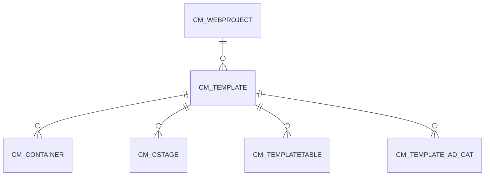

# CM_TEMPLATE

Area [CM](../../data-model/cm/index.md) · class **business** (proposed) · read from database `idempiere-db` (owner `ADEMPIERE`) · 4 row(s) when profiled

## Columns

| column | type | key | not null | business name | references (code) | nulls | distinct |
|---|---|---|---|---|---|---|---|
| `CM_TEMPLATE_ID` | NUMBER(10,0) | PK | yes |  |  | 0 | 4 |
| `AD_CLIENT_ID` | NUMBER(10,0) |  | yes |  |  | 0 | 1 |
| `AD_ORG_ID` | NUMBER(10,0) |  | yes |  |  | 0 | 1 |
| `ISACTIVE` | CHAR(1) |  | yes |  |  | 0 | 1 |
| `CREATED` | DATE |  | yes |  |  | 0 | 4 |
| `CREATEDBY` | NUMBER(10,0) |  | yes |  |  | 0 | 1 |
| `UPDATED` | DATE |  | yes |  |  | 0 | 4 |
| `UPDATEDBY` | NUMBER(10,0) |  | yes |  |  | 0 | 1 |
| `NAME` | VARCHAR2(60 CHAR) |  | yes |  |  | 0 | 4 |
| `DESCRIPTION` | VARCHAR2(255 CHAR) |  |  |  |  | 4 | 0 |
| `HELP` | VARCHAR2(2000 CHAR) |  |  |  |  | 4 | 0 |
| `CM_WEBPROJECT_ID` | NUMBER(10,0) |  |  |  |  | 0 | 1 |
| `VALUE` | VARCHAR2(40 CHAR) |  | yes |  |  | 0 | 4 |
| `ISINCLUDE` | CHAR(1) |  | yes |  |  | 0 | 2 |
| `ISUSEAD` | CHAR(1) |  | yes |  |  | 0 | 1 |
| `ISNEWS` | CHAR(1) |  | yes |  |  | 0 | 1 |
| `ELEMENTS` | VARCHAR2(2000 CHAR) |  |  |  |  | 2 | 2 |
| `TEMPLATEXST` | CLOB |  |  |  |  | 0 | 0 |
| `ISSUMMARY` | CHAR(1) |  | yes |  |  | 0 | 1 |
| `ISVALID` | CHAR(1) |  | yes |  |  | 0 | 1 |
| `PROCESSING` | CHAR(1) |  |  |  |  | 2 | 1 |
| `CM_TEMPLATE_UU` | VARCHAR2(36 CHAR) |  |  |  |  | 0 | 4 |

*references (code)* is the table the application model's code says a column points to; *Foreign keys* below are the constraints the database declares. Counts come from the profile; no value is ever shown.

## Check constraints

| name | expression |
|---|---|
| `SYS_C0022080` | `IsActive in ('Y','N')` |
| `SYS_C0022081` | `IsNews in ('Y','N')` |
| `SYS_C0022083` | `IsUseAd in ('Y','N')` |
| `SYS_C0022084` | `IsInclude in ('Y','N')` |

## Foreign keys

**References**

| table | columns | on delete |
|---|---|---|
| [CM_WEBPROJECT](../../data-model/cm/cm_webproject.md) | CM_TEMPLATE.CM_WEBPROJECT_ID → CM_WEBPROJECT.CM_WEBPROJECT_ID | CASCADE |

**Referenced by**

| table | columns | on delete |
|---|---|---|
| [CM_CONTAINER](../../data-model/cm/cm_container.md) | CM_CONTAINER.CM_TEMPLATE_ID → CM_TEMPLATE.CM_TEMPLATE_ID | NO ACTION |
| [CM_CSTAGE](../../data-model/cm/cm_cstage.md) | CM_CSTAGE.CM_TEMPLATE_ID → CM_TEMPLATE.CM_TEMPLATE_ID | CASCADE |
| [CM_TEMPLATETABLE](../../data-model/cm/cm_templatetable.md) | CM_TEMPLATETABLE.CM_TEMPLATE_ID → CM_TEMPLATE.CM_TEMPLATE_ID | CASCADE |
| [CM_TEMPLATE_AD_CAT](../../data-model/cm/cm_template_ad_cat.md) | CM_TEMPLATE_AD_CAT.CM_TEMPLATE_ID → CM_TEMPLATE.CM_TEMPLATE_ID | CASCADE |

## Write behaviour

- updates: **po_only**
- deletes: **deleted_by_users, deleted_by_cascade**
- change log: **recorded**
- evidence: 2 citation(s)

## Schema history

26 change(s); the latest:

| applied | release | operation | column | tickets |
|---|---|---|---|---|
| 2023-04-09T15:47 | iD11 | `add_constraint` |  | IDEMPIERE-5567 |
| 2023-04-09T15:47 | iD11 | `add_constraint` |  | IDEMPIERE-5567 |
| 2021-12-05T16:45 | i8.2z | `add_constraint` |  | IDEMPIERE-5075 |
| 2021-12-05T16:45 | i8.2z | `drop_constraint` |  | IDEMPIERE-5075 |
| 2020-08-04T01:00 | i7.1z | `modify_column` | CM_TEMPLATE_UU | IDEMPIERE-3862 |
| 2020-08-04T01:00 | i7.1z | `add_column` | tmp_col_2_tmp | IDEMPIERE-3862 |
| 2020-08-04T01:00 | i7.1z | `drop_column` | tmp_col_1_tmp | IDEMPIERE-3862 |
| 2020-08-04T01:00 | i7.1z | `drop_column` | tmp_col_6_tmp | IDEMPIERE-3862 |
| 2020-08-04T01:00 | i7.1z | `drop_column` | tmp_col_3_tmp | IDEMPIERE-3862 |
| 2020-08-04T01:00 | i7.1z | `add_column` | tmp_col_4_tmp | IDEMPIERE-3862 |
| 2020-08-04T01:00 | i7.1z | `modify_column` | DESCRIPTION | IDEMPIERE-3862 |
| 2020-08-04T01:00 | i7.1z | `modify_column` | VALUE | IDEMPIERE-3862 |
| 2020-08-04T01:00 | i7.1z | `modify_column` | NAME | IDEMPIERE-3862 |
| 2020-08-04T01:00 | i7.1z | `add_column` | tmp_col_5_tmp | IDEMPIERE-3862 |
| 2020-08-04T01:00 | i7.1z | `modify_column` | NAME | IDEMPIERE-3862 |

## Open conflicts

| type | attribute | explanation |
|---|---|---|
| `table_without_model` | `model_class` | unexplained |

## Notes

<!-- ekos:manual id="table.cm_template.notes" -->
_Business notes about this table._
<!-- /ekos:manual -->
