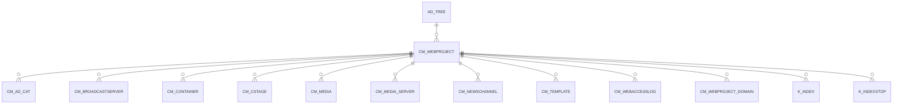

# CM_WEBPROJECT

Area [CM](../../data-model/cm/index.md) · class **business** (proposed) · read from database `idempiere-db` (owner `ADEMPIERE`) · 1 row(s) when profiled

## Columns

| column | type | key | not null | business name | references (code) | nulls | distinct |
|---|---|---|---|---|---|---|---|
| `CM_WEBPROJECT_ID` | NUMBER(10,0) | PK | yes |  |  | 0 | 1 |
| `AD_CLIENT_ID` | NUMBER(10,0) |  | yes |  |  | 0 | 1 |
| `AD_ORG_ID` | NUMBER(10,0) |  | yes |  |  | 0 | 1 |
| `ISACTIVE` | CHAR(1) |  | yes |  |  | 0 | 1 |
| `CREATED` | DATE |  | yes |  |  | 0 | 1 |
| `CREATEDBY` | NUMBER(10,0) |  | yes |  |  | 0 | 1 |
| `UPDATED` | DATE |  | yes |  |  | 0 | 1 |
| `UPDATEDBY` | NUMBER(10,0) |  | yes |  |  | 0 | 1 |
| `NAME` | VARCHAR2(60 CHAR) |  | yes |  |  | 0 | 1 |
| `DESCRIPTION` | VARCHAR2(255 CHAR) |  |  |  |  | 1 | 0 |
| `HELP` | VARCHAR2(2000 CHAR) |  |  |  |  | 1 | 0 |
| `META_COPYRIGHT` | VARCHAR2(2000 CHAR) |  | yes |  |  | 0 | 1 |
| `META_PUBLISHER` | VARCHAR2(2000 CHAR) |  | yes |  |  | 0 | 1 |
| `META_ROBOTSTAG` | VARCHAR2(2000 CHAR) |  | yes |  |  | 0 | 1 |
| `META_AUTHOR` | VARCHAR2(2000 CHAR) |  | yes |  |  | 0 | 1 |
| `META_CONTENT` | VARCHAR2(2000 CHAR) |  | yes |  |  | 0 | 1 |
| `AD_TREECMC_ID` | NUMBER(10,0) |  | yes |  |  | 0 | 1 |
| `AD_TREECMS_ID` | NUMBER(10,0) |  | yes |  |  | 0 | 1 |
| `AD_TREECMM_ID` | NUMBER(10,0) |  | yes |  |  | 0 | 1 |
| `AD_TREECMT_ID` | NUMBER(10,0) |  | yes |  |  | 0 | 1 |
| `CM_WEBPROJECT_UU` | VARCHAR2(36 CHAR) |  |  |  |  | 0 | 1 |

*references (code)* is the table the application model's code says a column points to; *Foreign keys* below are the constraints the database declares. Counts come from the profile; no value is ever shown.

## Check constraints

| name | expression |
|---|---|
| `SYS_C0020044` | `IsActive in ('Y','N')` |

## Foreign keys

**References**

| table | columns | on delete |
|---|---|---|
| [AD_TREE](../../data-model/ad/ad_tree.md) | CM_WEBPROJECT.AD_TREECMC_ID → AD_TREE.AD_TREE_ID | NO ACTION |

**Referenced by**

| table | columns | on delete |
|---|---|---|
| [CM_AD_CAT](../../data-model/cm/cm_ad_cat.md) | CM_AD_CAT.CM_WEBPROJECT_ID → CM_WEBPROJECT.CM_WEBPROJECT_ID | CASCADE |
| [CM_BROADCASTSERVER](../../data-model/cm/cm_broadcastserver.md) | CM_BROADCASTSERVER.CM_WEBPROJECT_ID → CM_WEBPROJECT.CM_WEBPROJECT_ID | SET NULL |
| [CM_CONTAINER](../../data-model/cm/cm_container.md) | CM_CONTAINER.CM_WEBPROJECT_ID → CM_WEBPROJECT.CM_WEBPROJECT_ID | CASCADE |
| [CM_CSTAGE](../../data-model/cm/cm_cstage.md) | CM_CSTAGE.CM_WEBPROJECT_ID → CM_WEBPROJECT.CM_WEBPROJECT_ID | CASCADE |
| [CM_MEDIA](../../data-model/cm/cm_media.md) | CM_MEDIA.CM_WEBPROJECT_ID → CM_WEBPROJECT.CM_WEBPROJECT_ID | NO ACTION |
| [CM_MEDIA_SERVER](../../data-model/cm/cm_media_server.md) | CM_MEDIA_SERVER.CM_WEBPROJECT_ID → CM_WEBPROJECT.CM_WEBPROJECT_ID | CASCADE |
| [CM_NEWSCHANNEL](../../data-model/cm/cm_newschannel.md) | CM_NEWSCHANNEL.CM_WEBPROJECT_ID → CM_WEBPROJECT.CM_WEBPROJECT_ID | CASCADE |
| [CM_TEMPLATE](../../data-model/cm/cm_template.md) | CM_TEMPLATE.CM_WEBPROJECT_ID → CM_WEBPROJECT.CM_WEBPROJECT_ID | CASCADE |
| `CM_WEBACCESSLOG` | CM_WEBACCESSLOG.CM_WEBPROJECT_ID → CM_WEBPROJECT.CM_WEBPROJECT_ID | NO ACTION |
| [CM_WEBPROJECT_DOMAIN](../../data-model/cm/cm_webproject_domain.md) | CM_WEBPROJECT_DOMAIN.CM_WEBPROJECT_ID → CM_WEBPROJECT.CM_WEBPROJECT_ID | CASCADE |
| [K_INDEX](../../data-model/k/k_index.md) | K_INDEX.CM_WEBPROJECT_ID → CM_WEBPROJECT.CM_WEBPROJECT_ID | CASCADE |
| [K_INDEXSTOP](../../data-model/k/k_indexstop.md) | K_INDEXSTOP.CM_WEBPROJECT_ID → CM_WEBPROJECT.CM_WEBPROJECT_ID | CASCADE |

## Write behaviour

- updates: **po_only**
- deletes: **soft_delete_only**
- change log: **recorded**
- evidence: 1 citation(s)

## Schema history

49 change(s); the latest:

| applied | release | operation | column | tickets |
|---|---|---|---|---|
| 2023-04-09T15:47 | iD11 | `add_constraint` |  | IDEMPIERE-5567 |
| 2023-04-09T15:47 | iD11 | `add_constraint` |  | IDEMPIERE-5567 |
| 2021-12-05T16:45 | i8.2z | `drop_constraint` |  | IDEMPIERE-5075 |
| 2021-12-05T16:45 | i8.2z | `add_constraint` |  | IDEMPIERE-5075 |
| 2021-12-05T16:45 | i8.2z | `drop_constraint` |  | IDEMPIERE-5075 |
| 2021-12-05T16:45 | i8.2z | `add_constraint` |  | IDEMPIERE-5075 |
| 2021-12-05T16:45 | i8.2z | `add_constraint` |  | IDEMPIERE-5075 |
| 2021-12-05T16:45 | i8.2z | `add_constraint` |  | IDEMPIERE-5075 |
| 2021-12-05T16:45 | i8.2z | `drop_constraint` |  | IDEMPIERE-5075 |
| 2021-12-05T16:45 | i8.2z | `drop_constraint` |  | IDEMPIERE-5075 |
| 2020-08-04T01:00 | i7.1z | `add_column` | tmp_col_8_tmp | IDEMPIERE-3862 |
| 2020-08-04T01:00 | i7.1z | `add_column` | tmp_col_6_tmp | IDEMPIERE-3862 |
| 2020-08-04T01:00 | i7.1z | `drop_column` | tmp_col_1_tmp | IDEMPIERE-3862 |
| 2020-08-04T01:00 | i7.1z | `modify_column` | META_COPYRIGHT | IDEMPIERE-3862 |
| 2020-08-04T01:00 | i7.1z | `drop_column` | tmp_col_8_tmp | IDEMPIERE-3862 |

## Open conflicts

| type | attribute | explanation |
|---|---|---|
| `table_without_model` | `model_class` | unexplained |

## Notes

<!-- ekos:manual id="table.cm_webproject.notes" -->
_Business notes about this table._
<!-- /ekos:manual -->
