# Area CM

38 table(s), 37 in scope.

```mermaid
erDiagram
  CM_ACCESSPROFILE ||--o{ CM_ACCESSCONTAINER : ""
  CM_ACCESSPROFILE ||--o{ CM_ACCESSLISTBPGROUP : ""
  CM_ACCESSPROFILE ||--o{ CM_ACCESSLISTROLE : ""
  CM_ACCESSPROFILE ||--o{ CM_ACCESSMEDIA : ""
  CM_ACCESSPROFILE ||--o{ CM_ACCESSNEWSCHANNEL : ""
  CM_ACCESSPROFILE ||--o{ CM_ACCESSSTAGE : ""
  CM_AD_CAT ||--o{ CM_AD : ""
  CM_AD_CAT ||--o{ CM_TEMPLATE_AD_CAT : ""
  CM_CHAT ||--o{ CM_CHATENTRY : ""
  CM_CHAT ||--o{ CM_CHATUPDATE : ""
  CM_CHATENTRY ||--o{ CM_CHATENTRY : ""
  CM_CHATTYPE ||--o{ CM_CHAT : ""
  CM_CHATTYPE ||--o{ CM_CHATTYPEUPDATE : ""
  CM_CONTAINER ||--o{ CM_ACCESSCONTAINER : ""
  CM_CONTAINER ||--o{ CM_CONTAINER : ""
  CM_CONTAINER ||--o{ CM_CONTAINERTTABLE : ""
  CM_CONTAINER ||--o{ CM_CONTAINER_ELEMENT : ""
  CM_CONTAINER ||--o{ CM_WEBPROJECT_DOMAIN : ""
  CM_CSTAGE ||--o{ CM_ACCESSSTAGE : ""
  CM_CSTAGE ||--o{ CM_CSTAGE : ""
  CM_CSTAGE ||--o{ CM_CSTAGETTABLE : ""
  CM_CSTAGE ||--o{ CM_CSTAGE_ELEMENT : ""
  CM_MEDIA ||--o{ CM_ACCESSMEDIA : ""
  CM_MEDIA ||--o{ CM_AD : ""
  CM_MEDIA ||--o{ CM_MEDIADEPLOY : ""
  CM_MEDIA_SERVER ||--o{ CM_MEDIADEPLOY : ""
  CM_NEWSCHANNEL ||--o{ CM_ACCESSNEWSCHANNEL : ""
  CM_TEMPLATE ||--o{ CM_CONTAINER : ""
  CM_TEMPLATE ||--o{ CM_CSTAGE : ""
  CM_TEMPLATE ||--o{ CM_TEMPLATETABLE : ""
  CM_TEMPLATE ||--o{ CM_TEMPLATE_AD_CAT : ""
  CM_TEMPLATETABLE ||--o{ CM_CONTAINERTTABLE : ""
  CM_TEMPLATETABLE ||--o{ CM_CSTAGETTABLE : ""
  CM_WEBPROJECT ||--o{ CM_AD_CAT : ""
  CM_WEBPROJECT ||--o{ CM_BROADCASTSERVER : ""
  CM_WEBPROJECT ||--o{ CM_CONTAINER : ""
  CM_WEBPROJECT ||--o{ CM_CSTAGE : ""
  CM_WEBPROJECT ||--o{ CM_MEDIA : ""
  CM_WEBPROJECT ||--o{ CM_MEDIA_SERVER : ""
  CM_WEBPROJECT ||--o{ CM_NEWSCHANNEL : ""
  CM_WEBPROJECT ||--o{ CM_TEMPLATE : ""
  CM_WEBPROJECT ||--o{ CM_WEBPROJECT_DOMAIN : ""
```

The diagram shows the 30 most connected tables; 7 more are listed below.

| table | class | scope | rows | description |
|---|---|---|---|---|
| [CM_ACCESSCONTAINER](../../data-model/cm/cm_accesscontainer.md) | business | in | 0 |  |
| [CM_ACCESSLISTBPGROUP](../../data-model/cm/cm_accesslistbpgroup.md) | business | in | 0 |  |
| [CM_ACCESSLISTROLE](../../data-model/cm/cm_accesslistrole.md) | business | in | 0 |  |
| [CM_ACCESSMEDIA](../../data-model/cm/cm_accessmedia.md) | business | in | 0 |  |
| [CM_ACCESSNEWSCHANNEL](../../data-model/cm/cm_accessnewschannel.md) | business | in | 0 |  |
| [CM_ACCESSPROFILE](../../data-model/cm/cm_accessprofile.md) | business | in | 0 |  |
| [CM_ACCESSSTAGE](../../data-model/cm/cm_accessstage.md) | business | in | 0 |  |
| [CM_AD](../../data-model/cm/cm_ad.md) | business | in | 0 |  |
| [CM_AD_CAT](../../data-model/cm/cm_ad_cat.md) | business | in | 0 |  |
| [CM_BROADCASTSERVER](../../data-model/cm/cm_broadcastserver.md) | business | in | 0 |  |
| [CM_CHAT](../../data-model/cm/cm_chat.md) | business | in | 0 |  |
| [CM_CHATENTRY](../../data-model/cm/cm_chatentry.md) | business | in | 0 |  |
| [CM_CHATTYPE](../../data-model/cm/cm_chattype.md) | business | in | 0 |  |
| [CM_CHATTYPEUPDATE](../../data-model/cm/cm_chattypeupdate.md) | business | in | 0 |  |
| [CM_CHATUPDATE](../../data-model/cm/cm_chatupdate.md) | business | in | 0 |  |
| [CM_CONTAINER](../../data-model/cm/cm_container.md) | business | in | 5 |  |
| [CM_CONTAINERTTABLE](../../data-model/cm/cm_containerttable.md) | business | in | 0 |  |
| [CM_CONTAINER_ELEMENT](../../data-model/cm/cm_container_element.md) | business | in | 6 |  |
| [CM_CONTAINER_ELEMENT_TRL](../../data-model/cm/cm_container_element_trl.md) | translation | in | 6 |  |
| [CM_CONTAINER_TRL](../../data-model/cm/cm_container_trl.md) | translation | in | 5 |  |
| [CM_CONTAINER_URL](../../data-model/cm/cm_container_url.md) | business | in | 0 |  |
| [CM_CSTAGE](../../data-model/cm/cm_cstage.md) | business | in | 5 |  |
| [CM_CSTAGETTABLE](../../data-model/cm/cm_cstagettable.md) | business | in | 0 |  |
| [CM_CSTAGE_ELEMENT](../../data-model/cm/cm_cstage_element.md) | business | in | 7 |  |
| [CM_CSTAGE_ELEMENT_TRL](../../data-model/cm/cm_cstage_element_trl.md) | translation | in | 7 |  |
| [CM_CSTAGE_TRL](../../data-model/cm/cm_cstage_trl.md) | translation | in | 5 |  |
| [CM_MEDIA](../../data-model/cm/cm_media.md) | business | in | 3 |  |
| [CM_MEDIADEPLOY](../../data-model/cm/cm_mediadeploy.md) | business | in | 0 |  |
| [CM_MEDIA_SERVER](../../data-model/cm/cm_media_server.md) | business | in | 1 |  |
| [CM_NEWSCHANNEL](../../data-model/cm/cm_newschannel.md) | business | in | 0 |  |
| [CM_NEWSITEM](../../data-model/cm/cm_newsitem.md) | business | in | 0 |  |
| [CM_TEMPLATE](../../data-model/cm/cm_template.md) | business | in | 4 |  |
| [CM_TEMPLATETABLE](../../data-model/cm/cm_templatetable.md) | business | in | 0 |  |
| [CM_TEMPLATE_AD_CAT](../../data-model/cm/cm_template_ad_cat.md) | business | in | 0 |  |
| `CM_WEBACCESSLOG` | log | out | 0 |  |
| [CM_WEBPROJECT](../../data-model/cm/cm_webproject.md) | business | in | 1 |  |
| [CM_WEBPROJECT_DOMAIN](../../data-model/cm/cm_webproject_domain.md) | business | in | 1 |  |
| [CM_WIKITOKEN](../../data-model/cm/cm_wikitoken.md) | business | in | 0 |  |
