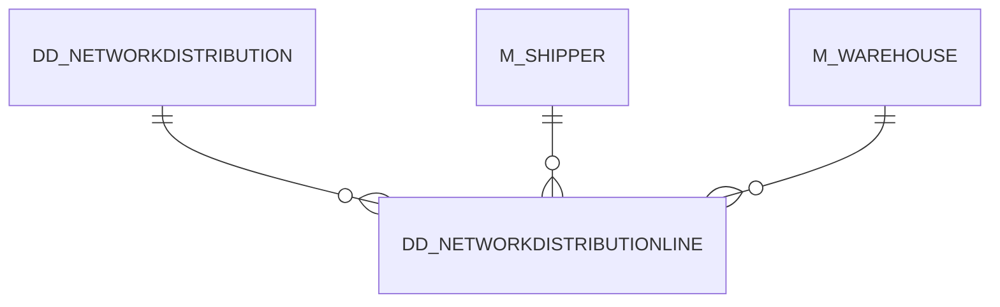

# DD_NETWORKDISTRIBUTIONLINE

Area [DD](../../data-model/dd/index.md) · class **business** (proposed) · read from database `idempiere-db` (owner `ADEMPIERE`) · 10 row(s) when profiled

Application model: `org.eevolution.model.X_DD_NetworkDistributionLine`, access level 3 - Client - Org.

## Columns

| column | type | key | not null | business name | references (code) | nulls | distinct |
|---|---|---|---|---|---|---|---|
| `AD_CLIENT_ID` | NUMBER(10,0) |  | yes | Tenant |  | 0 | 1 |
| `AD_ORG_ID` | NUMBER(10,0) |  | yes | Organization |  | 0 | 1 |
| `CREATED` | DATE |  | yes | Created |  | 0 | 10 |
| `CREATEDBY` | NUMBER(10,0) |  | yes | Created By |  | 0 | 1 |
| `DD_NETWORKDISTRIBUTIONLINE_ID` | NUMBER(10,0) | PK | yes | Network Distribution Line |  | 0 | 10 |
| `ISACTIVE` | CHAR(1) |  | yes | Active |  | 0 | 1 |
| `M_SHIPPER_ID` | NUMBER(10,0) |  | yes | Shipper | [M_SHIPPER](../../data-model/m/m_shipper.md) | 0 | 2 |
| `M_WAREHOUSESOURCE_ID` | NUMBER(10,0) |  | yes | Source Warehouse | [M_WAREHOUSE](../../data-model/m/m_warehouse.md) | 0 | 2 |
| `PERCENT` | NUMBER |  |  | Percent |  | 0 | 1 |
| `TRANSFERTTIME` | NUMBER(10,0) |  |  | Transfer Time |  | 0 | 4 |
| `UPDATED` | DATE |  | yes | Updated |  | 0 | 10 |
| `UPDATEDBY` | NUMBER(10,0) |  | yes | Updated By |  | 0 | 1 |
| `VALIDTO` | DATE |  |  | Valid to |  | 10 | 0 |
| `PRIORITYNO` | NUMBER(10,0) |  |  | Relative Priority |  | 0 | 1 |
| `DD_NETWORKDISTRIBUTION_ID` | NUMBER(10,0) |  | yes | Network Distribution | [DD_NETWORKDISTRIBUTION](../../data-model/dd/dd_networkdistribution.md) | 0 | 2 |
| `M_WAREHOUSE_ID` | NUMBER(10,0) |  | yes | Warehouse | [M_WAREHOUSE](../../data-model/m/m_warehouse.md) | 0 | 5 |
| `VALIDFROM` | DATE |  |  | Valid from |  | 10 | 0 |
| `DD_NETWORKDISTRIBUTIONLINE_UU` | VARCHAR2(36 CHAR) |  |  | DD_NetworkDistributionLine_UU |  | 0 | 10 |

*references (code)* is the table the application model's code says a column points to; *Foreign keys* below are the constraints the database declares. Counts come from the profile; no value is ever shown.

## Check constraints

| name | expression |
|---|---|
| `SYS_C0020027` | `IsActive IN ('Y','N')` |

## Foreign keys

**References**

| table | columns | on delete |
|---|---|---|
| [DD_NETWORKDISTRIBUTION](../../data-model/dd/dd_networkdistribution.md) | DD_NETWORKDISTRIBUTIONLINE.DD_NETWORKDISTRIBUTION_ID → DD_NETWORKDISTRIBUTION.DD_NETWORKDISTRIBUTION_ID | NO ACTION |
| [M_SHIPPER](../../data-model/m/m_shipper.md) | DD_NETWORKDISTRIBUTIONLINE.M_SHIPPER_ID → M_SHIPPER.M_SHIPPER_ID | NO ACTION |
| [M_WAREHOUSE](../../data-model/m/m_warehouse.md) | DD_NETWORKDISTRIBUTIONLINE.M_WAREHOUSESOURCE_ID → M_WAREHOUSE.M_WAREHOUSE_ID | NO ACTION |

**Referenced by**

_None._

## Write behaviour

- updates: **po_only**
- deletes: **deleted_by_users**
- change log: **recorded**
- evidence: 1 citation(s)

## Schema history

21 change(s); the latest:

| applied | release | operation | column | tickets |
|---|---|---|---|---|
| 2023-04-09T15:47 | iD11 | `add_constraint` |  | IDEMPIERE-5567 |
| 2023-04-09T15:47 | iD11 | `add_constraint` |  | IDEMPIERE-5567 |
| 2021-12-05T16:45 | i8.2z | `drop_constraint` |  | IDEMPIERE-5075 |
| 2021-12-05T16:45 | i8.2z | `add_constraint` |  | IDEMPIERE-5075 |
| 2021-12-05T16:45 | i8.2z | `drop_constraint` |  | IDEMPIERE-5075 |
| 2021-12-05T16:45 | i8.2z | `add_constraint` |  | IDEMPIERE-5075 |
| 2021-12-05T16:45 | i8.2z | `add_constraint` |  | IDEMPIERE-5075 |
| 2021-12-05T16:45 | i8.2z | `drop_constraint` |  | IDEMPIERE-5075 |
| 2021-12-05T16:45 | i8.2z | `drop_constraint` |  | IDEMPIERE-5075 |
| 2021-12-05T16:45 | i8.2z | `add_constraint` |  | IDEMPIERE-5075 |
| 2020-08-04T01:00 | i7.1z | `add_column` | tmp_col_1_tmp | IDEMPIERE-3862 |
| 2020-08-04T01:00 | i7.1z | `drop_column` | tmp_col_1_tmp | IDEMPIERE-3862 |
| 2020-08-04T01:00 | i7.1z | `modify_column` | DD_NETWORKDISTRIBUTIONLINE_UU | IDEMPIERE-3862 |
| 2014-05-02T10:09 | i2.0 | `modify_column` | created | IDEMPIERE-709 |
| 2014-05-02T10:09 | i2.0 | `modify_column` | updated | IDEMPIERE-709 |

## Notes

<!-- ekos:manual id="table.dd_networkdistributionline.notes" -->
_Business notes about this table._
<!-- /ekos:manual -->
