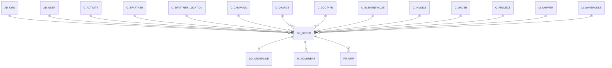

# DD_ORDER

Area [DD](../../data-model/dd/index.md) · class **business** (proposed) · read from database `idempiere-db` (owner `ADEMPIERE`) · 0 row(s) when profiled

Application model: `org.eevolution.model.X_DD_Order`, access level 1 - Org.

## Columns

| column | type | key | not null | business name | references (code) | nulls | distinct |
|---|---|---|---|---|---|---|---|
| `DOCUMENTNO` | VARCHAR2(30 CHAR) |  | yes | Document No |  | 0 | 0 |
| `AD_ORGTRX_ID` | NUMBER(10,0) |  |  | Trx Organization |  | 0 | 0 |
| `AD_ORG_ID` | NUMBER(10,0) |  | yes | Organization |  | 0 | 0 |
| `AD_USER_ID` | NUMBER(10,0) |  |  | User/Contact | [AD_USER](../../data-model/ad/ad_user.md) | 0 | 0 |
| `C_ACTIVITY_ID` | NUMBER(10,0) |  |  | Activity | [C_ACTIVITY](../../data-model/c/c_activity.md) | 0 | 0 |
| `C_BPARTNER_ID` | NUMBER(10,0) |  | yes | Business Partner | [C_BPARTNER](../../data-model/c/c_bpartner.md) | 0 | 0 |
| `C_BPARTNER_LOCATION_ID` | NUMBER(10,0) |  | yes | Partner Location | [C_BPARTNER_LOCATION](../../data-model/c/c_bpartner_location.md) | 0 | 0 |
| `C_CAMPAIGN_ID` | NUMBER(10,0) |  |  | Campaign | [C_CAMPAIGN](../../data-model/c/c_campaign.md) | 0 | 0 |
| `C_CHARGE_ID` | NUMBER(10,0) |  |  | Charge | [C_CHARGE](../../data-model/c/c_charge.md) | 0 | 0 |
| `C_DOCTYPE_ID` | NUMBER(10,0) |  | yes | Document Type | [C_DOCTYPE](../../data-model/c/c_doctype.md) | 0 | 0 |
| `C_INVOICE_ID` | NUMBER(10,0) |  |  | Invoice | [C_INVOICE](../../data-model/c/c_invoice.md) | 0 | 0 |
| `C_ORDER_ID` | NUMBER(10,0) |  |  | Order | [C_ORDER](../../data-model/c/c_order.md) | 0 | 0 |
| `C_PROJECT_ID` | NUMBER(10,0) |  |  | Project | [C_PROJECT](../../data-model/c/c_project.md) | 0 | 0 |
| `CHARGEAMT` | NUMBER |  |  | Charge amount |  | 0 | 0 |
| `CREATECONFIRM` | CHAR(1) |  |  | Create Confirm |  | 0 | 0 |
| `CREATEFROM` | CHAR(1) |  |  | Create lines from |  | 0 | 0 |
| `CREATEPACKAGE` | CHAR(1) |  |  | Create Package |  | 0 | 0 |
| `CREATED` | DATE |  | yes | Created |  | 0 | 0 |
| `CREATEDBY` | NUMBER(10,0) |  | yes | Created By |  | 0 | 0 |
| `DD_ORDER_ID` | NUMBER(10,0) | PK | yes | Distribution Order |  | 0 | 0 |
| `DATEORDERED` | DATE |  | yes | Date Ordered |  | 0 | 0 |
| `DATEPRINTED` | DATE |  |  | Date Printed |  | 0 | 0 |
| `DATEPROMISED` | DATE |  | yes | Date Promised |  | 0 | 0 |
| `DATERECEIVED` | DATE |  |  | Date Received |  | 0 | 0 |
| `DELIVERYRULE` | CHAR(1) |  | yes | Delivery Rule |  | 0 | 0 |
| `DELIVERYVIARULE` | CHAR(1) |  | yes | Delivery Via |  | 0 | 0 |
| `DESCRIPTION` | VARCHAR2(255 CHAR) |  |  | Description |  | 0 | 0 |
| `DOCACTION` | CHAR(2) |  | yes | Document Action |  | 0 | 0 |
| `DOCSTATUS` | CHAR(2) |  | yes | Document Status |  | 0 | 0 |
| `FREIGHTAMT` | NUMBER |  |  | Freight Amount |  | 0 | 0 |
| `FREIGHTCOSTRULE` | CHAR(1) |  | yes | Freight Cost Rule |  | 0 | 0 |
| `GENERATETO` | CHAR(1) |  |  | Generate To |  | 0 | 0 |
| `ISACTIVE` | CHAR(1) |  | yes | Active |  | 0 | 0 |
| `ISAPPROVED` | CHAR(1) |  | yes | Approved |  | 0 | 0 |
| `ISDELIVERED` | CHAR(1) |  |  | Delivered |  | 0 | 0 |
| `ISDROPSHIP` | CHAR(1) |  |  | Drop Shipment |  | 0 | 0 |
| `ISINDISPUTE` | CHAR(1) |  | yes | In Dispute |  | 0 | 0 |
| `ISINTRANSIT` | CHAR(1) |  | yes | In Transit |  | 0 | 0 |
| `ISPRINTED` | CHAR(1) |  | yes | Printed |  | 0 | 0 |
| `ISSOTRX` | CHAR(1) |  | yes | Sales Transaction |  | 0 | 0 |
| `ISSELECTED` | CHAR(1) |  |  | Selected |  | 0 | 0 |
| `M_SHIPPER_ID` | NUMBER(10,0) |  |  | Shipper | [M_SHIPPER](../../data-model/m/m_shipper.md) | 0 | 0 |
| `M_WAREHOUSE_ID` | NUMBER(10,0) |  | yes | Warehouse | [M_WAREHOUSE](../../data-model/m/m_warehouse.md) | 0 | 0 |
| `NOPACKAGES` | NUMBER(10,0) |  |  | No Packages |  | 0 | 0 |
| `POREFERENCE` | VARCHAR2(20 CHAR) |  |  | Order Reference |  | 0 | 0 |
| `PICKDATE` | DATE |  |  | Pick Date |  | 0 | 0 |
| `POSTED` | CHAR(1) |  | yes | Posted |  | 0 | 0 |
| `PRIORITYRULE` | CHAR(1) |  | yes | Priority |  | 0 | 0 |
| `PROCESSED` | CHAR(1) |  | yes | Processed |  | 0 | 0 |
| `PROCESSING` | CHAR(1) |  |  | Process Now |  | 0 | 0 |
| `REF_ORDER_ID` | NUMBER(10,0) |  |  | Referenced Order | [C_ORDER](../../data-model/c/c_order.md) | 0 | 0 |
| `SALESREP_ID` | NUMBER(10,0) |  |  | Sales Representative | [AD_USER](../../data-model/ad/ad_user.md) | 0 | 0 |
| `SENDEMAIL` | CHAR(1) |  | yes | Send EMail |  | 0 | 0 |
| `SHIPDATE` | DATE |  |  | Ship Date |  | 0 | 0 |
| `TRACKINGNO` | VARCHAR2(60 CHAR) |  |  | Tracking No |  | 0 | 0 |
| `UPDATED` | DATE |  | yes | Updated |  | 0 | 0 |
| `UPDATEDBY` | NUMBER(10,0) |  | yes | Updated By |  | 0 | 0 |
| `USER1_ID` | NUMBER(10,0) |  |  | User Element List 1 | [C_ELEMENTVALUE](../../data-model/c/c_elementvalue.md) | 0 | 0 |
| `USER2_ID` | NUMBER(10,0) |  |  | User Element List 2 | [C_ELEMENTVALUE](../../data-model/c/c_elementvalue.md) | 0 | 0 |
| `VOLUME` | NUMBER |  |  | Volume |  | 0 | 0 |
| `AD_CLIENT_ID` | NUMBER(10,0) |  | yes | Tenant |  | 0 | 0 |
| `WEIGHT` | NUMBER |  |  | Weight |  | 0 | 0 |
| `PROCESSEDON` | NUMBER |  |  | Processed On |  | 0 | 0 |
| `DD_ORDER_UU` | VARCHAR2(36 CHAR) |  |  | DD_Order_UU |  | 0 | 0 |

*references (code)* is the table the application model's code says a column points to; *Foreign keys* below are the constraints the database declares. Counts come from the profile; no value is ever shown.

## Check constraints

| name | expression |
|---|---|
| `SYS_C0022721` | `IsDropShip IN ('Y','N')` |
| `SYS_C0022723` | `IsInTransit IN ('Y','N')` |
| `SYS_C0022724` | `IsDelivered IN ('Y','N')` |
| `SYS_C0022725` | `IsInDispute IN ('Y','N')` |
| `SYS_C0022726` | `IsSelected IN ('Y','N')` |
| `SYS_C0022727` | `IsApproved IN ('Y','N')` |
| `SYS_C0022728` | `SendEMail IN ('Y','N')` |
| `SYS_C0022729` | `Processed IN ('Y','N')` |
| `SYS_C0022730` | `IsSOTrx IN ('Y','N')` |
| `SYS_C0022731` | `IsActive IN ('Y','N')` |
| `SYS_C0022733` | `IsPrinted IN ('Y','N')` |

## Foreign keys

**References**

| table | columns | on delete |
|---|---|---|
| [AD_ORG](../../data-model/ad/ad_org.md) | DD_ORDER.AD_ORGTRX_ID → AD_ORG.AD_ORG_ID | NO ACTION |
| [AD_USER](../../data-model/ad/ad_user.md) | DD_ORDER.AD_USER_ID → AD_USER.AD_USER_ID | NO ACTION |
| [C_ACTIVITY](../../data-model/c/c_activity.md) | DD_ORDER.C_ACTIVITY_ID → C_ACTIVITY.C_ACTIVITY_ID | NO ACTION |
| [C_BPARTNER](../../data-model/c/c_bpartner.md) | DD_ORDER.C_BPARTNER_ID → C_BPARTNER.C_BPARTNER_ID | NO ACTION |
| [C_BPARTNER_LOCATION](../../data-model/c/c_bpartner_location.md) | DD_ORDER.C_BPARTNER_LOCATION_ID → C_BPARTNER_LOCATION.C_BPARTNER_LOCATION_ID | NO ACTION |
| [C_CAMPAIGN](../../data-model/c/c_campaign.md) | DD_ORDER.C_CAMPAIGN_ID → C_CAMPAIGN.C_CAMPAIGN_ID | NO ACTION |
| [C_CHARGE](../../data-model/c/c_charge.md) | DD_ORDER.C_CHARGE_ID → C_CHARGE.C_CHARGE_ID | NO ACTION |
| [C_DOCTYPE](../../data-model/c/c_doctype.md) | DD_ORDER.C_DOCTYPE_ID → C_DOCTYPE.C_DOCTYPE_ID | NO ACTION |
| [C_ELEMENTVALUE](../../data-model/c/c_elementvalue.md) | DD_ORDER.USER1_ID → C_ELEMENTVALUE.C_ELEMENTVALUE_ID | NO ACTION |
| [C_INVOICE](../../data-model/c/c_invoice.md) | DD_ORDER.C_INVOICE_ID → C_INVOICE.C_INVOICE_ID | NO ACTION |
| [C_ORDER](../../data-model/c/c_order.md) | DD_ORDER.C_ORDER_ID → C_ORDER.C_ORDER_ID | NO ACTION |
| [C_PROJECT](../../data-model/c/c_project.md) | DD_ORDER.C_PROJECT_ID → C_PROJECT.C_PROJECT_ID | NO ACTION |
| [M_SHIPPER](../../data-model/m/m_shipper.md) | DD_ORDER.M_SHIPPER_ID → M_SHIPPER.M_SHIPPER_ID | NO ACTION |
| [M_WAREHOUSE](../../data-model/m/m_warehouse.md) | DD_ORDER.M_WAREHOUSE_ID → M_WAREHOUSE.M_WAREHOUSE_ID | NO ACTION |

**Referenced by**

| table | columns | on delete |
|---|---|---|
| [DD_ORDERLINE](../../data-model/dd/dd_orderline.md) | DD_ORDERLINE.DD_ORDER_ID → DD_ORDER.DD_ORDER_ID | NO ACTION |
| [M_MOVEMENT](../../data-model/m/m_movement.md) | M_MOVEMENT.DD_ORDER_ID → DD_ORDER.DD_ORDER_ID | NO ACTION |
| [PP_MRP](../../data-model/pp/pp_mrp.md) | PP_MRP.DD_ORDER_ID → DD_ORDER.DD_ORDER_ID | NO ACTION |

## Write behaviour

- updates: **po_only**
- deletes: **deleted_by_users**
- change log: **recorded**
- evidence: 1 citation(s)

## Read by

| kind | name |
|---|---|
| Procedure | [documentNo](../../logic/documentno.md) |
| View | `DD_ORDER_HEADER_V` |
| View | `DD_ORDER_HEADER_VT` |
| View | `M_MOVEMENT_CANDIDATE_V` |
| View | `RV_DD_ORDERDETAIL` |
| View | `dd_order_header_v` |
| View | `dd_order_header_vt` |
| View | `m_movement_candidate_v` |
| View | `rv_dd_orderdetail` |

## Schema history

63 change(s); the latest:

| applied | release | operation | column | tickets |
|---|---|---|---|---|
| 2023-04-09T15:47 | iD11 | `add_constraint` |  | IDEMPIERE-5567 |
| 2023-04-09T15:47 | iD11 | `add_constraint` |  | IDEMPIERE-5567 |
| 2021-12-05T16:45 | i8.2z | `drop_constraint` |  | IDEMPIERE-5075 |
| 2021-12-05T16:45 | i8.2z | `drop_constraint` |  | IDEMPIERE-5075 |
| 2021-12-05T16:45 | i8.2z | `drop_constraint` |  | IDEMPIERE-5075 |
| 2021-12-05T16:45 | i8.2z | `drop_constraint` |  | IDEMPIERE-5075 |
| 2021-12-05T16:45 | i8.2z | `add_constraint` |  | IDEMPIERE-5075 |
| 2021-12-05T16:45 | i8.2z | `drop_constraint` |  | IDEMPIERE-5075 |
| 2021-12-05T16:45 | i8.2z | `drop_constraint` |  | IDEMPIERE-5075 |
| 2021-12-05T16:45 | i8.2z | `add_constraint` |  | IDEMPIERE-5075 |
| 2021-12-05T16:45 | i8.2z | `add_constraint` |  | IDEMPIERE-5075 |
| 2021-12-05T16:45 | i8.2z | `drop_constraint` |  | IDEMPIERE-5075 |
| 2021-12-05T16:45 | i8.2z | `drop_constraint` |  | IDEMPIERE-5075 |
| 2021-12-05T16:45 | i8.2z | `add_constraint` |  | IDEMPIERE-5075 |
| 2021-12-05T16:45 | i8.2z | `drop_constraint` |  | IDEMPIERE-5075 |

## Notes

<!-- ekos:manual id="table.dd_order.notes" -->
_Business notes about this table._
<!-- /ekos:manual -->
