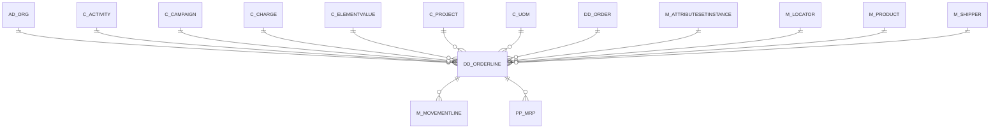

# DD_ORDERLINE

Area [DD](../../data-model/dd/index.md) · class **business** (proposed) · read from database `idempiere-db` (owner `ADEMPIERE`) · 0 row(s) when profiled

Application model: `org.eevolution.model.X_DD_OrderLine`, access level 1 - Org.

## Columns

| column | type | key | not null | business name | references (code) | nulls | distinct |
|---|---|---|---|---|---|---|---|
| `LINE` | NUMBER(10,0) |  | yes | Line No |  | 0 | 0 |
| `QTYINTRANSIT` | NUMBER |  |  | Qty In Transit |  | 0 | 0 |
| `QTYORDERED` | NUMBER |  | yes | Ordered Quantity |  | 0 | 0 |
| `M_PRODUCT_ID` | NUMBER(10,0) |  |  | Product | [M_PRODUCT](../../data-model/m/m_product.md) | 0 | 0 |
| `DD_ORDER_ID` | NUMBER(10,0) |  | yes | Distribution Order | [DD_ORDER](../../data-model/dd/dd_order.md) | 0 | 0 |
| `C_CHARGE_ID` | NUMBER(10,0) |  |  | Charge | [C_CHARGE](../../data-model/c/c_charge.md) | 0 | 0 |
| `C_PROJECT_ID` | NUMBER(10,0) |  |  | Project | [C_PROJECT](../../data-model/c/c_project.md) | 0 | 0 |
| `C_UOM_ID` | NUMBER(10,0) |  | yes | UOM | [C_UOM](../../data-model/c/c_uom.md) | 0 | 0 |
| `CONFIRMEDQTY` | NUMBER |  |  | Confirmed Quantity |  | 0 | 0 |
| `CREATED` | DATE |  | yes | Created |  | 0 | 0 |
| `CREATEDBY` | NUMBER(10,0) |  | yes | Created By |  | 0 | 0 |
| `DD_ORDERLINE_ID` | NUMBER(10,0) | PK | yes | Distribution Order Line |  | 0 | 0 |
| `DATEDELIVERED` | DATE |  |  | Date Delivered |  | 0 | 0 |
| `DATEORDERED` | DATE |  |  | Date Ordered |  | 0 | 0 |
| `DATEPROMISED` | DATE |  |  | Date Promised |  | 0 | 0 |
| `DESCRIPTION` | VARCHAR2(255 CHAR) |  |  | Description |  | 0 | 0 |
| `FREIGHTAMT` | NUMBER |  |  | Freight Amount |  | 0 | 0 |
| `ISACTIVE` | CHAR(1) |  | yes | Active |  | 0 | 0 |
| `ISDESCRIPTION` | CHAR(1) |  | yes | Description Only |  | 0 | 0 |
| `ISINVOICED` | CHAR(1) |  | yes | Invoiced |  | 0 | 0 |
| `LINENETAMT` | NUMBER |  |  | Line Amount |  | 0 | 0 |
| `M_ATTRIBUTESETINSTANCETO_ID` | NUMBER(10,0) |  |  | Attribute Set Instance To | [M_ATTRIBUTESETINSTANCE](../../data-model/m/m_attributesetinstance.md) | 0 | 0 |
| `M_ATTRIBUTESETINSTANCE_ID` | NUMBER(10,0) |  |  | Attribute Set Instance | [M_ATTRIBUTESETINSTANCE](../../data-model/m/m_attributesetinstance.md) | 0 | 0 |
| `M_LOCATORTO_ID` | NUMBER(10,0) |  | yes | Locator To | [M_LOCATOR](../../data-model/m/m_locator.md) | 0 | 0 |
| `M_LOCATOR_ID` | NUMBER(10,0) |  | yes | Locator | [M_LOCATOR](../../data-model/m/m_locator.md) | 0 | 0 |
| `PICKEDQTY` | NUMBER |  |  | Picked Quantity |  | 0 | 0 |
| `PROCESSED` | CHAR(1) |  | yes | Processed |  | 0 | 0 |
| `QTYDELIVERED` | NUMBER |  |  | Delivered Quantity |  | 0 | 0 |
| `QTYENTERED` | NUMBER |  | yes | Quantity |  | 0 | 0 |
| `QTYRESERVED` | NUMBER |  |  | Reserved Quantity |  | 0 | 0 |
| `SCRAPPEDQTY` | NUMBER |  |  | Scrapped Quantity |  | 0 | 0 |
| `TARGETQTY` | NUMBER |  |  | Target Quantity |  | 0 | 0 |
| `UPDATED` | DATE |  | yes | Updated |  | 0 | 0 |
| `UPDATEDBY` | NUMBER(10,0) |  | yes | Updated By |  | 0 | 0 |
| `USER1_ID` | NUMBER(10,0) |  |  | User Element List 1 | [C_ELEMENTVALUE](../../data-model/c/c_elementvalue.md) | 0 | 0 |
| `AD_CLIENT_ID` | NUMBER(10,0) |  | yes | Tenant |  | 0 | 0 |
| `USER2_ID` | NUMBER(10,0) |  |  | User Element List 2 | [C_ELEMENTVALUE](../../data-model/c/c_elementvalue.md) | 0 | 0 |
| `AD_ORGTRX_ID` | NUMBER(10,0) |  |  | Trx Organization |  | 0 | 0 |
| `AD_ORG_ID` | NUMBER(10,0) |  | yes | Organization |  | 0 | 0 |
| `C_ACTIVITY_ID` | NUMBER(10,0) |  |  | Activity | [C_ACTIVITY](../../data-model/c/c_activity.md) | 0 | 0 |
| `C_CAMPAIGN_ID` | NUMBER(10,0) |  |  | Campaign | [C_CAMPAIGN](../../data-model/c/c_campaign.md) | 0 | 0 |
| `M_SHIPPER_ID` | NUMBER(10,0) |  |  | Shipper | [M_SHIPPER](../../data-model/m/m_shipper.md) | 0 | 0 |
| `DD_ORDERLINE_UU` | VARCHAR2(36 CHAR) |  |  | DD_OrderLine_UU |  | 0 | 0 |

*references (code)* is the table the application model's code says a column points to; *Foreign keys* below are the constraints the database declares. Counts come from the profile; no value is ever shown.

## Check constraints

| name | expression |
|---|---|
| `SYS_C0022703` | `IsInvoiced IN ('Y','N')` |
| `SYS_C0022704` | `IsActive IN ('Y','N')` |
| `SYS_C0022706` | `IsDescription IN ('Y','N')` |
| `SYS_C0022707` | `Processed IN ('Y','N')` |

## Foreign keys

**References**

| table | columns | on delete |
|---|---|---|
| [AD_ORG](../../data-model/ad/ad_org.md) | DD_ORDERLINE.AD_ORGTRX_ID → AD_ORG.AD_ORG_ID | NO ACTION |
| [C_ACTIVITY](../../data-model/c/c_activity.md) | DD_ORDERLINE.C_ACTIVITY_ID → C_ACTIVITY.C_ACTIVITY_ID | NO ACTION |
| [C_CAMPAIGN](../../data-model/c/c_campaign.md) | DD_ORDERLINE.C_CAMPAIGN_ID → C_CAMPAIGN.C_CAMPAIGN_ID | NO ACTION |
| [C_CHARGE](../../data-model/c/c_charge.md) | DD_ORDERLINE.C_CHARGE_ID → C_CHARGE.C_CHARGE_ID | NO ACTION |
| [C_ELEMENTVALUE](../../data-model/c/c_elementvalue.md) | DD_ORDERLINE.USER1_ID → C_ELEMENTVALUE.C_ELEMENTVALUE_ID | NO ACTION |
| [C_PROJECT](../../data-model/c/c_project.md) | DD_ORDERLINE.C_PROJECT_ID → C_PROJECT.C_PROJECT_ID | NO ACTION |
| [C_UOM](../../data-model/c/c_uom.md) | DD_ORDERLINE.C_UOM_ID → C_UOM.C_UOM_ID | NO ACTION |
| [DD_ORDER](../../data-model/dd/dd_order.md) | DD_ORDERLINE.DD_ORDER_ID → DD_ORDER.DD_ORDER_ID | NO ACTION |
| [M_ATTRIBUTESETINSTANCE](../../data-model/m/m_attributesetinstance.md) | DD_ORDERLINE.M_ATTRIBUTESETINSTANCETO_ID → M_ATTRIBUTESETINSTANCE.M_ATTRIBUTESETINSTANCE_ID | NO ACTION |
| [M_LOCATOR](../../data-model/m/m_locator.md) | DD_ORDERLINE.M_LOCATORTO_ID → M_LOCATOR.M_LOCATOR_ID | NO ACTION |
| [M_PRODUCT](../../data-model/m/m_product.md) | DD_ORDERLINE.M_PRODUCT_ID → M_PRODUCT.M_PRODUCT_ID | NO ACTION |
| [M_SHIPPER](../../data-model/m/m_shipper.md) | DD_ORDERLINE.M_SHIPPER_ID → M_SHIPPER.M_SHIPPER_ID | NO ACTION |

**Referenced by**

| table | columns | on delete |
|---|---|---|
| [M_MOVEMENTLINE](../../data-model/m/m_movementline.md) | M_MOVEMENTLINE.DD_ORDERLINE_ID → DD_ORDERLINE.DD_ORDERLINE_ID | NO ACTION |
| [PP_MRP](../../data-model/pp/pp_mrp.md) | PP_MRP.DD_ORDERLINE_ID → DD_ORDERLINE.DD_ORDERLINE_ID | NO ACTION |

## Write behaviour

- updates: **raw_sql_skips_updated**
- deletes: **deleted_by_users**
- change log: **recorded**
- evidence: 2 citation(s)

## Read by

| kind | name |
|---|---|
| View | `M_MOVEMENT_CANDIDATE_V` |
| View | `RV_DD_ORDERDETAIL` |
| View | `m_movement_candidate_v` |
| View | `rv_dd_orderdetail` |

## Schema history

46 change(s); the latest:

| applied | release | operation | column | tickets |
|---|---|---|---|---|
| 2023-04-09T15:47 | iD11 | `add_constraint` |  | IDEMPIERE-5567 |
| 2023-04-09T15:47 | iD11 | `add_constraint` |  | IDEMPIERE-5567 |
| 2021-12-05T16:45 | i8.2z | `drop_constraint` |  | IDEMPIERE-5075 |
| 2021-12-05T16:45 | i8.2z | `drop_constraint` |  | IDEMPIERE-5075 |
| 2021-12-05T16:45 | i8.2z | `drop_constraint` |  | IDEMPIERE-5075 |
| 2021-12-05T16:45 | i8.2z | `add_constraint` |  | IDEMPIERE-5075 |
| 2021-12-05T16:45 | i8.2z | `add_constraint` |  | IDEMPIERE-5075 |
| 2021-12-05T16:45 | i8.2z | `add_constraint` |  | IDEMPIERE-5075 |
| 2021-12-05T16:45 | i8.2z | `drop_constraint` |  | IDEMPIERE-5075 |
| 2021-12-05T16:45 | i8.2z | `add_constraint` |  | IDEMPIERE-5075 |
| 2021-12-05T16:45 | i8.2z | `drop_constraint` |  | IDEMPIERE-5075 |
| 2021-12-05T16:45 | i8.2z | `drop_constraint` |  | IDEMPIERE-5075 |
| 2021-12-05T16:45 | i8.2z | `add_constraint` |  | IDEMPIERE-5075 |
| 2021-12-05T16:45 | i8.2z | `add_constraint` |  | IDEMPIERE-5075 |
| 2021-12-05T16:45 | i8.2z | `add_constraint` |  | IDEMPIERE-5075 |

## Notes

<!-- ekos:manual id="table.dd_orderline.notes" -->
_Business notes about this table._
<!-- /ekos:manual -->
