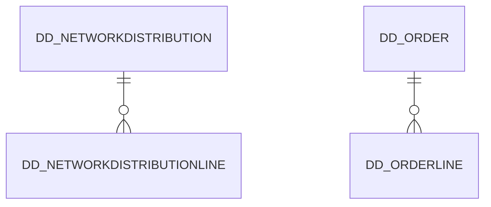

# Area DD

4 table(s), 4 in scope.

| table | class | scope | rows | description |
|---|---|---|---|---|
| [DD_NETWORKDISTRIBUTION](../../data-model/dd/dd_networkdistribution.md) | business | in | 2 |  |
| [DD_NETWORKDISTRIBUTIONLINE](../../data-model/dd/dd_networkdistributionline.md) | business | in | 10 |  |
| [DD_ORDER](../../data-model/dd/dd_order.md) | business | in | 0 |  |
| [DD_ORDERLINE](../../data-model/dd/dd_orderline.md) | business | in | 0 |  |
