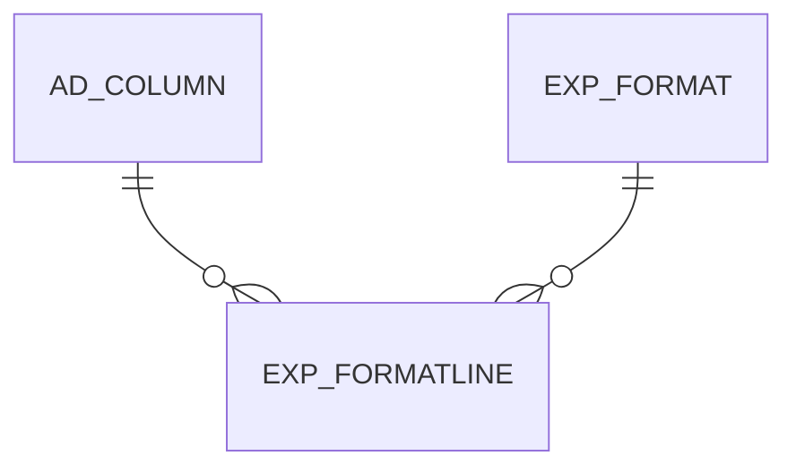

# EXP_FORMATLINE

Area [EXP](../../data-model/exp/index.md) · class **business** (proposed) · read from database `idempiere-db` (owner `ADEMPIERE`) · 43 row(s) when profiled

Application model: `org.compiere.model.X_EXP_FormatLine`, access level 6 - System - Client.

## Columns

| column | type | key | not null | business name | references (code) | nulls | distinct |
|---|---|---|---|---|---|---|---|
| `EXP_FORMATLINE_ID` | NUMBER(10,0) | PK | yes | Format Line |  | 0 | 43 |
| `AD_CLIENT_ID` | NUMBER(10,0) |  | yes | Tenant |  | 0 | 2 |
| `AD_ORG_ID` | NUMBER(10,0) |  | yes | Organization |  | 0 | 1 |
| `ISACTIVE` | CHAR(1) |  | yes | Active |  | 0 | 2 |
| `CREATED` | DATE |  | yes | Created |  | 0 | 37 |
| `CREATEDBY` | NUMBER(10,0) |  | yes | Created By |  | 0 | 1 |
| `UPDATED` | DATE |  | yes | Updated |  | 0 | 37 |
| `UPDATEDBY` | NUMBER(10,0) |  | yes | Updated By |  | 0 | 1 |
| `VALUE` | VARCHAR2(40 CHAR) |  | yes | Search Key |  | 0 | 25 |
| `NAME` | VARCHAR2(60 CHAR) |  | yes | Name |  | 0 | 29 |
| `DESCRIPTION` | VARCHAR2(255 CHAR) |  |  | Description |  | 43 | 0 |
| `HELP` | VARCHAR2(2000 CHAR) |  |  | Comment/Help |  | 43 | 0 |
| `EXP_FORMAT_ID` | NUMBER(10,0) |  |  | Export Format | [EXP_FORMAT](../../data-model/exp/exp_format.md) | 0 | 10 |
| `POSITION` | NUMBER(10,0) |  |  | Position |  | 0 | 12 |
| `ISMANDATORY` | CHAR(1) |  |  | Mandatory |  | 0 | 2 |
| `TYPE` | CHAR(1) |  | yes | Type |  | 0 | 3 |
| `AD_COLUMN_ID` | NUMBER(10,0) |  |  | Column | [AD_COLUMN](../../data-model/ad/ad_column.md) | 2 | 34 |
| `EXP_EMBEDDEDFORMAT_ID` | NUMBER(10,0) |  |  | Embedded Format | [EXP_FORMAT](../../data-model/exp/exp_format.md) | 26 | 7 |
| `ISPARTUNIQUEINDEX` | CHAR(1) |  |  | Is Part Unique Index |  | 0 | 2 |
| `DATEFORMAT` | VARCHAR2(40 CHAR) |  |  | Date Format |  | 39 | 1 |
| `EXP_FORMATLINE_UU` | VARCHAR2(36 CHAR) |  |  | EXP_FormatLine_UU |  | 0 | 43 |

*references (code)* is the table the application model's code says a column points to; *Foreign keys* below are the constraints the database declares. Counts come from the profile; no value is ever shown.

## Check constraints

| name | expression |
|---|---|
| `SYS_C0021844` | `IsPartUniqueIndex IN ('Y','N')` |
| `SYS_C0021846` | `IsActive IN ('Y','N')` |
| `SYS_C0021847` | `IsMandatory IN ('Y','N')` |

## Foreign keys

**References**

| table | columns | on delete |
|---|---|---|
| [AD_COLUMN](../../data-model/ad/ad_column.md) | EXP_FORMATLINE.AD_COLUMN_ID → AD_COLUMN.AD_COLUMN_ID | NO ACTION |
| [EXP_FORMAT](../../data-model/exp/exp_format.md) | EXP_FORMATLINE.EXP_EMBEDDEDFORMAT_ID → EXP_FORMAT.EXP_FORMAT_ID | NO ACTION |

**Referenced by**

_None._

## Write behaviour

- updates: **po_only**
- deletes: **deleted_by_app, deleted_by_users**
- change log: **recorded**
- evidence: 2 citation(s)

## Schema history

38 change(s); the latest:

| applied | release | operation | column | tickets |
|---|---|---|---|---|
| 2023-04-09T15:47 | iD11 | `add_constraint` |  | IDEMPIERE-5567 |
| 2023-04-09T15:47 | iD11 | `add_constraint` |  | IDEMPIERE-5567 |
| 2021-12-05T16:45 | i8.2z | `drop_constraint` |  | IDEMPIERE-5075 |
| 2021-12-05T16:45 | i8.2z | `drop_constraint` |  | IDEMPIERE-5075 |
| 2021-12-05T16:45 | i8.2z | `add_constraint` |  | IDEMPIERE-5075 |
| 2021-12-05T16:45 | i8.2z | `add_constraint` |  | IDEMPIERE-5075 |
| 2021-12-05T16:45 | i8.2z | `add_constraint` |  | IDEMPIERE-5075 |
| 2021-12-05T16:45 | i8.2z | `drop_constraint` |  | IDEMPIERE-5075 |
| 2020-08-04T01:00 | i7.1z | `add_column` | tmp_col_1_tmp | IDEMPIERE-3862 |
| 2020-08-04T01:00 | i7.1z | `drop_column` | tmp_col_2_tmp | IDEMPIERE-3862 |
| 2020-08-04T01:00 | i7.1z | `modify_column` | VALUE | IDEMPIERE-3862 |
| 2020-08-04T01:00 | i7.1z | `add_column` | tmp_col_6_tmp | IDEMPIERE-3862 |
| 2020-08-04T01:00 | i7.1z | `modify_column` | EXP_FORMATLINE_UU | IDEMPIERE-3862 |
| 2020-08-04T01:00 | i7.1z | `drop_column` | tmp_col_1_tmp | IDEMPIERE-3862 |
| 2020-08-04T01:00 | i7.1z | `modify_column` | NAME | IDEMPIERE-3862 |

## Open conflicts

| type | attribute | explanation |
|---|---|---|
| `mandatory_but_nullable` | `columns.AD_Column_ID.nullable` | unexplained |

## Notes

<!-- ekos:manual id="table.exp_formatline.notes" -->
_Business notes about this table._
<!-- /ekos:manual -->
