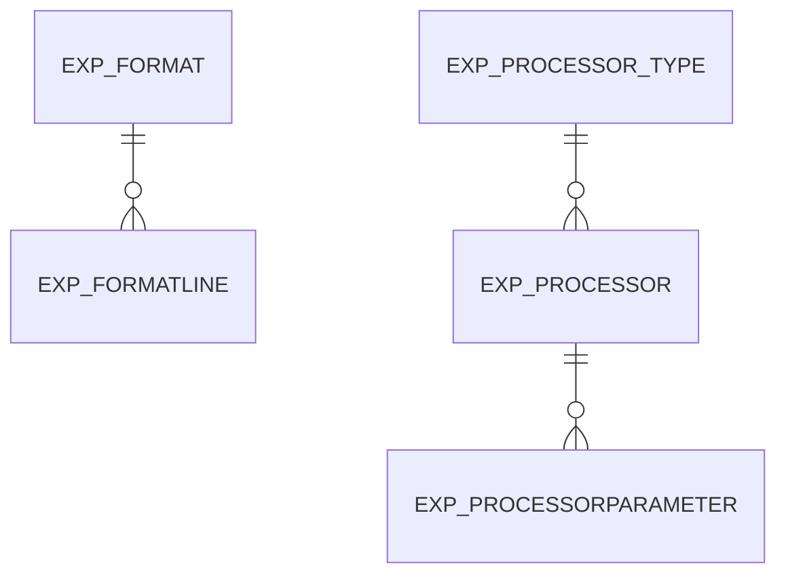

# Area EXP

5 table(s), 5 in scope.

| table | class | scope | rows | description |
|---|---|---|---|---|
| [EXP_FORMAT](../../data-model/exp/exp_format.md) | business | in | 10 |  |
| [EXP_FORMATLINE](../../data-model/exp/exp_formatline.md) | business | in | 43 |  |
| [EXP_PROCESSOR](../../data-model/exp/exp_processor.md) | business | in | 2 |  |
| [EXP_PROCESSORPARAMETER](../../data-model/exp/exp_processorparameter.md) | business | in | 7 |  |
| [EXP_PROCESSOR_TYPE](../../data-model/exp/exp_processor_type.md) | business | in | 2 |  |
