# FACT_ACCT_SUMMARY

Area [FACT](../../data-model/fact/index.md) · class **business** (proposed) · read from database `idempiere-db` (owner `ADEMPIERE`) · 0 row(s) when profiled

Application model: `org.compiere.model.X_Fact_Acct_Summary`, access level 3 - Client - Org.

## Columns

| column | type | key | not null | business name | references (code) | nulls | distinct |
|---|---|---|---|---|---|---|---|
| `AD_CLIENT_ID` | NUMBER(10,0) |  | yes | Tenant |  | 0 | 0 |
| `AD_ORGTRX_ID` | NUMBER(10,0) |  |  | Trx Organization |  | 0 | 0 |
| `AD_ORG_ID` | NUMBER(10,0) |  | yes | Organization |  | 0 | 0 |
| `ACCOUNT_ID` | NUMBER(10,0) |  | yes | Account | [C_ELEMENTVALUE](../../data-model/c/c_elementvalue.md) | 0 | 0 |
| `AMTACCTCR` | NUMBER |  | yes | Accounted Credit |  | 0 | 0 |
| `AMTACCTDR` | NUMBER |  | yes | Accounted Debit |  | 0 | 0 |
| `C_ACCTSCHEMA_ID` | NUMBER(10,0) |  | yes | Accounting Schema | [C_ACCTSCHEMA](../../data-model/c/c_acctschema.md) | 0 | 0 |
| `C_ACTIVITY_ID` | NUMBER(10,0) |  |  | Activity | [C_ACTIVITY](../../data-model/c/c_activity.md) | 0 | 0 |
| `C_BPARTNER_ID` | NUMBER(10,0) |  |  | Business Partner | [C_BPARTNER](../../data-model/c/c_bpartner.md) | 0 | 0 |
| `C_CAMPAIGN_ID` | NUMBER(10,0) |  |  | Campaign | [C_CAMPAIGN](../../data-model/c/c_campaign.md) | 0 | 0 |
| `C_LOCFROM_ID` | NUMBER(10,0) |  |  | Location From | [C_LOCATION](../../data-model/c/c_location.md) | 0 | 0 |
| `C_LOCTO_ID` | NUMBER(10,0) |  |  | Location To | [C_LOCATION](../../data-model/c/c_location.md) | 0 | 0 |
| `C_PERIOD_ID` | NUMBER(10,0) |  | yes | Period | [C_PERIOD](../../data-model/c/c_period.md) | 0 | 0 |
| `C_PROJECTPHASE_ID` | NUMBER(10,0) |  |  | Project Phase | [C_PROJECTPHASE](../../data-model/c/c_projectphase.md) | 0 | 0 |
| `C_PROJECTTASK_ID` | NUMBER(10,0) |  |  | Project Task | [C_PROJECTTASK](../../data-model/c/c_projecttask.md) | 0 | 0 |
| `C_PROJECT_ID` | NUMBER(10,0) |  |  | Project | [C_PROJECT](../../data-model/c/c_project.md) | 0 | 0 |
| `C_SALESREGION_ID` | NUMBER(10,0) |  |  | Sales Region | [C_SALESREGION](../../data-model/c/c_salesregion.md) | 0 | 0 |
| `C_SUBACCT_ID` | NUMBER(10,0) |  |  | Sub Account | [C_SUBACCT](../../data-model/c/c_subacct.md) | 0 | 0 |
| `CREATED` | DATE |  | yes | Created |  | 0 | 0 |
| `CREATEDBY` | NUMBER(10,0) |  | yes | Created By |  | 0 | 0 |
| `GL_BUDGET_ID` | NUMBER(10,0) |  |  | Budget | [GL_BUDGET](../../data-model/gl/gl_budget.md) | 0 | 0 |
| `ISACTIVE` | CHAR(1) |  | yes | Active |  | 0 | 0 |
| `M_PRODUCT_ID` | NUMBER(10,0) |  |  | Product | [M_PRODUCT](../../data-model/m/m_product.md) | 0 | 0 |
| `PA_REPORTCUBE_ID` | NUMBER(10,0) |  | yes | Report Cube | [PA_REPORTCUBE](../../data-model/pa/pa_reportcube.md) | 0 | 0 |
| `POSTINGTYPE` | CHAR(1) |  | yes | Posting Type |  | 0 | 0 |
| `QTY` | NUMBER |  | yes | Quantity |  | 0 | 0 |
| `UPDATED` | DATE |  | yes | Updated |  | 0 | 0 |
| `UPDATEDBY` | NUMBER(10,0) |  | yes | Updated By |  | 0 | 0 |
| `USER1_ID` | NUMBER(10,0) |  |  | User Element List 1 | [C_ELEMENTVALUE](../../data-model/c/c_elementvalue.md) | 0 | 0 |
| `USER2_ID` | NUMBER(10,0) |  |  | User Element List 2 | [C_ELEMENTVALUE](../../data-model/c/c_elementvalue.md) | 0 | 0 |
| `USERELEMENT1_ID` | NUMBER(10,0) |  |  | User Column 1 |  | 0 | 0 |
| `USERELEMENT2_ID` | NUMBER(10,0) |  |  | User Column 2 |  | 0 | 0 |
| `DATEACCT` | DATE |  |  | Account Date |  | 0 | 0 |
| `FACT_ACCT_SUMMARY_UU` | VARCHAR2(36 CHAR) |  |  | Fact_Acct_Summary_UU |  | 0 | 0 |

*references (code)* is the table the application model's code says a column points to; *Foreign keys* below are the constraints the database declares. Counts come from the profile; no value is ever shown.

## Check constraints

| name | expression |
|---|---|
| `SYS_C0022184` | `IsActive IN ('Y','N')` |

## Foreign keys

**References**

| table | columns | on delete |
|---|---|---|
| [AD_ORG](../../data-model/ad/ad_org.md) | FACT_ACCT_SUMMARY.AD_ORGTRX_ID → AD_ORG.AD_ORG_ID | NO ACTION |
| [C_ACCTSCHEMA](../../data-model/c/c_acctschema.md) | FACT_ACCT_SUMMARY.C_ACCTSCHEMA_ID → C_ACCTSCHEMA.C_ACCTSCHEMA_ID | NO ACTION |
| [C_ACTIVITY](../../data-model/c/c_activity.md) | FACT_ACCT_SUMMARY.C_ACTIVITY_ID → C_ACTIVITY.C_ACTIVITY_ID | NO ACTION |
| [C_BPARTNER](../../data-model/c/c_bpartner.md) | FACT_ACCT_SUMMARY.C_BPARTNER_ID → C_BPARTNER.C_BPARTNER_ID | NO ACTION |
| [C_CAMPAIGN](../../data-model/c/c_campaign.md) | FACT_ACCT_SUMMARY.C_CAMPAIGN_ID → C_CAMPAIGN.C_CAMPAIGN_ID | NO ACTION |
| [C_ELEMENTVALUE](../../data-model/c/c_elementvalue.md) | FACT_ACCT_SUMMARY.ACCOUNT_ID → C_ELEMENTVALUE.C_ELEMENTVALUE_ID | NO ACTION |
| [C_LOCATION](../../data-model/c/c_location.md) | FACT_ACCT_SUMMARY.C_LOCFROM_ID → C_LOCATION.C_LOCATION_ID | NO ACTION |
| [C_PERIOD](../../data-model/c/c_period.md) | FACT_ACCT_SUMMARY.C_PERIOD_ID → C_PERIOD.C_PERIOD_ID | NO ACTION |
| [C_PROJECT](../../data-model/c/c_project.md) | FACT_ACCT_SUMMARY.C_PROJECT_ID → C_PROJECT.C_PROJECT_ID | NO ACTION |
| [C_PROJECTPHASE](../../data-model/c/c_projectphase.md) | FACT_ACCT_SUMMARY.C_PROJECTPHASE_ID → C_PROJECTPHASE.C_PROJECTPHASE_ID | NO ACTION |
| [C_PROJECTTASK](../../data-model/c/c_projecttask.md) | FACT_ACCT_SUMMARY.C_PROJECTTASK_ID → C_PROJECTTASK.C_PROJECTTASK_ID | NO ACTION |
| [C_SALESREGION](../../data-model/c/c_salesregion.md) | FACT_ACCT_SUMMARY.C_SALESREGION_ID → C_SALESREGION.C_SALESREGION_ID | NO ACTION |
| [C_SUBACCT](../../data-model/c/c_subacct.md) | FACT_ACCT_SUMMARY.C_SUBACCT_ID → C_SUBACCT.C_SUBACCT_ID | NO ACTION |
| [GL_BUDGET](../../data-model/gl/gl_budget.md) | FACT_ACCT_SUMMARY.GL_BUDGET_ID → GL_BUDGET.GL_BUDGET_ID | NO ACTION |
| [M_PRODUCT](../../data-model/m/m_product.md) | FACT_ACCT_SUMMARY.M_PRODUCT_ID → M_PRODUCT.M_PRODUCT_ID | NO ACTION |
| [PA_REPORTCUBE](../../data-model/pa/pa_reportcube.md) | FACT_ACCT_SUMMARY.PA_REPORTCUBE_ID → PA_REPORTCUBE.PA_REPORTCUBE_ID | NO ACTION |

**Referenced by**

_None._

```mermaid
erDiagram
  AD_ORG ||--o{ FACT_ACCT_SUMMARY : ""
  C_ACCTSCHEMA ||--o{ FACT_ACCT_SUMMARY : ""
  C_ACTIVITY ||--o{ FACT_ACCT_SUMMARY : ""
  C_BPARTNER ||--o{ FACT_ACCT_SUMMARY : ""
  C_CAMPAIGN ||--o{ FACT_ACCT_SUMMARY : ""
  C_ELEMENTVALUE ||--o{ FACT_ACCT_SUMMARY : ""
  C_LOCATION ||--o{ FACT_ACCT_SUMMARY : ""
  C_PERIOD ||--o{ FACT_ACCT_SUMMARY : ""
  C_PROJECT ||--o{ FACT_ACCT_SUMMARY : ""
  C_PROJECTPHASE ||--o{ FACT_ACCT_SUMMARY : ""
  C_PROJECTTASK ||--o{ FACT_ACCT_SUMMARY : ""
  C_SALESREGION ||--o{ FACT_ACCT_SUMMARY : ""
  C_SUBACCT ||--o{ FACT_ACCT_SUMMARY : ""
  GL_BUDGET ||--o{ FACT_ACCT_SUMMARY : ""
  M_PRODUCT ||--o{ FACT_ACCT_SUMMARY : ""
  PA_REPORTCUBE ||--o{ FACT_ACCT_SUMMARY : ""
```

## Write behaviour

- updates: **po_only**
- deletes: **deleted_by_users**
- change log: **not_recorded**
- evidence: 1 citation(s)

## Schema history

87 change(s); the latest:

| applied | release | operation | column | tickets |
|---|---|---|---|---|
| 2024-05-14T13:59 | iD13 | `add_constraint` |  | IDEMPIERE-5598 |
| 2024-05-14T13:59 | iD13 | `add_column` | CustomFieldText3 | IDEMPIERE-5598 |
| 2024-05-14T13:59 | iD13 | `add_column` | M_AttributeSetInstance_ID | IDEMPIERE-5598 |
| 2024-05-14T13:59 | iD13 | `add_constraint` |  | IDEMPIERE-5598 |
| 2024-05-14T13:59 | iD13 | `add_column` | C_Department_ID | IDEMPIERE-5598 |
| 2024-05-14T13:59 | iD13 | `add_constraint` |  | IDEMPIERE-5598 |
| 2024-05-14T13:59 | iD13 | `add_constraint` |  | IDEMPIERE-5598 |
| 2024-05-14T13:59 | iD13 | `add_column` | CustomFieldText3 | IDEMPIERE-5598 |
| 2024-05-14T13:59 | iD13 | `add_column` | A_Asset_ID | IDEMPIERE-5598 |
| 2024-05-14T13:59 | iD13 | `add_column` | C_Department_ID | IDEMPIERE-5598 |
| 2024-05-14T13:59 | iD13 | `add_column` | C_CostCenter_ID | IDEMPIERE-5598 |
| 2024-05-14T13:59 | iD13 | `add_column` | M_Warehouse_ID | IDEMPIERE-5598 |
| 2024-05-14T13:59 | iD13 | `add_constraint` |  | IDEMPIERE-5598 |
| 2024-05-14T13:59 | iD13 | `add_column` | CustomFieldText1 | IDEMPIERE-5598 |
| 2024-05-14T13:59 | iD13 | `add_constraint` |  | IDEMPIERE-5598 |

## Open conflicts

| type | attribute | explanation |
|---|---|---|
| `model_column_missing` | `columns.A_Asset_ID` | unexplained |
| `model_column_missing` | `columns.C_Charge_ID` | unexplained |
| `model_column_missing` | `columns.C_CostCenter_ID` | unexplained |
| `model_column_missing` | `columns.C_Department_ID` | unexplained |
| `model_column_missing` | `columns.C_Employee_ID` | unexplained |
| `model_column_missing` | `columns.CustomFieldText1` | unexplained |
| `model_column_missing` | `columns.CustomFieldText2` | unexplained |
| `model_column_missing` | `columns.CustomFieldText3` | unexplained |
| `model_column_missing` | `columns.CustomFieldText4` | unexplained |
| `model_column_missing` | `columns.M_AttributeSetInstance_ID` | unexplained |
| `model_column_missing` | `columns.M_Warehouse_ID` | unexplained |

## Notes

<!-- ekos:manual id="table.fact_acct_summary.notes" -->
_Business notes about this table._
<!-- /ekos:manual -->
