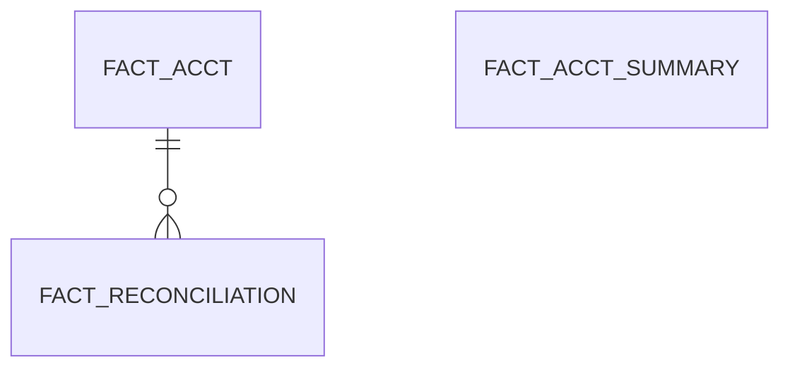

# Area FACT

3 table(s), 3 in scope.

| table | class | scope | rows | description |
|---|---|---|---|---|
| [FACT_ACCT](../../data-model/fact/fact_acct.md) | business | in | 0 |  |
| [FACT_ACCT_SUMMARY](../../data-model/fact/fact_acct_summary.md) | business | in | 0 |  |
| [FACT_RECONCILIATION](../../data-model/fact/fact_reconciliation.md) | business | in | 0 |  |
