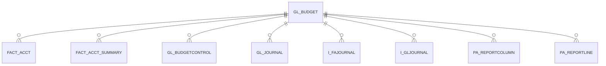

# GL_BUDGET

Area [GL](../../data-model/gl/index.md) · class **business** (proposed) · read from database `idempiere-db` (owner `ADEMPIERE`) · 1 row(s) when profiled

Application model: `org.compiere.model.X_GL_Budget`, access level 3 - Client - Org.

## Columns

| column | type | key | not null | business name | references (code) | nulls | distinct |
|---|---|---|---|---|---|---|---|
| `GL_BUDGET_ID` | NUMBER(10,0) | PK | yes | Budget |  | 0 | 1 |
| `AD_CLIENT_ID` | NUMBER(10,0) |  | yes | Tenant |  | 0 | 1 |
| `AD_ORG_ID` | NUMBER(10,0) |  | yes | Organization |  | 0 | 1 |
| `ISACTIVE` | CHAR(1) |  | yes | Active |  | 0 | 1 |
| `CREATED` | DATE |  | yes | Created |  | 0 | 1 |
| `CREATEDBY` | NUMBER(10,0) |  | yes | Created By |  | 0 | 1 |
| `UPDATED` | DATE |  | yes | Updated |  | 0 | 1 |
| `UPDATEDBY` | NUMBER(10,0) |  | yes | Updated By |  | 0 | 1 |
| `NAME` | VARCHAR2(60 CHAR) |  | yes | Name |  | 0 | 1 |
| `DESCRIPTION` | VARCHAR2(255 CHAR) |  |  | Description |  | 1 | 0 |
| `ISPRIMARY` | CHAR(1) |  | yes | Primary |  | 0 | 1 |
| `BUDGETSTATUS` | CHAR(1) |  |  | Budget Status |  | 0 | 1 |
| `GL_BUDGET_UU` | VARCHAR2(36 CHAR) |  |  | GL_Budget_UU |  | 0 | 1 |

*references (code)* is the table the application model's code says a column points to; *Foreign keys* below are the constraints the database declares. Counts come from the profile; no value is ever shown.

## Check constraints

| name | expression |
|---|---|
| `SYS_C0020953` | `IsActive in ('Y','N')` |
| `SYS_C0020954` | `IsPrimary in ('Y','N')` |

## Foreign keys

**References**

_None._

**Referenced by**

| table | columns | on delete |
|---|---|---|
| [FACT_ACCT](../../data-model/fact/fact_acct.md) | FACT_ACCT.GL_BUDGET_ID → GL_BUDGET.GL_BUDGET_ID | NO ACTION |
| [FACT_ACCT_SUMMARY](../../data-model/fact/fact_acct_summary.md) | FACT_ACCT_SUMMARY.GL_BUDGET_ID → GL_BUDGET.GL_BUDGET_ID | NO ACTION |
| [GL_BUDGETCONTROL](../../data-model/gl/gl_budgetcontrol.md) | GL_BUDGETCONTROL.GL_BUDGET_ID → GL_BUDGET.GL_BUDGET_ID | NO ACTION |
| [GL_JOURNAL](../../data-model/gl/gl_journal.md) | GL_JOURNAL.GL_BUDGET_ID → GL_BUDGET.GL_BUDGET_ID | NO ACTION |
| `I_FAJOURNAL` | I_FAJOURNAL.GL_BUDGET_ID → GL_BUDGET.GL_BUDGET_ID | NO ACTION |
| `I_GLJOURNAL` | I_GLJOURNAL.GL_BUDGET_ID → GL_BUDGET.GL_BUDGET_ID | SET NULL |
| [PA_REPORTCOLUMN](../../data-model/pa/pa_reportcolumn.md) | PA_REPORTCOLUMN.GL_BUDGET_ID → GL_BUDGET.GL_BUDGET_ID | NO ACTION |
| [PA_REPORTLINE](../../data-model/pa/pa_reportline.md) | PA_REPORTLINE.GL_BUDGET_ID → GL_BUDGET.GL_BUDGET_ID | NO ACTION |

## Write behaviour

- updates: **po_only**
- deletes: **deleted_by_users**
- change log: **recorded**
- evidence: 1 citation(s)

## Read by

| kind | name |
|---|---|
| View | `RV_FACT_ADAXA` |
| View | `rv_fact_adaxa` |

## Schema history

14 change(s); the latest:

| applied | release | operation | column | tickets |
|---|---|---|---|---|
| 2023-04-09T15:47 | iD11 | `add_constraint` |  | IDEMPIERE-5567 |
| 2023-04-09T15:47 | iD11 | `add_constraint` |  | IDEMPIERE-5567 |
| 2020-08-04T01:00 | i7.1z | `modify_column` | GL_BUDGET_UU | IDEMPIERE-3862 |
| 2020-08-04T01:00 | i7.1z | `drop_column` | tmp_col_2_tmp | IDEMPIERE-3862 |
| 2020-08-04T01:00 | i7.1z | `create_index` |  | IDEMPIERE-3862 |
| 2020-08-04T01:00 | i7.1z | `add_column` | tmp_col_1_tmp | IDEMPIERE-3862 |
| 2020-08-04T01:00 | i7.1z | `drop_column` | tmp_col_3_tmp | IDEMPIERE-3862 |
| 2020-08-04T01:00 | i7.1z | `add_column` | tmp_col_3_tmp | IDEMPIERE-3862 |
| 2020-08-04T01:00 | i7.1z | `modify_column` | NAME | IDEMPIERE-3862 |
| 2020-08-04T01:00 | i7.1z | `modify_column` | NAME | IDEMPIERE-3862 |
| 2020-08-04T01:00 | i7.1z | `add_column` | tmp_col_2_tmp | IDEMPIERE-3862 |
| 2020-08-04T01:00 | i7.1z | `modify_column` | NAME | IDEMPIERE-3862 |
| 2020-08-04T01:00 | i7.1z | `drop_column` | tmp_col_1_tmp | IDEMPIERE-3862 |
| 2020-08-04T01:00 | i7.1z | `modify_column` | DESCRIPTION | IDEMPIERE-3862 |

## Notes

<!-- ekos:manual id="table.gl_budget.notes" -->
_Business notes about this table._
<!-- /ekos:manual -->
