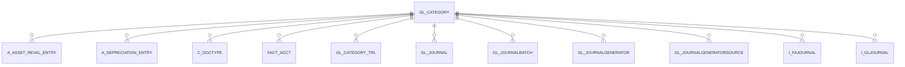

# GL_CATEGORY

Area [GL](../../data-model/gl/index.md) · class **business** (proposed) · read from database `idempiere-db` (owner `ADEMPIERE`) · 10 row(s) when profiled

Application model: `org.compiere.model.X_GL_Category`, access level 2 - Client.

## Columns

| column | type | key | not null | business name | references (code) | nulls | distinct |
|---|---|---|---|---|---|---|---|
| `GL_CATEGORY_ID` | NUMBER(10,0) | PK | yes | GL Category |  | 0 | 10 |
| `AD_CLIENT_ID` | NUMBER(10,0) |  | yes | Tenant |  | 0 | 2 |
| `AD_ORG_ID` | NUMBER(10,0) |  | yes | Organization |  | 0 | 2 |
| `ISACTIVE` | CHAR(1) |  | yes | Active |  | 0 | 1 |
| `CREATED` | DATE |  | yes | Created |  | 0 | 5 |
| `CREATEDBY` | NUMBER(10,0) |  | yes | Created By |  | 0 | 2 |
| `UPDATED` | DATE |  | yes | Updated |  | 0 | 6 |
| `UPDATEDBY` | NUMBER(10,0) |  | yes | Updated By |  | 0 | 2 |
| `NAME` | VARCHAR2(60 CHAR) |  | yes | Name |  | 0 | 10 |
| `DESCRIPTION` | VARCHAR2(255 CHAR) |  |  | Description |  | 10 | 0 |
| `CATEGORYTYPE` | CHAR(1) |  | yes | Category Type |  | 0 | 2 |
| `ISDEFAULT` | CHAR(1) |  | yes | Default |  | 0 | 2 |
| `DOCBASETYPE` | CHAR(3) |  |  |  |  | 10 | 0 |
| `GL_CATEGORY_UU` | VARCHAR2(36 CHAR) |  |  | GL_Category_UU |  | 0 | 10 |
| `VALUE` | VARCHAR2(60 CHAR) |  | yes | Search Key |  | 0 | 10 |
| `PRINTNAME` | VARCHAR2(60 CHAR) |  |  | Print Text |  | 10 | 0 |

*references (code)* is the table the application model's code says a column points to; *Foreign keys* below are the constraints the database declares. Counts come from the profile; no value is ever shown.

## Check constraints

| name | expression |
|---|---|
| `SYS_C0021823` | `IsActive in ('Y','N')` |

## Foreign keys

**References**

_None._

**Referenced by**

| table | columns | on delete |
|---|---|---|
| [A_ASSET_REVAL_ENTRY](../../data-model/a/a_asset_reval_entry.md) | A_ASSET_REVAL_ENTRY.GL_CATEGORY_ID → GL_CATEGORY.GL_CATEGORY_ID | NO ACTION |
| [A_DEPRECIATION_ENTRY](../../data-model/a/a_depreciation_entry.md) | A_DEPRECIATION_ENTRY.GL_CATEGORY_ID → GL_CATEGORY.GL_CATEGORY_ID | NO ACTION |
| [C_DOCTYPE](../../data-model/c/c_doctype.md) | C_DOCTYPE.GL_CATEGORY_ID → GL_CATEGORY.GL_CATEGORY_ID | NO ACTION |
| [FACT_ACCT](../../data-model/fact/fact_acct.md) | FACT_ACCT.GL_CATEGORY_ID → GL_CATEGORY.GL_CATEGORY_ID | NO ACTION |
| [GL_CATEGORY_TRL](../../data-model/gl/gl_category_trl.md) | GL_CATEGORY_TRL.GL_CATEGORY_ID → GL_CATEGORY.GL_CATEGORY_ID | CASCADE |
| [GL_JOURNAL](../../data-model/gl/gl_journal.md) | GL_JOURNAL.GL_CATEGORY_ID → GL_CATEGORY.GL_CATEGORY_ID | NO ACTION |
| [GL_JOURNALBATCH](../../data-model/gl/gl_journalbatch.md) | GL_JOURNALBATCH.GL_CATEGORY_ID → GL_CATEGORY.GL_CATEGORY_ID | NO ACTION |
| [GL_JOURNALGENERATOR](../../data-model/gl/gl_journalgenerator.md) | GL_JOURNALGENERATOR.GL_CATEGORY_ID → GL_CATEGORY.GL_CATEGORY_ID | NO ACTION |
| [GL_JOURNALGENERATORSOURCE](../../data-model/gl/gl_journalgeneratorsource.md) | GL_JOURNALGENERATORSOURCE.GL_CATEGORY_ID → GL_CATEGORY.GL_CATEGORY_ID | NO ACTION |
| `I_FAJOURNAL` | I_FAJOURNAL.GL_CATEGORY_ID → GL_CATEGORY.GL_CATEGORY_ID | NO ACTION |
| `I_GLJOURNAL` | I_GLJOURNAL.GL_CATEGORY_ID → GL_CATEGORY.GL_CATEGORY_ID | SET NULL |

## Write behaviour

- updates: **po_only**
- deletes: **deleted_by_users**
- change log: **recorded**
- evidence: 1 citation(s)

## Schema history

24 change(s); the latest:

| applied | release | operation | column | tickets |
|---|---|---|---|---|
| 2023-04-09T15:47 | iD11 | `add_constraint` |  | IDEMPIERE-5567 |
| 2023-04-09T15:47 | iD11 | `add_constraint` |  | IDEMPIERE-5567 |
| 2022-11-30T11:23 | iD10 | `add_column` | PrintName | IDEMPIERE-5505 |
| 2022-11-30T11:23 | iD10 | `modify_column` | Value | IDEMPIERE-5505 |
| 2022-11-30T11:23 | iD10 | `modify_column` | Value | IDEMPIERE-5505 |
| 2022-11-30T11:23 | iD10 | `create_index` |  | IDEMPIERE-5505 |
| 2022-11-30T11:23 | iD10 | `modify_column` | Value | IDEMPIERE-5505 |
| 2022-11-30T11:23 | iD10 | `add_column` | Value | IDEMPIERE-5505 |
| 2022-11-30T11:23 | iD10 | `add_column` | PrintName | IDEMPIERE-5505 |
| 2022-11-30T11:23 | iD10 | `create_index` |  | IDEMPIERE-5505 |
| 2022-11-30T11:23 | iD10 | `modify_column` | Value | IDEMPIERE-5505 |
| 2022-11-30T11:23 | iD10 | `add_column` | Value | IDEMPIERE-5505 |
| 2020-08-04T01:00 | i7.1z | `modify_column` | NAME | IDEMPIERE-3862 |
| 2020-08-04T01:00 | i7.1z | `drop_column` | tmp_col_2_tmp | IDEMPIERE-3862 |
| 2020-08-04T01:00 | i7.1z | `create_index` |  | IDEMPIERE-3862 |

## Notes

<!-- ekos:manual id="table.gl_category.notes" -->
_Business notes about this table._
<!-- /ekos:manual -->
