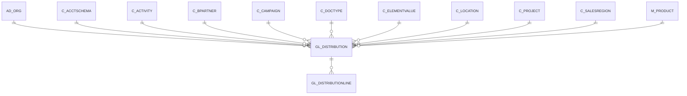

# GL_DISTRIBUTION

Area [GL](../../data-model/gl/index.md) · class **business** (proposed) · read from database `idempiere-db` (owner `ADEMPIERE`) · 1 row(s) when profiled

Application model: `org.compiere.model.X_GL_Distribution`, access level 2 - Client.

## Columns

| column | type | key | not null | business name | references (code) | nulls | distinct |
|---|---|---|---|---|---|---|---|
| `GL_DISTRIBUTION_ID` | NUMBER(10,0) | PK | yes | GL Distribution |  | 0 | 1 |
| `AD_CLIENT_ID` | NUMBER(10,0) |  | yes | Tenant |  | 0 | 1 |
| `AD_ORG_ID` | NUMBER(10,0) |  | yes | Organization |  | 0 | 1 |
| `ISACTIVE` | CHAR(1) |  | yes | Active |  | 0 | 1 |
| `CREATED` | DATE |  | yes | Created |  | 0 | 1 |
| `CREATEDBY` | NUMBER(10,0) |  | yes | Created By |  | 0 | 1 |
| `UPDATED` | DATE |  | yes | Updated |  | 0 | 1 |
| `UPDATEDBY` | NUMBER(10,0) |  | yes | Updated By |  | 0 | 1 |
| `NAME` | VARCHAR2(60 CHAR) |  | yes | Name |  | 0 | 1 |
| `DESCRIPTION` | VARCHAR2(255 CHAR) |  |  | Description |  | 1 | 0 |
| `HELP` | VARCHAR2(2000 CHAR) |  |  | Comment/Help |  | 1 | 0 |
| `POSTINGTYPE` | CHAR(1) |  |  | Posting Type |  | 1 | 0 |
| `C_DOCTYPE_ID` | NUMBER(10,0) |  |  | Document Type | [C_DOCTYPE](../../data-model/c/c_doctype.md) | 1 | 0 |
| `C_ACCTSCHEMA_ID` | NUMBER(10,0) |  | yes | Accounting Schema | [C_ACCTSCHEMA](../../data-model/c/c_acctschema.md) | 0 | 1 |
| `ANYORG` | CHAR(1) |  | yes | Any Organization |  | 0 | 1 |
| `ORG_ID` | NUMBER(10,0) |  |  | Organization |  | 1 | 0 |
| `ANYACCT` | CHAR(1) |  | yes | Any Account |  | 0 | 1 |
| `ACCOUNT_ID` | NUMBER(10,0) |  |  | Account | [C_ELEMENTVALUE](../../data-model/c/c_elementvalue.md) | 0 | 1 |
| `ANYPRODUCT` | CHAR(1) |  | yes | Any Product |  | 0 | 1 |
| `M_PRODUCT_ID` | NUMBER(10,0) |  |  | Product | [M_PRODUCT](../../data-model/m/m_product.md) | 1 | 0 |
| `ANYBPARTNER` | CHAR(1) |  | yes | Any Bus.Partner |  | 0 | 1 |
| `C_BPARTNER_ID` | NUMBER(10,0) |  |  | Business Partner | [C_BPARTNER](../../data-model/c/c_bpartner.md) | 1 | 0 |
| `ANYPROJECT` | CHAR(1) |  | yes | Any Project |  | 0 | 1 |
| `C_PROJECT_ID` | NUMBER(10,0) |  |  | Project | [C_PROJECT](../../data-model/c/c_project.md) | 1 | 0 |
| `ANYCAMPAIGN` | CHAR(1) |  | yes | Any Campaign |  | 0 | 1 |
| `C_CAMPAIGN_ID` | NUMBER(10,0) |  |  | Campaign | [C_CAMPAIGN](../../data-model/c/c_campaign.md) | 1 | 0 |
| `ANYACTIVITY` | CHAR(1) |  | yes | Any Activity |  | 0 | 1 |
| `C_ACTIVITY_ID` | NUMBER(10,0) |  |  | Activity | [C_ACTIVITY](../../data-model/c/c_activity.md) | 1 | 0 |
| `ANYSALESREGION` | CHAR(1) |  | yes | Any Sales Region |  | 0 | 1 |
| `C_SALESREGION_ID` | NUMBER(10,0) |  |  | Sales Region | [C_SALESREGION](../../data-model/c/c_salesregion.md) | 1 | 0 |
| `ANYORGTRX` | CHAR(1) |  | yes | Any Trx Organization |  | 0 | 1 |
| `AD_ORGTRX_ID` | NUMBER(10,0) |  |  | Trx Organization |  | 1 | 0 |
| `ANYLOCTO` | CHAR(1) |  | yes | Any Location To |  | 0 | 1 |
| `C_LOCTO_ID` | NUMBER(10,0) |  |  | Location To | [C_LOCATION](../../data-model/c/c_location.md) | 1 | 0 |
| `ANYLOCFROM` | CHAR(1) |  | yes | Any Location From |  | 0 | 1 |
| `C_LOCFROM_ID` | NUMBER(10,0) |  |  | Location From | [C_LOCATION](../../data-model/c/c_location.md) | 1 | 0 |
| `ANYUSER1` | CHAR(1) |  | yes | Any User 1 |  | 0 | 1 |
| `USER1_ID` | NUMBER(10,0) |  |  | User Element List 1 | [C_ELEMENTVALUE](../../data-model/c/c_elementvalue.md) | 1 | 0 |
| `ANYUSER2` | CHAR(1) |  | yes | Any User 2 |  | 0 | 1 |
| `USER2_ID` | NUMBER(10,0) |  |  | User Element List 2 | [C_ELEMENTVALUE](../../data-model/c/c_elementvalue.md) | 1 | 0 |
| `PERCENTTOTAL` | NUMBER |  | yes | Total Percent |  | 0 | 1 |
| `ISVALID` | CHAR(1) |  | yes | Valid |  | 0 | 1 |
| `PROCESSING` | CHAR(1) |  |  | Process Now |  | 0 | 1 |
| `ISCREATEREVERSAL` | CHAR(1) |  | yes | Create Reversal |  | 0 | 1 |
| `GL_DISTRIBUTION_UU` | VARCHAR2(36 CHAR) |  |  | GL_Distribution_UU |  | 0 | 1 |
| `SEQNO` | NUMBER(10,0) |  | yes | Sequence |  | 0 | 1 |
| `VALIDFROM` | DATE |  |  | Valid from |  | 1 | 0 |
| `VALIDTO` | DATE |  |  | Valid to |  | 1 | 0 |

*references (code)* is the table the application model's code says a column points to; *Foreign keys* below are the constraints the database declares. Counts come from the profile; no value is ever shown.

## Check constraints

| name | expression |
|---|---|
| `SYS_C0020231` | `AnyActivity in ('Y','N')` |
| `SYS_C0020232` | `IsCreateReversal IN ('Y','N')` |
| `SYS_C0020233` | `IsValid in ('Y','N')` |
| `SYS_C0020234` | `AnyProject in ('Y','N')` |
| `SYS_C0020235` | `IsActive in ('Y','N')` |
| `SYS_C0020236` | `AnyOrgTrx in ('Y','N')` |
| `SYS_C0020237` | `AnyBPartner in ('Y','N')` |
| `SYS_C0020238` | `AnyLocFrom in ('Y','N')` |
| `SYS_C0020239` | `AnyProduct in ('Y','N')` |
| `SYS_C0020240` | `AnyUser1 in ('Y','N')` |
| `SYS_C0020242` | `AnyOrg in ('Y','N')` |
| `SYS_C0020243` | `AnySalesRegion in ('Y','N')` |
| `SYS_C0020244` | `AnyLocTo in ('Y','N')` |
| `SYS_C0020245` | `AnyUser2 in ('Y','N')` |
| `SYS_C0020246` | `AnyAcct in ('Y','N')` |
| `SYS_C0020247` | `AnyCampaign in ('Y','N')` |

## Foreign keys

**References**

| table | columns | on delete |
|---|---|---|
| [AD_ORG](../../data-model/ad/ad_org.md) | GL_DISTRIBUTION.ORG_ID → AD_ORG.AD_ORG_ID | NO ACTION |
| [C_ACCTSCHEMA](../../data-model/c/c_acctschema.md) | GL_DISTRIBUTION.C_ACCTSCHEMA_ID → C_ACCTSCHEMA.C_ACCTSCHEMA_ID | NO ACTION |
| [C_ACTIVITY](../../data-model/c/c_activity.md) | GL_DISTRIBUTION.C_ACTIVITY_ID → C_ACTIVITY.C_ACTIVITY_ID | NO ACTION |
| [C_BPARTNER](../../data-model/c/c_bpartner.md) | GL_DISTRIBUTION.C_BPARTNER_ID → C_BPARTNER.C_BPARTNER_ID | NO ACTION |
| [C_CAMPAIGN](../../data-model/c/c_campaign.md) | GL_DISTRIBUTION.C_CAMPAIGN_ID → C_CAMPAIGN.C_CAMPAIGN_ID | NO ACTION |
| [C_DOCTYPE](../../data-model/c/c_doctype.md) | GL_DISTRIBUTION.C_DOCTYPE_ID → C_DOCTYPE.C_DOCTYPE_ID | NO ACTION |
| [C_ELEMENTVALUE](../../data-model/c/c_elementvalue.md) | GL_DISTRIBUTION.ACCOUNT_ID → C_ELEMENTVALUE.C_ELEMENTVALUE_ID | NO ACTION |
| [C_LOCATION](../../data-model/c/c_location.md) | GL_DISTRIBUTION.C_LOCFROM_ID → C_LOCATION.C_LOCATION_ID | NO ACTION |
| [C_PROJECT](../../data-model/c/c_project.md) | GL_DISTRIBUTION.C_PROJECT_ID → C_PROJECT.C_PROJECT_ID | NO ACTION |
| [C_SALESREGION](../../data-model/c/c_salesregion.md) | GL_DISTRIBUTION.C_SALESREGION_ID → C_SALESREGION.C_SALESREGION_ID | NO ACTION |
| [M_PRODUCT](../../data-model/m/m_product.md) | GL_DISTRIBUTION.M_PRODUCT_ID → M_PRODUCT.M_PRODUCT_ID | NO ACTION |

**Referenced by**

| table | columns | on delete |
|---|---|---|
| [GL_DISTRIBUTIONLINE](../../data-model/gl/gl_distributionline.md) | GL_DISTRIBUTIONLINE.GL_DISTRIBUTION_ID → GL_DISTRIBUTION.GL_DISTRIBUTION_ID | CASCADE |

## Write behaviour

- updates: **po_only**
- deletes: **deleted_by_users**
- change log: **recorded**
- evidence: 1 citation(s)

## Schema history

102 change(s); the latest:

| applied | release | operation | column | tickets |
|---|---|---|---|---|
| 2024-05-14T13:59 | iD13 | `add_column` | AnyWarehouse | IDEMPIERE-5598 |
| 2024-05-14T13:59 | iD13 | `modify_column` | AnyEmployee | IDEMPIERE-5598 |
| 2024-05-14T13:59 | iD13 | `add_constraint` |  | IDEMPIERE-5598 |
| 2024-05-14T13:59 | iD13 | `add_column` | M_Warehouse_ID | IDEMPIERE-5598 |
| 2024-05-14T13:59 | iD13 | `add_column` | C_Employee_ID | IDEMPIERE-5598 |
| 2024-05-14T13:59 | iD13 | `add_column` | C_CostCenter_ID | IDEMPIERE-5598 |
| 2024-05-14T13:59 | iD13 | `add_column` | AnyAsset | IDEMPIERE-5598 |
| 2024-05-14T13:59 | iD13 | `add_column` | AnyAttributeSetInstance | IDEMPIERE-5598 |
| 2024-05-14T13:59 | iD13 | `add_column` | AnyDepartment | IDEMPIERE-5598 |
| 2024-05-14T13:59 | iD13 | `add_column` | C_CostCenter_ID | IDEMPIERE-5598 |
| 2024-05-14T13:59 | iD13 | `add_column` | C_Employee_ID | IDEMPIERE-5598 |
| 2024-05-14T13:59 | iD13 | `add_column` | M_AttributeSetInstance_ID | IDEMPIERE-5598 |
| 2024-05-14T13:59 | iD13 | `modify_column` | AnyEmployee | IDEMPIERE-5598 |
| 2024-05-14T13:59 | iD13 | `modify_column` | AnyAttributeSetInstance | IDEMPIERE-5598 |
| 2024-05-14T13:59 | iD13 | `add_constraint` |  | IDEMPIERE-5598 |

## Open conflicts

| type | attribute | explanation |
|---|---|---|
| `model_column_missing` | `columns.A_Asset_ID` | unexplained |
| `model_column_missing` | `columns.AnyAsset` | unexplained |
| `model_column_missing` | `columns.AnyAttributeSetInstance` | unexplained |
| `model_column_missing` | `columns.AnyCharge` | unexplained |
| `model_column_missing` | `columns.AnyCostCenter` | unexplained |
| `model_column_missing` | `columns.AnyDepartment` | unexplained |
| `model_column_missing` | `columns.AnyEmployee` | unexplained |
| `model_column_missing` | `columns.AnyWarehouse` | unexplained |
| `model_column_missing` | `columns.C_Charge_ID` | unexplained |
| `model_column_missing` | `columns.C_CostCenter_ID` | unexplained |
| `model_column_missing` | `columns.C_Department_ID` | unexplained |
| `model_column_missing` | `columns.C_Employee_ID` | unexplained |
| `model_column_missing` | `columns.M_AttributeSetInstance_ID` | unexplained |
| `model_column_missing` | `columns.M_Warehouse_ID` | unexplained |

## Notes

<!-- ekos:manual id="table.gl_distribution.notes" -->
_Business notes about this table._
<!-- /ekos:manual -->
